# Глава 2. Географическая оболочка Земли
# Chapter 2. Earth's Geographic Envelope
 > **Статус:** интегрированы 40 показов изображений (20 уникальных материалов), включая 11 оригинальных двуязычных SVG-схем; все 19 визуальных заданий представлены и в русской, и в английской версиях. Для круговоротов использованы существующие научные изображения My NASA Data/NCAR и Wikimedia Commons (CC0), а для итоговой модели — NASA Earth System Diagram. Для 2.13-A используется рисунок 10 из статьи с открытой лицензией CC BY 4.0. Научная приёмка, финальная построчная вычитка и веб-проверки ещё не завершены.
>
> **Языки:** глава содержит русскую и английскую версии учебного текста, включая разобранный пример, контрольные вопросы и практическое задание.

## 2.1. Понятие географической оболочки / The Concept of the Geographic Envelope

**Иллюстрация 2-A — Четыре оболочки Земли и система Земли / Four Earth Spheres and the Earth System.**

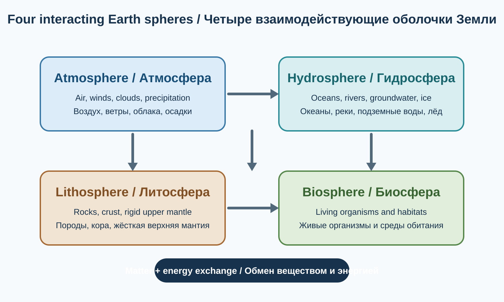

*Оригинальная двуязычная схема Atlas of Knowledge. Стрелки показывают взаимосвязь компонентов, а не количественные потоки вещества и энергии. / Original bilingual Atlas of Knowledge diagram. Arrows indicate interactions, not quantified matter or energy fluxes.*

Географическая оболочка — целостная внешняя оболочка Земли, в пределах которой взаимодействуют атмосфера, гидросфера, верхняя часть литосферы и биосфера. Здесь происходят основные природные процессы, формируются почвы и экосистемы, циркулирует вода, перемещаются воздушные массы и осуществляется обмен веществом и энергией.

Ключевые свойства географической оболочки:

1. **Целостность (integrity):** изменение одного компонента способно влиять на другие.
2. **Круговорот вещества (matter circulation):** вода, углерод, азот, кислород и другие вещества перемещаются между компонентами Земли.
3. **Обмен энергией (energy exchange):** солнечная и внутренняя энергия Земли приводят в движение природные процессы.
4. **Ритмичность (rhythmicity):** многие процессы имеют суточные, сезонные и многолетние циклы.
5. **Зональность (zonation):** природные условия закономерно изменяются по широте и высоте.
6. **Саморегуляция (self-regulation):** природные системы способны частично компенсировать изменения, но их устойчивость имеет пределы.

**Иллюстрация 2.1-A — Разрез географической оболочки / Geographic Envelope Cross-section.**

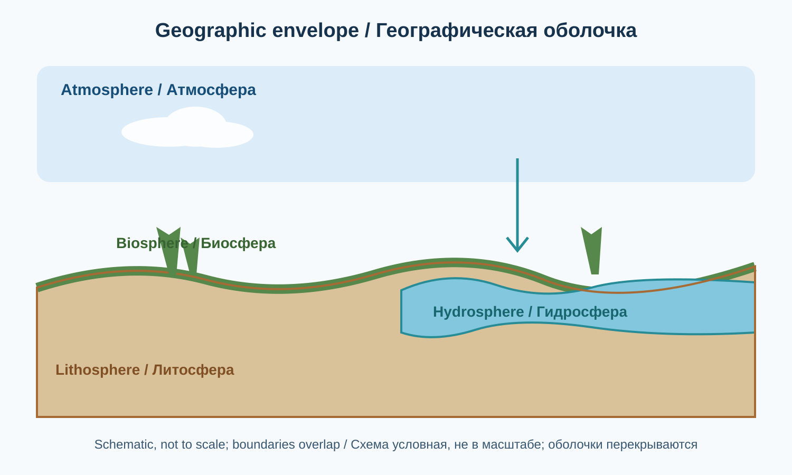

*Оригинальная учебная схема, не в масштабе; границы оболочек условны и перекрываются. / Original educational schematic, not to scale; sphere boundaries are conceptual and overlap.*

## 2.2. Четыре основные оболочки Земли / The Four Major Spheres of Earth

### 2.2.1. Атмосфера / Atmosphere
Газовая оболочка Земли. Она обеспечивает погодные процессы, участвует в формировании климата, переносит влагу и помогает поддерживать температурный баланс планеты.

### 2.2.2. Гидросфера / Hydrosphere
Совокупность вод Земли: океанов, морей, рек, озёр, подземных вод, ледников, сезонного снега и атмосферной влаги.

### 2.2.3. Литосфера / Lithosphere
Твёрдая внешняя оболочка Земли, включающая земную кору и жёсткую верхнюю часть мантии. Она образует геологическую основу материков, океанического дна, гор и равнин.

### 2.2.4. Биосфера / Biosphere
Область распространения жизни на Земле, включающая живые организмы и среды их обитания в нижней атмосфере, гидросфере и верхней части литосферы.

| Оболочка | Основная среда | Характерные процессы |
|---|---|---|
| Атмосфера | Воздух и газы | Ветры, осадки, циркуляция |
| Гидросфера | Вода | Испарение, осадки, сток |
| Литосфера | Горные породы | Тектоника, выветривание |
| Биосфера | Живые организмы | Фотосинтез, дыхание, питание |

Границы оболочек не являются непроницаемыми. Они перекрываются и взаимодействуют: вода содержится в породах, а живые организмы существуют в воде, почве и атмосфере.

**Важное уточнение о криосфере.** В традиционной учебной модели географической оболочки обычно выделяют четыре компонента, показанные выше. Лёд и снег включают в гидросферу, но из-за особых свойств и роли в климате их также рассматривают отдельно как **криосферу**. В современной науке о системе Земли часто используют пятисферную схему: атмосфера, гидросфера, криосфера, геосфера и биосфера. Эти схемы не противоречат друг другу: они группируют взаимосвязанные компоненты на разных уровнях детализации. Литосфера — жёсткая внешняя часть геосферы, а не синоним всей геосферы.

**Иллюстрация 2.2-A — Взаимодействие четырёх оболочек / Interactions Between Four Earth Spheres.**

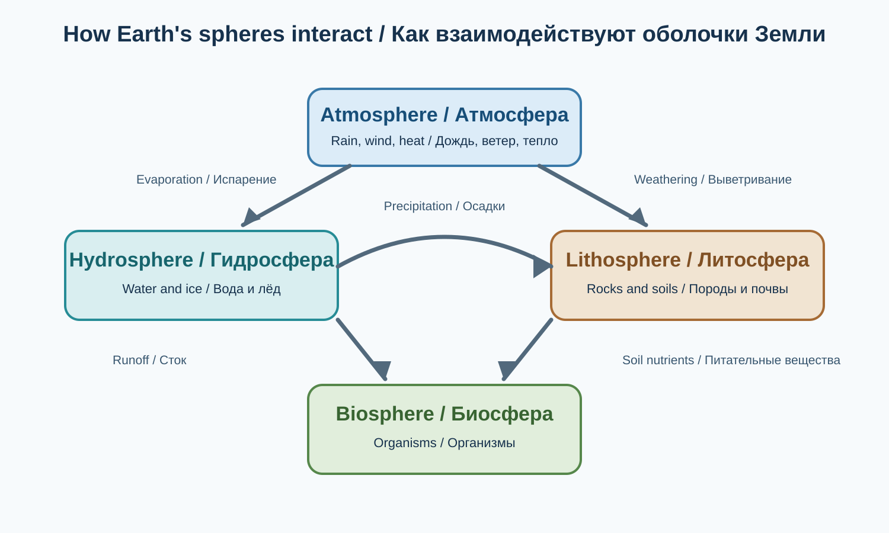

*Схема показывает примеры процессов; стрелки не задают их количественную величину. / The diagram shows process examples; arrows do not indicate quantitative magnitudes.*

## 2.3. Атмосфера: газовая оболочка планеты / Atmosphere: The Gaseous Envelope

**Иллюстрация 2-B — Слои атмосферы / Layers of the Atmosphere.**

*Источник / Source: NOAA National Weather Service, JetStream, “Layers of the Atmosphere”. Указание источника: NOAA. Схема показывает ориентировочные границы слоёв; тропосфера заметно меняет высоту в зависимости от широты. / Credit: NOAA. The diagram shows approximate layer boundaries; troposphere height varies substantially with latitude.*

Атмосфера удерживается гравитацией Земли. Она регулирует теплообмен, обеспечивает перенос влаги, формирует погоду и защищает поверхность планеты от значительной части вредного ультрафиолетового излучения.

### 2.3.1. Химический состав атмосферы / Atmospheric Composition

Приблизительный объёмный состав сухого воздуха у поверхности Земли:

| Газ | Объёмная доля |
|---|---:|
| Азот (N₂) | 78,08% |
| Кислород (O₂) | 20,95% |
| Аргон (Ar) | 0,93% |
| Углекислый газ (CO₂) | около 0,0426% (425,6 ppm — глобальное среднегодовое значение 2025 года, предварительная оценка NOAA) |
| Другие следовые газы (без CO₂) | менее 0,01% |

Значения округлены. Концентрация CO₂ меняется во времени и зависит от места измерения. По данным NOAA, глобальное среднегодовое значение для сухого воздуха в сети морских приповерхностных пунктов наблюдений составило 425,6 ppm в 2025 году (предварительная оценка; исходное значение — 425,62 ppm). Водяной пар не включён, поскольку его содержание сильно варьируется.

- Азот участвует в глобальном азотном цикле и становится доступен организмам после биологического или абиотического связывания.
- Кислород необходим для аэробного дыхания.
- Аргон — химически инертный газ.
- Углекислый газ участвует в фотосинтезе и естественном парниковом эффекте.
- Водяной пар участвует в образовании облаков и осадков и переносит скрытую теплоту.

### 2.3.2. Вертикальное строение атмосферы / Vertical Structure

| Слой | Приблизительные высоты | Основные особенности |
|---|---:|---|
| Тропосфера | от поверхности до примерно 6–20 км | Основные погодные явления |
| Стратосфера | до примерно 50 км | Озоновый слой |
| Мезосфера | примерно 50–85 км | Очень низкие температуры у мезопаузы |
| Термосфера | примерно от 85 км до нескольких сотен километров и выше | Ионосферные явления, полярные сияния |
| Экзосфера | верхние сотни километров и далее | Постепенный переход к космическому пространству |

Границы условны и меняются в зависимости от широты, сезона и солнечной активности. Тропосфера содержит большую часть массы атмосферного воздуха и почти весь атмосферный водяной пар. Озоновый слой стратосферы поглощает значительную часть ультрафиолетового излучения Солнца.

**Иллюстрация 2.3-A — Температурный профиль атмосферы / Atmospheric Temperature Profile.**

*Источник / Source: NOAA JetStream, “Layers of the Atmosphere” (temperature profile). Материал NOAA; указать NOAA в атрибуции. Высоты и профиль являются типичными, а не неизменными для всех широт и сезонов. / NOAA material; credit NOAA. Heights and profile are representative, not fixed for all latitudes and seasons.*

## 2.4. Гидросфера: водная оболочка Земли / Hydrosphere: Earth's Water Envelope

**Иллюстрация 2-C — Распределение воды Земли / Distribution of Earth's Water.**

*Источник / Source: USGS Water Science School, “The distribution of water on, in, and above the Earth” (2019). Public Domain. Округлённые доли основаны на оценках Игоря Шикломанова, опубликованных в 1993 году; это историческая глобальная оценка, а не измерение за 2026 год. В трёх столбцах используются разные знаменатели: вся вода Земли, вся пресная вода и поверхностная/прочая пресная вода. / Rounded proportions trace to Igor Shiklomanov's 1993 estimates; this is a historical global estimate, not a 2026 measurement. The three bars use different denominators: all Earth's water, all freshwater, and surface/other freshwater. [Страница оригинала / Original source page](https://www.usgs.gov/media/images/distribution-water-and-above-earth).

Гидросфера включает Мировой океан, континентальные поверхностные воды, подземные воды, ледники, снежный покров и атмосферную влагу.

### 2.4.1. Распределение воды / Distribution of Earth's Water

Около 97,5% воды Земли является солёной; примерно 2,5% — пресной. Пресная вода распределена крайне неравномерно.

Ориентировочная учебная схема распределения всей воды:

| Резервуар | Приблизительная доля от всей воды |
|---|---:|
| Мировой океан и моря | 96,54% |
| Ледники, ледяные покровы и постоянный снег | 1,74% |
| Подземные воды — всего | 1,69% |
| — пресные подземные воды | 0,76% |
| — солёные подземные воды | 0,93% |
| Озёра, реки, атмосфера, почвенная влага и другие резервуары | менее 0,1% |

Подземные воды включают как пресную, так и солёную воду: поэтому их общую долю нельзя целиком относить к запасам пресной воды. По оценке USGS, около 68,7% всей пресной воды заключено в ледниках и постоянном снеге, а около 30,1% находится в пресных подземных водах. Значения округлены; сумма долей может не составлять ровно 100%.

### 2.4.2. Круговорот воды / The Water Cycle

Круговорот воды — непрерывное перемещение воды между океаном, атмосферой, сушей и подземными резервуарами.

Основные процессы круговорота:

1. **Испарение** с поверхности океанов, озёр, рек и почвы.
2. **Транспирация** — выделение водяного пара растениями; вместе с испарением с суши её часто описывают общим термином «эвапотранспирация».
3. **Конденсация** водяного пара и образование облаков.
4. **Осадки** — выпадение дождя, снега и других форм атмосферной влаги.
5. **Снеготаяние** и образование талого стока; часть осадков временно накапливается в снежном покрове и ледниках.
6. **Поверхностный сток** по склонам и руслам рек.
7. **Инфильтрация** — проникновение воды в почву, а затем её просачивание глубже и пополнение подземных вод.
8. **Подземный поток и разгрузка** — движение подземных вод и их естественный выход в родниках, реках и океане.
9. **Сублимация** — переход снега или льда непосредственно в водяной пар, минуя жидкую фазу.

Это не замкнутая последовательность шагов: процессы могут идти одновременно, а вода может временно храниться в океане, атмосфере, почве, озёрах, снежном покрове, ледниках и водоносных горизонтах. Водозабор, водохранилища, орошение и осушение болот также меняют места хранения и пути движения воды.

**Иллюстрация 2.4-A — Глобальный круговорот воды / The Global Water Cycle.**

*Источник / Source: USGS VizLab, “The Water Cycle” (2022), создано совместно с USGS Water Resources Mission Area Web Communications Branch. Public Domain. Диаграмма включает использование воды человеком и влияние на её качество; это не только естественный цикл. / Public Domain. The diagram includes human water use and water-quality impacts; it is not a natural-only cycle. [Описание и версия для изучения / Description and learning version](https://www.usgs.gov/media/images/water-cycle).*

### 2.4.3. Неравномерность распределения воды

Распределение воды зависит от географической широты, температуры, атмосферной циркуляции, рельефа, близости к океанам и геологического строения. В горах наветренные склоны часто получают больше осадков, чем подветренные; это связано с орографическим подъёмом воздуха и дождевой тенью.

## 2.5. Литосфера: твёрдая оболочка Земли / Lithosphere: The Solid Outer Shell

Литосфера включает земную кору и жёсткую верхнюю часть мантии. Она разделена на крупные и малые тектонические плиты, которые медленно перемещаются относительно друг друга.

### 2.5.1. Континентальная и океаническая кора / Continental and Oceanic Crust

| Признак | Континентальная кора | Океаническая кора |
|---|---|---|
| Типичная толщина | В среднем около 35–40 км, с большими вариациями | В среднем около 7 км |
| Состав | Разнообразные породы, включая гранитоиды | Преимущественно базальтовые и габбровые породы |
| Плотность | В среднем ниже | В среднем выше |
| Возраст | Отдельные древнейшие сохранившиеся породы датируются примерно 4 млрд лет | Обычно значительно моложе; океаническая кора постоянно обновляется |

Толщина континентальной коры особенно велика под многими крупными горными поясами, в том числе сформированными при столкновении континентальных плит. Средние значения в таблице являются ориентировочными: реальная толщина сильно меняется от региона к региону. Глобальная сейсмическая сводка 2025 года оценивает среднюю толщину континентальной коры примерно в 40,4 км для участков выше уровня моря и 36,5 км при включении континентальных окраин; в орогенных поясах толщина может достигать примерно 60–80 км. Возраст в таблице относится к отдельным сохранившимся древним породам, а не ко всей континентальной коре как единому массиву. Океаническая кора значительно моложе: она формируется у срединно-океанических хребтов и постепенно погружается в мантию в зонах субдукции.

### 2.5.2. Тектонические процессы / Plate Tectonics

- **Дивергенция:** расхождение плит.
- **Конвергенция:** сближение плит.
- **Трансформное движение:** горизонтальное смещение плит относительно друг друга.

Последствия зависят от типа границы. При расхождении плит поднимается магма и формируется новая океаническая кора; при субдукции одна плита погружается под другую, что может сопровождаться глубоководными желобами, землетрясениями и вулканическими дугами; при столкновении континентальных плит кора сминается и утолщается, формируя горные пояса. Трансформные границы прежде всего связаны с горизонтальным смещением и землетрясениями; вулканизм для них не является типичным прямым следствием.

Границы плит не всегда представлены одной узкой линией: существуют широкие зоны деформации, где движение распределено между несколькими разломами и блоками коры. Землетрясения возможны также внутри плит, хотя особенно часто они происходят в зонах границ.

**Иллюстрация 2.5-A — Типы границ литосферных плит / Plate Boundary Types.**

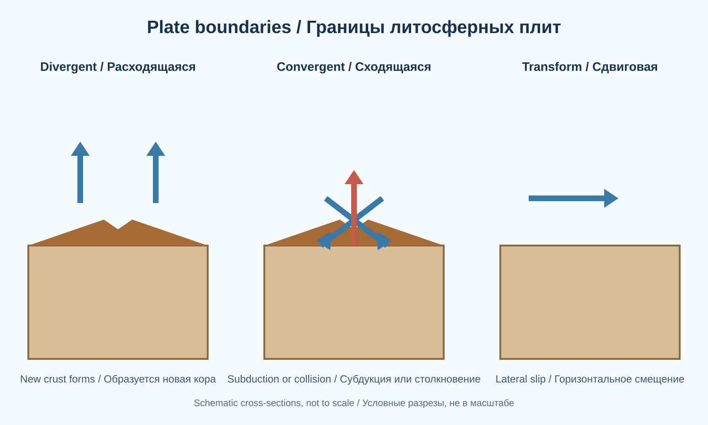

*Условные геологические разрезы, не в масштабе. Конвергентная граница может включать субдукцию или столкновение континентальных плит. / Schematic geological cross-sections, not to scale. A convergent boundary may involve subduction or continental collision.*

## 2.6. Биосфера: пространство жизни / Biosphere: The Realm of Life

Биосфера объединяет живые организмы и области Земли, где существует жизнь. Она охватывает нижнюю часть атмосферы, практически всю гидросферу и верхнюю часть литосферы, включая почвы и некоторые подземные среды.

Живые организмы изменяют географическую оболочку:
- растения поглощают CO₂ и выделяют кислород при фотосинтезе;
- микроорганизмы разлагают органическое вещество;
- животные участвуют в распространении семян и преобразовании местообитаний;
- почвенные организмы обеспечивают круговорот питательных веществ.

### 2.6.1. Уровни организации живой природы / Levels of Biological Organization

| Уровень | Пример |
|---|---|
| Организм | Отдельное дерево |
| Популяция | Сосны одного вида на определённой территории |
| Сообщество | Растения, животные и микроорганизмы |
| Экосистема | Лес вместе с почвой, водой и климатом |
| Биом | Тайга, саванна, тундра |
| Биосфера | Совокупность всех экосистем Земли |

**Иллюстрация 2.6-A — От организма к биосфере / From Organism to Biosphere.**

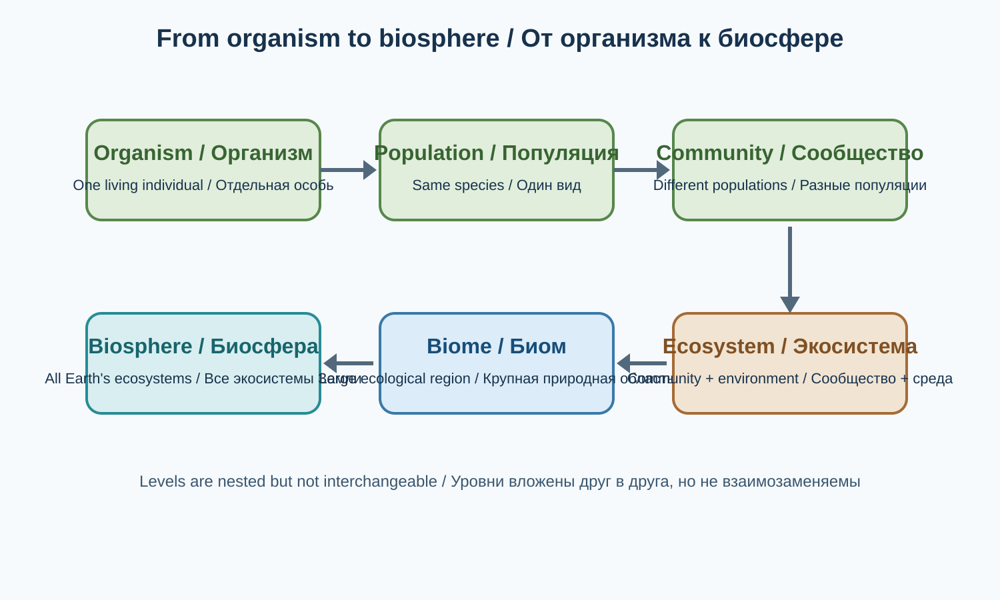

*Уровни вложены друг в друга; биом не является просто суммой экосистем одного вида. / The levels are nested; a biome is not simply a collection of identical ecosystems.*

## 2.7. Взаимодействие географических оболочек / Interactions Between Earth's Spheres

Взаимосвязанность — ключевое свойство географической оболочки. Например, формирование горного ледникового озера включает несколько компонентов:

1. Литосфера формирует котловину и горный рельеф.
2. Атмосфера обеспечивает выпадение снега и осадков.
3. Криосфера накапливает лёд и сезонный снег.
4. Гидросфера получает талую воду и формирует озеро.
5. Биосфера осваивает водную и прибрежную экосистему.

**Криосфера** — совокупность замёрзших компонентов Земли: ледников, ледяных покровов, морского льда, сезонного снега и многолетней мерзлоты. В классической четырёхсферной модели это не отдельная пятая оболочка, а особая система, пересекающая гидросферу и другие компоненты Земли.

### Пример: лес и климат

| Изменение | Возможное последствие |
|---|---|
| Вырубка леса | Сокращение растительного покрова |
| Снижение транспирации | Изменение локального влагообмена |
| Оголение почвы | Повышение риска эрозии |
| Увеличение поверхностного стока | Возможное усиление паводков |
| Изменение местообитаний | Сокращение биоразнообразия |

## 2.8. Энергетика географической оболочки / Energy Systems

### Солнечная энергия
Главный внешний источник энергии для поверхности Земли. Она обеспечивает нагрев, атмосферную циркуляцию, испарение, фотосинтез и климатические различия.

### Внутренняя энергия Земли
Связана с остаточным теплом формирования планеты и радиоактивным распадом элементов. Она поддерживает тектонические процессы, движение вещества мантии, вулканизм и геотермальные явления.

### Гравитационная энергия
Участвует в речном стоке, движении воды по склонам, оползнях, обвалах, движении ледников и вертикальном распределении вещества.

**Иллюстрация 2.8-A — Источники энергии и процессы Земли / Energy Sources and Earth Processes.**

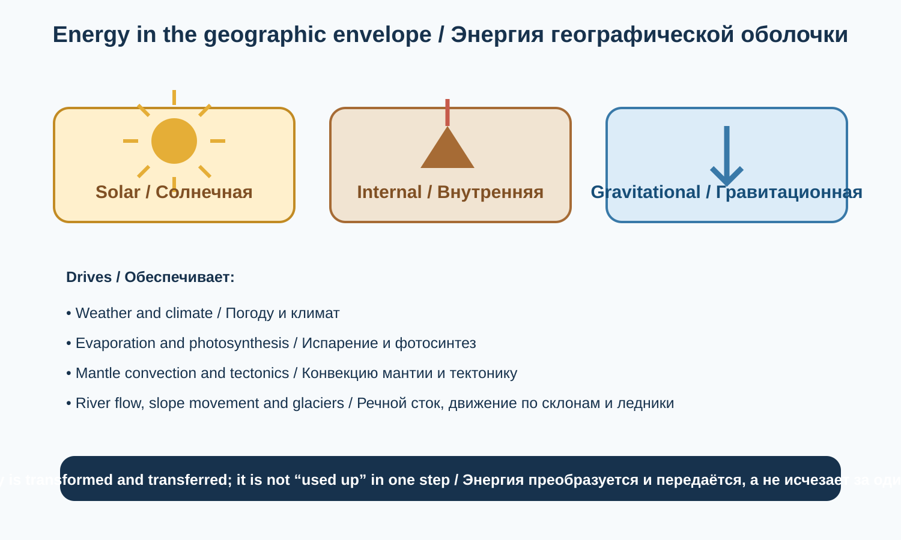

*Схема качественная: она не сравнивает энергетические потоки в численных единицах. / Qualitative diagram; it does not compare energy fluxes in numerical units.*

## 2.9. Географическая зональность / Geographical Zonation

Природные условия Земли закономерно меняются в пространстве.

- **Широтная зональность:** изменение природных условий от экватора к полюсам.
- **Высотная поясность:** изменение природных условий с увеличением высоты в горах.
- **Секторность:** различия между западными, внутренними и восточными частями материков, связанные с удалённостью от океанов и атмосферной циркуляцией.

### 2.9.1. Широтная зональность / Latitudinal Zonation

| Природная зона | Основные характеристики |
|---|---|
| Влажные экваториальные леса | Высокие температуры и обильные осадки |
| Саванны | Сезонность увлажнения |
| Тропические пустыни | Дефицит осадков |
| Субтропические леса и кустарники | Разнообразие климатических условий |
| Умеренные леса и степи | Выраженная сезонность |
| Тайга | Холодные зимы, хвойные леса |
| Тундра | Низкорослая растительность, часто многолетняя мерзлота |
| Полярные пустыни | Экстремально холодные условия |

Границы природных зон не всегда совпадают с границами климатических поясов: на них влияют рельеф, океанические течения, почвы и история развития территории.

### 2.9.2. Высотная поясность / Altitudinal Zonation

В горах с высотой могут последовательно сменяться предгорные степи, леса, субальпийские и альпийские луга, горная тундра и нивальный пояс снегов и ледников. Конкретная последовательность зависит от широты, экспозиции склонов, влажности и местного климата.

**Иллюстрация 2.9-A — Широтная зональность и высотная поясность / Latitudinal and Altitudinal Zonation.**

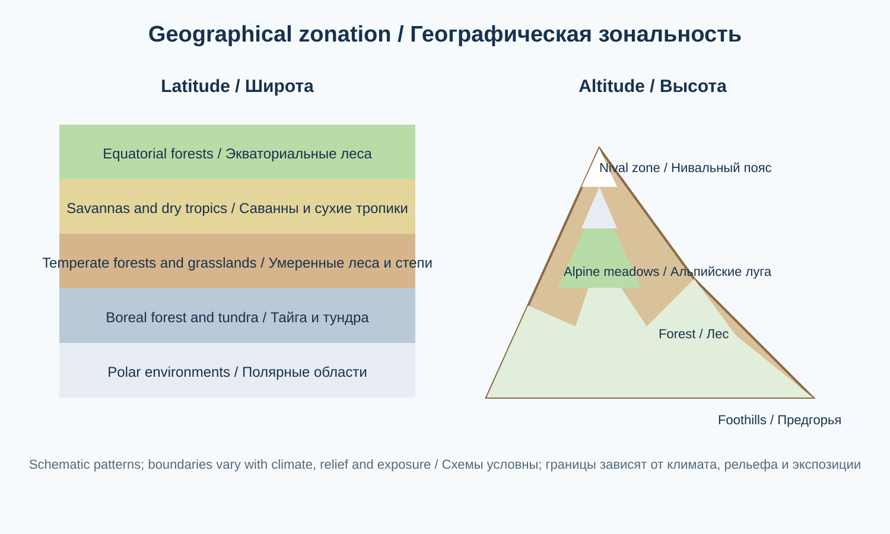

*Схематическое сравнение, не карта и не универсальная последовательность природных зон; границы зависят от климата, рельефа и экспозиции. / Schematic comparison, not a map or universal sequence; boundaries depend on climate, relief and slope aspect.*

## 2.10. Биогеохимические циклы / Biogeochemical Cycles

**Иллюстрация 2-D — Обзор биогеохимических циклов / Biogeochemical Cycles Overview.**

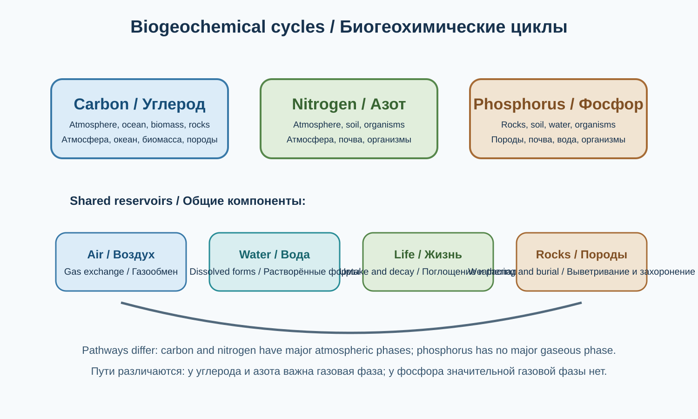

*Оригинальная обобщающая схема; отдельные процессы и резервуары подробно показаны в подразделах 2.10.1–2.10.4. Стрелки не обозначают количественные потоки. / Original overview; individual processes and reservoirs are detailed in sections 2.10.1–2.10.4. Arrows do not represent quantified fluxes.*

**Углеродный цикл / Carbon cycle**

Биогеохимические циклы — непрерывное перемещение химических элементов между живыми организмами и компонентами неживой природы.

### 2.10.1. Углеродный цикл / Carbon Cycle

Углерод — основа органических соединений. Его главные резервуары: атмосфера, океан, растительность, почвы, осадочные породы и ископаемое органическое вещество.

Основные процессы:
- фотосинтез поглощает CO₂;
- дыхание организмов возвращает CO₂ в атмосферу и воду;
- разложение органики высвобождает углерод;
- океан обменивается CO₂ с атмосферой;
- седиментация способствует долговременному захоронению углерода;
- сжигание ископаемого топлива быстро возвращает геологический углерод в активный цикл.

Сжигание угля, нефти и природного газа увеличивает концентрацию CO₂ в атмосфере и усиливает антропогенное воздействие на климат.

**Иллюстрация 2.10-A — Глобальный круговорот углерода / The Global Carbon Cycle.**

*Source: My NASA Data, “Energy and Matter Cycles”; diagram adapted from the U.S. Department of Energy, Biological and Environmental Research Information System. The diagram distinguishes natural fluxes, human contributions and stored carbon; numerical values belong to the source's stated units and reference context. / Схема различает природные потоки, вклад человека и запасы углерода; численные значения следует читать в единицах и контексте источника. [Source page / Страница источника](https://mynasadata.larc.nasa.gov/basic-page/energy-and-matter-cycles).*

### 2.10.2. Кислородный цикл / Oxygen Cycle

Кислород необходим для аэробного дыхания. Его цикл включает фотосинтез, дыхание, разложение органики, окисление минералов, а также образование и разрушение озона.

### 2.10.3. Азотный цикл / Nitrogen Cycle

Азот составляет около 78% сухого атмосферного воздуха, но большинство организмов не могут непосредственно использовать молекулярный N₂.

| Этап | Содержание |
|---|---|
| Азотфиксация | Превращение N₂ в доступные соединения |
| Нитрификация | Окисление аммония до нитритов и нитратов |
| Ассимиляция | Поглощение соединений азота организмами |
| Аммонификация | Образование аммония при разложении органики |
| Денитрификация | Превращение нитратов в газообразные формы азота |

Бобовые растения вступают в симбиоз с азотфиксирующими бактериями, благодаря чему атмосферный азот включается в биологический круговорот.

### 2.10.4. Фосфорный цикл / Phosphorus Cycle

Фосфор необходим для ДНК, РНК, клеточных мембран и АТФ. В отличие от углеродного и азотного циклов, у него нет значительной газовой фазы.

Основные этапы: выветривание фосфатсодержащих пород, поступление фосфатов в почву и воду, поглощение растениями, передача по пищевым цепям, возвращение при разложении и осаждение в донных отложениях.

Избыточное поступление фосфора в водоёмы может вызывать эвтрофикацию.

**Иллюстрация 2.10-B — Круговороты азота и фосфора / Nitrogen and Phosphorus Cycles.**

*Source: My NASA Data, “Energy and Matter Cycles”; nitrogen-cycle image credited to NCAR/UCAR. The original NCAR page states that the image is freely available for nonprofit and media use. The diagram shows fixation, nitrification, plant uptake, decomposition/mineralisation and denitrification. / Источник: My NASA Data, “Energy and Matter Cycles”; изображение цикла азота предоставлено NCAR/UCAR. На исходной странице NCAR указано, что изображение можно свободно использовать в некоммерческих и медийных материалах. Схема показывает фиксацию, нитрификацию, поглощение растениями, разложение/минерализацию и денитрификацию. [My NASA Data](https://mynasadata.larc.nasa.gov/basic-page/energy-and-matter-cycles) · [Original NCAR source and reuse note / Первоисточник NCAR и условия использования](https://news.ucar.edu/1449/nitrogen-earth-system).*

*Source: Entropyrider, “Phosphorus cycle flowchart” (2024), Wikimedia Commons. CC0 1.0 Universal Public Domain Dedication; credit is retained for provenance. The diagram distinguishes biological cycling from geological cycling and is a simplified conceptual flowchart, not a quantitative flux model. / Источник: Entropyrider, “Phosphorus cycle flowchart” (2024), Wikimedia Commons, CC0 1.0. Схема различает биологический и геологический круговороты и является упрощённой концептуальной моделью, а не количественной моделью потоков. [File page and licence / Страница файла и лицензия](https://commons.wikimedia.org/wiki/File:Phosphorus_cycle_flowchart.png).*

## 2.11. Природные комплексы и геосистемы / Natural Complexes and Geosystems

Природный комплекс — закономерное сочетание взаимосвязанных природных компонентов на определённой территории. Горная долина, например, объединяет рельеф, климат, речную сеть, почвы, растительность и животный мир.

### 2.11.1. Иерархия природных комплексов / Hierarchy

| Уровень | Пример |
|---|---|
| Глобальный | Географическая оболочка |
| Региональный | Природная зона или крупная природная область |
| Провинциальный | Горная природная область |
| Локальный | Горная долина |
| Элементарный | Отдельный склон или участок поймы |

Это учебная схема: конкретная иерархия геосистем зависит от научной школы и масштаба исследования.

### 2.11.2. Компоненты природного комплекса

- Рельеф.
- Климат.
- Поверхностные и подземные воды.
- Почвы.
- Биота — растения, животные и микроорганизмы.

Все компоненты взаимодействуют и формируют единую природную геосистему.

**Иллюстрация 2.11-A — Структура природной геосистемы / Structure of a Natural Geosystem.**

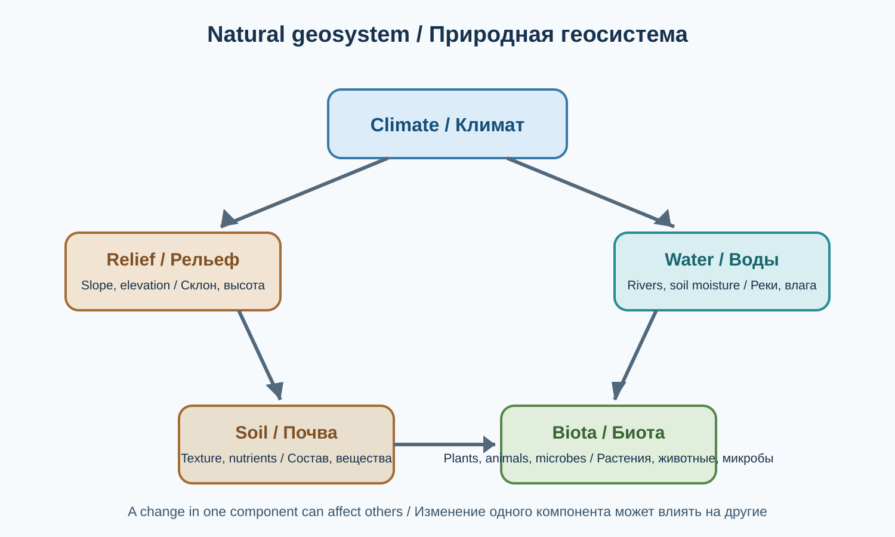

*Схема показывает основные компоненты, а не исчерпывающую модель всех причинных связей. / The diagram shows core components, not an exhaustive model of all causal links.*

### 2.11.3. Природные и антропогенные геосистемы

Природные геосистемы формируются преимущественно естественными процессами. Антропогенные геосистемы возникают или существенно преобразуются деятельностью человека.

| Природные примеры | Антропогенные примеры |
|---|---|
| Естественный лес | Лесная плантация |
| Нетронутая степь | Пашня |
| Природное озеро | Искусственное водохранилище |
| Горная река | Зарегулированная река |
| Естественная долина | Городская территория |

Многие современные ландшафты являются смешанными системами.

## 2.12. Устойчивость природных систем / Stability of Natural Systems

Устойчивость природной системы описывает её способность сохранять важные свойства и функции при воздействиях. Это не означает неподвижности или обязательного возвращения к прежнему состоянию.

Важно различать несколько связанных понятий:
- **Сопротивляемость (resistance)** — насколько мало система изменяется во время воздействия.
- **Восстановление (recovery)** — насколько и как быстро система возвращается к прежнему состоянию после нарушения.
- **Экологическая устойчивость, или резильентность (resilience)**, — способность системы выдерживать нарушения, восстанавливаться или адаптироваться, не обязательно возвращаясь к прежнему состоянию. При сильном воздействии возможна реорганизация системы и переход к другому устойчивому состоянию.

Биоразнообразие, круговорот веществ, восстановление растительности, взаимодействия видов и состояние почв и вод могут влиять на устойчивость. Однако ни один из этих факторов сам по себе не гарантирует восстановления: результат зависит от силы и длительности воздействия, исходного состояния системы и сочетания процессов.

### 2.12.1. Обратные связи / Feedback Mechanisms

Обратная связь возникает, когда результат процесса влияет на его дальнейшее течение.
- **Отрицательная обратная связь** противодействует первоначальному изменению и может сдерживать его.
- **Положительная обратная связь** усиливает первоначальное изменение.

Пример положительной обратной связи: при таянии снега и льда уменьшается альбедо — доля солнечного излучения, отражаемая поверхностью. Более тёмная поверхность поглощает больше энергии, что может ускорять дальнейшее таяние.

Упрощённый пример отрицательной обратной связи: при росте растений усиливается расход почвенной влаги на транспирацию. Если доступность воды снижается, дальнейший рост растений ограничивается. Такая связь может сдерживать изменение, но не обязательно возвращает систему к исходному состоянию.

Положительная и отрицательная обратные связи не означают соответственно «плохую» и «хорошую»: первая усиливает изменения, вторая ослабляет их. В реальных природных системах несколько обратных связей действуют одновременно.

**Иллюстрация 2.12-A — Положительная и отрицательная обратная связь / Positive and Negative Feedback.**

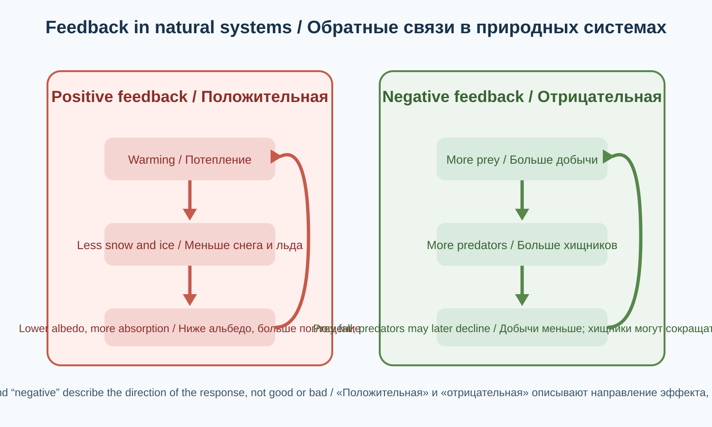

*Примеры упрощены; реальные системы включают временные задержки и несколько взаимодействующих обратных связей. / Examples are simplified; real systems include time lags and multiple interacting feedbacks.*

## 2.13. Антропогенное воздействие / Human Impact

Антропогенное воздействие — изменения природной среды, вызванные хозяйственной и иной деятельностью человека.

| Компонент | Примеры воздействия |
|---|---|
| Атмосфера | Загрязнение воздуха, изменение климата |
| Гидросфера | Загрязнение вод, изменение речного стока |
| Литосфера | Эрозия, деградация земель, горные выработки |
| Биосфера | Утрата местообитаний, сокращение биоразнообразия |
| Криосфера | Сокращение ледников и снежных запасов |

К глобальным экологическим проблемам относятся изменение климата, опустынивание, потеря биоразнообразия, дефицит пресной воды, загрязнение океана и деградация почв.

**Иллюстрация 2.13-A — Глобальная модификация наземных экосистем человеком / Global Human Modification of Terrestrial Ecosystems (2022).**

*Источник / Source: Figure 10, Theobald, D. M., Oakleaf, J. R., Moncrieff, G., Voigt, M., Kiesecker, J. & Kennedy, C. M. (2025), “Global extent and change in human modification of terrestrial ecosystems from 1990 to 2022”, *Scientific Data* 12, Article 606, DOI: [10.1038/s41597-025-04892-2](https://doi.org/10.1038/s41597-025-04892-2). Reproduced from the open-access article under the Creative Commons Attribution 4.0 International licence (CC BY 4.0); no changes made. The article's Rights and permissions statement applies CC BY 4.0 to its images and other third-party material unless a separate credit line states otherwise; no separate restrictive credit line is given for Figure 10. The figure maps overall cumulative human modification for 2022; Figure 10 represents the 300 m dataset. Antarctica is excluded. The article's correction published on 7 August 2025 corrected Figure 2 only; Figure 10 was not the figure identified in that correction. The model combines 16 human threats. Its 0–1 index is a modelled measure of human modification, not a direct measurement of ecosystem condition or biodiversity. / Воспроизведено из статьи открытого доступа по лицензии Creative Commons Attribution 4.0 International (CC BY 4.0); изменения не вносились. Условия раздела Rights and permissions распространяют лицензию на изображения статьи, если в отдельной подписи не указано иное; для рисунка 10 отдельного ограничительного указания нет. Карта показывает совокупную модификацию наземных территорий в 2022 году; рисунок 10 представляет набор данных с разрешением 300 м. Антарктида исключена. В исправлении статьи от 7 августа 2025 года была заменена только иллюстрация 2; рисунок 10 не относился к исправленной иллюстрации. Индекс 0–1 является модельной оценкой антропогенной модификации, а не прямым измерением состояния экосистем или биоразнообразия. [Статья, рисунок 10 и условия лицензии / Article, Figure 10 and licence terms](https://www.nature.com/articles/s41597-025-04892-2) · [Исправление к статье от 7 августа 2025 года / 7 August 2025 correction](https://doi.org/10.1038/s41597-025-05710-5) · [CC BY 4.0](https://creativecommons.org/licenses/by/4.0/).*

## 2.14. Глобальные изменения и будущее географической оболочки / Global Change

На географическую оболочку влияют естественные климатические колебания, вулканизм, тектоника, солнечная активность и деятельность человека.

Для мониторинга состояния планеты используются:
- средняя глобальная температура;
- концентрация CO₂;
- уровень Мирового океана;
- масса ледников;
- лесной покров;
- состояние биоразнообразия;
- качество пресной воды;
- состояние почв.

### 2.14.1. Планетарные границы / Planetary Boundaries

Планетарные границы — научная концепция, описывающая критически важные процессы системы Земли и пределы безопасного воздействия на них.

К рассматриваемым процессам относятся:

1. Изменение климата.
2. Целостность биосферы.
3. Изменение землепользования.
4. Изменение пресноводных систем.
5. Биогеохимические потоки азота и фосфора.
6. Закисление океана.
7. Стратосферное истощение озона.
8. Атмосферные аэрозоли.
9. Новые вещества и формы загрязнения.

Это не один универсальный индекс экологического состояния: каждый процесс требует отдельных методов оценки. Планетарные границы — глобальная научная рамка оценки рисков для системы Земли, а не готовый набор юридических нормативов для каждой страны или местности. Их нельзя напрямую переносить на отдельный водосбор, город или государство без подходящих региональных данных и отдельной методики.

**Состояние по оценке 2026 года.** В *Planetary Health Check 2026* сообщается, что семь из девяти планетарных границ пересечены, причём по всем семи фиксируется тенденция к усилению давления. Две границы — стратосферное истощение озона и атмосферная аэрозольная нагрузка — не пересечены на глобальном уровне. Это не исключает региональных рисков: аэрозольное загрязнение может быть опасным локально. Статус зависит от года, контрольных переменных и методов оценки, поэтому всегда указывайте источник и год.

**Иллюстрация 2.14-A — Планетарные границы / Planetary Boundaries (оценка 2026 года).**

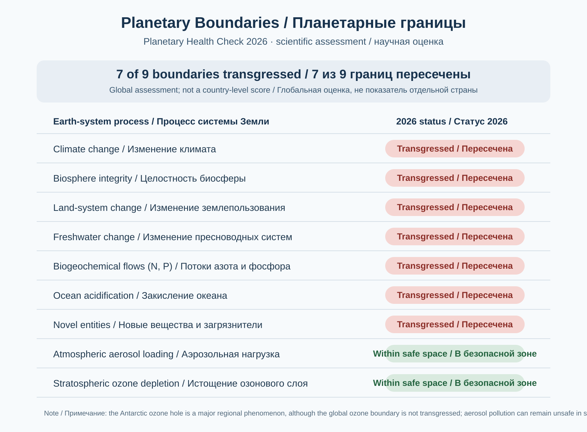

*Оригинальная учебная инфографика Atlas of Knowledge, подготовленная по данным Planetary Health Check 2026, PBScience / Potsdam Institute for Climate Impact Research. Научная основа: Caesar et al. (2026), DOI: 10.48485/pik.2026.25; оценка сообщает о пересечении семи из девяти границ. Графика создана редакцией Atlas of Knowledge и не является копией официальной диаграммы PIK. См. [официальный отчёт](https://publications.pik-potsdam.de/pubman/item/item_35009) и [описание PIK](https://www.pik-potsdam.de/en/output/infodesk/planetary-boundaries). / Original educational graphic by Atlas of Knowledge, based on Planetary Health Check 2026, PBScience / PIK. The 2026 assessment reports seven of nine boundaries transgressed. This is an original educational adaptation, not a reproduction of PIK's official figure.

## 2.14.2. Разбор природной системы: изменение растительного покрова в горном водосборе / Worked Example: Vegetation Change in a Mountain Catchment

Рассмотрим условный горный водосбор площадью 10 км². На части его склонов лесной покров сократился. Географическая задача — проследить, какие компоненты природной системы могут отреагировать на это изменение и какие данные нужны, чтобы проверить предполагаемые последствия.

**Шаг 1. Определяем исходное изменение.**  
Допустим, по сопоставимым спутниковым снимкам установлено, что площадь леса уменьшилась с 6 до 4 км². Сокращение составляет 2 км²: лес занимал 60% площади водосбора, а теперь занимает 40%. Это уменьшение на 20 процентных пунктов, или примерно на 33% относительно первоначальной площади леса: (6 − 4) / 6 × 100%.

**Шаг 2. Прослеживаем возможные связи между оболочками.**

| Компонент | Возможное изменение | Что следует измерить |
|---|---|---|
| Биосфера | Сокращение площади лесных местообитаний | Площадь и состояние растительного покрова |
| Почва и литосфера | При определённых условиях возрастает уязвимость почвы к эрозии | Потери почвы, оголённость поверхности, устойчивость склонов |
| Атмосфера | Меняются затенение, испарение и транспирация | Температура, влажность, осадки |
| Гидросфера | Может измениться соотношение инфильтрации и поверхностного стока | Расход воды, мутность, инфильтрация |

**Шаг 3. Не делаем вывод без проверки.**  
Уменьшение лесной площади само по себе не доказывает, что паводки обязательно станут сильнее или что речной сток увеличится. Результат зависит также от интенсивности осадков, крутизны склонов, типа почвы, состояния дорог, сезонности, мерзлоты и других факторов. Для проверки нужны наблюдения до и после изменения, а по возможности — сравнение с похожим водосбором, где лесной покров существенно не менялся.

**Вывод.** Изменение одного компонента географической оболочки может повлиять на другие, но направление и сила воздействия должны подтверждаться данными. Системная схема помогает сформулировать гипотезы и выбрать измерения, а не заменяет наблюдения.

**Проверьте себя:** почему по одному лишь факту сокращения площади леса нельзя точно рассчитать изменение паводкового стока?

### 2.14.3. Как распознавать обратные связи в природной системе / Recognising Feedbacks in a Natural System

Обратная связь возникает, когда изменение одного компонента системы влияет на другие компоненты, а их ответ затем усиливает или ослабляет исходное изменение. **Положительная обратная связь** усиливает первоначальное воздействие; **отрицательная** противодействует ему и может стабилизировать систему. Эти термины описывают направление эффекта, а не оценку «хорошо» или «плохо».

**Пример положительной обратной связи:** потепление уменьшает площадь снежного покрова; более тёмная поверхность отражает меньше солнечной энергии; поглощение энергии возрастает и способствует дальнейшему нагреву. Сила эффекта зависит от сезона, облачности, высоты и свойств поверхности.

**Пример отрицательной обратной связи в экосистеме:** если численность добычи возрастает, хищникам становится доступнее пища и их численность со временем может увеличиться. Усиление хищничества сокращает численность добычи; затем из-за уменьшения корма может снизиться и численность хищников. Такая связь способна сдерживать рост популяций, хотя временные задержки могут вызывать колебания численности.

При анализе схемы обозначьте переменные и направление причинных связей, отметьте задержки во времени, различайте корреляцию и доказанный механизм, укажите внешние факторы. Схема не заменяет измерения и модель.

**Задание.** Постройте причинную схему «снег — альбедо — поглощение солнечной энергии — температура». Обозначьте знак каждой связи и объясните, какие данные нужны для оценки силы обратной связи в конкретном горном районе.

## 2.15. Итоговая модель географической оболочки / Integrated Model

Географическая оболочка — сложная природная система, в которой взаимодействуют вещество, энергия, живые организмы и геологические процессы. Её нельзя понять, изучая атмосферу, воду, горные породы и жизнь только по отдельности: важны связи между ними и последствия изменений в одной части системы для остальных.

**Как читать интегрированную модель**

1. **Компоненты и границы.** Выделите атмосферу, гидросферу, литосферу (как часть более широкой геосферы), биосферу и криосферу. Границы между ними условны: вода и организмы встречаются сразу в нескольких оболочках.
2. **Потоки энергии.** Солнечная энергия поступает в систему, отражается или поглощается поверхностью и атмосферой, преобразуется и в конечном счёте рассеивается в космос в виде теплового излучения. Внутренняя энергия Земли поддерживает геологические процессы. Энергия проходит через систему, а не совершает замкнутый круговорот, как многие вещества.
3. **Круговороты вещества.** Вода, углерод, азот, фосфор и другие вещества перемещаются между резервуарами. Вещество может временно накапливаться в океане, почве, атмосфере, ледниках или живых организмах, а затем переходить в другие части системы.
4. **Связи между оболочками.** Осадки (атмосфера) питают реку (гидросфера); река размывает породы и переносит осадки (литосфера/геосфера); почва и вода поддерживают растения (биосфера); растительность влияет на испарение, сток и закрепление почвы.
5. **Обратные связи и изменения.** Изменение может усиливаться или частично компенсироваться обратными связями. Последствия зависят от масштаба, длительности воздействия, исходного состояния системы и задержек между причиной и результатом.
6. **Человеческое воздействие.** Вырубка лесов, строительство плотин, добыча полезных ископаемых, выбросы и изменение землепользования меняют потоки вещества и энергии. Человек — часть биосферы и одновременно фактор, воздействующий на другие оболочки.

**Основные выводы**

- Природные оболочки Земли не существуют изолированно.
- Вода, углерод, азот, фосфор и другие вещества участвуют в круговоротах, тогда как энергия проходит через систему и рассеивается.
- Географическая оболочка пространственно неоднородна; связи и процессы проявляются по-разному на местном, региональном и глобальном уровнях.
- Природные комплексы имеют иерархическую структуру: локальные участки входят в более крупные системы.
- Устойчивость и восстановление экосистем зависят от множества факторов; система не всегда возвращается к прежнему состоянию.
- Деятельность человека стала одним из важнейших факторов глобальных изменений.
- Любая модель упрощает реальность: её выводы необходимо сопоставлять с наблюдениями, измерениями и масштабом задачи.

**Иллюстрация 2.15-A — Земля как целостная система / Earth as an Integrated System.**

*Source: NASA Goddard Space Flight Center, “Earth System Diagram” (2018; page updated 2024), graphic designer Kevin W. Miller. Credit NASA's Goddard Space Flight Center. NASA's media guidance permits educational/informational reuse of NASA imagery unless a third-party copyright notice is shown; do not imply NASA endorsement. This five-sphere Earth-system illustration includes cryosphere components and is used here as an integrated overview. / Источник: NASA Goddard Space Flight Center, “Earth System Diagram” (2018; страница обновлена в 2024 году), дизайнер Kevin W. Miller. Условия NASA допускают образовательное и информационное использование материалов NASA, если не указано авторское право третьей стороны; нельзя создавать впечатление одобрения со стороны NASA. Схема показывает пятисферную систему Земли, включая криосферу, и используется как итоговый обзор. [Source page / Страница источника](https://svs.gsfc.nasa.gov/30988) · [NASA media-use guidance / Правила использования материалов NASA](https://www.nasa.gov/nasa-brand-center/images-and-media/).*

## Контрольные вопросы / Review Questions

1. Что такое географическая оболочка?
2. Какие четыре основные оболочки формируют её структуру?
3. Почему криосфера выделяется в отдельную систему?
4. Каковы основные этапы углеродного цикла?
5. Почему азотфиксация важна для экосистем?
6. Чем фосфорный цикл отличается от углеродного?
7. Что такое природная геосистема?
8. Чем отличаются положительная и отрицательная обратные связи?
9. Как деятельность человека изменяет биогеохимические циклы?
10. Что представляют собой планетарные границы?
11. Чем поток энергии через систему Земли отличается от круговорота вещества?
12. Приведите пример причинно-следственной связи между тремя или более географическими оболочками. Почему для проверки такой связи нужны наблюдения?

## Практическое задание / Practical Assignment

Выберите природную территорию и составьте её системную модель. Для горного озера определите:
- атмосферные процессы над озером;
- реки, осадки и подземные воды, питающие озеро, а также пути оттока воды;
- влияние геологического строения на форму котловины и свойства берегов;
- характерные водные и прибрежные организмы и их связи с условиями среды;
- возможные воздействия человека и признаки изменения состояния озера.

**Что нужно представить:** схему с озером в центре, четырьмя оболочками вокруг него и стрелками, показывающими потоки воды, вещества и энергии; краткое объяснение не менее трёх причинно-следственных связей; список трёх наблюдений или наборов данных, которые помогли бы проверить ваши выводы. Отметьте, какие связи подтверждены наблюдениями, а какие пока являются гипотезами. Не делайте вывод о загрязнении или ухудшении состояния озера только по внешнему виду воды.

## English-language chapter text

### 2.1. The Concept of the Geographic Envelope

The geographic envelope is Earth's integrated outer zone in which the atmosphere, hydrosphere, upper lithosphere and biosphere interact. It is where major natural processes occur, soils and ecosystems develop, water circulates, air masses move, and matter and energy are exchanged.

**Illustration 2-A — Four Earth Spheres and the Earth System.**

*Original bilingual Atlas of Knowledge diagram. Arrows show examples of interaction, not measured matter or energy fluxes. / Оригинальная двуязычная схема Atlas of Knowledge. Стрелки показывают примеры взаимодействия, а не измеренные потоки вещества или энергии.*

Key properties of the geographic envelope include:

1. **Integrity:** a change in one component can affect others.
2. **Circulation of matter:** water, carbon, nitrogen, oxygen and other substances move between Earth's components.
3. **Energy exchange:** solar and internal energy drive natural processes.
4. **Rhythmicity:** many processes follow daily, seasonal and multi-year cycles.
5. **Zonation:** natural conditions change systematically with latitude and elevation.
6. **Self-regulation:** natural systems can partly compensate for change, but their resilience has limits.

**Illustration 2.1-A — Geographic Envelope Cross-section.**

*Original educational schematic, not to scale; sphere boundaries are conceptual and overlap. / Оригинальная учебная схема, не в масштабе; границы оболочек условны и перекрываются.*

### 2.2. The Four Major Spheres of Earth

- **Atmosphere:** Earth's gaseous envelope. It supports weather, helps shape climate, transports moisture and contributes to the planet's thermal balance.
- **Hydrosphere:** all of Earth's water, including oceans, seas, rivers, lakes, groundwater, glaciers, seasonal snow and atmospheric moisture.
- **Lithosphere:** Earth's rigid outer layer, comprising the crust and the rigid uppermost mantle. It forms the geological foundation of continents, ocean floors, mountains and plains.
- **Biosphere:** the zone of life on Earth, including living organisms and their habitats in the lower atmosphere, hydrosphere and upper lithosphere.

The spheres do not have impermeable boundaries. They overlap and interact: water occurs within rocks, while living organisms inhabit water, soil and the atmosphere.

**Important clarification about the cryosphere.** The traditional educational model of the geographic envelope commonly identifies the four components listed above. Ice and snow are included within the hydrosphere, but their distinctive properties and climate role also justify treating them separately as the **cryosphere**. Modern Earth system science often uses a five-sphere model: atmosphere, hydrosphere, cryosphere, geosphere and biosphere. These models are compatible; they group interacting components at different levels of detail. The lithosphere is the rigid outer part of the geosphere, not a synonym for the entire geosphere.

**Illustration 2.2-A — Interactions Between Four Earth Spheres.**

*Original bilingual schematic. Arrows show process examples and do not indicate quantitative magnitudes. / Оригинальная двуязычная схема. Стрелки показывают примеры процессов и не обозначают их количественную величину.*

| Sphere | Main environment | Characteristic processes |
|---|---|---|
| Atmosphere | Air and gases | Winds, precipitation, circulation |
| Hydrosphere | Water | Evaporation, precipitation, runoff |
| Lithosphere | Rocks | Tectonics, weathering |
| Biosphere | Living organisms | Photosynthesis, respiration, feeding |

### 2.3. Atmosphere: The Gaseous Envelope

Earth's atmosphere is held by gravity. It regulates heat exchange, transports moisture, generates weather and protects the surface from a substantial part of harmful ultraviolet radiation.

**Illustration 2-B — Layers of the Atmosphere.**

*Source: NOAA National Weather Service, JetStream, “Layers of the Atmosphere”. Credit NOAA. Layer boundaries are approximate; troposphere height varies with latitude. / Источник: NOAA National Weather Service, JetStream. Границы слоёв приблизительны; высота тропосферы меняется с широтой.*

#### 2.3.1. Atmospheric Composition

The approximate volume composition of dry air near Earth's surface is 78.08% nitrogen, 20.95% oxygen, 0.93% argon, about 0.0426% carbon dioxide (425.6 ppm as NOAA's preliminary 2025 global annual mean) and less than 0.01% other trace gases (excluding CO₂). Values are rounded. CO₂ concentration changes over time and varies by measurement location. NOAA's preliminary 2025 global annual mean for dry air at marine surface sites was 425.6 ppm (425.62 ppm before rounding). Water vapour is excluded because its concentration is highly variable.

Nitrogen is part of the global nitrogen cycle and becomes available to organisms after biological or abiotic fixation. Oxygen is essential for aerobic respiration. Argon is chemically inert. Carbon dioxide is used in photosynthesis and contributes to the natural greenhouse effect. Water vapour forms clouds and precipitation and transports latent heat.

#### 2.3.2. Vertical Structure

| Layer | Approximate altitude | Main features |
|---|---:|---|
| Troposphere | Surface to about 6–20 km | Most weather phenomena |
| Stratosphere | Up to about 50 km | Ozone layer |
| Mesosphere | About 50–85 km | Very low temperatures near the mesopause |
| Thermosphere | About 85 km to several hundred kilometres and above | Ionospheric phenomena and auroras |
| Exosphere | Upper hundreds of kilometres and beyond | Gradual transition to outer space |

Boundaries are approximate and vary with latitude, season and solar activity. The troposphere contains most of the atmosphere's mass and almost all atmospheric water vapour. The stratospheric ozone layer absorbs a substantial part of the Sun's ultraviolet radiation.

**Illustration 2.3-A — Atmospheric Temperature Profile.**

*Source: NOAA JetStream, “Layers of the Atmosphere”. Credit NOAA. The profile is representative, not fixed for all latitudes and seasons. / Источник: NOAA JetStream. Профиль типичный, а не неизменный для всех широт и сезонов.*

### 2.4. Hydrosphere: Earth's Water Envelope

The hydrosphere includes the world ocean, continental surface water, groundwater, glaciers, snow cover and atmospheric moisture.

#### 2.4.1. Distribution of Earth's Water

About 97.5% of Earth's water is saline and approximately 2.5% is fresh. Fresh water is distributed very unevenly.

| Reservoir | Approximate share of all Earth's water |
|---|---:|
| Oceans and seas | 96.54% |
| Glaciers, ice sheets and permanent snow | 1.74% |
| Groundwater — total | 1.69% |
| — fresh groundwater | 0.76% |
| — saline groundwater | 0.93% |
| Lakes, rivers, atmosphere, soil moisture and other reservoirs | Less than 0.1% |

Groundwater includes both fresh and saline water, so its total share must not be treated entirely as freshwater. According to the USGS estimate, about 68.7% of all freshwater is stored in glaciers and permanent snow, while about 30.1% is fresh groundwater. Values are rounded; percentages may not sum to exactly 100%.

**Illustration 2-C — Distribution of Earth's Water.**

*Source: USGS Water Science School, “The distribution of water on, in, and above the Earth” (2019). Public Domain. Rounded proportions are based on Shiklomanov's 1993 estimates, not a new 2026 measurement. The bars use different denominators. / Источник: USGS Water Science School (2019), Public Domain. Доли основаны на оценках Шикломанова 1993 года, а не на новом измерении 2026 года; столбцы используют разные знаменатели. [Original source / Источник](https://www.usgs.gov/media/images/distribution-water-and-above-earth).

#### 2.4.2. The Water Cycle

The water cycle is the continuous movement of water among the ocean, atmosphere, land and underground reservoirs. Its processes include:
- **Evaporation** from oceans, lakes, rivers and soil.
- **Transpiration** — water vapour released by plants; together with evaporation from land, it is often described as **evapotranspiration**.
- **Condensation** of water vapour and cloud formation.
- **Precipitation**, including rain and snow.
- **Snowmelt** and meltwater runoff; some precipitation is temporarily stored in snowpack and glaciers.
- **Surface runoff** across slopes and through river channels.
- **Infiltration** into soil, followed by percolation and groundwater recharge.
- **Groundwater flow and discharge** through springs and natural outflow to rivers and the ocean.
- **Sublimation**, when snow or ice changes directly into water vapour without first melting.

These processes do not form a fixed sequence and can occur simultaneously. Water may be stored temporarily in the ocean, atmosphere, soil, lakes, snowpack, glaciers and aquifers. Water withdrawals, reservoirs, irrigation and wetland drainage also alter where water is stored and how it moves.

**Illustration 2.4-A — The Global Water Cycle.**

*Source: USGS VizLab, “The Water Cycle” (2022). Public Domain. The diagram includes human water use and water-quality impacts, not only natural processes. / Источник: USGS VizLab (2022), Public Domain. Схема показывает не только природные процессы, но и водопользование человеком и влияние на качество воды. [Source page / Страница источника](https://www.usgs.gov/media/images/water-cycle).*

#### 2.4.3. Uneven Distribution of Water

Water distribution depends on latitude, temperature, atmospheric circulation, relief, distance from oceans and geological structure. In mountains, windward slopes often receive more precipitation than leeward slopes because of orographic uplift and rain-shadow effects.

### 2.5. Lithosphere: The Solid Outer Shell

The lithosphere consists of Earth's crust and rigid upper mantle. It is divided into large and small tectonic plates that move slowly relative to one another.

#### 2.5.1. Continental and Oceanic Crust

| Feature | Continental crust | Oceanic crust |
|---|---|---|
| Typical thickness | About 35–40 km on average, with large variations | About 7 km on average |
| Composition | Diverse rocks, including granitoids | Mainly basaltic and gabbroic rocks |
| Density | Lower on average | Higher on average |
| Age | Some of the oldest preserved rocks date to about 4 billion years ago | Generally much younger; oceanic crust is continually renewed |

Continental crust is especially thick beneath many major mountain belts, including those formed by continental collision. The table gives broad approximate values: actual thickness varies greatly from region to region. A 2025 global seismic compilation estimates a mean of about 40.4 km for continental crust above sea level and 36.5 km when continental margins are included; crust in orogenic belts can reach about 60–80 km. The age entry refers to particular surviving ancient rocks, not to the continental crust as a single uniform block. Oceanic crust is much younger: it forms at mid-ocean ridges and is gradually recycled into the mantle at subduction zones.

#### 2.5.2. Plate Tectonics At divergent boundaries plates move apart; at convergent boundaries they move towards one another; at transform boundaries they slide horizontally past each other. The effects depend on the boundary type. At divergent boundaries, magma rises and new oceanic crust forms; at subduction zones, one plate descends beneath another, potentially producing deep-ocean trenches, earthquakes and volcanic arcs; when continents collide, the crust is shortened and thickened, building mountain belts. Transform boundaries are primarily associated with horizontal slip and earthquakes; volcanism is not a typical direct result of transform motion.

Plate boundaries are not always represented by a single narrow line: broad deformation zones may distribute motion across several faults and crustal blocks. Earthquakes can also occur within plates, although they are especially common near plate boundaries.

**Illustration 2.5-A — Plate Boundary Types.**

*Original schematic geological cross-sections, not to scale. A convergent boundary may involve subduction or continental collision. / Оригинальные условные геологические разрезы, не в масштабе. Конвергентная граница может включать субдукцию или столкновение континентальных плит.*

### 2.6. Biosphere: The Realm of Life

The biosphere includes living organisms and the parts of Earth where life exists. It extends through the lower atmosphere, almost the entire hydrosphere and the upper lithosphere, including soils and some underground environments.

Living organisms change the geographic envelope. Plants absorb CO₂ and release oxygen through photosynthesis; microorganisms decompose organic matter; animals disperse seeds and modify habitats; and soil organisms support nutrient cycling.

#### 2.6.1. Levels of Biological Organisation

Levels of biological organisation range from an individual organism to a population, community, ecosystem, biome and, ultimately, the biosphere. A forest ecosystem, for example, includes living organisms together with soil, water and climate.

**Illustration 2.6-A — From Organism to Biosphere.**

*Original bilingual schematic. The levels are nested; a biome is not simply a collection of identical ecosystems. / Оригинальная двуязычная схема. Уровни вложены друг в друга; биом не является просто суммой одинаковых экосистем.*

### 2.7. Interactions Between Earth's Spheres

Interconnection is a defining property of the geographic envelope. The formation of a mountain glacial lake, for example, involves several components:

1. The lithosphere provides the basin and mountain relief.
2. The atmosphere supplies snowfall and precipitation.
3. The cryosphere stores ice and seasonal snow.
4. The hydrosphere receives meltwater and forms the lake.
5. The biosphere develops aquatic and shoreline ecosystems.

The **cryosphere** is the collection of Earth's frozen components: glaciers, ice sheets, sea ice, seasonal snow and permafrost. In the classic four-sphere model, it is not a separate fifth sphere; it is a special system that intersects the hydrosphere and other Earth components.

A forest illustrates the links between vegetation, water and climate. Deforestation reduces vegetation cover and transpiration, can expose soil to erosion, may alter surface runoff and can reduce habitat availability. These are possible consequences, not automatic outcomes; their magnitude depends on local conditions.

### 2.8. Energy Systems

Three major energy sources and drivers shape the geographic envelope:

- **Solar energy** is the main external energy source for Earth's surface. It drives heating, atmospheric circulation, evaporation, photosynthesis and climatic differences.
- **Earth's internal energy** comes from residual heat from planetary formation and radioactive decay. It supports tectonic processes, mantle movement, volcanism and geothermal phenomena.
- **Gravitational energy** contributes to river flow, water movement down slopes, landslides, rockfalls, glacier movement and the vertical distribution of matter.

**Illustration 2.8-A — Energy Sources and Earth Processes.**

*Original qualitative diagram; it does not compare energy fluxes in numerical units. / Оригинальная качественная схема; она не сравнивает энергетические потоки в численных единицах.*

### 2.9. Geographical Zonation

Natural conditions change systematically across Earth's surface.

- **Latitudinal zonation** is the change in natural conditions from the equator towards the poles.
- **Altitudinal zonation** is the change in natural conditions with increasing elevation in mountains.
- **Sectorality** describes differences between western, interior and eastern parts of continents associated with distance from oceans and atmospheric circulation.

Major latitudinal natural zones include humid equatorial forests, savannas, tropical deserts, subtropical forests and shrublands, temperate forests and steppes, taiga, tundra and polar deserts. Their boundaries do not always coincide with climatic-zone boundaries because relief, ocean currents, soils and the history of a region also matter.

In mountains, foothill steppes may give way to forests, subalpine and alpine meadows, mountain tundra and the nival zone of permanent snow and glaciers. The sequence depends on latitude, slope aspect, moisture and local climate.

**Illustration 2.9-A — Latitudinal and Altitudinal Zonation.**

*Original schematic comparison, not a map or universal sequence; boundaries depend on climate, relief and slope aspect. / Оригинальное схематическое сравнение, не карта и не универсальная последовательность; границы зависят от климата, рельефа и экспозиции.*

### 2.10. Biogeochemical Cycles

Biogeochemical cycles are the continuous movement of chemical elements between living organisms and non-living components of the environment.

**Illustration 2-D — Biogeochemical Cycles Overview.**

*Original bilingual overview. Individual processes and reservoirs are detailed below; arrows do not represent quantified fluxes. / Оригинальная двуязычная схема. Отдельные процессы и резервуары рассмотрены ниже; стрелки не обозначают количественные потоки.*

#### 2.10.1. Carbon Cycle

Carbon is the basis of organic compounds. Its main reservoirs include the atmosphere, ocean, vegetation, soils, sedimentary rocks and fossil organic matter. Photosynthesis absorbs CO₂; respiration returns CO₂ to the atmosphere and water; decomposition releases carbon; the ocean exchanges CO₂ with the atmosphere; sedimentation supports long-term burial; and burning fossil fuels rapidly returns geological carbon to the active cycle. Burning coal, oil and natural gas increases atmospheric CO₂ and strengthens human influence on climate.

**Illustration 2.10-A — The Global Carbon Cycle.**

*Source: My NASA Data, “Energy and Matter Cycles”; diagram adapted from the U.S. Department of Energy, Biological and Environmental Research Information System. The diagram distinguishes natural fluxes, human contributions and stored carbon; numerical values belong to the source's stated units and reference context. / Схема различает природные потоки, вклад человека и запасы углерода; численные значения следует читать в единицах и контексте источника. [Source page / Страница источника](https://mynasadata.larc.nasa.gov/basic-page/energy-and-matter-cycles).*

#### 2.10.2. Oxygen Cycle

Oxygen is essential for aerobic respiration. Its cycle includes photosynthesis, respiration, decomposition, mineral oxidation and the formation and destruction of ozone.

#### 2.10.3. Nitrogen Cycle

Nitrogen makes up about 78% of dry atmospheric air, but most organisms cannot use molecular N₂ directly. The main stages are nitrogen fixation, nitrification, assimilation, ammonification and denitrification. Leguminous plants form symbioses with nitrogen-fixing bacteria, bringing atmospheric nitrogen into biological cycles.

#### 2.10.4. Phosphorus Cycle

Phosphorus is essential for DNA, RNA, cell membranes and ATP. Unlike the carbon and nitrogen cycles, it has no major gaseous phase. Its main stages include weathering of phosphate-bearing rocks, movement of phosphates into soil and water, uptake by plants, transfer through food webs, return through decomposition and deposition in bottom sediments. Excess phosphorus entering water bodies can cause eutrophication.

**Illustration 2.10-B — Nitrogen and Phosphorus Cycles.**

*Source: My NASA Data, “Energy and Matter Cycles”; nitrogen-cycle image credited to NCAR/UCAR. The original NCAR page states that the image is freely available for nonprofit and media use. The diagram shows fixation, nitrification, plant uptake, decomposition/mineralisation and denitrification. / Источник: My NASA Data, “Energy and Matter Cycles”; изображение цикла азота предоставлено NCAR/UCAR. На исходной странице NCAR указано, что изображение можно свободно использовать в некоммерческих и медийных материалах. Схема показывает фиксацию, нитрификацию, поглощение растениями, разложение/минерализацию и денитрификацию. [My NASA Data](https://mynasadata.larc.nasa.gov/basic-page/energy-and-matter-cycles) · [Original NCAR source and reuse note / Первоисточник NCAR и условия использования](https://news.ucar.edu/1449/nitrogen-earth-system).*

*Source: Entropyrider, “Phosphorus cycle flowchart” (2024), Wikimedia Commons. CC0 1.0 Universal Public Domain Dedication; credit is retained for provenance. The diagram distinguishes biological cycling from geological cycling and is a simplified conceptual flowchart, not a quantitative flux model. / Источник: Entropyrider, “Phosphorus cycle flowchart” (2024), Wikimedia Commons, CC0 1.0. Схема различает биологический и геологический круговороты и является упрощённой концептуальной моделью, а не количественной моделью потоков. [File page and licence / Страница файла и лицензия](https://commons.wikimedia.org/wiki/File:Phosphorus_cycle_flowchart.png).*

### 2.11. Natural Complexes and Geosystems

A natural complex is a spatially defined combination of interacting natural components. A mountain valley, for example, brings together relief, climate, river networks, soils, vegetation and wildlife.

#### 2.11.1. Hierarchy of Natural Complexes

Natural complexes can be considered at different levels, from the global geographic envelope and major natural regions to mountain provinces, local valleys and individual slopes or floodplain sections. This is an educational hierarchy; the exact classification depends on the scientific school and scale of analysis.

#### 2.11.2. Components of a Natural Complex

The components of a natural complex include relief, climate, surface and groundwater, soils, and biota—plants, animals and microorganisms. Together they form an integrated natural geosystem.

#### 2.11.3. Natural and Anthropogenic Geosystems

Natural geosystems are shaped mainly by natural processes. Anthropogenic geosystems are created or substantially transformed by human activity. Examples include natural forests and plantations, undisturbed steppes and cropland, natural lakes and artificial reservoirs, free-flowing and regulated rivers, and natural valleys and urban areas. Many modern landscapes are mixed systems.

**Illustration 2.11-A — Structure of a Natural Geosystem.**

*Original schematic showing core components, not an exhaustive model of all causal links. / Оригинальная схема основных компонентов, а не исчерпывающая модель всех причинных связей.*

### 2.12. Stability of Natural Systems

The stability of a natural system concerns its ability to maintain important properties and functions under external pressures. It does not mean that the system is motionless or must always return to its previous state.

Several related concepts should be distinguished:
- **Resistance** describes how little a system changes while a disturbance is occurring.
- **Recovery** describes the extent and speed with which a system returns towards its previous condition after a disturbance.
- **Ecological resilience** is the capacity to withstand disturbance, recover or adapt without necessarily returning to the former state. Under sufficiently strong pressure, a system may reorganise and shift into a different persistent state.

Biodiversity, nutrient cycling, vegetation recovery, species interactions, and soil and water conditions can all influence resilience. None guarantees recovery on its own: outcomes depend on the intensity and duration of the disturbance, the system's initial condition and the interaction of multiple processes.

#### 2.12.1. Feedback Mechanisms

A **feedback** occurs when the result of a process influences how that process continues.
- **Negative feedback** counteracts an initial change and can limit it.
- **Positive feedback** amplifies an initial change.

An example of positive feedback is snow and ice melt: as they melt, surface albedo—the fraction of incoming sunlight reflected by a surface—decreases. The darker surface absorbs more energy, which can accelerate further melting.

A simplified example of negative feedback is plant growth and soil moisture. As plants grow, transpiration uses soil water. If water availability falls, further plant growth becomes limited. This can constrain the change, but it does not necessarily return the system to its original state.

Positive and negative do not mean “bad” and “good”: the terms describe whether a feedback amplifies or counteracts a change. Real natural systems contain several feedbacks operating at the same time.

**Illustration 2.12-A — Positive and Negative Feedback.**

*Original bilingual schematic. Examples are simplified; real systems include time lags and multiple interacting feedbacks. / Оригинальная двуязычная схема. Примеры упрощены; реальные системы включают временные задержки и несколько взаимодействующих обратных связей.*

### 2.13. Human Impact

Human impact refers to changes in the natural environment caused by economic and other human activities.

| Component | Examples of impact |
|---|---|
| Atmosphere | Air pollution and climate change |
| Hydrosphere | Water pollution and altered river flow |
| Lithosphere | Erosion, land degradation and mining |
| Biosphere | Habitat loss and declining biodiversity |
| Cryosphere | Shrinking glaciers and reduced snow storage |

Global environmental challenges include climate change, desertification, biodiversity loss, freshwater scarcity, ocean pollution and soil degradation.

**Illustration 2.13-A — Global Human Modification of Terrestrial Ecosystems (2022).**

*Source: Figure 10, Theobald et al. (2025), “Global extent and change in human modification of terrestrial ecosystems from 1990 to 2022”, *Scientific Data* 12, Article 606, DOI: [10.1038/s41597-025-04892-2](https://doi.org/10.1038/s41597-025-04892-2). Reproduced under CC BY 4.0; no changes made. The 0–1 index is modelled human modification, not a direct measure of ecosystem condition or biodiversity. / Источник: рисунок 10 из статьи Theobald et al. (2025), воспроизведён по лицензии CC BY 4.0 без изменений. Индекс 0–1 — модельная оценка антропогенной модификации, а не прямое измерение состояния экосистем или биоразнообразия. [Article / Статья](https://www.nature.com/articles/s41597-025-04892-2) · [Correction (Figure 2 only) / Исправление (только рисунок 2)](https://doi.org/10.1038/s41597-025-05710-5) · [CC BY 4.0](https://creativecommons.org/licenses/by/4.0/).*

### 2.14. Global Change and the Future of the Geographic Envelope

The geographic envelope is affected by natural climate variability, volcanism, tectonics, solar activity and human activity. Planetary monitoring uses indicators such as global mean temperature, atmospheric CO₂ concentration, sea level, glacier mass, forest cover, biodiversity condition, freshwater quality and soil condition.

#### 2.14.1. Planetary Boundaries

Planetary boundaries are a scientific framework describing critical Earth-system processes and the limits of a safe operating space. The processes considered include climate change, biosphere integrity, land-system change, freshwater change, nitrogen and phosphorus flows, ocean acidification, stratospheric ozone depletion, atmospheric aerosols, and novel entities and forms of pollution.

Planetary boundaries are not one universal environmental-condition index. Each process requires its own assessment methods. The framework is a global scientific approach to assessing risks to the Earth system, not a ready-made set of legal standards for every country or locality. It cannot be transferred directly to an individual catchment, city or country without suitable regional data and a separate method.

**Status in the 2026 assessment.** *Planetary Health Check 2026* reports that seven of the nine planetary boundaries are transgressed and that all seven show trends of increasing pressure. Stratospheric ozone depletion and atmospheric aerosol loading are not transgressed at the global level. This does not rule out regional risks: aerosol pollution can still be harmful locally. Boundary status depends on the assessment year, control variables and methods, so an infographic must name its source and year rather than simply say “currently”.

**Illustration 2.14-A — Planetary Boundaries (2026 assessment).**

*Original bilingual educational graphic by Atlas of Knowledge, based on Planetary Health Check 2026, PBScience / Potsdam Institute for Climate Impact Research. DOI: 10.48485/pik.2026.25. [Official report](https://publications.pik-potsdam.de/pubman/item/item_35009). / Оригинальная двуязычная учебная схема Atlas of Knowledge по данным Planetary Health Check 2026. DOI: 10.48485/pik.2026.25. [Официальный отчёт](https://publications.pik-potsdam.de/pubman/item/item_35009).*

### 2.14.2. Worked Example: Vegetation Change in a Mountain Catchment

Consider a hypothetical mountain catchment covering 10 km². Forest cover has declined on some slopes. The task is to trace which parts of the natural system may respond and identify the data needed to test the expected effects.

**Step 1. Identify the initial change.**  
Suppose comparable satellite images show that forest area declined from 6 to 4 km². The loss is 2 km²: forest cover fell from 60% to 40% of the catchment area. That is a decrease of 20 percentage points, or about 33% relative to the original forest area: (6 − 4) / 6 × 100%.

**Step 2. Trace possible links between Earth's spheres.**

| Component | Possible change | What to measure |
|---|---|---|
| Biosphere | Reduction in forest habitat | Area and condition of vegetation cover |
| Soil and lithosphere | Under some conditions, greater soil vulnerability to erosion | Soil loss, exposed ground, slope stability |
| Atmosphere | Changes in shading, evaporation and transpiration | Temperature, humidity, precipitation |
| Hydrosphere | The balance between infiltration and surface runoff may change | Streamflow, turbidity, infiltration |

**Step 3. Do not draw a conclusion without testing it.**  
A reduction in forest area alone does not prove that floods will necessarily become more severe or river flow will increase. The outcome also depends on rainfall intensity, slope steepness, soil type, road conditions, seasonality, frozen ground and other factors. Testing the hypothesis requires observations before and after the change and, where possible, comparison with a similar catchment where forest cover has not changed substantially.

**Conclusion.** A change in one component of the geographic envelope may affect others, but the direction and magnitude of the effect must be supported by evidence. A systems diagram helps formulate hypotheses and select measurements; it does not replace observation.

**Check your understanding:** Why can the change in flood runoff not be calculated precisely from the reduction in forest area alone?

### 2.14.3. Recognising Feedbacks in a Natural System

A feedback occurs when a change in one component of a system affects other components, whose response then amplifies or weakens the initial change. **Positive feedback** amplifies the initial influence; **negative feedback** counteracts it and may stabilise the system. These terms describe the direction of an effect, not whether it is good or bad.

**Positive feedback example:** warming reduces snow cover; the darker surface reflects less solar energy; energy absorption increases and contributes to further warming. The strength of this effect depends on season, cloud cover, elevation and surface properties.

**Negative feedback example in an ecosystem:** when prey become more abundant, food becomes more available to predators, and predator numbers may rise after a time lag. Increased predation reduces the prey population; with less food available, predator numbers may then decline as well. This interaction can constrain population growth, although time lags may produce population cycles.

When analysing a diagram, identify variables and causal links, note time lags, distinguish correlation from an established mechanism, and identify external factors. A diagram does not replace measurements or a model.

**Activity.** Draw a causal diagram linking snow cover, albedo, absorbed solar energy and temperature. Mark the sign of each link and explain what data are needed to estimate feedback strength in a particular mountain area.

### 2.15. Integrated Model of the Geographic Envelope

The geographic envelope is a complex natural system in which matter, energy, living organisms and geological processes interact. It cannot be understood by studying air, water, rocks and life separately: the connections among them, and the effects that changes in one part have on the others, are essential.

**How to read the integrated model**

1. **Components and boundaries.** Identify the atmosphere, hydrosphere, lithosphere (as part of the broader geosphere), biosphere and cryosphere. Their boundaries are not impermeable: water and organisms occur across several spheres.
2. **Energy flows.** Solar energy enters the system, is reflected or absorbed by the surface and atmosphere, transformed, and ultimately released to space as heat radiation. Earth's internal energy drives geological processes. Energy flows through the system; unlike many materials, it does not circulate in a closed global cycle.
3. **Matter cycles.** Water, carbon, nitrogen, phosphorus and other substances move among reservoirs. Matter may be stored temporarily in the ocean, soil, atmosphere, glaciers or living organisms before moving to another part of the system.
4. **Connections among spheres.** Precipitation (atmosphere) feeds a river (hydrosphere); the river erodes rock and transports sediment (lithosphere/geosphere); soil and water support plants (biosphere); vegetation affects evaporation, runoff and soil stability.
5. **Feedbacks and change.** A change may be amplified or partly counteracted by feedbacks. Its effects depend on scale, duration, the system's initial condition and delays between cause and response.
6. **Human influence.** Deforestation, dams, mineral extraction, emissions and land-use change alter flows of matter and energy. Humans are part of the biosphere and also influence the other spheres.

**Main conclusions**

- Earth's natural spheres do not exist in isolation.
- Water, carbon, nitrogen, phosphorus and other substances cycle, whereas energy flows through the system and is dissipated.
- The geographic envelope is spatially heterogeneous; processes and connections differ at local, regional and global scales.
- Natural complexes are hierarchical: local areas form parts of larger systems.
- Ecosystem persistence and recovery depend on many factors; a system does not always return to its previous state.
- Human activity has become one of the major drivers of global change.
- Every model simplifies reality: its conclusions must be compared with observations, measurements and the scale of the question.

**Illustration 2.15-A — Earth as an Integrated System.**

*Source: NASA Goddard Space Flight Center, “Earth System Diagram” (2018; page updated 2024), graphic designer Kevin W. Miller. Credit NASA's Goddard Space Flight Center. NASA's media guidance permits educational/informational reuse of NASA imagery unless a third-party copyright notice is shown; do not imply NASA endorsement. This five-sphere Earth-system illustration includes cryosphere components and is used here as an integrated overview. / Источник: NASA Goddard Space Flight Center, “Earth System Diagram” (2018; страница обновлена в 2024 году), дизайнер Kevin W. Miller. Условия NASA допускают образовательное и информационное использование материалов NASA, если не указано авторское право третьей стороны; нельзя создавать впечатление одобрения со стороны NASA. Схема показывает пятисферную систему Земли, включая криосферу, и используется как итоговый обзор. [Source page / Страница источника](https://svs.gsfc.nasa.gov/30988) · [NASA media-use guidance / Правила использования материалов NASA](https://www.nasa.gov/nasa-brand-center/images-and-media/).*

### Review Questions

1. What is the geographic envelope?
2. Which four major spheres form its structure?
3. Why is the cryosphere often treated as a distinct system?
4. What are the main stages of the carbon cycle?
5. Why is nitrogen fixation important to ecosystems?
6. How does the phosphorus cycle differ from the carbon cycle?
7. What is a natural geosystem?
8. How do positive and negative feedback differ?
9. How does human activity change biogeochemical cycles?
10. What are planetary boundaries?
11. How does the flow of energy through the Earth system differ from the cycling of matter?
12. Give an example of a cause-and-effect connection among at least three Earth spheres. Why are observations needed to test this connection?

### Practical Assignment

Choose a natural area and create a systems model. For a mountain lake, identify:
- atmospheric processes above the lake;
- rivers, precipitation and groundwater that supply the lake, as well as its water outlets;
- how geological structure influences the shape of the basin and the properties of its shores;
- characteristic aquatic and shoreline organisms and their relationships with environmental conditions;
- possible human pressures and indicators of change in the lake's condition.

**What to submit:** a diagram with the lake at the centre, the four spheres around it, and arrows showing flows of water, matter and energy; a short explanation of at least three cause-and-effect links; and a list of three observations or datasets that could test your conclusions. Mark which links are supported by observations and which remain hypotheses. Do not infer pollution or declining lake condition from water appearance alone.

### English scientific and editorial notes

- Numerical values are rounded where appropriate. Dated observations identify their source, year, metric and provisional/final status; historical estimates are not presented as current measurements.
- Atmospheric layer boundaries vary with latitude, season and classification; the USGS water-distribution table is a rounded global estimate based on I. Shiklomanov's 1993 assessment, not a new measurement made in 2026.
- The four-component educational model and the five-sphere Earth-system model use different levels of grouping; the cryosphere overlaps the hydrosphere, while the lithosphere is part of the geosphere.
- The term “geographic envelope” should be distinguished from the broader concept of the “Earth system”.
- The carbon-cycle description is qualitative; no annual global flux values are asserted in this chapter. Nitrogen and phosphorus pathways are simplified for school-level teaching and should not be used as a quantitative nutrient budget.
- All geographic labels, numerical values, units and map scales in illustrations require separate verification.

## Источники и дальнейшее чтение / Sources and Further Reading

1. NASA Earth Observatory. *The Earth System*. https://earthobservatory.nasa.gov/
2. NASA Science. *The Water Cycle*. https://science.nasa.gov/earth/earth-observatory/the-water-cycle/
3. NOAA JetStream. *Layers of the Atmosphere*. https://www.noaa.gov/jetstream/atmosphere/layers-of-atmosphere
4. NOAA JetStream. *The Atmosphere* (dry-air composition and variable water-vapour content). https://www.noaa.gov/jetstream/atmosphere
5. Stockholm Resilience Centre. *The Planetary Boundaries Framework*. https://www.stockholmresilience.org/research/planetary-boundaries.html
6. Richardson, K. et al. (2023). Earth beyond six of nine planetary boundaries. *Science Advances*, 9(37). https://doi.org/10.1126/sciadv.adh2458
7. Planetary Boundaries Science / Potsdam Institute for Climate Impact Research. (2026). *Planetary Health Check 2026*. https://doi.org/10.48485/pik.2026.25
8. NOAA Global Monitoring Laboratory. **Trends in CO₂: globally averaged marine-surface monthly and annual mean data** (2025 annual mean preliminary; data version 2026-10). https://gml.noaa.gov/ccgg/trends/gl_data.html
9. World Meteorological Organization. **Greenhouse Gas Bulletin No. 22** (2025 global surface concentrations; 27 October 2026). https://wmo.int/resources/publication-series/greenhouse-gas-bulletin/no-22
10. U.S. Geological Survey. *How Much Water Is There on Earth?* (global water-distribution estimate; table based on Shiklomanov's 1993 assessment; includes fresh and saline groundwater). https://www.usgs.gov/water-science-school/science/how-much-water-there-earth
11. NASA Science. *Earth System Science Research: Science Spheres*. https://science.nasa.gov/earth-science/research/
12. U.S. Geological Survey. *The Water Cycle*. https://www.usgs.gov/special-topics/water-science-school/science/water-cycle
13. National Oceanic and Atmospheric Administration. *Layers of the Atmosphere*. https://www.noaa.gov/jetstream/atmosphere/layers-of-atmosphere
14. National Oceanic and Atmospheric Administration. *Carbon Cycle*. https://www.noaa.gov/education/resource-collections/climate/carbon-cycle
15. NASA Earth Observatory. *Climate and Earth's Energy Budget*. https://science.nasa.gov/earth/earth-observatory/climate-and-earths-energy-budget/
16. United Nations Environment Programme. *Beat Nitrogen Pollution: The Science*. https://www.unep.org/interactives/beat-nitrogen-pollution/
17. University of Missouri Extension. *Nitrogen in the Environment: Nitrogen Cycle* (reviewed November 2022). https://extension.missouri.edu/publications/wq252
18. The Open University. *Eutrophication: Phosphorus*. https://www.open.edu/openlearn/nature-environment/environmental-studies/eutrophication/content-section-3.1.1
19. National Oceanic and Atmospheric Administration. *The Atmosphere* (chemical composition of dry air; table excludes water vapour). https://www.noaa.gov/jetstream/atmosphere
20. U.S. Geological Survey. *Understanding Plate Motions* (This Dynamic Earth; divergent, convergent and transform boundaries). https://pubs.usgs.gov/gip/dynamic/understanding.html
21. Mooney, W. D., Barrera-Lopez, P., & Suárez, M. G. (2025). *Secular evolution of the seismic structure of continental crust, Archean to present*. *Journal of Geophysical Research: Solid Earth*, 130, e2025JB031907. https://doi.org/10.1029/2025JB031907. First published 16 October 2025; correction to the copyright line published 8 January 2026.
22. National Oceanic and Atmospheric Administration, Ocean Exploration. *What features form at plate tectonic boundaries?* https://oceanexplorer.noaa.gov/ocean-fact/tectonic-features/
23. U.S. Geological Survey. *Before the break-up of Pangaea* (average and maximum ages of present-day oceanic crust; recycling at subduction zones). https://pubs.usgs.gov/gip/dynamic/Pangaea.html
24. U.S. Geological Survey. *Geologic Time: Age of the Earth* (limits of preserved primordial rocks and radiometric dating context). https://pubs.usgs.gov/gip/geotime/age.html
25. U.S. Geological Survey. *Some Unanswered Questions: What drives the plates?* (explains mantle flow, ridge push and slab pull; notes that details of the driving mechanisms remain an active scientific question). https://pubs.usgs.gov/gip/dynamic/unanswered.html
26. U.S. Geological Survey. *Where Do Earthquakes Occur?* (plate-boundary and intraplate earthquakes; spreading, transform and subduction settings). https://pubs.usgs.gov/gip/earthq1/where.html
27. National Oceanic and Atmospheric Administration. *The Water Cycle* (water storage and fluxes, including evaporation, transpiration, sublimation, deposition, runoff, infiltration and atmospheric transport). https://www.noaa.gov/education/resource-collections/freshwater/water-cycle
28. U.S. Geological Survey. *Mechanisms of Forest Resilience* (resilience as an emergent property involving persistence, recovery and ecosystem reorganisation). https://www.usgs.gov/publications/mechanisms-forest-resilience
29. NASA My NASA Data. *Systems Thinking About Earth System* (introductory explanation and examples of positive and negative feedbacks, including ice–albedo feedback). https://mynasadata.larc.nasa.gov/basic-page/systems-thinking-about-earth-system
30. DeAngelis, D. L., & Xu, L. (2024). *Feedbacks: A new synthesis of causal loops across ecology*. Ecography. https://doi.org/10.1111/ecog.07460
31. NASA My NASA Data. *Systems and System Models* (Earth system components, inputs, processes, outputs, and modelling). https://mynasadata.larc.nasa.gov/basic-page/Systems-and-System-Models
32. U.S. Department of Energy. *DOE Explains... Earth System and Climate Models* (interacting physical, chemical and biological processes in Earth system models). https://www.energy.gov/science/doe-explainsearth-system-and-climate-models
33. Theobald, D. M., Oakleaf, J. R., Moncrieff, G., Voigt, M., Kiesecker, J., & Kennedy, C. M. (2025). *Correction: Global extent and change in human modification of terrestrial ecosystems from 1990 to 2022*. *Scientific Data*, 12, 1376. https://doi.org/10.1038/s41597-025-05710-5 (corrected Figure 2 only; Figure 10 was not changed).

Для концепции планетарных границ важно указывать конкретную публикацию и год оценки: научная оценка состояния границ обновляется, а диаграммы разных лет могут использовать разные методы и уровни детализации.

Сопоставление тематических источников: NASA Earth System Science Research (11) обосновывает современную систему сфер; USGS (10) — численные доли водных резервуаров; NOAA (3, 4, 13, 19) — вертикальную структуру и состав атмосферы; USGS (20) — типы границ литосферных плит; Mooney (21) — диапазон и изменчивость толщины континентальной коры; NOAA Ocean Exploration (22) — процессы субдукции, образования океанической коры, желобов и вулканических дуг; USGS (23) — обновление и переработку океанической коры; USGS (24) — ограничения интерпретации возраста древнейших пород; USGS (25) — сочетание mantle flow, ridge push и slab pull и научную неопределённость деталей механизма движения плит; USGS (26) — типы границ и внутриплитные землетрясения; USGS Water Cycle (12) и NOAA (27) — процессы переноса воды, временное хранение и влияние деятельности человека; USGS (28) — различие устойчивости лесных экосистем, сохранения, восстановления и реорганизации; NASA My NASA Data (29) — базовые определения обратных связей и пример альбедо; DeAngelis & Xu (30) — обратные связи в экологических системах; NASA My NASA Data (31) — компоненты, входы, процессы, выходы и моделирование системы Земли; U.S. Department of Energy (32) — объединение физических, химических и биологических процессов в моделях системы Земли; NOAA Carbon Cycle (14) — резервуары и потоки углерода; NASA Energy Budget (15) — баланс солнечной энергии и её перераспределение; UNEP и University of Missouri Extension (16–17) — этапы азотного цикла; Open University (18) — отсутствие значимой газовой фазы у фосфорного цикла и связь фосфора с эвтрофикацией.

## Редакционные и научные примечания

- Численные значения округлены там, где это уместно. Для датированных наблюдений указаны источник, год, показатель и предварительный/окончательный статус; исторические оценки не выдаются за современные измерения.
- Высотные границы атмосферных слоёв зависят от широты, сезона и принятой классификации; таблица распределения воды USGS — округлённая глобальная оценка, основанная на опубликованной в 1993 году оценке И. Шикломанова, а не результат нового измерения в 2026 году.
- Четырёхкомпонентная учебная схема оболочек и пятисферная схема науки о системе Земли используют разные уровни группировки; криосфера пересекается с гидросферой, а литосфера является частью геосферы.
- Термин «географическая оболочка» следует отличать от более широкого понятия «система Земли».
- Для иллюстраций необходимо отдельно проверить все географические подписи, численные значения, единицы измерения и масштаб.
- Для глобальной концентрации CO₂ указывать измерительную сеть и показатель: среднегодовое значение NOAA по морским приповерхностным пунктам наблюдений (425,6 ppm в 2025 году, предварительно) и глобальная поверхностная оценка WMO (426,8 ppm в 2025 году) получены разными сетями и методами; эти значения не следует считать взаимозаменяемыми.
- When reporting global CO₂ concentration, identify the observing network and metric: NOAA's marine-surface-site annual mean (425.6 ppm in 2025, preliminary) and WMO's global surface estimate (426.8 ppm in 2025) use different networks and methods and should not be treated as interchangeable.
