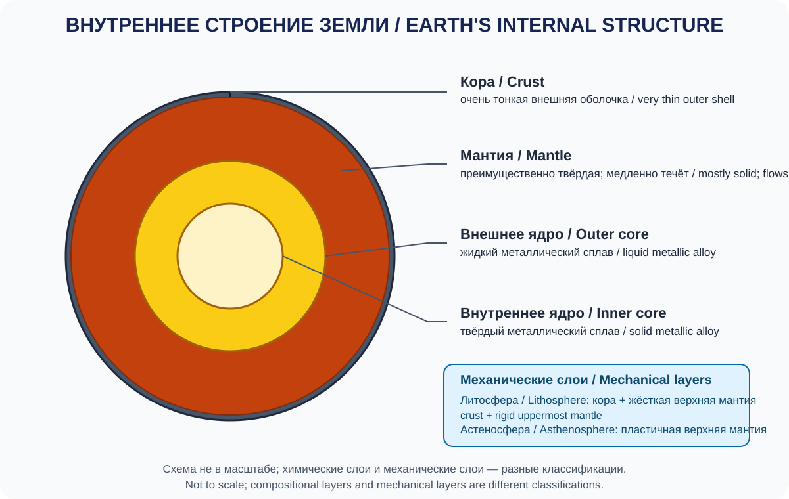
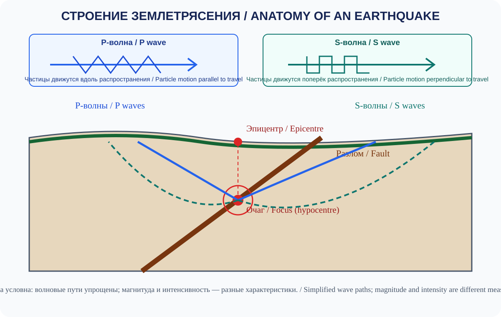
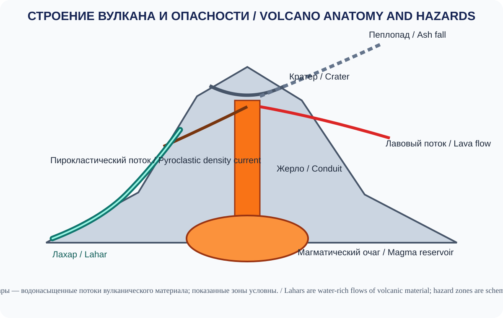
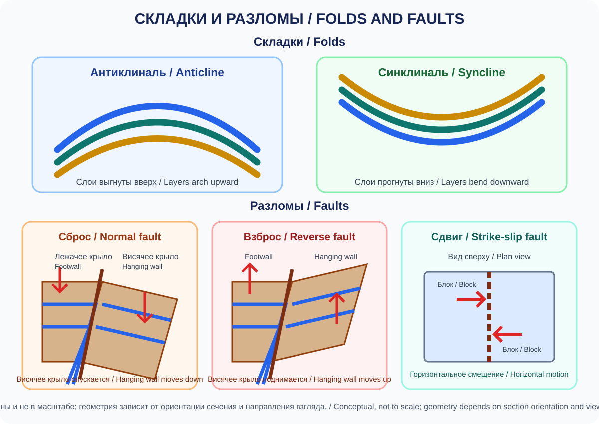
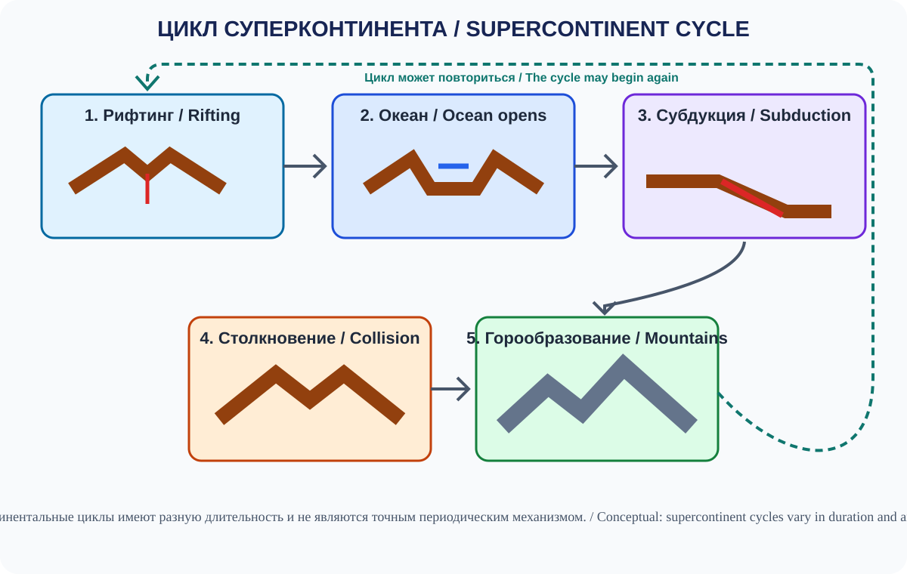
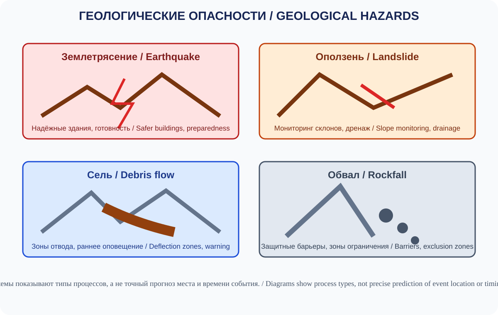

# Глава 3. Литосфера и геологические процессы
# Chapter 3. Lithosphere and Geological Processes

> **Статус:** научно-редакторская проверка текста завершена (100%). Двуязычные задания для 13 иллюстраций размечены; сами изображения, финальная вёрстка и отдельные браузерные/устройственные проверки остаются вне этого текстового аудита.
> **Языки:** русский / English.

## Введение / Introduction

Литосфера — твёрдая внешняя оболочка Земли, состоящая из земной коры и жёсткой верхней части мантии. Её строение и движение определяют развитие материков и океанических бассейнов, формирование гор, землетрясения, вулканизм и размещение многих месторождений полезных ископаемых.

Геологические процессы действуют в чрезвычайно широком диапазоне времени: от секунд при землетрясениях до сотен миллионов лет при формировании океанов и горных систем. Их изучение позволяет реконструировать историю планеты и оценивать природные опасности.

## 3.1. Внутреннее строение Земли / Internal Structure of Earth

Внутреннее строение Земли изучают по образцам горных пород, геофизическим измерениям и прежде всего по распространению сейсмических волн. Земные недра невозможно исследовать непосредственно на больших глубинах, поэтому значительная часть знаний основана на физических моделях.

### 3.1.1. Химическое строение / Chemical Composition

По химическому составу выделяют три главных слоя:

| Слой | Основные характеристики |
|---|---|
| Земная кора | Внешняя тонкая оболочка из силикатных пород; континентальная и океаническая |
| Мантия | Силикатная оболочка, богатая магнием и железом; простирается до глубины около 2 900 км |
| Ядро | Преимущественно железо-никелевый металлический состав; внешнее жидкое и внутреннее твёрдое |

Земная кора и литосфера — не одно и то же. Кора является химически выделяемой внешней оболочкой, тогда как литосфера определяется прежде всего механическими свойствами и включает кору вместе с жёсткой верхней мантией.

### 3.1.2. Механическое строение / Mechanical Layers

| Механический слой | Свойства |
|---|---|
| Литосфера | Жёсткая, относительно холодная оболочка, разделённая на плиты |
| Астеносфера | Область верхней мантии с пониженной вязкостью и способностью к медленному течению |
| Нижняя мантия | В основном твёрдое вещество, деформирующееся на геологических временах |
| Внешнее ядро | Жидкий металлический слой |
| Внутреннее ядро | Твёрдая металлическая область |

Астеносфера не является глобальным океаном магмы: её вещество преимущественно твёрдое, но при высоких температурах и давлениях способно медленно течь. Мантия в целом также преимущественно твёрдая, хотя в ней происходят длительные конвективные движения.

### 3.1.3. Основные глубины и параметры / Key Depths and Properties

- Средний радиус Земли — около 6 371 км.
- Граница кора–мантия называется поверхностью Мохоровичича (Moho).
- Граница мантия–ядро расположена примерно на глубине 2 900 км.
- Внешнее ядро простирается приблизительно от 2 900 до 5 150 км.
- Внутреннее ядро занимает центральную область планеты.
- Температура и давление возрастают с глубиной; оценки температуры внутренних областей имеют диапазоны и зависят от моделей.

**Иллюстрация 3.1-A — Внутреннее строение Земли / Earth's Internal Structure.**

*Схема не в масштабе. Мантия и астеносфера показаны как преимущественно твёрдые, способные к медленной деформации материалы; химические и механические классификации слоёв различаются. / Not to scale. The mantle and asthenosphere are shown as predominantly solid materials capable of slow deformation; compositional and mechanical layer classifications are distinct.*

## 3.2. Минералы и их свойства / Minerals and Their Properties

Минерал — природное, обычно неорганическое твёрдое вещество с характерным химическим составом и упорядоченной внутренней структурой. В минералогии изучают состав, кристаллическое строение, физические и оптические свойства минералов.

Не все природные твёрдые вещества являются минералами в строгом смысле: например, вулканическое стекло не имеет упорядоченной кристаллической структуры.

### 3.2.1. Диагностические свойства минералов / Diagnostic Properties

1. **Твёрдость (hardness):** сопротивление царапанию.
2. **Спайность (cleavage):** способность раскалываться по определённым кристаллографическим направлениям.
3. **Излом (fracture):** характер поверхности разрушения, если раскол не происходит по плоскостям спайности.
4. **Блеск (lustre):** характер отражения света.
5. **Цвет (colour):** видимый цвет образца; может изменяться из-за примесей.
6. **Черта (streak):** цвет порошка минерала.
7. **Плотность (density):** масса единицы объёма.
8. **Кристаллическая форма (crystal habit):** характерная внешняя форма кристаллов.

### 3.2.2. Шкала Мооса / Mohs Hardness Scale

Шкала Мооса — относительная шкала сопротивления царапанию, а не линейная шкала абсолютной твёрдости.

| Твёрдость | Минерал |
|---:|---|
| 1 | Тальк |
| 2 | Гипс |
| 3 | Кальцит |
| 4 | Флюорит |
| 5 | Апатит |
| 6 | Ортоклаз |
| 7 | Кварц |
| 8 | Топаз |
| 9 | Корунд |
| 10 | Алмаз |

Минерал с более высоким номером обычно царапает минерал с более низким. Разница между соседними ступенями шкалы не одинакова.

### 3.2.3. Распространённые породообразующие минералы / Common Rock-Forming Minerals

| Минерал | Химическая формула (упрощённо) | Значение |
|---|---|---|
| Кварц | SiO₂ | Распространён в магматических, осадочных и метаморфических породах |
| Ортоклаз | KAlSi₃O₈ | Полевой шпат, важный компонент гранитов |
| Плагиоклаз | NaAlSi₃O₈–CaAl₂Si₂O₈ | Группа полевых шпатов |
| Биотит | K(Mg,Fe)₃AlSi₃O₁₀(OH,F)₂ (обобщённая формула) | Тёмная слюда; состав изменяется |
| Мусковит | KAl₂(AlSi₃O₁₀)(OH)₂ (упрощённая формула) | Светлая слюда |
| Кальцит | CaCO₃ | Основной минерал многих известняков |
| Доломит | CaMg(CO₃)₂ | Характерен для доломитовых пород |
| Оливин | (Mg,Fe)₂SiO₄ | Типичен для многих основных и ультраосновных пород |
| Гипс | CaSO₄·2H₂O | Эвапоритовый минерал |
| Галит | NaCl | Каменная соль |

Формулы некоторых минералов отражают переменный состав твёрдых растворов и приведены в обобщённой форме.

**Место для иллюстрации 3.2-A — Mineral Identification Board.** Девять–десять образцов минералов с корректными названиями, формулами и шкалой Мооса; фотографии или реалистичные образцы без ошибочных подписей.
**EN:** A board of nine or ten mineral specimens with verified names, chemical formulae and Mohs hardness values; use photographs or realistic specimens with accurate labels.

## 3.3. Горные породы и круговорот пород / Rocks and the Rock Cycle

Горные породы — природные агрегаты одного или нескольких минералов, а иногда и стекла или органического вещества. По происхождению выделяют три основные группы: магматические, осадочные и метаморфические.

### 3.3.1. Магматические породы / Igneous Rocks

Образуются при охлаждении и кристаллизации магмы или лавы.

- **Интрузивные (plutonic):** застывают в глубине; обычно имеют более крупные кристаллы. Примеры: гранит, габбро.
- **Эффузивные (volcanic):** застывают на поверхности или близко к ней; часто имеют мелкозернистую или стекловатую структуру. Примеры: базальт, обсидиан.

Состав и текстура магматической породы зависят от химического состава расплава, скорости охлаждения, содержания летучих компонентов и истории кристаллизации.

### 3.3.2. Осадочные породы / Sedimentary Rocks

Формируются в результате накопления, уплотнения и цементации осадков, химического осаждения или накопления органического материала.

Основные типы:
- обломочные: конгломерат, песчаник, алевролит, аргиллит;
- химические: каменная соль, некоторые разновидности гипса;
- органогенные и биохемогенные: многие известняки, мел, уголь.

Осадочные породы часто сохраняют слоистость, окаменелости и следы древних сред осадконакопления.

### 3.3.3. Метаморфические породы / Metamorphic Rocks

Возникают при преобразовании ранее существовавших пород под воздействием температуры, давления и химически активных флюидов без полного плавления исходного материала.

Примеры:
- известняк → мрамор;
- гранит → гнейс (при соответствующих условиях метаморфизма);
- глинистые породы → сланцы и филлиты;
- песчаник → кварцит.

### 3.3.4. Круговорот горных пород / The Rock Cycle

Любая группа пород может переходить в другую через выветривание, эрозию, осадконакопление, погружение, метаморфизм, плавление и кристаллизацию. Круговорот не является замкнутым циклом с обязательным единым порядком: геологические пути разнообразны.

**Иллюстрация 3.3-A — Круговорот горных пород / The Rock Cycle.**

*Учебная схема, упрощённая по материалам USGS, Open-File Report 94-636 (1994); она показывает возможные пути преобразования, а не обязательный замкнутый цикл. / Teaching schematic simplified from USGS Open-File Report 94-636 (1994); it shows possible pathways, not a compulsory closed cycle.*

## 3.4. Минералогия, петрография и методы геологических исследований / Mineralogy, Petrography and Geological Methods

Геологические исследования сочетают полевые наблюдения, лабораторный анализ и геофизические методы.

### 3.4.1. Полевые методы / Field Methods

- описание обнажений и геологических разрезов;
- измерение элементов залегания слоёв и трещин;
- отбор и документирование образцов;
- геологическое картирование;
- анализ взаимоотношений пород и геологических структур.

### 3.4.2. Лабораторные методы / Laboratory Methods

| Метод | Что позволяет изучать |
|---|---|
| Оптическая микроскопия шлифов | Минералы, текстуру и структуру породы |
| Рентгеновская дифракция (XRD) | Кристаллические фазы и минеральный состав |
| Рентгенофлуоресцентный анализ (XRF) | Элементный химический состав |
| Масс-спектрометрия | Изотопный и элементный состав |
| Электронная микроскопия | Микроструктуру и химические особенности |
| Геохронология | Численный возраст минералов и геологических событий по изотопным и другим датирующим системам |
| Термохронология | История нагревания и охлаждения пород по температурно-зависимому поведению изотопных систем и других геологических индикаторов |

Геохронология и термохронология отвечают на связанные, но разные вопросы: первая помогает определить возраст минерала или события, а вторая — восстановить температурную историю породы. Термохронологические данные позволяют оценивать историю охлаждения и вместе с геологическими данными помогают ограничивать время и скорость эксгумации — постепенного выведения пород к поверхности. Возраст породы и возраст события, которое её изменило, могут различаться. Поэтому метод выбирают с учётом геологического вопроса, типа образца и истории породы.

### 3.4.3. Геофизические методы / Geophysical Methods

Сейсмические исследования, гравиметрия, магнитометрия и электрические методы позволяют изучать строение недр без непосредственного отбора образцов на каждой глубине.

**Место для иллюстрации 3.4-A — Geological Research Toolkit.** Полевой геолог, образец породы, тонкий шлиф под микроскопом, дифрактограмма и геофизический профиль.
**EN:** Show a field geologist, a rock sample, a thin section under a microscope, an X-ray diffraction pattern and a geophysical profile.

## 3.5. Тектоника литосферных плит / Plate Tectonics

Теория тектоники плит объясняет движение крупных фрагментов литосферы и многие закономерности распределения землетрясений, вулканов, горных поясов и океанических структур.

### 3.5.1. Движение плит / Plate Motion

Литосферные плиты движутся с разными скоростями: от менее 1 см/год до более 15 см/год в отдельных районах; многие участки движутся на несколько сантиметров в год. Скорость зависит от конкретной плиты, направления движения и геологического периода. Движение связано с тепловой эволюцией Земли и динамикой мантии. Среди взаимодействующих факторов обычно выделяют мантийную конвекцию, тягу погружающейся плиты и гравитационное отталкивание плит от приподнятых срединно-океанических хребтов. Их относительная роль различается в зависимости от региона и системы плит.

### 3.5.2. Типы границ плит / Types of Plate Boundaries

- **Дивергентные:** плиты расходятся; формируется новая океаническая кора на срединно-океанических хребтах и континентальных рифтах.
- **Конвергентные:** плиты сближаются; возможны субдукция, вулканические дуги и горообразование.
- **Трансформные:** плиты смещаются вдоль границы; часто возникают землетрясения.

В учебной классификации выделяют три основных типа границ плит. В некоторых регионах взаимодействие распределено по широкой деформируемой зоне, а не сосредоточено на узкой границе. Не всякая конвергентная граница сопровождается вулканизмом. Например, столкновение двух континентальных плит может приводить к утолщению коры и формированию высоких горных систем.

### 3.5.3. Континентальный дрейф и доказательства / Continental Drift

Идея дрейфа материков получила развитие в начале XX века. Современная теория тектоники плит объясняет механизм перемещения литосферы и объединяет доказательства:
- соответствие геологических структур по разные стороны океанов;
- сходство ископаемых организмов на ныне разделённых материках;
- палеоклиматические свидетельства;
- полосовые магнитные аномалии океанического дна;
- возраст океанической коры;
- современные геодезические измерения движения плит.

**Место для иллюстрации 3.5-A — Global Plate Tectonic Map.** Карта основных литосферных плит с дивергентными, конвергентными и трансформными границами. Геометрия границ должна быть проверена по авторитетной геологической карте.
**EN:** Map the major lithospheric plates and divergent, convergent and transform boundaries. Verify boundary geometry against an authoritative geological map and include a clear legend and source.

## 3.6. Землетрясения / Earthquakes

Землетрясение — колебание земной поверхности, вызванное быстрым высвобождением накопленной упругой энергии в земной коре или верхней мантии. Наиболее распространённая причина — внезапное смещение по разлому.

### 3.6.1. Очаг и эпицентр / Focus and Epicentre

- **Очаг (hypocentre, focus):** точка в недрах, где начинается разрыв и высвобождение энергии; на учебных схемах его иногда условно показывают как небольшую область.
- **Эпицентр (epicentre):** точка на поверхности Земли непосредственно над очагом.
- **Разлом (fault):** трещинная зона, вдоль которой происходило или может происходить смещение пород.

### 3.6.2. Сейсмические волны / Seismic Waves

- **P-волны:** продольные, самые быстрые; проходят через твёрдые тела и жидкости.
- **S-волны:** поперечные; распространяются через твёрдые материалы, но не проходят через жидкое внешнее ядро.
- **Поверхностные волны:** распространяются вдоль поверхности и часто вызывают значительные разрушения.

### 3.6.3. Магнитуда и интенсивность / Magnitude and Intensity

Магнитуда характеризует размер землетрясения на основе инструментальных измерений. Моментная магнитуда (Mw) широко используется для оценки крупных землетрясений. Интенсивность описывает наблюдаемые эффекты и разрушения в конкретном месте; она может различаться в пределах одного события.

Магнитуда не является линейной шкалой: увеличение на одну единицу соответствует примерно десятикратному увеличению амплитуды сопоставимой записи и примерно 32-кратному росту выделившейся сейсмической энергии.

### 3.6.4. Сейсмический риск / Seismic Risk

Риск определяется не только вероятностью землетрясения, но и уязвимостью зданий, плотностью населения, качеством инфраструктуры и готовностью к чрезвычайным ситуациям. Сейсмическая опасность не может быть устранена, но последствия можно уменьшить с помощью норм строительства, инженерной оценки и подготовки населения.

**Иллюстрация 3.6-A — Строение землетрясения / Anatomy of an Earthquake.**

*Схема условна; магнитуда характеризует размер источника, а интенсивность — проявления сотрясений в конкретном месте. / Schematic; magnitude characterises source size, while intensity describes shaking effects at a location.*
**EN:** Cross-section showing a fault, hypocentre (focus), epicentre and the main types of seismic waves.

### 3.6.5. Как определяют положение эпицентра / How the Epicentre Is Located

Сейсмостанция регистрирует колебания грунта в виде сейсмограммы. На записи обычно можно различить приход более быстрых P-волн и более медленных S-волн. Чем дальше станция от очага, тем, как правило, больше временной интервал между приходом этих волн.

**От разницы времени к расстоянию.** Специалисты используют кривые времени пробега сейсмических волн или вычислительные модели, чтобы перевести интервал между P- и S-волнами в оценку расстояния до очага. Нельзя применять одну постоянную скорость ко всем волнам и всем глубинам: скорость зависит от свойств и строения пород.

**Трилатерация (определение по расстояниям).** Если известны расстояния от нескольких станций до эпицентра, вокруг каждой станции на карте проводят окружность соответствующего радиуса. Здесь положение определяют по расстояниям, а не по измеренным углам. В идеализированном случае три окружности пересекаются в одной точке. На практике измерения содержат погрешности, поэтому окружности могут не сходиться точно; положение эпицентра определяют методами совместной обработки данных. Для определения глубины очага и параметров разрыва нужны дополнительные наблюдения и более сложные модели.

**Упрощённый учебный пример.** Пусть три станции расположены в разных частях региона, а анализ сейсмограмм дал условные расстояния до эпицентра 40, 65 и 50 км. На карте строят три окружности с этими радиусами. Область их наиболее близкого пересечения показывает примерное положение эпицентра. Эти условные расстояния иллюстрируют геометрический принцип и не описывают реальное землетрясение.

**Почему важна сеть станций.** Одна станция позволяет оценить расстояние, но не задаёт однозначное направление на эпицентр. Несколько станций дают возможность локализовать событие и проверить согласованность измерений. Чем лучше географическое распределение станций и качество временной синхронизации, тем надёжнее результат. Станции, расположенные почти на одной линии, обычно дают менее устойчивую геометрию определения.

**Учебное задание.** Нарисуйте условную карту с тремя сейсмостанциями. Постройте окружности по заданным расстояниям и отметьте область пересечения. Затем измените один радиус на несколько километров и объясните, почему оценка эпицентра смещается. Укажите, почему эта схема не определяет глубину очага.

A seismic station records ground motion as a seismogram. The record usually makes it possible to identify the arrival of faster P-waves and slower S-waves. The farther a station is from the source, the greater the time interval between the arrivals generally becomes.

**From time difference to distance.** Scientists use seismic travel-time curves or computational models to convert the interval between P- and S-wave arrivals into an estimated distance to the source. A single constant velocity cannot be applied to all waves and depths: velocity depends on the properties and structure of the rocks.

**Trilateration (location by distance).** If distances from several stations to the epicentre are known, a circle with the corresponding radius is drawn around each station on a map. The location is determined from measured distances, not from measured angles. In an idealised case, three circles intersect at one point. In practice, measurements contain errors, so the circles may not meet exactly; the epicentre is estimated by jointly analysing the observations. Additional measurements and more complex models are needed to determine focal depth and rupture parameters.

**Simplified learning example.** Suppose three stations are located in different parts of a region, and seismogram analysis gives hypothetical distances to the epicentre of 40, 65 and 50 km. Draw three circles with these radii on a map. The area where they come closest to intersecting indicates the approximate epicentre location. These illustrative distances do not describe a real earthquake.

**Why a station network matters.** One station can provide an estimate of distance but cannot uniquely determine the direction to the epicentre. Several stations make it possible to locate the event and check the consistency of measurements. Better geographic distribution and accurate time synchronisation improve reliability. Stations arranged almost along a single line generally provide weaker location geometry.

**Learning activity.** Draw a hypothetical map with three seismic stations. Plot circles using given distances and mark their intersection area. Then change one radius by several kilometres and explain why the estimated epicentre shifts. State why this diagram cannot determine focal depth.

### 3.6.6. Как читать сейсмограмму и оценивать неопределённость / Reading a Seismogram and Understanding Uncertainty

Сейсмограмма показывает движение грунта во времени, зарегистрированное конкретным прибором в конкретном месте. По горизонтальной оси обычно откладывают время, по вертикальной — амплитуду сигнала или её инструментальную характеристику. Перед сравнением записей необходимо проверить единицы, масштаб времени, частотную характеристику прибора и то, была ли запись скорректирована.

**Основные шаги чтения:**

1. Найдите начало записи и оцените фоновый шум до события.
2. Определите наиболее ранний уверенный приход P-волны; не принимайте случайный шум за начало сигнала.
3. Найдите приход S-волны, учитывая, что он может быть менее отчётливым.
4. Измерьте интервал S–P и используйте подходящую региональную кривую времени пробега, а не универсальную формулу для всех районов.
5. Сравните результат с данными других станций. Несогласованность может указывать на ошибку чтения, сложное строение земной коры или недостаточную точность модели.

**Амплитуда — не магнитуда сама по себе.** Большая амплитуда на одной записи не означает автоматически более сильное землетрясение: на неё влияют расстояние до очага, глубина, направление распространения волн, местные грунты, тип прибора и настройки регистрации. Магнитуду рассчитывают по стандартизованным методикам с поправками на эти факторы.

**Неопределённость результата.** В каталогах землетрясений положение эпицентра, глубина и магнитуда могут сопровождаться оценками погрешности. Первоначальная автоматическая оценка иногда уточняется после поступления данных дополнительных станций. Поэтому для научного анализа важно указывать версию каталога и время его обновления, а не представлять предварительные координаты как абсолютно точные.

**Практическое задание.** Сравните две учебные сейсмограммы с разными расстояниями S–P. Определите, на какой станции интервал больше, и объясните, почему это обычно указывает на большее расстояние до очага. Затем перечислите не менее трёх причин, по которым амплитуды двух записей нельзя сравнивать напрямую.

A seismogram shows ground motion over time as recorded by a particular instrument at a particular location. Time is usually shown on the horizontal axis and signal amplitude, or an instrument-related measure, on the vertical axis. Before comparing records, check the units, time scale, instrument response and whether the record has been corrected.

**A basic reading sequence:**

1. Identify the beginning of the record and assess background noise before the event.
2. Mark the earliest reliable P-wave arrival; do not mistake random noise for the signal onset.
3. Identify the S-wave arrival, which may be less distinct.
4. Measure the S–P interval and use an appropriate regional travel-time curve rather than a universal formula for every region.
5. Compare the result with observations from other stations. Disagreement may indicate reading errors, complex crustal structure or limitations in the model.

**Amplitude is not magnitude by itself.** A large amplitude on one record does not automatically mean a stronger earthquake. It is affected by source distance, focal depth, wave-propagation direction, local ground conditions, instrument type and recording settings. Magnitude is calculated using standardised methods that account for these factors.

**Uncertainty in the result.** Earthquake catalogues may include uncertainty estimates for epicentre location, depth and magnitude. An initial automatic estimate may be revised when data from additional stations become available. Scientific analysis should therefore identify the catalogue version and its update time instead of presenting preliminary coordinates as perfectly exact.

**Practical activity.** Compare two teaching seismograms with different S–P intervals. Identify the station with the longer interval and explain why this generally indicates a greater distance from the source. Then list at least three reasons why the amplitudes of the two records cannot be compared directly.

## 3.7. Вулканизм / Volcanism

Вулканизм — совокупность процессов подъёма магмы, выделения газов и выхода расплавленного вещества на поверхность.

### 3.7.1. Магма и лава / Magma and Lava

Магма — расплав или частично расплавленное вещество с кристаллами и растворёнными летучими компонентами в недрах. Лава — магма, вышедшая на поверхность и обычно частично потерявшая газы.

### 3.7.2. Типы вулканов и извержений / Volcano Types and Eruptions

Форма вулкана зависит от вязкости магмы, состава, объёма и характера извержений.

- Щитовые вулканы формируются преимущественно текучими лавами.
- Стратовулканы состоят из чередующихся лавовых и пирокластических отложений.
- Шлаковые конусы обычно меньше и состоят главным образом из рыхлых пирокластических материалов.
- Кальдеры возникают, когда крупная вулканическая структура обрушивается после значительного выхода или перемещения магмы из неглубокого резервуара. Это не означает, что вся магматическая система обязательно полностью опустошена.

Извержения бывают эффузивными и взрывными; реальный характер может сочетать оба типа.

### 3.7.3. Вулканические опасности / Volcanic Hazards

Опасности включают лавовые потоки, пеплопады, пирокластические потоки, вулканические газы, лахары и оползни вулканических склонов. Пирокластические потоки особенно опасны из-за высокой температуры и скорости движения.

**Иллюстрация 3.7-A — Строение вулкана и опасности извержения / Volcano Anatomy and Eruption Hazards.**

*Зоны опасностей схематичны; лахары — водонасыщенные потоки вулканического материала. / Hazard extents are schematic; lahars are water-rich flows of volcanic material.*
**EN:** Volcano cross-section showing the magma reservoir, conduit, crater and zones affected by different volcanic hazards.

## 3.8. Складчатость и разломы / Folding and Faulting

Горные породы деформируются под воздействием напряжений. Деформация может быть пластической, приводящей к изгибу слоёв, или хрупкой, сопровождающейся трещинами и разломами.

### 3.8.1. Складки / Folds

- **Антиклиналь:** складка, в которой слои обычно выгнуты вверх; самые древние породы часто находятся в ядре, если структура не опрокинута и не нарушена.
- **Синклиналь:** складка, в которой слои обычно прогнуты вниз; в ядре часто залегают более молодые породы.
- **Моноклиналь:** ступенеобразный изгиб слоёв.

### 3.8.2. Разломы / Faults

- **Сброс:** висячее крыло смещается вниз относительно лежачего.
- **Взброс:** висячее крыло смещается вверх; при малом угле падения выделяют надвиг.
- **Сдвиг:** преобладает горизонтальное смещение.

Тип разлома определяется направлением относительного смещения блоков, а не только внешним видом поверхности.

**Иллюстрация 3.8-A — Складки и разломы / Folds and Faults.**

*Условные разрезы; направление перемещения показано стрелками и не задаёт универсальную геометрию разломов. / Conceptual sections; arrows indicate movement and do not imply universal fault geometry.*
**EN:** Compare an anticline, syncline, normal fault, reverse/thrust fault and strike-slip fault using clearly labelled geological cross-sections.

## 3.9. Геологическое время / Geological Time

Геологическая история Земли охватывает около 4,54 млрд лет. В таблице ICS 2026/06 нижняя граница гадея установлена на 4 567,3 ± 0,16 млн лет по возрасту древнейших кальций-алюминиевых включений (CAI) в метеоритах. Это формальная граница, связанная с началом формирования твёрдых тел Солнечной системы, а не точная дата завершения формирования Земли. Для реконструкции геологической истории используют относительную и численную геохронологию.

### 3.9.1. Относительная геохронология / Relative Dating

Основные принципы:
- закон суперпозиции: в ненарушенной последовательности нижние слои обычно древнее верхних;
- принцип первоначальной горизонтальности: осадки обычно накапливаются близко к горизонтальному положению;
- принцип пересечения: геологическое тело или разлом, пересекающий другое образование, обычно моложе пересекаемого;
- принцип включений: обломки внутри породы старше породы, которая их содержит.

### 3.9.2. Численная геохронология / Numerical Dating

Радиометрическое датирование основано на распаде радиоактивного **материнского изотопа** в **дочерний изотоп** с известной скоростью. Важное понятие — период полураспада: время, за которое распадается половина исходных материнских атомов. Измеряя соотношение материнских и дочерних изотопов, специалисты рассчитывают численный возраст образца.

Метод выбирают с учётом возраста, минерала и геологической истории. Для надёжного результата важно учитывать, сохраняла ли минеральная система изотопы после своего образования: нагревание, метаморфизм, выветривание или потеря вещества могут изменить изотопное соотношение. Поэтому полученная дата часто показывает время кристаллизации минерала или последнего важного события, повлиявшего на его изотопную систему, а не автоматически возраст всей породы.

Магматические минералы и вулканический пепел можно датировать подходящими радиометрическими методами. Многие обломочные осадочные породы нельзя напрямую датировать как единое целое: возраст отдельных зёрен может отражать породу-источник, а не время осадконакопления. Их возраст часто ограничивают по датируемым слоям выше и ниже или по вулканическому пеплу внутри последовательности. Примеры изотопных систем: уран-свинцовая, калий-аргоновая/аргон-аргоновая и рубидий-стронциевая.

### 3.9.3. Геологическая шкала времени / Geologic Time Scale

| Эон / Eon | Интервал и важнейшие события |
|---|---|
| Гадей | Формирование Земли и ранняя эволюция планеты |
| Архей | Древнейшие известные свидетельства жизни; развитие ранней коры |
| Протерозой | Рост содержания кислорода, развитие сложной жизни |
| Фанерозой | Обильная ископаемая летопись; включает палеозой, мезозой и кайнозой |

Границы геологических подразделений определяются международной стратиграфической шкалой и уточняются по мере развития исследований. В окончательной версии атласа численные даты границ должны быть сверены с актуальной таблицей Международной комиссии по стратиграфии.

**Место для иллюстрации 3.9-A — Geological Time Scale.** Вертикальная временная шкала от формирования Земли до современности; неравномерный масштаб должен быть явно обозначен.
**EN:** Vertical geological time scale from Earth's formation to the present. Make the non-linear time spacing explicit and use the current ICS chart for boundary ages.

### 3.9.4. Разобранный пример: определение относительного возраста слоёв и интрузии / Worked Example: Establishing the Relative Ages of Layers and an Intrusion

Представим геологический разрез из трёх осадочных слоёв: A находится внизу, B залегает над ним, C — сверху. Магматическое тело D пересекает слои A и B, но не пересекает слой C.

**Шаг 1.** По закону суперпозиции, если последовательность не опрокинута и не нарушена, слой A древнее слоя B, а слой B древнее слоя C.

**Шаг 2.** По принципу пересечения интрузия D моложе слоёв A и B, которые она прорезает.

**Шаг 3.** Поскольку D не пересекает слой C, а C перекрывает участок интрузии, доступные отношения позволяют заключить, что C сформировался после внедрения D.

Итоговая последовательность от древнего к молодому:

\[
A\;\rightarrow\;B\;\rightarrow\;D\;\rightarrow\;C
\]

Это относительная последовательность, а не календарные даты. Чтобы определить численный возраст, нужны подходящие образцы и метод датирования. Если слои опрокинуты, разрез разломан или контакты неясны, сначала необходимо установить геологическую структуру.

**Проверьте себя:** разлом пересекает слои A, B и C, но не смещает более молодой слой E, который перекрывает разлом. Что можно сказать о возрасте разлома относительно этих слоёв?

Imagine a geological cross-section with three sedimentary layers: A at the bottom, B above it and C at the top. An igneous body D cuts through layers A and B but does not cut layer C.

**Step 1.** Under the law of superposition, if the sequence has not been overturned or disturbed, layer A is older than B, and B is older than C.

**Step 2.** Under the principle of cross-cutting relationships, intrusion D is younger than layers A and B, which it cuts through.

**Step 3.** Because D does not cut layer C, and C overlies the intrusion, the available relationships indicate that C formed after D was emplaced.

The sequence from oldest to youngest is:

\[
A\;\rightarrow\;B\;\rightarrow\;D\;\rightarrow\;C
\]

This is a relative sequence, not a set of calendar dates. Numerical ages require suitable samples and an appropriate dating method. If layers are overturned, the section is faulted or contacts are unclear, the geological structure must be established first.

**Check your understanding:** a fault cuts layers A, B and C but does not displace a younger layer E that overlies the fault. What can you infer about the age of the fault relative to these layers?

## 3.10. Формирование материков и океанов / Formation of Continents and Oceans

Лик Земли менялся на протяжении геологической истории. Континенты росли за счёт аккреции островных дуг, микроконтинентов и других террейнов, а океанические бассейны открывались и закрывались в результате движения плит.

### 3.10.1. Суперконтиненты / Supercontinents

В геологической истории существовали крупные объединения континентальной коры. Среди наиболее известных — Родиния и Пангея. Их реконструкции основаны на геологических, палеомагнитных и палеонтологических данных и содержат научные неопределённости.

Пангея существовала в позднем палеозое и раннем мезозое; её распад привёл к развитию современных океанических бассейнов Атлантики и Индийского океана.

### 3.10.2. Открытие и закрытие океанов / Ocean Opening and Closure

Рифтинг может привести к растяжению и расколу континентальной коры, затем к формированию нового океанического бассейна. При субдукции океаническая литосфера погружается в мантию; при столкновении континентов океанический бассейн может исчезнуть, а континентальные массы образуют складчатые горные пояса.

**Иллюстрация 3.10-A — Цикл суперконтинента / The Supercontinent Cycle.**

*Концептуальная модель: циклы имеют разную длительность и не являются точным периодическим механизмом. / Conceptual model: cycles vary in duration and are not a precise periodic mechanism.*
**EN:** Sequence illustrating continental rifting, ocean-basin opening, subduction, continental collision and mountain building.

## 3.11. Геологические ресурсы и полезные ископаемые / Geological Resources and Mineral Resources

Геологические ресурсы включают полезные ископаемые, строительные материалы, подземные воды и геотермальную энергию.

### 3.11.1. Основные группы полезных ископаемых / Mineral Resource Groups

| Группа | Примеры |
|---|---|
| Металлические руды | Железная руда, медная руда, боксит (алюминиевая руда), золотосодержащая руда |
| Неметаллические | Фосфориты, соли, гипс, известняк |
| Энергетические | Уголь, нефть, природный газ, уран |
| Строительные материалы | Песок, гравий, глина, строительный камень |

Минеральное проявление не обязательно является месторождением. Для экономической разработки важны содержание полезного компонента, объём запасов, технология добычи, инфраструктура, экологические ограничения и рыночные условия.

### 3.11.2. Геологические условия образования месторождений / Ore-Forming Processes

Месторождения могут формироваться в магматических, гидротермальных, осадочных, метаморфических и выветрелых системах. Один и тот же металл может концентрироваться разными геологическими путями.

### 3.11.3. Ответственное использование ресурсов / Responsible Resource Use

Добыча полезных ископаемых может сопровождаться нарушением земель, образованием отходов, загрязнением вод и воздуха, а также изменением ландшафтов. Геологическая оценка должна учитывать не только потенциальную ценность ресурса, но и весь жизненный цикл добычи, переработки и рекультивации.

**Место для иллюстрации 3.11-A — From Geological Deposit to Resource Management.** Разрез месторождения, этапы разведки, добычи, переработки и рекультивации.
**EN:** Cross-section of a mineral deposit with the stages of exploration, extraction, processing, closure and land rehabilitation.

## 3.12. Геологические опасности и управление рисками / Geological Hazards and Risk Management

К геологическим опасностям относятся землетрясения, вулканические извержения, оползни, обвалы, сели, просадки и некоторые виды цунами.

### 3.12.1. Оползни и обвалы / Landslides and Rockfalls

Оползень — перемещение массы грунта, обломочного материала или горных пород вниз по склону под действием силы тяжести. Его провоцируют насыщение водой, подрезка склона, землетрясения, выветривание и изменение растительного покрова.

Обвал — быстрое отделение и падение крупных блоков горной породы. Риск повышается на крутых склонах с трещиноватыми породами.

### 3.12.2. Сели / Debris Flows

Сель — быстро движущийся поток воды, грязи, обломков пород и других материалов по руслам и долинам. Сели могут возникать после интенсивных осадков, быстрого таяния снега и льда, прорыва естественных или искусственных водоёмов.

### 3.12.3. Снижение риска / Risk Reduction

- геологическое и инженерно-геологическое картирование;
- мониторинг сейсмичности и склоновых процессов;
- системы раннего предупреждения;
- соблюдение строительных норм;
- регулирование землепользования;
- информирование населения и планы эвакуации.

Опасность, подверженность воздействию и уязвимость — разные составляющие риска. Наличие опасного процесса не означает автоматически катастрофу: последствия зависят от того, кто и что находится в зоне воздействия и насколько хорошо защищены объекты.

**Иллюстрация 3.12-A — Геологические опасности / Geological Hazards.**

*Схема показывает типы процессов и общие меры снижения риска, но не предсказывает точное место и время события. / The diagram shows process types and general risk reduction, not the precise location or timing of an event.*
**EN:** Four panels showing an earthquake, landslide, debris flow and rockfall, with key triggering factors and practical risk-reduction measures.

## Итоги главы / Chapter Summary

1. Земля имеет слоистое внутреннее строение, которое изучают с помощью геофизики и анализа пород.
2. Литосфера включает земную кору и жёсткую верхнюю мантию.
3. Минералы различаются составом, кристаллической структурой и физическими свойствами.
4. Горные породы делятся на магматические, осадочные и метаморфические.
5. Тектоника плит объясняет многие процессы формирования рельефа и распределения геологических опасностей.
6. Землетрясения связаны с высвобождением энергии, а вулканизм — с движением магмы и газов.
7. Геологическая летопись позволяет реконструировать историю Земли.
8. Геологические ресурсы имеют экономическое значение, но их использование требует экологической и социальной ответственности.
9. Оценка геологических опасностей основана на понимании процессов, уязвимости и подверженности воздействию.

## Контрольные вопросы / Review Questions

1. Чем земная кора отличается от литосферы?
2. Почему астеносфера не является полностью жидкой?
3. Какие свойства используют для определения минералов?
4. Чем магматические породы отличаются от осадочных и метаморфических?
5. Какие три основных типа границ литосферных плит существуют?
6. Чем магнитуда землетрясения отличается от его интенсивности?
7. Почему S-волны не проходят через внешнее ядро?
8. Какие геологические процессы формируют складки и разломы?
9. В чём различие относительного и численного датирования?
10. Какие меры снижают риск геологических катастроф?

## Практическая работа / Practical Assignment

**Задание: чтение геологического разреза.**

На схематическом разрезе (будет подготовлен как учебная иллюстрация) определите:
- последовательность слоёв от древних к молодым;
- какие структуры являются складками;
- какие разломы пересекают слои;
- какие геологические события произошли раньше, а какие позже;
- какие участки могут представлять инженерно-геологическую опасность.

**Место для иллюстрации 3.12-B — Interpreting a Geological Cross-Section.** Учебный разрез с легендой, слоями разных возрастов, складкой, разломом и интрузивным телом; предусмотреть задания с ответами в отдельном приложении.
**EN:** Teaching cross-section with a legend, rock layers of different ages, a fold, a fault and an igneous intrusion; provide learner questions and a separate answer key.

## English-language chapter text

### Introduction

The lithosphere is Earth's rigid outer shell, consisting of the crust and the rigid upper part of the mantle. Its structure and movement influence the development of continents and ocean basins, mountain building, earthquakes, volcanism and the location of many mineral deposits.

Geological processes operate over an extremely wide range of timescales—from seconds during earthquakes to hundreds of millions of years during the formation of oceans and mountain systems. Studying them helps reconstruct Earth's history and assess natural hazards.

### 3.1. Internal Structure of Earth

Earth's interior is studied through rock samples, geophysical measurements and, above all, the behaviour of seismic waves. The deep interior cannot be sampled directly, so much of our knowledge is based on physical models.

**Illustration 3.1-A — Earth's Internal Structure.**

*Not to scale. The mantle and asthenosphere are shown as predominantly solid materials capable of slow deformation; compositional and mechanical layer classifications are distinct. / Схема не в масштабе. Мантия и астеносфера показаны как преимущественно твёрдые, способные к медленной деформации материалы; химические и механические классификации слоёв различаются.*

### 3.1.1. Chemical Structure

**Chemical structure.** Three major compositional layers are recognised:

| Layer | Main characteristics |
|---|---|
| Crust | Thin outer shell of silicate rocks; continental and oceanic types |
| Mantle | Silicate shell rich in magnesium and iron, extending to about 2,900 km depth |
| Core | Mainly metallic iron and nickel; liquid outer core and solid inner core |

The crust and lithosphere are not the same. The crust is a compositional layer, whereas the lithosphere is defined mainly by mechanical properties and includes the crust together with the rigid uppermost mantle.

### 3.1.2. Mechanical Structure

**Mechanical structure.**

| Mechanical layer | Properties |
|---|---|
| Lithosphere | Rigid, relatively cool shell divided into plates |
| Asthenosphere | Upper-mantle zone of reduced viscosity that can flow slowly |
| Lower mantle | Mostly solid material that deforms over geological timescales |
| Outer core | Liquid metallic layer |
| Inner core | Solid metallic region |

The asthenosphere is not a global ocean of magma. Its material is mostly solid but can flow slowly under high temperatures and pressures. The mantle as a whole is also predominantly solid, although long-term convective motion occurs within it.

### 3.1.3. Key Depths and Properties

Earth's mean radius is about 6,371 km. The crust–mantle boundary is the Mohorovičić discontinuity (Moho); the mantle–core boundary is at about 2,900 km depth. The outer core extends approximately from 2,900 to 5,150 km, while the inner core occupies the planet's centre. Temperature and pressure increase with depth; estimates for the deep interior vary among models.

### 3.2. Minerals and Their Properties

A mineral is a naturally occurring, usually inorganic solid with a characteristic chemical composition and an ordered internal structure. Mineralogy studies mineral composition, crystal structure, and physical and optical properties.

Not every naturally occurring solid is a mineral in the strict sense. Volcanic glass, for example, lacks an ordered crystalline structure.

### 3.2.1. Diagnostic Properties

Diagnostic properties include:

1. **Hardness:** resistance to scratching.
2. **Cleavage:** tendency to split along particular crystallographic directions.
3. **Fracture:** the character of a broken surface when cleavage does not control the break.
4. **Lustre:** the way a mineral reflects light.
5. **Colour:** the visible colour of a specimen, which may be affected by impurities.
6. **Streak:** the colour of a mineral in powdered form.
7. **Density:** mass per unit volume.
8. **Crystal habit:** the characteristic external shape of crystals.

### 3.2.2. Mohs Hardness Scale

The Mohs scale is a relative scratch-resistance scale, not a linear scale of absolute hardness.

| Hardness | Mineral |
|---:|---|
| 1 | Talc |
| 2 | Gypsum |
| 3 | Calcite |
| 4 | Fluorite |
| 5 | Apatite |
| 6 | Orthoclase |
| 7 | Quartz |
| 8 | Topaz |
| 9 | Corundum |
| 10 | Diamond |

A mineral with a higher number will generally scratch one with a lower number. The difference between adjacent steps is not equal.

### 3.2.3. Common Rock-Forming Minerals

Common rock-forming minerals include quartz (SiO₂), orthoclase (KAlSi₃O₈), plagioclase feldspars (a solid-solution series between NaAlSi₃O₈ and CaAl₂Si₂O₈), biotite (a variable-composition mica, often represented by K(Mg,Fe)₃AlSi₃O₁₀(OH,F)₂), muscovite (KAl₂(AlSi₃O₁₀)(OH)₂), calcite (CaCO₃), dolomite (CaMg(CO₃)₂), olivine ((Mg,Fe)₂SiO₄), gypsum (CaSO₄·2H₂O) and halite (NaCl). These are representative or simplified formulae; some minerals have variable compositions.

### 3.3. Rocks and the Rock Cycle

Rocks are natural aggregates of one or more minerals and may also contain glass or organic matter. By origin, they are divided into three main groups: igneous, sedimentary and metamorphic.

### 3.3.1. Igneous Rocks

**Igneous rocks** form when magma or lava cools and crystallises. Intrusive (plutonic) rocks solidify at depth and commonly have larger crystals; examples include granite and gabbro. Extrusive (volcanic) rocks solidify at or near the surface and often have fine-grained or glassy textures; examples include basalt and obsidian. Composition and texture depend on melt chemistry, cooling rate, volatile content and crystallisation history.

### 3.3.2. Sedimentary Rocks

**Sedimentary rocks** form through the accumulation, compaction and cementation of sediments, chemical precipitation or accumulation of organic material. Main types include clastic rocks (conglomerate, sandstone, siltstone and mudstone), chemical rocks (rock salt and some gypsum deposits), and organic or biochemical rocks (many limestones, chalk and coal). Sedimentary rocks often preserve layering, fossils and evidence of ancient depositional environments.

### 3.3.3. Metamorphic Rocks

**Metamorphic rocks** form when pre-existing rocks are transformed by temperature, pressure and chemically active fluids without completely melting. Examples include limestone transformed into marble, granite transformed into gneiss under suitable conditions, clay-rich rocks transformed into slate or phyllite, and sandstone transformed into quartzite.

### 3.3.4. The Rock Cycle

In the **rock cycle**, any rock group may be transformed into another through weathering, erosion, deposition, burial, metamorphism, melting and crystallisation. It is not a closed cycle with one compulsory sequence; geological pathways are diverse.

**Illustration 3.3-A — The Rock Cycle.**

*Teaching schematic simplified from USGS Open-File Report 94-636 (1994); it shows possible pathways, not a compulsory closed cycle. / Учебная схема, упрощённая по материалам USGS Open-File Report 94-636 (1994); она показывает возможные пути преобразования, а не обязательный замкнутый цикл.*

### 3.4. Mineralogy, Petrography and Geological Methods

Geological research combines field observations, laboratory analysis and geophysical methods.

### 3.4.1. Field Methods

**Field methods** include describing outcrops and geological sections, measuring the orientation of layers and fractures, collecting and documenting samples, geological mapping, and analysing relationships between rock units and structures.

### 3.4.2. Laboratory Methods

**Laboratory methods** include:

| Method | What it can reveal |
|---|---|
| Optical microscopy of thin sections | Minerals, rock texture and structure |
| X-ray diffraction (XRD) | Crystalline phases and mineral composition |
| X-ray fluorescence (XRF) | Elemental chemical composition |
| Mass spectrometry | Isotopic and elemental composition |
| Electron microscopy | Microstructure and chemical features |
| Geochronology | Numerical ages of minerals and geological events using isotopic and other dating systems |
| Thermochronology | The heating and cooling history of rocks, inferred from the temperature-dependent behaviour of isotopic systems and other geological indicators |

Geochronology and thermochronology address related but different questions: the first helps determine the age of a mineral or event, while the second reconstructs a rock's thermal history. Thermochronological data can constrain cooling history and, together with geological evidence, help estimate the timing and rate of exhumation—the gradual exposure of rocks as overlying material is removed. The age of a rock and the age of an event that altered it may differ. A method must therefore be selected according to the geological question, sample type and history of the rock.

### 3.4.3. Geophysical Methods

Geophysical methods—including seismic surveys, gravity, magnetic and electrical methods—help investigate the subsurface without collecting samples at every depth.

### 3.5. Plate Tectonics

Plate tectonics explains the movement of large lithospheric fragments and many patterns in the distribution of earthquakes, volcanoes, mountain belts and ocean-floor structures.

### 3.5.1. Plate Motion

Lithospheric plates move at different rates, from less than 1 cm per year to more than 15 cm per year in some regions; many plate segments move by a few centimetres per year. The rate depends on the plate, direction of motion and timescale considered. Their motion is linked to Earth's thermal evolution and mantle dynamics. Commonly discussed interacting drivers include mantle convection, slab pull and gravitational ridge push from elevated mid-ocean ridges. Their relative importance varies among plate systems and regions.

### 3.5.2. Types of Plate Boundaries

Three main types of plate boundary are recognised:

- **Divergent boundaries:** plates move apart, forming new oceanic crust at mid-ocean ridges and continental rifts.
- **Convergent boundaries:** plates move towards each other; subduction, volcanic arcs and mountain building may occur.
- **Transform boundaries:** plates slide horizontally past one another, often generating earthquakes.

School-level classifications describe three main types of plate boundary. In some regions, plate interaction is distributed across a broad deforming boundary zone rather than a narrow line. Not every convergent boundary is associated with volcanism. Collision between two continents, for example, may thicken the crust and form high mountain systems.

### 3.5.3. Continental Drift and Evidence

The idea of continental drift developed in the early twentieth century. Modern plate tectonics explains the mechanism of lithospheric movement and brings together several lines of evidence: matching geological structures across oceans, similar fossils on continents now separated, palaeoclimatic evidence, magnetic stripes on the ocean floor, the age of oceanic crust and modern geodetic measurements of plate motion.

### 3.6. Earthquakes

An earthquake is ground shaking caused by the rapid release of accumulated elastic energy in the crust or upper mantle. The most common cause is sudden displacement along a fault.

### 3.6.1. Focus and Epicentre

- **Focus (hypocentre):** the point within the Earth where rupture and energy release begin; teaching diagrams may represent it as a small area.
- **Epicentre:** the point on Earth's surface directly above the focus.
- **Fault:** a fracture zone along which rocks have moved or may move.

### 3.6.2. Seismic Waves

**Seismic waves** include P-waves, which are the fastest compressional waves and travel through solids and liquids; S-waves, which are shear waves and travel through solids but not through the liquid outer core; and surface waves, which travel along Earth's surface and often cause substantial damage.

### 3.6.3. Magnitude and Intensity

**Magnitude and intensity are different.** Magnitude characterises earthquake size using instrumental measurements. Moment magnitude (Mw) is widely used for large earthquakes. Intensity describes observed effects and damage at a particular location and can vary across the area affected by one event. Magnitude is not a linear scale: an increase of one unit corresponds to about ten times the amplitude on a comparable seismogram and roughly 32 times more released seismic energy.

### 3.6.4. Seismic Risk

Seismic risk depends not only on the probability of an earthquake but also on building vulnerability, population density, infrastructure quality and emergency preparedness. Seismic hazards cannot be eliminated, but their consequences can be reduced through building standards, engineering assessment and public preparedness.

### 3.6.5. Locating an Earthquake Epicentre

A seismic station records ground motion as a seismogram. The record usually makes it possible to identify the arrival of faster P-waves and slower S-waves. The farther a station is from the earthquake source, the greater the time interval between these arrivals generally becomes.

**From the time difference to distance.** Seismologists use seismic travel-time curves or computational models to convert the interval between P- and S-wave arrivals into an estimate of the distance to the source. A single constant velocity cannot be applied to all waves and depths: wave speed depends on the properties and structure of the rocks.

**Locating the epicentre.** If distances from several stations to the epicentre are known, a circle with the corresponding radius is drawn around each station on a map. In an idealised example, three circles intersect at one point. In practice, measurements contain uncertainties, so the circles may not meet exactly; the epicentre is estimated by jointly analysing the observations. Determining focal depth and rupture parameters requires additional observations and more complex models.

**Simplified learning example.** Suppose three stations are located in different parts of a region, and analysis gives hypothetical distances to the epicentre of 40, 65 and 50 km. Draw three circles with these radii on a map. The area where they come closest to intersecting indicates the approximate epicentre location. These illustrative distances do not describe a real earthquake.

**Why a station network matters.** One station can provide an estimate of distance but cannot uniquely determine the direction to the epicentre. Several stations make it possible to locate the event and check the consistency of measurements. Better geographic distribution and accurate time synchronisation improve reliability. Stations arranged almost along a single line generally provide weaker location geometry.

**Learning activity.** Draw a hypothetical map with three seismic stations. Plot circles using the given distances and mark the area where they come closest to intersecting. Then change one radius by several kilometres and explain why the estimated epicentre shifts. State why this simplified construction does not determine focal depth.

### 3.6.6. Reading a Seismogram and Understanding Uncertainty

A seismogram shows ground motion over time as recorded by a particular instrument at a particular location. Time is usually shown on the horizontal axis and signal amplitude, or an instrument-related measure, on the vertical axis. Before comparing records, check the units, time scale, instrument response and whether the record has been corrected.

**A basic reading sequence:**

1. Identify the beginning of the record and assess background noise before the event.
2. Mark the earliest reliable arrival of the P-wave; do not mistake random noise for the signal onset.
3. Identify the S-wave arrival, which may be less distinct.
4. Measure the S–P interval and use an appropriate regional travel-time curve, not a universal formula for every region.
5. Compare the result with records from other stations. Differences may indicate reading errors, complex crustal structure or limitations in the model.

**Amplitude is not magnitude by itself.** A large amplitude on one record does not automatically mean a stronger earthquake. Amplitude is affected by distance from the source, focal depth, wave propagation direction, local ground conditions, instrument type and recording settings. Magnitude is calculated using standardised methods that account for relevant factors.

**Uncertainty.** Earthquake catalogues may report uncertainty estimates for epicentre location, depth and magnitude. An initial automatic solution may be revised when data from additional stations become available. Scientific analysis should therefore identify the catalogue version and update time rather than presenting preliminary coordinates as absolutely exact.

**Practical activity.** Compare two teaching seismograms with different S–P intervals. Identify the station with the larger interval and explain why this usually indicates a greater distance from the source. Then list at least three reasons why the amplitudes of two records cannot be compared directly.

### 3.7. Volcanism

Volcanism includes the processes by which magma rises, gases are released and molten material reaches Earth's surface.

### 3.7.1. Magma and Lava

**Magma** is molten or partly molten material, with crystals and dissolved volatile components, beneath the surface. **Lava** is magma that has reached the surface and has usually lost some of its gases.

### 3.7.2. Volcano Types and Eruptions

Volcano shape depends on magma viscosity and composition, eruption volume and eruption style. Shield volcanoes are built mainly by fluid lava; stratovolcanoes consist of alternating lava and pyroclastic deposits; cinder cones are generally smaller and made largely of loose pyroclastic material; and calderas form when a large volcanic structure collapses after substantial magma withdrawal or eruption from a shallow reservoir. This does not mean that the entire magmatic system must be completely emptied. Eruptions may be effusive or explosive, and some combine both styles.

### 3.7.3. Volcanic Hazards

Volcanic hazards include lava flows, ash fall, pyroclastic flows, volcanic gases, lahars and landslides on volcanic slopes. Pyroclastic flows are especially dangerous because of their high temperature and speed.

### 3.8. Folding and Faulting

Rocks deform under stress. Deformation may be ductile, bending layers, or brittle, producing fractures and faults.

### 3.8.1. Folds

**Folds** include:
- **anticlines**, in which layers are generally arched upwards and the oldest rocks often occur in the core if the structure has not been overturned or disrupted;
- **synclines**, in which layers are generally folded downwards and younger rocks often occur in the core; and
- **monoclines**, step-like bends in rock layers.

### 3.8.2. Faults

**Faults** are classified by the relative movement of blocks:
- a **normal fault** has the hanging wall moving down relative to the footwall;
- a **reverse fault** has the hanging wall moving up; a low-angle reverse fault is called a thrust; and
- a **strike-slip fault** is dominated by horizontal displacement.

Fault type is determined by the direction of relative block movement, not merely by the surface appearance.

### 3.9. Geological Time

Earth's geological history spans about 4.54 billion years. The ICS 2026/06 chart places the base of the Hadean at 4,567.3 ± 0.16 million years ago, based on the age of the oldest calcium–aluminium-rich inclusions (CAIs) in meteorites. This is a formal boundary tied to the earliest solids in the Solar System, not the exact date when Earth finished forming. Relative and numerical dating are used to reconstruct it.

### 3.9.1. Relative Dating

**Relative dating** relies on several principles:
- the law of superposition: in an undisturbed sequence, lower layers are generally older than upper layers;
- original horizontality: sediments are generally deposited in near-horizontal layers;
- cross-cutting relationships: a geological body or fault that cuts another unit is generally younger than the unit it cuts; and
- inclusions: fragments contained in a rock are older than the rock that encloses them.

### 3.9.2. Numerical Dating

**Numerical dating** (often called radiometric dating when radioactive decay is used) is based on the decay of a radioactive **parent isotope** into a **daughter isotope** at a predictable rate. A key concept is the half-life: the time required for half of the original parent atoms in a sample to decay. By measuring the proportions of parent and daughter isotopes, scientists calculate a numerical age.

The method is selected according to the sample's age, mineral and geological history. A reliable interpretation must consider whether the mineral system has remained closed to the relevant isotopes since it formed. Heating, metamorphism, weathering or loss of material can alter isotopic ratios. A measured date may therefore record mineral crystallisation or a later event that reset the isotopic system, rather than automatically giving the age of the entire rock.

Suitable igneous minerals and volcanic ash can be dated using appropriate radiometric methods. Many clastic sedimentary rocks cannot be dated directly as a whole: the ages of individual grains may record their source rocks rather than the time of deposition. Their depositional age is often constrained using datable layers above and below, or volcanic ash within the sequence. Examples of isotope systems include uranium–lead, potassium–argon/argon–argon and rubidium–strontium.

### 3.9.3. Geologic Time Scale

The major eons are the Hadean, when Earth formed and underwent early evolution; the Archean, which contains the oldest known evidence of life and development of early crust; the Proterozoic, marked by rising oxygen levels and the development of complex life; and the Phanerozoic, which has an abundant fossil record and includes the Paleozoic, Mesozoic and Cenozoic eras. Boundaries are defined by the international stratigraphic timescale and are refined as research develops. Numerical boundary ages must be checked against the current International Commission on Stratigraphy chart.

### 3.9.4. Worked Example: Establishing the Relative Ages of Layers and an Intrusion

Imagine a geological cross-section with three sedimentary layers: A at the bottom, B above it and C at the top. An igneous body D cuts through layers A and B but does not cut layer C.

**Step 1.** Under the law of superposition, if the sequence has not been overturned or disturbed, layer A is older than B, and B is older than C.

**Step 2.** Under the principle of cross-cutting relationships, intrusion D is younger than layers A and B, which it cuts through.

**Step 3.** Because D does not cut layer C, and C overlies the intrusion, the available relationships indicate that C formed after D was emplaced.

The sequence from oldest to youngest is:

\\[
A\\;\\rightarrow\\;B\\;\\rightarrow\\;D\\;\\rightarrow\\;C
\\]

This is a relative sequence, not a set of calendar dates. Numerical ages require suitable samples and an appropriate dating method. If layers are overturned, the section is faulted or contacts are unclear, the geological structure must be established first.

**Check your understanding:** A fault cuts layers A, B and C but does not displace a younger layer E that overlies the fault. What can you infer about the age of the fault relative to these layers?

### 3.10. Formation of Continents and Oceans

Earth's surface has changed throughout geological history. Continents have grown through the accretion of island arcs, microcontinents and other terranes, while ocean basins have opened and closed through plate movement.

### 3.10.1. Supercontinents

Large continental assemblies known as supercontinents existed in Earth's history. Two well-known examples are Rodinia and Pangaea. Their reconstructions are based on geological, palaeomagnetic and palaeontological evidence and contain scientific uncertainties. Pangaea existed during the late Paleozoic and early Mesozoic; its breakup contributed to the development of the modern Atlantic and Indian Ocean basins.

### 3.10.2. Ocean Opening and Closure

Rifting may stretch and split continental crust, eventually forming a new ocean basin. During subduction, oceanic lithosphere descends into the mantle. When continents collide, an ocean basin may disappear and continental masses may form folded mountain belts.

### 3.11. Geological Resources and Mineral Resources

Geological resources include mineral deposits, construction materials, groundwater and geothermal energy.

### 3.11.1. Mineral Resource Groups

Mineral resources may be grouped as metallic ores (iron ore, copper ore, bauxite as an aluminium ore, and gold-bearing ore), non-metallic resources (phosphorites, salts, gypsum and limestone), energy resources (coal, oil, natural gas and uranium), and construction materials (sand, gravel, clay and building stone).

A mineral occurrence is not necessarily an economically viable deposit. Development depends on grade, reserve volume, extraction technology, infrastructure, environmental constraints and market conditions.

### 3.11.2. Ore-Forming Processes

Deposits may form in igneous, hydrothermal, sedimentary, metamorphic and weathering environments. The same metal can become concentrated through different geological processes.

### 3.11.3. Responsible Resource Use

Mining may disturb land, generate waste, pollute water and air, and transform landscapes. Geological assessment should consider not only the potential value of a resource but also the full life cycle of extraction, processing and rehabilitation.

### 3.12. Geological Hazards and Risk Management

Geological hazards include earthquakes, volcanic eruptions, landslides, rockfalls, debris flows, subsidence and some types of tsunami.

### 3.12.1. Landslides and Rockfalls

A **landslide** is the downslope movement of soil, debris or rock under gravity. It may be triggered by water saturation, slope cutting, earthquakes, weathering and changes in vegetation cover. A **rockfall** is the rapid detachment and fall of large rock blocks; risk is elevated on steep slopes with fractured rock.

### 3.12.2. Debris Flows

A **debris flow** is a rapidly moving mixture of water, mud, rock fragments and other material travelling through channels and valleys. It may occur after intense rainfall, rapid snow and ice melt, or the failure of natural or artificial water bodies.

### 3.12.3. Risk Reduction

Risk-reduction measures include geological and engineering-geological mapping, monitoring of seismicity and slope processes, early-warning systems, compliance with building codes, land-use regulation, public information and evacuation plans.

Hazard, exposure and vulnerability are different components of risk. The presence of a hazardous process does not automatically result in a disaster: consequences depend on what and who are exposed and how well they are protected.

### Chapter Summary

1. Earth has a layered internal structure studied through geophysics and rock analysis.
2. The lithosphere includes the crust and rigid upper mantle.
3. Minerals differ in composition, crystal structure and physical properties.
4. Rocks are classified as igneous, sedimentary and metamorphic.
5. Plate tectonics explains many processes that shape relief and distribute geological hazards.
6. Earthquakes involve the release of stored energy; volcanism involves the movement of magma and gases.
7. The geological record makes it possible to reconstruct Earth's history.
8. Geological resources are economically important, but their use requires environmental and social responsibility.
9. Geological-risk assessment depends on understanding processes, exposure and vulnerability.

### Review Questions

1. How does Earth's crust differ from the lithosphere?
2. Why is the asthenosphere not completely liquid?
3. Which properties are used to identify minerals?
4. How do igneous rocks differ from sedimentary and metamorphic rocks?
5. What are the three main types of lithospheric plate boundaries?
6. How does earthquake magnitude differ from intensity?
7. Why do S-waves not travel through the outer core?
8. Which geological processes form folds and faults?
9. How do relative and numerical dating differ?
10. Which measures can reduce geological-disaster risk?

### Practical Assignment: Reading a Geological Cross-Section

On a schematic geological cross-section, identify:
- the sequence of layers from oldest to youngest;
- structures that are folds;
- faults that cut through layers;
- which geological events occurred earlier and which occurred later; and
- areas that may present engineering-geological hazards.

## Источники и дальнейшее чтение / Sources and Further Reading

1. U.S. Geological Survey (USGS). *Inside the Earth* (This Dynamic Earth: Earth structure). https://pubs.usgs.gov/gip/dynamic/inside.html
2. USGS. *How Fast Do Tectonic Plates Move?* https://www.usgs.gov/faqs/how-fast-do-tectonic-plates-move
3. USGS. *Understanding Plate Motions* (This Dynamic Earth). https://pubs.usgs.gov/gip/dynamic/understanding.html
4. National Park Service. *Minerals* (mineral properties and Mohs hardness). https://www.nps.gov/subjects/geology/minerals.htm
5. NSF SAGE, EarthScope Consortium (formerly IRIS educational resource). *Locating an Earthquake with Seismic Data*. https://www.iris.edu/hq/inclass/lesson/locating_an_earthquake_with_recent_seismic_data
6. International Union of Geological Sciences (IUGS), International Commission on Stratigraphy (ICS). *International Chronostratigraphic Chart*, current edition 2026/06. https://stratigraphy.org/chart
7. British Geological Survey. *Geological Processes*. https://www.bgs.ac.uk/discovering-geology/geological-processes/
8. U.S. Geological Survey (USGS). *Earthquake Magnitude, Energy Release, and Shaking Intensity*. https://www.usgs.gov/programs/earthquake-hazards/earthquake-magnitude-energy-release-and-shaking-intensity
9. USGS Volcano Hazards Program. *Volcano Hazards Program Glossary* (calderas, shield volcanoes, stratovolcanoes, pyroclastic flows and volcanic hazards). https://www.usgs.gov/glossary/volcano-hazards-program-glossary
10. USGS. *What Is a Landslide and What Causes One?* https://www.usgs.gov/faqs/what-a-landslide-and-what-causes-one/
11. USGS. *Assessments of Mineral Resources* (definition of mineral resources and assessment scope). https://www.usgs.gov/science/science-explorer/minerals/Assessments-of-Mineral-Resources
12. British Geological Survey. *Rocks and Minerals* (rock groups and rock cycle). https://www.bgs.ac.uk/discovering-geology/rocks-and-minerals/
13. USGS. *Fossils, Rocks, and Time: The Laws of Superposition and Cross-Cutting Relations*. https://pubs.usgs.gov/gip/fossils/laws.html
14. USGS. *Geologic Age: Using Radioactive Decay to Determine Geologic Age* (parent and daughter isotopes, half-life and age equation). https://www.usgs.gov/educational-resources/geologic-age-using-radioactive-decay-determine-geologic-age
15. USGS. *Geologic Time: Radiometric Time Scale* (dating igneous minerals and bracketing sedimentary sequences). https://pubs.usgs.gov/gip/geotime/radiometric.html
16. USGS. *Fossils, Rocks, and Time: The Numeric Time Scale* (isotopes and half-life). https://pubs.usgs.gov/gip/fossils/numeric.html
17. British Geological Survey. *What Causes Earthquakes?* (fault movement and normal, reverse and strike-slip faults). https://www.bgs.ac.uk/discovering-geology/earth-hazards/earthquakes/what-causes-earthquakes/
18. USGS. *Geologic Time: Age of the Earth*. https://pubs.usgs.gov/gip/geotime/age.html
19. Halla, J. et al. (2024). *Ratification of the base of the ICS Geological Time Scale: the Global Standard Stratigraphic Age (GSSA) for the Hadean lower boundary*. Episodes. https://doi.org/10.18814/epiiugs/2024/024002
20. Thomson, K. D. et al. (2026). *USGS Geochron—A Database of Geochronological and Thermochronological Dates and Data: Technical Documentation*. U.S. Geological Survey Data Report 1227. https://www.usgs.gov/publications/usgs-geochron-a-database-geochronological-and-thermochronological-dates-and-data (DOI: https://doi.org/10.3133/dr1227).

Для выпуска визуальных материалов следует повторно сверять геологические термины и численные подписи с актуальной международной стратиграфической шкалой и авторитетными региональными геологическими картами.

## Редакционные и научные примечания

- Численные параметры в тексте представлены как приближённые там, где они зависят от модели или региона; радиус Земли, основные глубины внутренних границ и диапазон скоростей плит сверены с NASA/USGS и геологическими источниками.
- Возраст Земли (~4,54 млрд лет) не смешивается с формальной нижней границей гадея 4 567,3 ± 0,16 млн лет, основанной на возрасте CAI; версия диаграммы ICS 2026/06 подтверждена на официальном сайте.
- Перед публикацией карты и иллюстрации должны пройти отдельную проверку границ, легенды, проекции и исходных пространственных данных.
- Не изображать мантию как глобальный океан расплава или астеносферу как полностью жидкий слой.

**[ILLUSTRATION PLACEHOLDER 3.1-A — Earth's Internal Structure]** Scaled cutaway of Earth showing the crust, lithosphere, asthenosphere, mantle, liquid outer core and solid inner core. Distinguish chemical composition layers from mechanical layers; label major depth boundaries and include a schematic temperature profile. Use matching Russian and English labels.

**[ILLUSTRATION PLACEHOLDER 3.2-A — Mineral Identification Board]** Display nine or ten mineral specimens with verified names, chemical formulae and Mohs hardness values. Use photographs or realistic specimens; ensure labels match the actual minerals.

**[ILLUSTRATION PLACEHOLDER 3.3-A — The Rock Cycle]** Diagram the transformations among igneous, sedimentary and metamorphic rocks, including weathering, erosion, deposition, burial, metamorphism, melting and crystallisation.

**[ILLUSTRATION PLACEHOLDER 3.4-A — Geological Research Toolkit]** Show field geology, a rock specimen, a thin section under a microscope, an X-ray diffraction pattern and a geophysical profile. Label each method and its purpose.

**[ILLUSTRATION PLACEHOLDER 3.5-A — Global Plate Tectonic Map]** Map the major lithospheric plates and divergent, convergent and transform boundaries. Verify boundary geometry against an authoritative geological map; include a clear legend and motion arrows.

**Illustration 3.6-A — Anatomy of an Earthquake.**

*Schematic; magnitude characterises source size, while intensity describes shaking effects at a location. / Схема условна; магнитуда характеризует размер источника, а интенсивность — проявления сотрясений в конкретном месте.*

**Illustration 3.7-A — Volcano Anatomy and Eruption Hazards.**

*Hazard extents are schematic; lahars are water-rich flows of volcanic material. / Зоны опасностей схематичны; лахары — водонасыщенные потоки вулканического материала.*

**Illustration 3.8-A — Folds and Faults.**

*Conceptual sections; arrows indicate movement and do not imply universal fault geometry. / Условные разрезы; направление перемещения показано стрелками и не задаёт универсальную геометрию разломов.*

**[ILLUSTRATION PLACEHOLDER 3.9-A — Geological Time Scale]** Vertical time scale from Earth's formation to the present. Use the current ICS chart, show the unequal duration of intervals honestly, and label the non-linear scale clearly.

**Illustration 3.10-A — The Supercontinent Cycle.**

*Conceptual model: cycles vary in duration and are not a precise periodic mechanism. / Концептуальная модель: циклы имеют разную длительность и не являются точным периодическим механизмом.*

**[ILLUSTRATION PLACEHOLDER 3.11-A — From Geological Deposit to Resource Management]** Cross-section of a mineral deposit plus a process sequence for exploration, extraction, processing, waste management and land rehabilitation.

**Illustration 3.12-A — Geological Hazards.**

*The diagram shows process types and general risk reduction, not the precise location or timing of an event. / Схема показывает типы процессов и общие меры снижения риска, но не предсказывает точное место и время события.*

**[ILLUSTRATION PLACEHOLDER 3.12-B — Interpreting a Geological Cross-Section]** Educational cross-section with a legend, rock layers of different relative ages, a fold, a fault and an intrusive body. Provide a separate exercise key; ensure the cross-cutting and superposition relationships are internally consistent.
