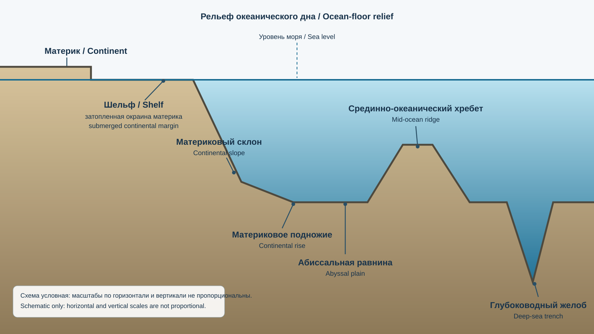
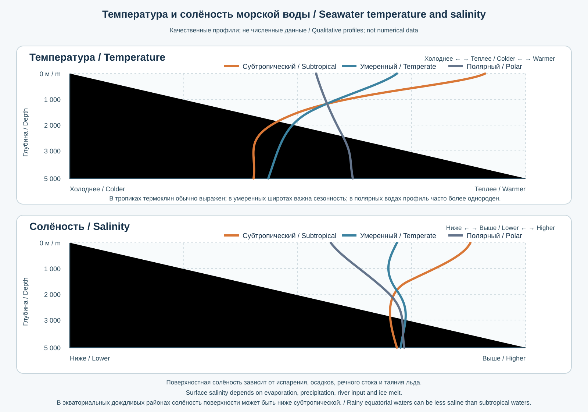

# Глава 6. Гидросфера и Мировой океан
# Chapter 6. The Hydrosphere and the World Ocean

> **Статус:** рабочая текстовая редакция. Перед публикацией необходимы научная сверка, редактура, подготовка карт и иллюстраций, финальная вёрстка.
> **Языки:** русский / English.

## Введение / Introduction

Гидросфера — водная оболочка Земли, включающая океаны и моря, реки и озёра, ледники и снежный покров, подземные воды, почвенную влагу, атмосферную воду и воду, содержащуюся в организмах. Вода присутствует на планете в жидком, твёрдом и газообразном состояниях и постоянно перемещается между резервуарами.

Мировой океан — единая взаимосвязанная система океанических бассейнов, занимающая около 71% поверхности Земли. Он регулирует климат, поддерживает морские экосистемы, участвует в глобальных циклах углерода и воды и обеспечивает важнейшие транспортные и ресурсные функции.

## 6.1. Вода на Земле: распределение и свойства / Water on Earth: Distribution and Properties

*Источник изображения: U.S. Geological Survey (USGS), Water Science School, «The distribution of water on, in, and above the Earth» (2019). Данные: оценка Игоря Шикломанова, опубликованная в 1993 году; проценты округлены. Изображение используется без изменений; источник и автор данных указаны по подписи USGS. Это оценка, основанная на историческом наборе данных, а не современное измерение.*

**Перевод подписей диаграммы:**  
- **Общий запас воды:** океаны — 96,5%; другая солёная вода — 0,9%; пресная вода — 2,5%.
- **Весь запас пресной воды:** ледники и ледяные щиты — 68,7%; подземные воды — 30,1%; поверхностные и прочие пресные воды — 1,2%.
- **Поверхностные и прочие пресные воды:** подземный лёд и многолетняя мерзлота — 69,0%; озёра — 20,9%; почвенная влага — 3,8%; атмосфера — 3,0%; болота и заболоченные территории — 2,6%; реки — 0,49%; вода в живых организмах — 0,26%.

Важно: три столбца показывают вложенные уровни распределения, а не три независимых доли. Правый столбец раскрывает только категорию «поверхностные и прочие пресные воды» из среднего столбца; его проценты нельзя складывать с долями первого или второго столбца.

Общий объём воды на Земле оценивается примерно в 1,386 млрд км³. Около 96,5% всего объёма приходится на океаны и моря, а приблизительно 2,5% — на пресную воду. Если учитывать также другие солёные резервуары, включая солёные подземные воды и озёра, доля всей солёной воды составляет около 97,5%. Эти оценки округлены; точные доли зависят от классификации резервуаров и используемых данных.

Основные резервуары пресной воды включают ледники и ледяные щиты, подземные воды, озёра и реки, подземный лёд и многолетнюю мерзлоту, почвенную влагу, болота, атмосферную воду и воду в организмах. Большая часть пресной воды заключена в ледниках и подземных водах. Доля воды в реках и озёрах относительно общего запаса воды планеты очень мала, хотя именно эти ресурсы имеют большое значение для экосистем и водоснабжения.

### Важнейшие свойства воды / Key Properties of Water

- Высокая теплоёмкость: вода медленно нагревается и остывает.
- Высокая теплота испарения: испарение переносит значительное количество энергии.
- Полярность молекулы: способствует растворению многих веществ.
- Максимальная плотность пресной воды при температуре около 4 °C при нормальном давлении.
- При замерзании вода расширяется, поэтому лёд обычно менее плотный и плавает.
- Поверхностное натяжение и капиллярные свойства важны для почв и живых организмов.

## 6.2. Круговорот воды в природе / The Hydrological Cycle

*Источник: U.S. Geological Survey (USGS), Water Cycle Diagram (2022; изображение WCD 1, опубликовано в 2023 году). Создано USGS VizLab совместно с Water Resources Mission Area Web Communications Branch. Public Domain; изображение используется без изменений. Стрелки показывают направления движения воды качественно, а не измеренные годовые объёмы или скорости потоков.*

**Перевод основных подписей диаграммы:**  
- **Резервуары (pools):** океан; смешанный и глубинный слои океана; пресные и солёные озёра; пресные и солоноватые водно-болотные угодья; водохранилища; реки; ледяные щиты и ледники; снежный покров; вечная мерзлота; почвенная влага; подземные воды; атмосферная влага над океаном и сушей.
- **Потоки (fluxes):** испарение океана; осадки над океаном и сушей; перенос влаги с океана на сушу; эвапотранспирация; снеготаяние; поверхностный сток; речной сток в замкнутые бассейны и в океан; пополнение запасов подземных вод; подземный сток в океан; океаническая циркуляция.
- **Водопользование и воздействие человека:** бытовое, муниципальное, промышленное, сельскохозяйственное и пастбищное водопользование; городской сток; регулирование рек и водохранилища; осушение водно-болотных угодий; загрязнение вод.

Круговорот воды — непрерывное перемещение воды между океаном, сушей, атмосферой, криосферой и подземными резервуарами под воздействием солнечной энергии и силы тяжести.

Основные процессы:
- испарение с поверхности океанов, водоёмов и почвы;
- транспирация растений;
- конденсация водяного пара;
- перенос влаги атмосферой;
- выпадение осадков;
- инфильтрация воды в почву;
- просачивание в водоносные горизонты;
- поверхностный и подземный сток;
- накопление воды в ледниках и снежном покрове;
- таяние и сублимация.

**Эвапотранспирация** объединяет испарение с поверхности и транспирацию растений. Для водосбора за выбранный период общий принцип баланса записывают так:

\[
\text{Приток} - \text{Отток} = \Delta S,
\]

где \(\Delta S\) — изменение запасов воды. В упрощённом естественном водосборе без внешних перебросок и значимого подземного обмена часто используют запись \(P = ET + R + \Delta S\): осадки равны эвапотранспирации, стоку и изменению запасов. Это не универсальная формула для любого бассейна: при наличии притока и оттока подземных вод, водозабора, сбросов, каналов и водохранилищ эти потоки нужно включать отдельно с правильным знаком. Все члены должны относиться к одной границе территории и одному периоду и выражаться в сопоставимых единицах (например, мм за год).

### Масштабы круговорота / Scales of the Cycle

- Малый океанический цикл: испарение и выпадение осадков над океаном.
- Океан-суша: перенос водяного пара с океана, осадки над сушей и возврат воды стоком.
- Континентальный цикл: повторное испарение и выпадение осадков внутри материка.

## 6.3. Мировой океан: единая система / The World Ocean as an Integrated System

> **[МЕТКА ИЛЛЮСТРАЦИИ 6-B / IMAGE PLACEHOLDER 6-B]** Карта пяти океанов с указанием используемой гидрографической классификации и границы Южного океана.
> **EN:** Map of the five oceans identifying the hydrographic classification used and the boundary of the Southern Ocean.

Мировой океан образует непрерывную водную систему, хотя традиционно его разделяют на отдельные океаны и моря. Границы между океанами условны и определяются географической и гидрографической традицией.

В современной распространённой классификации выделяют пять океанов:
- Тихий;
- Атлантический;
- Индийский;
- Южный;
- Северный Ледовитый.

Южный океан выделяется вокруг Антарктиды; его северную границу часто проводят по параллели 60° ю. ш. Однако это разграничение не является универсально утверждённой границей IHO: действующая официальная публикация IHO S-23 «Limits of Oceans and Seas» датирована 1953 годом и не включает Южный океан, а проект четвёртого издания S-23 2002 года остался рабочим документом и не был утверждён. Поэтому при работе с картами необходимо указывать принятую классификацию и источник границы.

### Площадь и глубина / Area and Depth

Тихий океан — крупнейший и в среднем один из наиболее глубоких океанов. Атлантический океан имеет сложную систему срединно-океанических хребтов и окраинных морей. Индийский океан отличается муссонной сезонностью в северной части. Южный океан играет важную роль в глобальной циркуляции вод. Северный Ледовитый океан — самый маленький и сравнительно мелководный океан.

При публикации точных площадей и средних глубин необходимо использовать одну согласованную гидрографическую классификацию: оценки меняются в зависимости от того, какие моря и окраинные бассейны включены в расчёт.

**Место для иллюстрации 6-B — The Five Oceans.** Политически нейтральная физическая карта океанов с границами выбранной гидрографической системы, ключевыми морями и основными проливами.
**EN production brief:** Prepare a politically neutral physical map of the oceans, showing the boundaries of the selected hydrographic system, major seas and principal straits.

## 6.4. Рельеф океанического дна / Ocean-Floor Relief

*Учебная схема, созданная специально для атласа с помощью ChatGPT. Это не батиметрический профиль конкретного участка океана: формы и их размеры условны, вертикальный и горизонтальный масштабы не пропорциональны, не все элементы обязательно встречаются вместе. / Teaching schematic created specifically for the atlas with ChatGPT assistance. It is not a bathymetric profile of a specific ocean transect: shapes and dimensions are illustrative, vertical and horizontal scales are not proportional, and the features do not necessarily occur together.*

Океаническое дно имеет сложное строение и включает формы, сопоставимые по масштабу с крупнейшими формами рельефа суши.

Основные элементы:
- **Континентальный шельф:** затопленная окраина материка с относительно небольшими глубинами.
- **Континентальный склон:** крутой переход от шельфа к глубоководной части бассейна.
- **Континентальное подножие:** область накопления осадков у основания склона.
- **Абиссальные равнины:** обширные глубоководные относительно ровные поверхности.
- **Срединно-океанические хребты:** протяжённые подводные горные системы, связанные с образованием океанической коры.
- **Глубоководные желоба:** узкие глубокие впадины, часто связанные с зонами субдукции.
- **Подводные горы и гайоты:** изолированные возвышенности; гайоты имеют уплощённые вершины.
- **Островные дуги:** цепи вулканических островов, связанные с субдукционными процессами.

Рельеф океанического дна формируется тектоникой плит, вулканизмом, осадконакоплением, оползнями подводных склонов и эрозионными процессами.

## 6.5. Температура, солёность и плотность морской воды / Seawater Temperature, Salinity and Density

*Схема показывает обобщённые закономерности, а не универсальные профили: реальные значения зависят от океанического бассейна, сезона, широты и водных масс. В дождливых экваториальных районах поверхностная солёность может быть ниже, чем в субтропических зонах испарительного максимума. / The diagram shows generalized patterns, not universal profiles: actual values depend on ocean basin, season, latitude and water masses. In rainy equatorial regions, surface salinity may be lower than in subtropical evaporation-dominated zones.*

Физические свойства морской воды определяют вертикальную устойчивость океана, перемешивание, циркуляцию и распространение морских организмов.

### 6.5.1. Температура / Temperature

Температура поверхности океана зависит от широты, сезона, облачности, ветров и океанических течений. С глубиной температура в большинстве океанических районов уменьшается, но вертикальный профиль различается по широте и бассейнам.

**Термоклин** — слой, в котором температура быстро меняется с глубиной. В тропических и субтропических районах он часто выражен сильнее, чем в высоких широтах.

### 6.5.2. Солёность / Salinity

Солёность характеризует содержание растворённых веществ в морской воде. Практическая солёность \(S_P\) определяется по шкале PSS-78 и является безразмерной величиной; запись «PSU» часто встречается в учебных материалах, но технически некорректна. В системе TEOS-10 для термодинамических расчётов используют абсолютную солёность \(S_A\), выражаемую в г/кг. Поэтому при публикации данных необходимо указывать, какая именно величина приведена. Значение около 35 относится к типичному порядку практической солёности открытого океана, а не к универсальной константе.

Солёность повышается при интенсивном испарении и обычно снижается при выпадении осадков, речном стоке и таянии льда. Значения различаются между морями и океаническими районами.

### 6.5.3. Плотность / Density

Плотность морской воды зависит прежде всего от температуры, солёности и давления. Холодная и более солёная вода обычно плотнее тёплой и менее солёной при сопоставимом давлении. Различия плотности участвуют в формировании глубинной циркуляции.

## 6.6. Волны, приливы и морские течения / Waves, Tides and Ocean Currents

> **[МЕТКА ИЛЛЮСТРАЦИИ 6-D / IMAGE PLACEHOLDER 6-D]** Схемы ветровых волн, приливов и поверхностных/глубинных течений с раздельными причинами формирования.
> **EN:** Diagrams of wind waves, tides and surface/deep currents, with their distinct generating mechanisms.

### 6.6.1. Волны / Waves

Ветровые волны возникают при передаче энергии от ветра поверхности воды. Частицы воды в обычной волне преимущественно совершают орбитальные движения; на большой глубине их траектории близки к круговым, а на мелководье становятся более вытянутыми. Сама форма волны и энергия распространяются дальше, тогда как перенос воды на большие расстояния обычно намного меньше переноса энергии.

Цунами — длинные волны, обычно вызванные внезапным смещением больших объёмов воды при подводных землетрясениях, оползнях или вулканических событиях. В открытом океане цунами могут иметь небольшую высоту, но большую длину волны и скорость; у побережья их высота может резко увеличиваться.

### 6.6.2. Приливы и отливы / Tides

Приливы и отливы связаны прежде всего с гравитационным воздействием Луны и Солнца и движением системы Земля—Луна. География бассейнов, форма берегов, глубина и резонанс существенно влияют на локальную амплитуду приливов.

- **Сизигийные приливы:** возникают вблизи новолуния и полнолуния, когда солнечное и лунное воздействия в основном усиливают друг друга.
- **Квадратурные приливы:** характерны для периодов первой и последней четверти Луны, когда приливный диапазон обычно меньше.

### 6.6.3. Морские течения / Ocean Currents

Течения — устойчивые или повторяющиеся направленные движения морской воды. Их формируют ветры, различия плотности, вращение Земли, конфигурация бассейнов, приливные силы и взаимодействие с рельефом дна.

Различают:
- поверхностные ветровые течения;
- глубинную термохалинную циркуляцию;
- приливные течения;
- прибрежные и локальные течения.

**Место для иллюстрации 6-D — Ocean Motion.** Схема ветровых волн, приливов и поверхностных/глубинных течений с раздельными условными обозначениями.
**EN production brief:** Show wind waves, tides and surface/deep currents using distinct symbols and separate panels or clearly separated layers.

## 6.7. Глобальная океаническая циркуляция / Global Ocean Circulation

> **[МЕТКА ИЛЛЮСТРАЦИИ 6.7-A / IMAGE PLACEHOLDER 6.7-A]** Карта основных поверхностных течений и схема глубинного переноса водных масс. / **EN:** Map of major surface currents and a diagram of deep-water mass transport.

Океан переносит тепло, соль, кислород, углерод и питательные вещества. Поверхностные течения в значительной мере управляются ветрами и вращением Земли, а глубинная циркуляция связана с пространственными различиями плотности и процессами образования водных масс.

### 6.7.1. Океанические круговороты / Ocean Gyres

Крупные субтропические круговороты формируются в основных океанических бассейнах под действием постоянных ветров и силы Кориолиса. Их вращение обычно направлено по часовой стрелке в Северном полушарии и против часовой стрелки в Южном.

### 6.7.2. Термохалинная циркуляция / Thermohaline Circulation

Термохалинная циркуляция связана с различиями температуры и солёности, определяющими плотность воды. Образование плотных глубинных вод происходит в отдельных высокоширотных районах, но современная глобальная циркуляция не является простым конвейером с постоянной скоростью: она включает сложные пути, перемешивание, вихри и обмен с атмосферой.

**Место для иллюстрации 6.7-A — Global Ocean Circulation.** Карта основных поверхностных течений и отдельная упрощённая схема глубинного переноса водных масс; различать наблюдаемые течения и концептуальную модель.
**EN production brief:** Map major surface currents and provide a separate simplified diagram of deep-water mass transport. Distinguish observed currents from the conceptual global circulation model.

## 6.8. Морская вода, химический состав и газообмен / Seawater Chemistry and Gas Exchange

Морская вода содержит растворённые соли, газы, органические вещества и питательные элементы. Основные ионы — хлорид, натрий, сульфат, магний, кальций, калий и бикарбонат.

Океан обменивается с атмосферой углекислым газом и кислородом. Направление и интенсивность обмена зависят от температуры, ветра, биологической активности и разности парциальных давлений газа между воздухом и водой.

### 6.8.1. Закисление океана / Ocean Acidification

Поглощение океаном части антропогенного CO₂ изменяет карбонатную систему морской воды и снижает её pH. Это явление называют закислением океана. Оно не означает, что вся морская вода уже стала кислой в бытовом смысле: речь идёт о снижении pH относительно прежнего уровня.

Изменение химического равновесия уменьшает доступность карбонат-ионов, необходимых многим организмам для формирования раковин и скелетов.

### 6.8.2. Деоксигенация / Ocean Deoxygenation

Снижение содержания растворённого кислорода может происходить из-за потепления, ослабления вентиляции водных масс и разложения органического вещества. В прибрежных районах избыток питательных веществ способен усиливать эвтрофикацию и приводить к гипоксии.

## 6.9. Морские экосистемы и биологическая продуктивность / Marine Ecosystems and Productivity

> **[МЕТКА ИЛЛЮСТРАЦИИ 6.9-A / IMAGE PLACEHOLDER 6.9-A]** Разрез от побережья до открытого океана с литоралью, рифом, пелагиалью, бенталью и глубоководной зоной. / **EN:** Coastal-to-open-ocean cross-section showing the littoral zone, reef, pelagic realm, benthic realm and deep-sea zone.

Океанические экосистемы отличаются по освещённости, глубине, температуре, солёности, доступности питательных веществ и характеру субстрата.

В одной из распространённых учебных схем выделяют следующие экологические зоны (границы и употребление терминов могут различаться в зависимости от дисциплины и принятой классификации):
- литораль — область периодического воздействия приливов;
- сублитораль — мелководная постоянно затопленная зона;
- пелагиаль — толща открытой воды;
- бенталь — дно водоёма;
- абиссаль и хадаль — глубоководные области.

Эти термины описывают разные признаки среды и не образуют единого ряда взаимоисключающих зон: «пелагиаль» и «бенталь» различают толщу воды и дно, литораль и сублитораль характеризуют положение относительно береговой зоны, а абиссаль и хадаль — глубинные области океана. Поэтому одна и та же глубина может относиться, например, к пелагической толще и соответствующей бентальной области дна.

**Фитопланктон** осуществляет фотосинтез в освещённом верхнем слое океана и составляет основу многих морских пищевых сетей. Зоны апвеллинга, где глубинные богатые питательными веществами воды поднимаются к поверхности, часто характеризуются высокой биологической продуктивностью; однако она зависит также от освещённости, устойчивости водной толщи и сезонного поступления питательных веществ.

К важным экосистемам относятся коралловые рифы, мангровые леса, морские травяные луга, солёные марши, открытый океан и глубоководные сообщества.

**Место для иллюстрации 6.9-A — Ocean Ecosystems.** Разрез от побережья до открытого океана с литоралью, рифом, пелагиалью, бенталью и глубоководной зоной.
**EN production brief:** Create a coastal-to-open-ocean cross-section showing the littoral zone, reef, pelagic realm, benthic realm and deep-sea zone. Do not imply that zone boundaries occur at universal depths.

## 6.10. Морские ресурсы и хозяйственное использование океана / Marine Resources and Ocean Uses

Мировой океан обеспечивает человечество:
- биологическими ресурсами и продуктами рыболовства;
- морским транспортом и международными торговыми маршрутами;
- энергетическими ресурсами;
- минеральным сырьём;
- возможностями для туризма и рекреации;
- генетическими и биотехнологическими ресурсами.

Морская аквакультура и рыболовство имеют важное значение для продовольственной безопасности. Их устойчивость зависит от контроля промысловой нагрузки, сохранения местообитаний, борьбы с незаконным промыслом и научно обоснованного управления запасами.

Оффшорная энергетика включает добычу нефти и газа, морские ветровые электростанции и перспективные технологии использования энергии волн и приливов. Каждая технология имеет экологические, экономические и инженерные ограничения.

## 6.11. Загрязнение океана и охрана морской среды / Ocean Pollution and Marine Protection

> **[МЕТКА ИЛЛЮСТРАЦИИ 6.11-A / IMAGE PLACEHOLDER 6.11-A]** Пути поступления загрязнителей с суши, судов и атмосферного переноса, а также меры предотвращения. / **EN:** Pollutant pathways from land, ships and atmospheric transport, with prevention measures.

Основные источники загрязнения:
- пластик и микропластик;
- нефтяные разливы;
- сточные воды и избыток питательных веществ;
- тяжёлые металлы и стойкие химические загрязнители;
- морской мусор с судов и берегов;
- шумовое загрязнение;
- перенос инвазивных видов.

Пластиковые отходы могут травмировать морских животных, попадать в пищевые сети и переноситься на большие расстояния. Микропластик обнаруживается в различных компонентах морской среды, однако последствия для отдельных видов и человека продолжают активно изучаться.

Меры охраны:
- предотвращение поступления мусора и неочищенных стоков;
- сокращение одноразового пластика и улучшение управления отходами;
- контроль судоходства и промысла;
- создание морских охраняемых территорий;
- мониторинг качества воды и состояния экосистем;
- международное сотрудничество.

**Место для иллюстрации 6.11-A — Ocean Pollution Pathways.** Схема путей поступления загрязнителей с суши, судов и атмосферного переноса; показать меры предотвращения на каждом этапе.
**EN production brief:** Diagram pollutant pathways from land, ships and atmospheric transport. Show prevention or mitigation measures at each stage.

## 6.12. Ледники, морской лёд и криосфера / Glaciers, Sea Ice and the Cryosphere

> **[МЕТКА ИЛЛЮСТРАЦИИ 6.12-A / IMAGE PLACEHOLDER 6.12-A]** Компоненты криосферы: ледники, ледяные щиты, морской лёд, сезонный снег и многолетняя мерзлота. / **EN:** Cryosphere components: glaciers, ice sheets, sea ice, seasonal snow and permafrost.

Криосфера включает все компоненты Земли, где вода находится в твёрдом состоянии: ледники, ледяные щиты, морской лёд, сезонный снежный покров, многолетнюю мерзлоту и подземный лёд.

**Ледник** — масса льда на суше, возникающая в результате накопления и уплотнения снега и способная двигаться под действием силы тяжести. Ледники являются важными индикаторами климатических изменений и резервуарами пресной воды.

**Морской лёд** формируется при замерзании морской воды и плавает на поверхности океана. Он отличается от наземного ледникового льда происхождением, солёностью и динамикой.

### Баланс массы ледника / Glacier Mass Balance

Баланс массы — разность между накоплением снега и льда и потерями вследствие таяния, сублимации, откалывания айсбергов и других процессов. Положительный баланс означает увеличение массы за рассматриваемый период, отрицательный — её уменьшение.

**Место для иллюстрации 6.12-A — Cryosphere Components.** Карта и разрез, показывающие ледники, ледяные щиты, морской лёд, сезонный снег и многолетнюю мерзлоту; визуально различать наземный и морской лёд.
**EN production brief:** Use a map and cross-section to show glaciers, ice sheets, sea ice, seasonal snow and permafrost. Visually distinguish land ice from floating sea ice.

## 6.13. Реки и речные бассейны / Rivers and Drainage Basins

> **[МЕТКА ИЛЛЮСТРАЦИИ 6.13-A / IMAGE PLACEHOLDER 6.13-A]** Строение речного бассейна: водораздел, исток, притоки, главное русло, пойма и устье. / **EN:** Drainage-basin anatomy showing the watershed divide, source, tributaries, main channel, floodplain and mouth.

Река — естественный водный поток, движущийся по руслу от истока к устью. Реки получают воду из осадков, таяния снега и льда, подземного питания и притоков.

**Речной бассейн** — территория, с которой поверхностный сток направляется в определённую реку и её притоки. Граница поверхностного водосбора обычно проходит по топографическому водоразделу. Подземный водораздел может не совпадать с ним, поэтому границы поверхностного и подземного водосборов в некоторых геологических условиях различаются.

Ключевые характеристики реки:
- длина;
- площадь бассейна;
- расход воды;
- режим стока;
- уклон русла;
- сезонность и экстремумы.

**Расход воды** — объём воды, проходящий через поперечное сечение русла за единицу времени; обычно выражается в м³/с. Водный режим реки описывает сезонные и многолетние изменения уровня и расхода.

Реки выполняют экологические, транспортные, энергетические и водоснабженческие функции. Плотины и водозаборы меняют естественный режим стока, перенос наносов и миграцию водных организмов.

**Место для иллюстрации 6.13-A — River Basin Anatomy.** Схема бассейна с водоразделом, истоком, притоками, главным руслом, поймой и устьем.
**EN production brief:** Diagram a drainage basin with the watershed divide, source, tributaries, main channel, floodplain and river mouth.

### 6.13.1. Практический пример: оценка расхода воды в реке / Worked Example: Estimating River Discharge

Расход воды показывает, какой объём воды проходит через поперечное сечение реки за одну секунду. Для упрощённой оценки используют формулу:

\[
Q = A \times v,
\]

где Q — расход воды (м³/с), A — площадь поперечного сечения потока (м²), v — средняя скорость течения (м/с).

**Условный пример.** Предположим, что ширина небольшого прямоугольного участка русла равна 8 м, средняя глубина — 0,75 м, а средняя скорость воды по всему сечению — 0,6 м/с.

1. Оценим площадь сечения: A = 8 × 0,75 = 6 м².
2. Рассчитаем расход: Q = 6 × 0,6 = **3,6 м³/с**.

Это означает, что через выбранное сечение в среднем проходит около 3,6 кубического метра воды каждую секунду.

**Почему это приближение?** Естественное русло редко имеет форму прямоугольника, глубина и скорость меняются от берега к берегу и по глубине. Для точного измерения сечение делят на несколько участков, измеряют глубину и скорость в каждом из них, а затем суммируют частичные расходы. Измерение следует проводить безопасным способом и фиксировать дату, уровень воды и место наблюдения.

**Проверьте себя:** если площадь сечения составляет 4 м², а средняя скорость — 0,5 м/с, чему равен расход?

### Worked Example: Estimating River Discharge

Discharge is the volume of water passing through a river cross-section each second. A simplified estimate uses:

\[
Q = A \times v,
\]

where Q is discharge (m³/s), A is the cross-sectional area of flow (m²), and v is the mean flow velocity (m/s).

**Hypothetical example.** Suppose a small river section is approximated as rectangular, 8 m wide and 0.75 m deep on average. The mean velocity across the whole section is 0.6 m/s.

1. Estimate the cross-sectional area: A = 8 × 0.75 = 6 m².
2. Calculate discharge: Q = 6 × 0.6 = **3.6 m³/s**.

This means that approximately 3.6 cubic metres of water pass through the selected cross-section each second, on average.

**Why is this an approximation?** A natural channel is rarely rectangular, and depth and velocity vary across the channel and with depth. For a more accurate measurement, divide the cross-section into several subsections, measure depth and velocity in each, and add the partial discharges. Measurements must be made safely, with the date, water level and observation location recorded.

**Check your understanding:** If the cross-sectional area is 4 m² and mean velocity is 0.5 m/s, what is the discharge?

---

## 6.14. Озёра и внутренние водоёмы / Lakes and Inland Waters

> **[МЕТКА ИЛЛЮСТРАЦИИ 6.14-A / IMAGE PLACEHOLDER 6.14-A]** Типы озёрных котловин и разрез стратифицированного озера. / **EN:** Types of lake basins and a cross-section of a stratified lake.

Озеро — естественный водоём в углублении суши, не имеющий прямого свободного соединения с океаном. Искусственные водоёмы, созданные плотинами или выемкой грунта, корректнее называть водохранилищами или искусственными прудами, хотя в повседневной речи их иногда называют искусственными озёрами. Озёра различаются по происхождению, глубине, солёности, водному балансу и биологической продуктивности.

По происхождению котловин выделяют:
- тектонические;
- ледниковые;
- вулканические;
- карстовые;
- запрудные;
- термокарстовые;
- остаточные и другие.

По водному балансу озёра бывают сточными и бессточными. В бессточных водоёмах соли могут накапливаться вследствие испарения, что способствует формированию солёных озёр.

**Эвтрофикация** — обогащение водоёма питательными веществами, прежде всего соединениями азота и фосфора. Чрезмерная эвтрофикация может вызывать цветение воды, снижение прозрачности и дефицит кислорода.

**Место для иллюстрации 6.14-A — Lake Types and Lake Structure.** Сравнить тектоническую, ледниковую, вулканическую и карстовую котловины; дополнить разрезом стратифицированного озера.
**EN production brief:** Compare tectonic, glacial, volcanic and karst lake basins, and add a cross-section of a stratified lake.

## 6.15. Подземные воды / Groundwater

> **[МЕТКА ИЛЛЮСТРАЦИИ 6.15-A / IMAGE PLACEHOLDER 6.15-A]** Геологический разрез водоносной системы с зоной аэрации, уровнем грунтовых вод, водоносными горизонтами, водоупорами, скважинами и источником. / **EN:** Geological cross-section of a groundwater system showing the unsaturated zone, water table, aquifers, aquitards, wells and a spring.

Подземные воды находятся в порах, трещинах и полостях горных пород. Они формируются преимущественно за счёт инфильтрации атмосферных осадков и поверхностных вод, хотя в отдельных геологических условиях возможны и другие источники.

Основные понятия:
- **Водоносный горизонт:** геологическое тело, способное накапливать и передавать подземную воду.
- **Водоупор:** слой с очень низкой проницаемостью, ограничивающий движение воды.
- **Уровень грунтовых вод:** верхняя граница зоны насыщения в безнапорном водоносном горизонте.
- **Артезианская вода:** вода в напорном водоносном горизонте, давление которой может поднимать её выше кровли горизонта.
- **Источник:** естественный выход подземной воды на поверхность.

Подземные воды важны для питьевого водоснабжения, сельского хозяйства и поддержания речного стока в засушливые сезоны. Их уязвимость зависит от глубины, проницаемости пород, времени обновления и характера землепользования.

**Место для иллюстрации 6.15-A — Groundwater System.** Геологический разрез с зоной аэрации, уровнем грунтовых вод, водоносными горизонтами, водоупорами, скважинами и источником.
**EN production brief:** Draw a geological cross-section showing the unsaturated zone, water table, aquifers, aquitards, wells and a spring.

## 6.16. Водные ресурсы, дефицит и управление / Water Resources, Scarcity and Management

Водные ресурсы распределены крайне неравномерно. Доступность воды определяется не только общим объёмом, но и сезонностью стока, качеством воды, инфраструктурой, экономическими условиями и трансграничным управлением.

Различают:
- физический дефицит воды — недостаточность доступных водных ресурсов;
- экономический дефицит — недостаток инфраструктуры и возможностей для доступа к воде;
- сезонный дефицит — временное несоответствие между спросом и доступностью;
- дефицит качественной воды — загрязнение или природные ограничения состава воды.

Интегрированное управление водными ресурсами рассматривает бассейн как единую систему и учитывает интересы населения, сельского хозяйства, энергетики, промышленности и экосистем.

Ключевые инструменты:
- мониторинг поверхностных и подземных вод;
- водосберегающие технологии;
- очистка и повторное использование воды;
- восстановление водно-болотных угодий;
- экологические попуски;
- трансграничные соглашения и обмен данными.

## 6.17. Вода и климатические изменения / Water and Climate Change

> **[МЕТКА ИЛЛЮСТРАЦИИ 6.17-A / IMAGE PLACEHOLDER 6.17-A]** Причинно-следственная схема влияния потепления на снег, ледники, испарение, осадки, сток и гидрологические экстремумы. / **EN:** Cause-and-effect diagram showing how warming affects snow, glaciers, evaporation, precipitation, runoff and hydrological extremes.

Изменение климата воздействует на гидрологический цикл через изменение испарения, интенсивности осадков, снегового накопления, таяния ледников и частоты экстремальных событий.

В разных регионах могут усиливаться:
- интенсивные ливни и паводки;
- продолжительные засухи;
- сезонные колебания стока;
- риски для ледниковых озёр и горных долин;
- конкуренция между секторами за водные ресурсы.

Последствия зависят от географии, инфраструктуры и способности общества адаптироваться. Изменение осадков и стока не следует описывать как одинаковое для всех регионов.

**Место для иллюстрации 6.17-A — Climate Change and the Water Cycle.** Причинно-следственная схема влияния потепления на снег, ледники, испарение, осадки, сток и экстремальные гидрологические явления.
**EN production brief:** Create a cause-and-effect diagram showing how warming can affect snow, glaciers, evaporation, precipitation, runoff and hydrological extremes. Distinguish observed trends from projections where data are shown.

### 6.17.1. Как составить простой водный баланс водосбора / Building a Simple Catchment Water Balance

Для водосбора за выбранный период можно представить упрощённый баланс:

`Изменение запасов = осадки − испарение и транспирация − сток`

Эта краткая запись предполагает, что внешние переброски и подземный обмен несущественны либо уже учтены. Для более полного баланса используют принцип «все поступления − все потери = изменение запасов»: к поступлениям могут относиться осадки, поверхностный и подземный приток, а также переброска воды в бассейн; к потерям — эвапотранспирация, сток через выходной створ, подземный отток и переброска воды за пределы бассейна. Все компоненты должны относиться к одной и той же границе водосбора и одному периоду и быть приведены к сопоставимым единицам (например, миллиметрам слоя воды или объёму за период). Водозабор внутри бассейна сам по себе не обязательно является потерей: если вода возвращается в реку или подземные воды, возвратный поток учитывают отдельно; потерей становится только вода, испарённая, включённая в продукцию или перенесённая за границу бассейна. Водохранилище внутри выбранной границы относится к запасам воды, поэтому его изменение учитывают в ΔS, а не повторно как внешний приток или отток.

**Учебный пример.** За год на водосбор выпало 600 мм осадков, оценённая суммарная эвапотранспирация составила 350 мм, а слой стока на выходе водосбора — 220 мм. Здесь расход воды, измеренный в выходном створе, уже пересчитан в эквивалентный слой воды по площади водосбора; поэтому все три величины выражены в миллиметрах за один и тот же год. Остаток баланса равен 30 мм. Его нельзя автоматически объявлять ошибкой измерений или новым запасом воды: он может отражать изменение запасов в почве, снегу, ледниках, озёрах и подземных водах, неучтённые потоки, а также погрешности оценок.

**Практическая последовательность:** очертить границу водосбора; определить период; собрать осадки и расход воды; оценить эвапотранспирацию подходящим методом; учесть снегозапасы, ледники, водохранилища и водозаборы; рассчитать остаток и обсудить неопределённость. В горных районах Кыргызстана особенно важно не считать снег и ледниковый лёд неизменными запасами: их накопление и таяние меняются по сезонам и годам.

**Задание.** Рассчитайте остаток баланса для приведённых данных и перечислите не менее четырёх возможных причин его ненулевого значения. Объясните, почему баланс за один год не обязательно характеризует долгосрочное состояние водосбора.

For a catchment over a selected period, the general mass-balance principle is:

`All inflows − all outflows = change in storage (ΔS)`

Inflows may include precipitation, surface-water and groundwater inflow, and water transferred into the catchment. Outflows may include evapotranspiration, streamflow at the outlet, groundwater outflow and water transferred beyond the catchment boundary. For a simplified natural catchment with no external transfers and negligible groundwater exchange, this is often written as `P = ET + R + ΔS`, where P is precipitation, ET is evapotranspiration and R is runoff. A water withdrawal within the catchment is not automatically a net loss: return flow to a river or aquifer must be counted, and only water consumed, evaporated or transferred beyond the catchment is a loss from the chosen control volume. A reservoir located inside the catchment is part of water storage, so its change belongs in ΔS rather than being counted again as an external inflow or outflow. All terms must refer to the same catchment boundary and period and use consistent units, such as millimetres of water depth or volume per period.

**Worked example.** Annual precipitation over a catchment is 600 mm, estimated evapotranspiration is 350 mm, and the runoff depth at the catchment outlet is 220 mm. The discharge measured at the outlet has already been converted into an equivalent water depth over the catchment area; all three quantities are therefore expressed in millimetres for the same year. The balance residual is 30 mm. It should not automatically be labelled a measurement error or a new water store: it may reflect changes in soil moisture, snow, glaciers, lakes and groundwater, unaccounted flows, or uncertainty in the estimates.

**Practical sequence:** delineate the catchment; define the period; collect precipitation and streamflow data; estimate evapotranspiration with an appropriate method; account for snow storage, glaciers, reservoirs and abstractions; calculate the residual and discuss uncertainty. In the mountains of Kyrgyzstan, snow and glacier ice must not be treated as constant stores: accumulation and melting vary by season and year.

**Activity.** Calculate the residual from the data above and list at least four possible reasons why it is not zero. Explain why a one-year balance does not necessarily describe the long-term condition of a catchment.

## Итоги главы / Chapter Summary

1. Гидросфера включает океанические, поверхностные, подземные, атмосферные и замёрзшие воды.
2. Основная часть воды Земли солёная; большая часть пресной воды сосредоточена в ледниках и подземных резервуарах.
3. Круговорот воды связывает океан, сушу, атмосферу и криосферу.
4. Мировой океан представляет собой единую взаимосвязанную систему бассейнов.
5. Рельеф океанического дна отражает тектоническое строение и историю океанических бассейнов.
6. Температура, солёность и плотность определяют многие особенности океанической циркуляции.
7. Волны, приливы и течения переносят энергию и вещество.
8. Морские и пресноводные экосистемы зависят от качества воды, питательных веществ и физических условий.
9. Реки, озёра и подземные воды обеспечивают население и хозяйство пресной водой.
10. Устойчивое управление водными ресурсами требует бассейнового подхода и международного сотрудничества.

## Ключевые понятия / Key Terms

Гидросфера — Hydrosphere; водный резервуар — Water reservoir; круговорот воды — Hydrological cycle; испарение — Evaporation; транспирация — Transpiration; инфильтрация — Infiltration; речной бассейн — Drainage basin; водораздел — Watershed divide; расход воды — River discharge; водный баланс — Water balance; солёность — Salinity; практическая солёность — Practical Salinity; абсолютная солёность — Absolute Salinity; термоклин — Thermocline; плотность морской воды — Seawater density; прилив — Tide; океанический круговорот — Ocean gyre; термохалинная циркуляция — Thermohaline circulation; закисление океана — Ocean acidification; деоксигенация океана — Ocean deoxygenation; водоносный горизонт — Aquifer; водоупор — Aquitard; уровень грунтовых вод — Water table; физический дефицит воды — Physical water scarcity; экономический дефицит воды — Economic water scarcity.

## Контрольные вопросы / Review Questions

1. Как распределена вода между солёными и пресными резервуарами?
2. Какие свойства воды особенно важны для климата?
3. Какие процессы составляют круговорот воды?
4. Какие пять океанов часто выделяют в современных источниках и почему при обозначении границы Южного океана важно указывать используемую классификацию?
5. Чем континентальный шельф отличается от континентального склона?
6. Как температура и солёность влияют на плотность морской воды?
7. Чем ветровые волны отличаются от цунами?
8. Как возникают приливы и отливы?
9. Чем поверхностные течения отличаются от глубинной циркуляции?
10. Что такое закисление океана?
11. Какие факторы влияют на биологическую продуктивность океана?
12. Чем ледник отличается от морского льда?
13. Что такое речной бассейн и водораздел?
14. Как формируются подземные воды?
15. Чем физический дефицит воды отличается от экономического?
16. Как изменение климата влияет на гидрологический цикл?

## Практическая работа / Practical Assignment

> **[МЕТКА ИЛЛЮСТРАЦИИ 6.18-A / IMAGE PLACEHOLDER 6.18-A]** Учебная карта речного бассейна, таблица водного баланса и график сезонного расхода реки. / **EN:** Teaching map of a river basin, water-balance table and seasonal river-discharge graph.

**Задание: анализ водного баланса и речного бассейна.**

Рассмотрите условный речной бассейн площадью 10 000 км². За год средняя высота осадков составила 800 мм, фактическая эвапотранспирация — 500 мм, а увеличение запасов воды в почве, водоносных горизонтах и водоёмах — 50 мм.

Для упрощённого годового баланса без межбассейнового переноса используйте:

\[
P = ET + R + \Delta S,
\]

где P — осадки, ET — эвапотранспирация, R — слой стока, ΔS — изменение запасов воды.

1. Рассчитайте слой стока R в миллиметрах.
2. Переведите слой стока в объём воды для всего бассейна в км³.
3. Используя объём стока, рассчитанный в пункте 2, оцените средний расход воды в створе реки в м³/с. Примите продолжительность года равной 365 суткам и используйте формулу Q = V/t.
4. Объясните, почему фактический расход в отдельные месяцы будет отличаться от среднегодового.
5. Назовите два фактора, которые могут изменить водный баланс бассейна, и предложите три меры устойчивого управления водой.
6. На карте выделите водораздел, главное русло и основные притоки; объясните, по каким признакам определяется граница водосбора.
7. Объясните, как изменение землепользования (вырубка леса, застройка, распашка склонов или уплотнение почвы) может повлиять на паводки, эрозию и качество воды.

**Проверка расчётов:** слой стока равен 250 мм, или 0,25 м. Площадь бассейна 10 000 км² равна 10 000 000 000 м². Объём стока: 0,25 × 10 000 000 000 = 2 500 000 000 м³ = 2,5 км³. В году 365 × 24 × 60 × 60 = 31 536 000 секунд. Средний расход: Q = 2 500 000 000 / 31 536 000 ≈ **79,3 м³/с**. Это среднее значение за год; фактический расход меняется по сезонам и дням.

Дополнительное задание: сравните два океанических региона по температуре поверхности, солёности и направлению основных течений, используя карту и данные с указанием периода наблюдений.

**Место для иллюстрации 6.18-A — Hydrological Basin Exercise.** Учебная карта бассейна, таблица водного баланса и график сезонного расхода реки.
**EN production brief:** Prepare a teaching basin map, a water-balance table and a seasonal river-discharge graph. Label all data as hypothetical unless they are taken from a named, dated source.

## English-language chapter text

### Introduction

The hydrosphere is Earth's water envelope. It includes oceans and seas, rivers and lakes, glaciers and snow cover, groundwater, soil moisture, atmospheric water and water contained in organisms. Water occurs on the planet in liquid, solid and gaseous states and moves continuously between reservoirs.

The world ocean is one interconnected system of ocean basins, covering about 71% of Earth's surface. It regulates climate, supports marine ecosystems, participates in global carbon and water cycles, and provides important transport and resource functions.

### 6.1. Water on Earth: Distribution and Properties

*Image source: U.S. Geological Survey (USGS), Water Science School, “The distribution of water on, in, and above the Earth” (2019). Data source: Igor Shiklomanov's estimate published in 1993; percentages are rounded. The image is reused unchanged, with the USGS source and data author credited. This is a historical estimate, not a current measurement.*

**Translation of diagram labels:**
- **Total global water:** oceans — 96.5%; other saline water — 0.9%; freshwater — 2.5%.
- **All freshwater:** glaciers and ice caps — 68.7%; groundwater — 30.1%; surface and other freshwater — 1.2%.
- **Surface and other freshwater:** ground ice and permafrost — 69.0%; lakes — 20.9%; soil moisture — 3.8%; atmosphere — 3.0%; swamps and marshes — 2.6%; rivers — 0.49%; water in living things — 0.26%.

The three bars show nested levels, not three independent shares. The right-hand bar breaks down only the “surface and other freshwater” category from the middle bar; its percentages must not be added to those in the first or second bar.

The total volume of water on Earth is estimated at about 1.386 billion km³. About 96.5% of the total is held in oceans and seas, while approximately 2.5% is freshwater. When other saline reservoirs, including saline groundwater and lakes, are also counted, all saline water together makes up about 97.5%. These figures are rounded; exact proportions depend on how reservoirs are classified and on the data used.

The main freshwater reservoirs include glaciers and ice sheets, groundwater, lakes and rivers, ground ice and permafrost, soil moisture, wetlands, atmospheric water and water in living organisms. Most freshwater is stored in glaciers and groundwater. The share held in rivers and lakes is very small compared with the planet's total water, although these resources are highly important for ecosystems and water supply.

Important properties of water include:
- **high heat capacity:** water warms and cools relatively slowly;
- **high latent heat of vaporisation:** evaporation transfers substantial energy;
- **molecular polarity:** water dissolves many substances;
- **maximum density of freshwater near 4°C** at normal pressure;
- **expansion on freezing:** ice is usually less dense than liquid water and floats; and
- **surface tension and capillarity**, which are important in soils and living organisms.

### 6.2. The Hydrological Cycle

*Source: U.S. Geological Survey (USGS), Water Cycle Diagram (2022; image WCD 1, published in 2023). Created by USGS VizLab with the Water Resources Mission Area Web Communications Branch. Public Domain; reused unchanged. Arrows show qualitative directions of water movement, not measured annual volumes or flow rates.*

**Key translation of diagram labels:**
- **Pools:** ocean; ocean mixed and deep-water zones; fresh and saline lakes; fresh and brackish wetlands; reservoirs; rivers; ice sheets and glaciers; snowpack; permafrost; soil moisture; groundwater; atmospheric moisture over ocean and land.
- **Fluxes:** ocean evaporation; precipitation over ocean and land; transport of moisture from ocean to land; evapotranspiration; snowmelt; surface runoff; streamflow to closed basins and to the ocean; groundwater recharge; groundwater discharge to the ocean; ocean circulation.
- **Human water use and impacts:** domestic, municipal, industrial, agricultural and grazing water use; urban runoff; river regulation and reservoirs; wetland drainage; water pollution.

The hydrological cycle is the continuous movement of water among the ocean, land, atmosphere, cryosphere and underground reservoirs, driven by solar energy and gravity.

Its main processes include evaporation from oceans, water bodies and soil; plant transpiration; condensation; atmospheric moisture transport; precipitation; infiltration into soil; percolation into aquifers; surface and groundwater runoff; storage in glaciers and snow cover; melting; and sublimation.

**Evapotranspiration** combines evaporation from surfaces and transpiration by plants. For a catchment over a selected period, the general water-balance principle is:

\[
\text{Inflow} - \text{Outflow} = \Delta S,
\]

where \(\Delta S\) is the change in water storage. For a simplified natural catchment with no external transfers and negligible groundwater exchange, this is often written as \(P = ET + R + \Delta S\): precipitation equals evapotranspiration, runoff and the change in storage. This is not a universal formula for every basin. Where groundwater inflow or outflow, water withdrawals, return flows, canals or reservoirs are significant, those terms must be included separately with the correct sign. All terms must refer to the same catchment boundary and period and use consistent units (for example, millimetres per year).

The cycle operates at different scales:
- a **small oceanic cycle**, with evaporation and precipitation occurring over the ocean;
- an **ocean-to-land cycle**, in which atmospheric moisture moves from the ocean, falls as precipitation over land and returns through runoff; and
- a **continental cycle**, in which moisture is repeatedly evaporated and precipitated within a continent.

### 6.3. The World Ocean as an Integrated System

The world ocean is a continuous water system, although it is traditionally divided into individual oceans and seas. Boundaries between oceans are conventional and depend on geographical and hydrographic traditions.

Many modern educational and scientific sources recognise five oceans: the Pacific, Atlantic, Indian, Southern and Arctic. The Southern Ocean surrounds Antarctica, and its northern boundary is often drawn at 60° S. However, this is not a universally adopted IHO boundary: the current official IHO publication S-23, *Limits of Oceans and Seas*, dates from 1953 and does not include the Southern Ocean, while the 2002 draft of the fourth edition remained a working document and was not approved. Maps should therefore identify the classification and boundary source used.

The Pacific is the largest ocean and one of the deepest on average. The Atlantic has a complex system of mid-ocean ridges and marginal seas. The northern Indian Ocean is strongly influenced by monsoon seasonality. The Southern Ocean plays an important role in global water circulation. The Arctic is the smallest and comparatively shallowest ocean.

Exact areas and mean depths should be taken from one consistent hydrographic classification because estimates vary according to which seas and marginal basins are included.

### 6.4. Ocean-Floor Relief

*Teaching schematic created specifically for the atlas with ChatGPT assistance. It is not a bathymetric profile of a specific ocean transect: shapes and dimensions are illustrative, vertical and horizontal scales are not proportional, and the features do not necessarily occur together.*

The ocean floor has a complex structure and includes features comparable in scale to the largest landforms on continents.

Major features include:
- the **continental shelf**, the relatively shallow submerged edge of a continent;
- the **continental slope**, the steep transition from the shelf to the deep basin;
- the **continental rise**, where sediments accumulate near the base of the slope;
- **abyssal plains**, extensive, relatively flat deep-ocean areas;
- **mid-ocean ridges**, long submarine mountain systems associated with the formation of oceanic crust;
- **deep-sea trenches**, narrow, very deep depressions often associated with subduction;
- **seamounts and guyots**, isolated submarine elevations, with guyots having flat tops; and
- **island arcs**, chains of volcanic islands associated with subduction.

Ocean-floor relief is shaped by plate tectonics, volcanism, sedimentation, submarine slope failures and erosional processes.

### 6.5. Seawater Temperature, Salinity and Density

*The diagram shows generalized patterns, not universal profiles: actual values depend on ocean basin, season, latitude and water masses. In rainy equatorial regions, surface salinity may be lower than in subtropical evaporation-dominated zones.*

The physical properties of seawater influence vertical stability, mixing, circulation and the distribution of marine organisms.

### 6.5.1. Temperature

Temperature at the ocean surface depends on latitude, season, cloud cover, winds and currents. Temperature generally decreases with depth in most ocean regions, but the vertical profile varies between latitudes and basins. A **thermocline** is a layer in which temperature changes rapidly with depth; it is often more pronounced in tropical and subtropical waters than at high latitudes.

### 6.5.2. Salinity

Salinity describes dissolved material in seawater. Practical Salinity \(S_P\), defined on the PSS-78 scale, is dimensionless; the label “PSU” is common in teaching materials but is technically incorrect. For thermodynamic calculations, TEOS-10 uses Absolute Salinity \(S_A\), expressed in g/kg. Published values should therefore identify which salinity variable is being reported. A value near 35 is typical of open-ocean Practical Salinity, not a universal constant. Salinity tends to rise with strong evaporation and decrease with precipitation, river inflow and ice melt. Values vary among seas and ocean regions.

### 6.5.3. Density

Density depends mainly on temperature, salinity and pressure. At comparable pressure, colder and saltier water is generally denser than warmer and less saline water. Density differences help drive deep-ocean circulation.

### 6.6. Waves, Tides and Ocean Currents

### 6.6.1. Waves

Wind waves form when energy is transferred from the wind to the water surface. Water particles in an ordinary wave mainly move in orbital paths, while the wave form and energy propagate onward.

A **tsunami** is a long wave usually caused by the sudden displacement of large volumes of water during submarine earthquakes, landslides or volcanic events. In the open ocean, a tsunami may have a small height but a very long wavelength and high speed; its height can increase sharply near a coast.

### 6.6.2. Tides

Tides are caused mainly by the gravitational effects of the Moon and Sun and the motion of the Earth–Moon system. Basin geography, coastline shape, depth and resonance strongly influence local tidal range. Spring tides occur near new and full moons, when solar and lunar effects generally reinforce one another. Neap tides occur near the first and last quarter moons, when the tidal range is usually smaller.

### 6.6.3. Ocean Currents

Ocean currents are persistent or recurring directed movements of seawater. They are driven by winds, density differences, Earth's rotation, basin geometry, tidal forces and interactions with the ocean floor. Types include surface wind-driven currents, deep thermohaline circulation, tidal currents and coastal or local currents.

### 6.7. Global Ocean Circulation

The ocean transports heat, salt, oxygen, carbon and nutrients. Surface currents are largely driven by winds and Earth's rotation, while deep circulation is associated with spatial differences in water density and the formation of water masses.

### 6.7.1. Ocean Gyres

Large subtropical ocean gyres form in the main ocean basins under the influence of prevailing winds and the Coriolis effect. They generally rotate clockwise in the Northern Hemisphere and counterclockwise in the Southern Hemisphere.

### 6.7.2. Thermohaline Circulation

Thermohaline circulation is associated with temperature and salinity differences that determine water density. Dense deep waters form in certain high-latitude regions. Modern global circulation is not a simple conveyor belt moving at a constant speed: it includes complex pathways, mixing, eddies and exchanges with the atmosphere.

### 6.8. Seawater Chemistry and Gas Exchange

Seawater contains dissolved salts, gases, organic substances and nutrients. Its main ions include chloride, sodium, sulphate, magnesium, calcium, potassium and bicarbonate.

The ocean exchanges carbon dioxide and oxygen with the atmosphere. The direction and intensity of exchange depend on temperature, wind, biological activity and differences in gas partial pressure between air and water.

### 6.8.1. Ocean Acidification

Ocean acidification occurs when the ocean absorbs part of human-caused CO₂ emissions, changing the carbonate system and lowering seawater pH. It does not mean that all seawater has become acidic in the everyday sense; it refers to a decline in pH relative to an earlier level. The chemical change reduces the availability of carbonate ions needed by many organisms to build shells and skeletons.

### 6.8.2. Ocean Deoxygenation

Ocean deoxygenation is a decline in dissolved oxygen. It may result from warming, weaker ventilation of water masses and decomposition of organic matter. In coastal areas, excess nutrients can intensify eutrophication and lead to hypoxia.

### 6.9. Marine Ecosystems and Productivity

Ocean ecosystems differ in light, depth, temperature, salinity, nutrient availability and substrate.

One commonly used teaching classification distinguishes the **littoral**, periodically affected by tides; the **sublittoral**, a shallow permanently submerged zone; the **pelagic zone**, the open-water column; the **benthic zone**, the seabed; and the **abyssal and hadal zones**, the deepest regions. Exact boundaries and terminology vary among disciplines and classification systems.

These terms describe different dimensions of the marine environment and are not one mutually exclusive series: “pelagic” and “benthic” distinguish the water column from the seabed, littoral and sublittoral describe position relative to the shore, and abyssal and hadal refer to deep-ocean depth zones. Thus, a given depth can include both a pelagic water column and its corresponding benthic seafloor.

**Phytoplankton** photosynthesises in the sunlit upper ocean and forms the base of many marine food webs. Upwelling zones, where deep nutrient-rich water rises towards the surface, often have high biological productivity; however, productivity also depends on light, water-column stability and the seasonal supply of nutrients.

Important ecosystems include coral reefs, mangrove forests, seagrass meadows, salt marshes, the open ocean and deep-sea communities.

### 6.10. Marine Resources and Ocean Uses

The world ocean provides biological resources and fisheries products, maritime transport and international trade routes, energy resources, mineral raw materials, tourism and recreation opportunities, and genetic and biotechnological resources.

Marine aquaculture and fisheries are important to food security. Their sustainability depends on controlling fishing pressure, conserving habitats, combating illegal fishing and managing stocks on a scientific basis.

Offshore energy includes oil and gas extraction, offshore wind farms and emerging technologies that use wave and tidal energy. Each technology has environmental, economic and engineering limitations.

### 6.11. Ocean Pollution and Marine Protection

Major sources of ocean pollution include plastics and microplastics, oil spills, wastewater and excess nutrients, heavy metals and persistent chemical pollutants, marine litter from ships and coasts, underwater noise and the transfer of invasive species.

Plastic waste can injure marine animals, enter food webs and travel long distances. Microplastics have been found in different parts of the marine environment, although their effects on particular species and on human health remain an active area of research.

Protection measures include preventing litter and untreated wastewater from entering the ocean, reducing single-use plastics and improving waste management, controlling shipping and fishing, establishing marine protected areas, monitoring water quality and ecosystem condition, and strengthening international cooperation.

### 6.12. Glaciers, Sea Ice and the Cryosphere

The cryosphere includes all parts of Earth where water is in a frozen state: glaciers, ice sheets, sea ice, seasonal snow cover, permafrost and ground ice.

A **glacier** is a mass of land-based ice formed by the accumulation and compaction of snow and capable of moving under gravity. Glaciers are important indicators of climate change and freshwater reservoirs.

**Sea ice** forms when seawater freezes and floats on the ocean surface. It differs from land-based glacier ice in origin, salinity and dynamics.

**Glacier mass balance** is the difference between accumulation of snow and ice and losses through melting, sublimation, iceberg calving and other processes. A positive balance means the glacier gained mass over the period considered; a negative balance means it lost mass.

### 6.13. Rivers and Drainage Basins

A **river** is a natural flow of water moving in a channel from its source to its mouth. Rivers receive water from precipitation, snow and ice melt, groundwater and tributaries.

A **drainage basin** is the area from which surface runoff drains into a particular river and its tributaries. Its surface boundary generally follows a topographic watershed divide. The groundwater divide may differ, so surface-water and groundwater catchment boundaries do not always coincide.

Key river characteristics include length, basin area, discharge, flow regime, channel gradient, seasonality and extremes.

**Discharge** is the volume of water passing through a channel cross-section per unit of time, usually expressed in cubic metres per second (m³/s). A river's flow regime describes seasonal and multi-year changes in water level and discharge.

Rivers have ecological, transport, energy and water-supply functions. Dams and water abstraction change natural flow regimes, sediment transport and the migration of aquatic organisms.

### 6.13.1. Worked Example: Estimating River Discharge

Discharge is the volume of water passing through a river cross-section each second. A simplified estimate uses:

\[
Q = A \times v,
\]

where Q is discharge (m³/s), A is the cross-sectional area of flow (m²), and v is the mean flow velocity (m/s).

**Hypothetical example.** Suppose a small river section is approximated as rectangular, 8 m wide and 0.75 m deep on average. The mean velocity across the whole section is 0.6 m/s.

1. Estimate the cross-sectional area: A = 8 × 0.75 = 6 m².
2. Calculate discharge: Q = 6 × 0.6 = **3.6 m³/s**.

This means that approximately 3.6 cubic metres of water pass through the selected cross-section each second, on average.

**Why is this an approximation?** A natural channel is rarely rectangular, and depth and velocity vary across the channel and with depth. For a more accurate measurement, divide the cross-section into several subsections, measure depth and velocity in each, and add the partial discharges. Measurements must be made safely, with the date, water level and observation location recorded.

**Check your understanding:** If the cross-sectional area is 4 m² and mean velocity is 0.5 m/s, what is the discharge?

---

### 6.14. Lakes and Inland Waters

A **lake** is a natural inland water body occupying a depression in the land surface and lacking a direct, freely flowing connection to the ocean. Artificial water bodies created by dams or excavation are more precisely called reservoirs or artificial ponds, although they are sometimes referred to informally as artificial lakes. Lakes differ in origin, depth, area, water balance, salinity and ecological condition.

By origin, lake basins may be tectonic, glacial, volcanic, karst, dammed, thermokarst or residual. By water balance, lakes may be outflowing or closed. In closed lakes, salts may accumulate through evaporation, producing saline water.

**Eutrophication** is the enrichment of a water body with nutrients, especially nitrogen and phosphorus compounds. Excessive eutrophication can cause algal blooms, reduced water transparency and oxygen depletion.

### 6.15. Groundwater

Groundwater occurs in pores, fractures and cavities in rocks. It is replenished mainly by infiltration of precipitation and surface water, although other sources may contribute under particular geological conditions.

Key concepts include:
- an **aquifer**, a geological body able to store and transmit groundwater;
- an **aquitard or confining layer**, a layer of very low permeability that restricts water movement;
- the **water table**, the upper surface of the saturated zone in an unconfined aquifer;
- **artesian water**, groundwater in a confined aquifer under pressure that may rise above the top of the aquifer; and
- a **spring**, a natural discharge of groundwater at the surface.

Groundwater is important for drinking-water supply, agriculture and sustaining river flow during dry seasons. Its vulnerability depends on depth, rock permeability, renewal time and land use.

### 6.16. Water Resources, Scarcity and Management

Water resources are distributed very unevenly. Availability depends not only on total volume but also on seasonal flow, water quality, infrastructure, economic conditions and transboundary management.

Different forms of scarcity include:
- **physical scarcity:** insufficient available water resources;
- **economic scarcity:** insufficient infrastructure or capacity to access water;
- **seasonal scarcity:** a temporary mismatch between demand and availability; and
- **scarcity of safe water:** pollution or naturally unsuitable water quality.

Integrated water-resources management treats a basin as one system and considers the needs of communities, agriculture, energy, industry and ecosystems.

Key tools include monitoring surface water and groundwater, water-saving technologies, treatment and reuse, wetland restoration, environmental flows, transboundary agreements and data exchange.

### 6.17. Water and Climate Change

Climate change affects the hydrological cycle through changes in evaporation, precipitation intensity, snow accumulation, glacier melt and the frequency of extreme events.

Some regions may experience stronger intense rainfall and floods, longer droughts, seasonal changes in runoff, increased risks to glacial lakes and mountain valleys, and greater competition between sectors for water. Impacts depend on geography, infrastructure and society's capacity to adapt. Changes in precipitation and runoff should not be described as identical across all regions.

### 6.17.1. Building a Simple Catchment Water Balance

For a catchment over a selected period, the general mass-balance principle is:

`All inflows − all outflows = change in storage (ΔS)`

Inflows may include precipitation, surface-water and groundwater inflow, and water transferred into the catchment. Outflows may include evapotranspiration, streamflow at the outlet, groundwater outflow and water transferred beyond the catchment boundary. For a simplified natural catchment with no external transfers and negligible groundwater exchange, this is often written as `P = ET + R + ΔS`, where P is precipitation, ET is evapotranspiration and R is runoff. A water withdrawal within the catchment is not automatically a net loss: return flow to a river or aquifer must be counted, and only water consumed, evaporated or transferred beyond the catchment is a loss from the chosen control volume. A reservoir located inside the catchment is part of water storage, so its change belongs in ΔS rather than being counted again as an external inflow or outflow. All terms must refer to the same catchment boundary and period and use consistent units, such as millimetres of water depth or volume per period.

**Worked example.** Annual precipitation over a catchment is 600 mm, estimated evapotranspiration is 350 mm, and the runoff depth at the catchment outlet is 220 mm. The discharge measured at the outlet has already been converted into an equivalent water depth over the catchment area; all three quantities are therefore expressed in millimetres for the same year. The balance residual is 30 mm. It should not automatically be labelled a measurement error or a new water store: it may reflect changes in soil moisture, snow, glaciers, lakes and groundwater, unaccounted flows, or uncertainty in the estimates.

**Practical sequence:** delineate the catchment; define the period; collect precipitation and streamflow data; estimate evapotranspiration with an appropriate method; account for snow storage, glaciers, reservoirs and abstractions; calculate the residual and discuss uncertainty. In the mountains of Kyrgyzstan, snow and glacier ice must not be treated as constant stores: accumulation and melting vary by season and year.

**Activity.** Calculate the residual from the data above and list at least four possible reasons why it is not zero. Explain why a one-year balance does not necessarily describe the long-term condition of a catchment.

### Chapter Summary

1. The hydrosphere includes oceanic, surface, groundwater, atmospheric and frozen water.
2. Most of Earth's water is saline; most freshwater is stored in glaciers and underground reservoirs.
3. The water cycle links the ocean, land, atmosphere and cryosphere.
4. The world ocean is one interconnected system of basins.
5. Ocean-floor relief reflects the tectonic structure and history of ocean basins.
6. Temperature, salinity and density shape many aspects of ocean circulation.
7. Waves, tides and currents transport energy and matter.
8. Marine and freshwater ecosystems depend on water quality, nutrients and physical conditions.
9. Rivers, lakes and groundwater provide freshwater for communities and economic activity.
10. Sustainable water management requires a basin approach and international cooperation.

### Review Questions

1. How is water distributed between saline and freshwater reservoirs?
2. Which properties of water are especially important for climate?
3. Which processes make up the hydrological cycle?
4. Which five oceans are commonly recognised in modern sources, and why should the source of the Southern Ocean boundary be stated?
5. How does the continental shelf differ from the continental slope?
6. How do temperature and salinity affect seawater density?
7. How do wind waves differ from tsunamis?
8. How do tides form?
9. How do surface currents differ from deep circulation?
10. What is ocean acidification?
11. Which factors affect ocean biological productivity?
12. How does a glacier differ from sea ice?
13. What are a drainage basin and a watershed?
14. How does groundwater form?
15. How does physical water scarcity differ from economic scarcity?
16. How does climate change affect the hydrological cycle?

### Practical Assignment: Analysing a Water Balance and River Basin

Consider a hypothetical river basin with an area of 10,000 km². Annual mean precipitation is 800 mm, actual evapotranspiration is 500 mm, and water storage in soil, aquifers and water bodies increases by 50 mm.

For a simplified annual balance without inter-basin transfers, use:

\[
P = ET + R + \Delta S,
\]

where P is precipitation, ET is evapotranspiration, R is runoff depth and ΔS is the change in water storage.

1. Calculate runoff depth R in millimetres.
2. Convert the runoff depth into a water volume for the whole basin in km³.
3. Using the runoff volume calculated in question 2, estimate the mean river discharge at the outlet in m³/s. Use 365 days per year and the formula Q = V/t.
4. Explain why actual discharge in individual months differs from the annual mean.
5. Name two factors that could change the basin water balance and propose three measures for sustainable water management.
6. On a map, delineate the watershed divide, main river channel and principal tributaries. Explain which features help identify the catchment boundary.
7. Explain how land-use change (deforestation, urban development, cultivation of slopes or soil compaction) can affect floods, erosion and water quality.

**Worked calculation:** runoff depth is 250 mm, or 0.25 m. The basin area of 10,000 km² equals 10,000,000,000 m². Runoff volume = 0.25 × 10,000,000,000 = 2,500,000,000 m³ = 2.5 km³. A 365-day year contains 31,536,000 seconds. Mean discharge = 2,500,000,000 / 31,536,000 ≈ **79.3 m³/s**. This is an annual mean; actual discharge varies from season to season and from day to day.

Additional task: compare two ocean regions using surface temperature, salinity and the direction of major currents, based on a map and data with a stated observation period.

### English scientific and editorial notes

- Every estimate of global water stores should include a source and date; rounded percentages must not imply absolute precision.
- When comparing oceans, state the hydrographic classification and the boundaries used for the Southern Ocean.
- Ocean-depth values should identify the measurement method, date and source; a single measurement must not be presented as an unchanging property of an entire trench.
- Salinity, temperature and dissolved-gas concentrations vary by season, depth and region.
- Water-cycle diagrams must distinguish reservoir volumes from flow rates.
- Descriptions of climate impacts should distinguish observed trends from regional projections and scenarios.
- Maps of rivers, lakes and aquifers should use verified hydrographic and hydrogeological data and should not oversimplify transboundary basin boundaries.

## Источники и дальнейшее чтение / Sources and Further Reading

1. USGS Water Science School. **How Much Water Is There on Earth?** — estimated global water volume and reservoir distribution; values are rounded and based on a cited global compilation. https://www.usgs.gov/water-science-school/science/how-much-water-there-earth. Exact teaching chart used for visual 6.1-A: **The distribution of water on, in, and above the Earth** (Public Domain; underlying data credited to Shiklomanov, 1993): https://www.usgs.gov/media/images/distribution-water-and-above-earth
2. USGS Water Science School. **Streamflow and the Water Cycle** — explains the very small share of global water held in rivers and provides a global water-distribution table. https://www.usgs.gov/water-science-school/science/streamflow-and-water-cycle
3. USGS Water Science School. **Aquifers and Groundwater** (17 September 2026) — aquifers, water table, recharge, permeability, groundwater movement and pumping effects. https://www.usgs.gov/water-science-school/science/aquifers-and-groundwater
4. USGS Water Science School. **Groundwater Flow and the Water Cycle** — groundwater movement, porosity, permeability, recharge and discharge. https://www.usgs.gov/water-science-school/science/groundwater-flow-and-water-cycle
5. NASA Earth Observatory. **The Water Cycle** — evaporation, latent heat, atmospheric transport and precipitation. https://science.nasa.gov/earth/earth-observatory/the-water-cycle/
6. NOAA National Ocean Service. **How Many Oceans Are There?** — explains the common five-ocean convention and notes that the 60°S Southern Ocean boundary has not been ratified by IHO members. https://oceanservice.noaa.gov/facts/howmanyoceans.html
7. International Hydrographic Organization. **S-23, Limits of Oceans and Seas, Draft 4th Edition (2002)** — explicitly marked by IHO as a working document only; it was not approved. https://legacy.iho.int/mtg_docs/com_wg/S-23WG/S-23WG_Misc/Draft_2002/Draft_2002.htm
8. International Hydrographic Organization (IHO). **Standards and Specifications** — catalogue of S-23, S-44, S-102 and S-100; check for later revisions before formal hydrographic use. https://iho.int/en/standards-and-specifications
9. NOAA National Ocean Service. **What Is a Current?** — wind, density differences and tides as drivers of ocean currents. https://oceanservice.noaa.gov/facts/current.html
10. NOAA. **Ocean Acidification** — ocean CO₂ uptake, pH decline and carbonate chemistry. https://www.noaa.gov/ocean-acidification
11. National Snow and Ice Data Center (NSIDC). **Quick Facts About Sea Ice** — distinguishes sea ice from land-based glaciers and icebergs; explains sea-ice extent. https://nsidc.org/learn/parts-cryosphere/sea-ice/quick-facts-about-sea-ice
12. Intergovernmental Oceanographic Commission, SCOR and IAPSO. (2010). **The International Thermodynamic Equation of Seawater—2010 (TEOS-10): Calculation and Use of Thermodynamic Properties.** IOC Manuals and Guides No. 56. https://www.teos-10.org/pubs/TEOS-10_Manual.pdf
13. USDA Forest Service. **Technical Guide to Ground Water Resource Management** (FS-881, 2007) — watershed water budgets and the inflow–outflow–storage balance. https://www.fs.usda.gov/geology/FINAL_Ground%20Water%20Technical%20Guide_FS-881_March2007.pdf
14. UNESCO. **United Nations World Water Development Report** — global water-resource assessment and management context. https://www.unesco.org/reports/wwdr
15. Flanders Marine Institute (2021). **Global Oceans and Seas, version 1.** WGS84 boundaries for ten major ocean and sea regions; CC BY 4.0. DOI: https://doi.org/10.14284/542. Dataset download and current version: https://www.marineregions.org/downloads.php
При использовании численных данных о запасах воды, океанических глубинах, ледниках и речном стоке следует фиксировать год, пространственный охват, методику оценки и единицы измерения. Данные о запасах (например, км³) нельзя смешивать с потоками за период (например, км³/год).

## Редакционные и научные примечания

- Все оценки мировых запасов воды следует сопровождать источником и датой; округлённые доли не должны создавать впечатление абсолютной точности.
- При сравнении океанов указывать используемую гидрографическую классификацию и границы Южного океана.
- Для данных о глубинах океана указывать метод промера, дату и источник; не представлять единичное измерение как неизменную характеристику всей впадины.
- Значения солёности, температуры и содержания растворённых газов зависят от сезона, глубины и региона.
- В схемах круговорота воды различать объёмы запасов и скорости потоков.
- В описании климатических воздействий отделять наблюдаемые тенденции от региональных прогнозов и сценариев.
- Для карт рек, озёр и водоносных горизонтов использовать проверенные гидрографические и гидрогеологические данные; не упрощать трансграничные границы водосборов.

## Final focused scientific and editorial closure pass — 5 November 2026

- **Sentence-level RU/EN review:** reviewed all 17 numbered main sections and the paired examples, chapter summary, key terms, review questions and practical assignment. Corrected the lake/reservoir definition mismatch, qualified the particle-motion description for wind waves, clarified surface-water versus groundwater divides, and aligned the marine-zone terminology caveat in both languages.
- **Source-to-claim sweep:** replaced the loosely ordered bibliography with 14 topic-specific institutional references covering global water distribution, streamflow, groundwater, the hydrological cycle, ocean classification, IHO standards, currents, ocean acidification, sea ice, TEOS-10 and catchment water budgets. The 2002 IHO S-23 draft remains explicitly labelled a working document, not an approved edition.
- **Numerical controls:** recalculated the river-discharge example (3.6 m³/s) and basin exercise (250 mm; 2.5 km³; 79.3 m³/s); checked unit consistency and the stated 365-day conversion. The 600/350/220 mm example retains a 30 mm balance residual and explains why it is not automatically a measurement error.
- **Visual inventory:** 15 unique bilingual visual IDs are registered. Visuals 6-A, 6-C and 6.1-A are integrated in both language sections; 6-A and 6.1-A reuse unchanged USGS public-domain diagrams, while 6-C is a new ChatGPT-assisted schematic whose creator/rightsholder and project licence remain unresolved. Visual 6-B has a candidate boundary dataset with confirmed CC BY 4.0 terms, but its derived map is not yet integrated; 12 other visual needs remain open.
- **Release boundary:** this closes the chapter's text/source editorial pass, not visual production, layout rendering, mobile/browser accessibility testing or deployment QA.

## Earlier focused scientific and editorial audit record — 5 November 2026

- **Water-balance units:** corrected the worked example so outlet discharge is explicitly converted to an equivalent runoff depth over the catchment area before it is compared with precipitation and evapotranspiration. The three terms now share the same unit (mm) and period (one year); the 30 mm residual is not automatically labelled an error or a separate store. Integrated in the worked example.
- **Catchment accounting:** clarified the control-volume boundary, inflows, outflows and storage changes; retained the instruction to account for snow, glaciers, lakes, groundwater, abstractions and uncertainty. Integrated in the explanatory text and practical sequence.
- **Ocean classification:** clarified that the Southern Ocean boundary depends on the hydrographic classification used; the map and review question must identify the source rather than imply one universally ratified boundary.
- **Maritime and ocean terminology:** aligned the bilingual review question and glossary with the chapter's classification caveat. Existing distinctions among ocean water stocks and annual fluxes are retained.
- **Visual production:** reconciled 15 unique bilingual visual IDs and their briefs; four redundant aliases were normalised. Visuals 6-A and 6.1-A use unchanged USGS public-domain diagrams; 6-C is a new bilingual schematic integrated in both language sections. The 6-B boundary dataset is licensed CC BY 4.0, but map production and integration remain open; 12 other visual needs remain unfilled.
- **Bilingual structure:** the previous heading-ID audit found 29 matched numbered teaching headings in Russian and English. This is structural parity only, not a substitute for final sentence-level proofreading.

