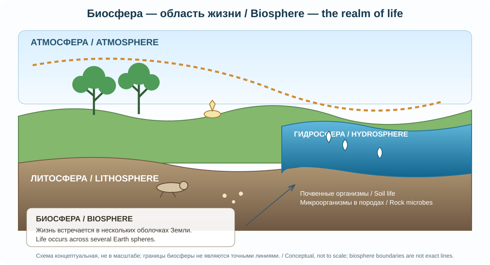
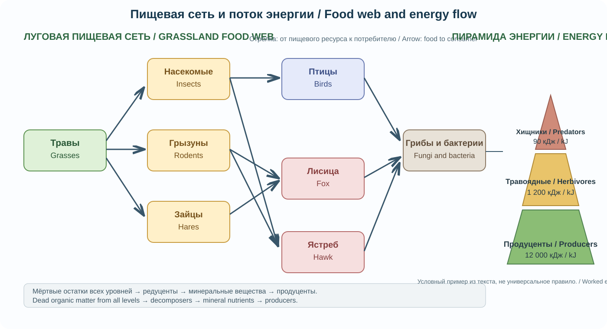
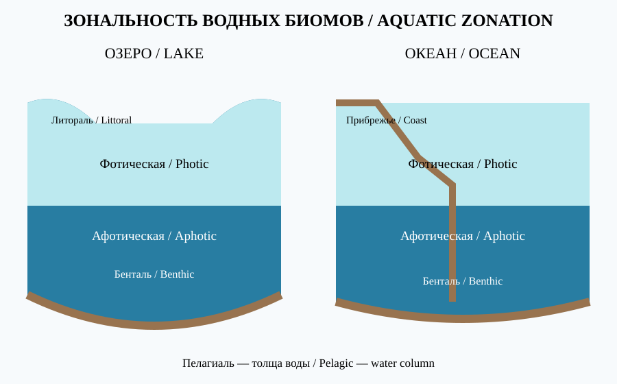

# Глава 7. Биосфера и природные зоны Земли
# Chapter 7. The Biosphere and Earth's Natural Biomes

> **Часть I. Фундаментальная география / Part I. Fundamental Geography**  
> Научно-образовательный атлас географии / Scientific and Educational Geography Atlas

## Цели главы / Chapter objectives

После изучения главы читатель сможет объяснять границы и функции биосферы, различать уровни организации живого, анализировать структуру экосистем и потоки энергии, сопоставлять главные биомы Земли, понимать закономерности биогеографии и оценивать причины деградации природных систем.  
After studying this chapter, readers will be able to explain the extent and functions of the biosphere, distinguish levels of biological organization, analyse ecosystem structure and energy flows, compare the major biomes, understand biogeographical patterns, and assess drivers of ecosystem degradation.

## 7.1. Биосфера: пространство жизни / The Biosphere: The Realm of Life

*07-A. Авторская двуязычная учебная схема Atlas of Knowledge. Границы биосферы показаны условно; схема не задаёт точную высоту или глубину распространения жизни. / Original bilingual teaching diagram by Atlas of Knowledge. Biosphere boundaries are illustrative; the diagram does not specify exact upper or lower limits.*

Биосфера — глобальная оболочка жизни на Земле. В ней организмы взаимодействуют с атмосферой, гидросферой и верхней частью литосферы. Жизнь существует в почвах, океанах и пресных водах, на поверхности суши и в нижней атмосфере. Некоторые микроорганизмы обитают глубоко в горных породах и в экстремальных условиях. Поэтому биосфера не имеет одной тонкой и строго очерченной границы.

Термин «биосфера» получил научное развитие в работах Эдуарда Зюсса в XIX веке, а целостное учение о биосфере было глубоко разработано Владимиром Вернадским. Он подчёркивал геологическую роль живого вещества: организмы не просто населяют планету, но и преобразуют её химический состав, почвы, осадочные породы и глобальные циклы элементов.

Биосфера не является замкнутой системой по энергии. Основной внешний источник энергии для большинства экосистем — солнечное излучение. Вещество же многократно циркулирует между организмами и компонентами окружающей среды. Существуют также экосистемы, основанные на химической энергии, например сообщества у гидротермальных источников.

**Основные функции биосферы:**
- газовая — участие организмов в формировании и поддержании состава атмосферы;
- концентрационная — избирательное накопление химических элементов живыми организмами;
- окислительно-восстановительная — преобразование веществ в биологических и геохимических процессах;
- средообразующая — формирование почв, участие в регулировании водного режима и климата;
- энергетическая — преобразование и передача энергии через пищевые сети;
- информационно-эволюционная — сохранение и изменение генетической информации в ходе эволюции.

**Рисунок 7.1 / Figure 7.1 — Биосфера как область взаимодействия оболочек Земли / The biosphere as a zone of interaction among Earth's spheres.**  
Техническое задание: создать научную разрезную схему от верхней тропосферы до океанического дна и верхней литосферы; показать лес, почвенный профиль, реку, океан, микроорганизмы в породах; обозначить атмосферу, гидросферу, литосферу и биосферу; не изображать границы биосферы как абсолютно точные.
**EN production brief:** Create a scientific cross-section from the upper troposphere to the ocean floor and upper lithosphere. Show a forest, soil profile, river, ocean and microorganisms in rock; label the atmosphere, hydrosphere, lithosphere and biosphere. Do not depict the biosphere's boundaries as exact lines.

## 7.2. Уровни организации живого / Levels of Biological Organization

Живые системы организованы иерархически. Каждый уровень обладает свойствами, которые нельзя полностью свести к свойствам отдельных элементов.

| Уровень / Level | Содержание / Description | Географическое значение / Geographic relevance |
|---|---|---|
| Молекулярный / Molecular | Биомолекулы, ДНК, белки / Biomolecules, DNA, proteins | Наследственность и адаптация / Heredity and adaptation |
| Клеточный / Cellular | Структурная единица жизни / Basic unit of life | Физиологические ограничения организмов / Physiological limits |
| Организменный / Organismal | Отдельный организм / Individual organism | Ареал и экологическая ниша / Range and ecological niche |
| Популяционный / Population | Особи одного вида на территории / Individuals of one species in an area | Динамика численности и расселение / Population dynamics and dispersal |
| Видовой / Species | Эволюционно самостоятельная группа / Evolutionary lineage | Видовое разнообразие / Species diversity |
| Сообщество / Community | Совокупность популяций разных видов / Interacting populations of different species | Структура биоценоза / Biotic community structure |
| Экосистемный / Ecosystem | Сообщество и абиотическая среда / Community and abiotic environment | Потоки энергии и вещества / Energy and matter flows |
| Биомный / Biome | Крупная природная система со сходными климатом и растительностью / Large region with characteristic climate and vegetation | Крупномасштабная зональность / Large-scale zonation |
| Биосферный / Biosphere | Глобальная система жизни / Global system of life | Планетарные биогеохимические циклы / Planetary biogeochemical cycles |

Популяция характеризуется численностью, плотностью, возрастной и пространственной структурой, рождаемостью, смертностью и миграциями. Сообщество (биоценоз) включает популяции разных видов, связанные конкуренцией, хищничеством, паразитизмом, мутуализмом и другими отношениями. Экосистема объединяет сообщество с неживой средой — водой, воздухом, почвой, климатом и минеральными веществами.

Понятия «биогеоценоз» и «экосистема» близки, но не полностью тождественны во всех научных традициях. Биогеоценоз в классической отечественной школе обычно рассматривается как территориально определённый природный комплекс с относительно однородными условиями, тогда как экосистема может иметь разные масштабы — от небольшого водоёма до океана.

## 7.3. Экологические факторы и ниша / Ecological Factors and the Niche

На организм воздействуют абиотические, биотические и антропогенные факторы.

- **Абиотические:** температура, свет, влажность, солёность, кислотность, давление, ветер, свойства субстрата.
- **Биотические:** конкуренты, хищники, паразиты, опылители, симбионты и кормовые организмы.
- **Антропогенные:** изменение землепользования, загрязнение, добыча ресурсов, охота, интродукция видов, климатические изменения.

Экологическая ниша — совокупность условий, ресурсов и функциональных связей, определяющих существование вида. Она шире, чем местообитание: местообитание отвечает на вопрос, где живёт организм, а ниша — как он использует ресурсы и взаимодействует с окружающей средой.

Закон толерантности Шелфорда описывает диапазон условий, в пределах которого организм способен существовать и размножаться. За пределами оптимума жизнедеятельность ухудшается, а при выходе за пределы толерантности существование популяции становится невозможным. Для каждого фактора различают минимум, максимум и оптимум; эти значения зависят от стадии развития и взаимодействия факторов.

**Рисунок 7.2 / Figure 7.2 — Кривая экологической толерантности / Ecological tolerance curve.**

*07-D. Двуязычная адаптация по схеме «Shelford's Law of Tolerance» авторов Adriana Olenici, Francisco Jiménez-Gómez, María Borrego-Ramos и Călin Baciu. Источник: Wikimedia Commons; CC BY 4.0. Перерисовано и переведено; форма кривой и границы условны. / Bilingual adaptation of “Shelford's Law of Tolerance” by Adriana Olenici, Francisco Jiménez-Gómez, María Borrego-Ramos and Călin Baciu. Source: Wikimedia Commons; CC BY 4.0. Redrawn and translated; curve shape and boundaries are illustrative.*

## 7.4. Трофическая структура и поток энергии / Trophic Structure and Energy Flow

*07-B. Авторская двуязычная схема. Значения 12 000, 1 200 и 90 кДж взяты из условного примера в этой главе; они не являются универсальными коэффициентами передачи энергии. / Original bilingual diagram. The 12,000, 1,200 and 90 kJ values come from this chapter's worked example; they are not universal energy-transfer ratios.*

В экосистемах организмы связаны пищевыми отношениями. По способу получения энергии и вещества выделяют три основные функциональные группы:

1. **Продуценты** — организмы, создающие органическое вещество из неорганического. Большинство использует фотосинтез; некоторые микроорганизмы — хемосинтез.
2. **Консументы** — организмы, потребляющие готовое органическое вещество. К ним относятся травоядные, хищники, всеядные и паразиты.
3. **Редуценты и детритофаги** — организмы, разлагающие мёртвое органическое вещество и возвращающие минеральные элементы в круговорот. Бактерии и грибы играют ключевую роль в разложении; детритофаги измельчают остатки и ускоряют процесс.

Пищевая цепь — упрощённая последовательность передачи вещества и энергии. В природе цепи переплетаются в пищевые сети. Один вид может занимать разные трофические позиции в зависимости от рациона и жизненной стадии.

Энергия проходит через экосистему однонаправленно: поступает главным образом от Солнца, преобразуется в химическую энергию органического вещества и постепенно рассеивается в виде тепла. В отличие от энергии, химические элементы участвуют в циклическом обмене.

Первичная продукция — скорость образования органического вещества продуцентами. Валовая первичная продукция (ВПП) — вся энергия, зафиксированная фотосинтезом за единицу времени; чистая первичная продукция (ЧПП) равна ВПП за вычетом затрат растений на дыхание. ЧПП доступна для роста растений, потребителей и детритных цепей.

Часто приводимое «правило 10 процентов» — лишь ориентир: доля энергии, переходящая на следующий трофический уровень, сильно различается между экосистемами и типами организмов. Поэтому пирамиды энергии, биомассы и численности могут иметь разную форму. Пирамида энергии всегда отражает уменьшение доступной энергии по трофическим уровням за выбранный интервал времени.

**Рисунок 7.3 / Figure 7.3 — Пищевая сеть и пирамида энергии / Food web and energy pyramid.**  
Техническое задание: слева показать сеть умеренной луговой экосистемы (травы, насекомые, грызуны, птицы, хищники, грибы и бактерии), справа — пирамиду энергии с условными единицами на каждом уровне; стрелки должны идти от пищевого ресурса к потребителю; не задавать универсальную эффективность передачи энергии.
**EN production brief:** On the left, show a food web for a temperate grassland (grasses, insects, rodents, birds, predators, fungi and bacteria). On the right, show an energy pyramid with illustrative units at each trophic level. Arrows must point from food resource to consumer; do not imply a universal energy-transfer efficiency.

### 7.4.1. Практический пример: передача энергии в пищевой цепи / Worked Example: Energy Transfer in a Food Chain

Рассмотрим условную луговую экосистему. За выбранный период продуценты (растения) накопили 12 000 кДж энергии в новой биомассе. Из этой энергии 1 200 кДж оказалось в биомассе травоядных животных.

**Шаг 1. Рассчитываем долю передачи энергии.**

\[
\eta = \frac{E_{\text{следующий уровень}}}{E_{\text{предыдущий уровень}}}\times 100\%
\]

\[
\eta = \frac{1\,200}{12\,000}\times 100\% = 10\%
\]

В данном условном примере эффективность передачи энергии от продуцентов к травоядным составляет **10%**.

**Шаг 2. Правильно интерпретируем результат.**  
Это не означает, что ровно 10% энергии передаётся на каждом следующем уровне во всех экосистемах. Часть энергии не потребляется, часть не усваивается, а значительная доля расходуется организмами на дыхание, движение и другие процессы и рассеивается в виде тепла. Полученная величина относится только к указанным уровням, периоду и способу учёта.

**Шаг 3. Сравниваем другой переход.**  
Если из 1 200 кДж в биомассе травоядных 90 кДж накопили хищники, эффективность этого перехода равна 90 / 1 200 × 100% = **7,5%**. Значения для разных переходов могут различаться.

**Проверьте себя:** если хищники накопили 60 кДж из 800 кДж энергии в биомассе добычи, какова эффективность передачи?

### Worked Example: Energy Transfer in a Food Chain

Consider a hypothetical grassland ecosystem. During a selected period, producers (plants) store 12,000 kJ of energy in new biomass. Of this energy, 1,200 kJ is incorporated into the biomass of herbivores.

**Step 1. Calculate the proportion of energy transferred.**

\[
\eta = \frac{E_{\text{next level}}}{E_{\text{previous level}}}\times 100\%
\]

\[
\eta = \frac{1,200}{12,000}\times 100\% = 10\%
\]

In this hypothetical example, the transfer efficiency from producers to herbivores is **10%**.

**Step 2. Interpret the result correctly.**  
This does not mean that exactly 10% of energy is transferred at every successive level in all ecosystems. Some energy is not consumed, some is not assimilated, and a substantial share is used for respiration, movement and other processes and dissipated as heat. The calculated value applies only to the stated levels, period and accounting method.

**Step 3. Compare another transfer.**  
If predators incorporate 90 kJ into their biomass from the 1,200 kJ stored in herbivore biomass, the efficiency of this transfer is 90 / 1,200 × 100% = **7.5%**. Efficiencies can differ between transfers.

**Check your understanding:** If predators incorporate 60 kJ from 800 kJ of energy in prey biomass, what is the transfer efficiency?

---

## 7.5. Биологическое разнообразие / Biodiversity

Биоразнообразие — изменчивость живого мира на нескольких уровнях:
- **генетическое разнообразие** — различия генов и наследственных вариантов внутри видов и популяций;
- **видовое разнообразие** — разнообразие видов и соотношение их численности;
- **экосистемное разнообразие** — разнообразие местообитаний, сообществ и экологических процессов.

Для оценки видового разнообразия используют богатство видов, выравненность их численности и индексы разнообразия. Богатство видов показывает число видов, а выравненность — насколько равномерно распределены особи между ними. Один показатель не заменяет другой.

Эндемики — виды или иные таксоны, естественный ареал которых ограничен определённой территорией. Реликты — представители древних линий, сохранившиеся в ограниченных или изменившихся местообитаниях. Редкость не всегда означает низкую численность повсюду: вид может быть локально многочисленным, но иметь очень небольшой ареал.

Биоразнообразие поддерживает опыление, плодородие почв, очистку воды, регулирование вредителей, устойчивость экосистем и культурные ценности. При этом устойчивость не означает неизменность: экосистемы динамичны и способны перестраиваться, но скорость и масштаб нарушений могут превышать возможности восстановления.

## 7.6. Биогеография и закономерности распространения видов / Biogeography and Species Distributions

Биогеография изучает пространственное распределение организмов и сообществ, а также исторические и экологические причины этого распределения. Современные ареалы формируются под влиянием климата, рельефа, почв, водных барьеров, конкуренции, эволюционной истории и деятельности человека.

Крупные биогеографические области отражают длительную изоляцию и историю развития флоры и фауны. Их границы не всегда совпадают с государственными границами или климатическими поясами. В разных классификациях число и названия областей могут различаться.

Основные закономерности:
- широтная смена климатов и растительности от экватора к полюсам;
- высотная поясность в горах, обусловленная изменением температуры, увлажнения и других условий с высотой;
- островной эффект — ограниченность расселения и повышенная уязвимость изолированных популяций;
- зависимость ареалов от барьеров, коридоров расселения и истории континентов;
- изменение границ ареалов при климатических колебаниях и антропогенном преобразовании ландшафтов.

Ареал может быть сплошным, разорванным (дизъюнктивным), очень узким или широко распространённым. Его границы динамичны и могут смещаться при изменении климата, землепользования и доступности местообитаний.

> **[МЕТКА ИЛЛЮСТРАЦИИ 07-E / IMAGE PLACEHOLDER 07-E]** Карта биогеографических областей мира с принятой классификацией и оговоркой о переходных зонах. / **EN:** Map of the world's biogeographical realms using a named classification and noting transitional zones.
**Рисунок 7.4 / Figure 7.4 — Биогеографические области мира / World's biogeographical realms.**  
Техническое задание: подготовить карту суши с основными биогеографическими областями по одной явно указанной научной классификации; показать условные границы, легенду и названия; не смешивать биогеографические области с климатическими поясами; островные территории подписывать отдельно при необходимости.
**EN production brief:** Prepare a land map of the major biogeographical realms using one explicitly named scientific classification. Show schematic boundaries, a legend and labels. Do not confuse biogeographical realms with climatic belts; label island territories separately where necessary.

## 7.7. Широтная зональность и высотная поясность / Latitudinal Zonation and Altitudinal Belts

Широтная зональность — закономерная смена природных условий от экватора к полюсам, связанная прежде всего с распределением солнечной радиации и общей циркуляцией атмосферы. Она проявляется в климате, почвах, растительности, животном мире и гидрологическом режиме.

Высотная поясность — смена природных комплексов с увеличением высоты в горах. Обычно температура понижается, меняются осадки, продолжительность вегетационного периода и свойства почв. Однако конкретная последовательность поясов зависит от широты, экспозиции склонов, удалённости от океана, рельефа и местной циркуляции.

На наветренных склонах осадки часто выше, чем на подветренных. Южные и северные склоны в Северном полушарии различаются по освещённости и тепловому режиму. Поэтому две горные долины на одной высоте могут иметь разные экосистемы.

**Рисунок 7.5 / Figure 7.5 — Широтная зональность и высотная поясность / Latitudinal zonation and altitudinal belts.**  
Техническое задание: сделать две сопоставимые схемы: профиль Земли от экватора к полюсам и горный склон от подножия до нивального пояса; подписать биомы схематически, указать, что реальные границы переходные и зависят от региональных условий.
**EN production brief:** Create two comparable diagrams: a latitudinal profile from the equator to the poles and a mountain slope from its base to the nival zone. Label biomes schematically and note that real boundaries are transitional and depend on regional conditions.

## 7.8. Главные наземные биомы Земли / Major Terrestrial Biomes
> **[МЕТКА ИЛЛЮСТРАЦИИ 07-C / IMAGE PLACEHOLDER 07-C]** Карта наземных биомов мира с климатическими поясами и примерами адаптаций. / World map of terrestrial biomes with climate belts and examples of adaptation.

Биом — крупная природная система, объединённая характерными климатическими условиями, растительностью и связанными с ними сообществами животных и микроорганизмов. Границы биомов переходные, а классификации могут отличаться по числу категорий и критериям. Важно учитывать цель классификации: традиционные наземные биомы часто выделяют по климату и структуре растительности, тогда как Глобальная типология экосистем IUCN использует шесть уровней: царства, функциональные биомы, функциональные группы экосистем, биогеографические экотипы, глобальные типы экосистем и субглобальные типы экосистем. Верхние уровни группируют системы по крупным функциональным признакам, а нижние подробнее различают их географический и видовой состав. Эти схемы дополняют друг друга, но их категории нельзя автоматически считать взаимозаменяемыми. Для карты или статистического сравнения всегда называйте систему, её версию и пространственный уровень.

| Биом / Biome | Климатические особенности / Climate | Характерная растительность / Typical vegetation |
|---|---|---|
| Влажные тропические леса / Tropical moist forests | Тепло и обильные осадки большую часть года / Warm, high rainfall | Многоярусные вечнозелёные леса / Multi-layered evergreen forests |
| Сезонные тропические леса / Tropical seasonal forests | Выраженный влажный и сухой сезоны / Wet and dry seasons | Леса с сезонным листопадом / Seasonally deciduous forests |
| Саванны / Savannas | Тёплый климат с сезонностью осадков; режим пожаров различается / Warm climate with seasonal rainfall; fire regimes vary | Травы с отдельными деревьями и кустарниками / Grasses with scattered trees and shrubs |
| Пустыни жарких и холодных регионов / Hot and cold deserts | Очень малое количество осадков; температура может быть высокой или низкой / Very low precipitation; temperatures may be high or low | Разреженная ксерофитная растительность / Sparse xerophytic vegetation |
| Средиземноморские кустарники / Mediterranean shrublands | Сухое лето, мягкая влажная зима / Dry summers, mild wet winters | Жёстколистные кустарники и редколесья / Sclerophyll shrubs and open woodland |
| Умеренные дождевые леса / Temperate rainforests | Мягкий климат и обильные осадки / Mild climate and high rainfall | Влажные леса из хвойных и/или широколиственных пород / Moist forests of coniferous and/or broadleaf trees |
| Умеренные широколиственные и смешанные леса / Temperate broadleaf and mixed forests | Сезонность температур и осадков / Seasonal temperatures and precipitation | Лиственные и смешанные леса / Deciduous and mixed forests |
| Умеренные травянистые экосистемы / Temperate grasslands | Умеренные осадки, засухи и пожары / Moderate rainfall, drought and fire | Степи, прерии, пампа / Steppes, prairies, pampas |
| Тайга / Boreal forest | Долгая холодная зима / Long, cold winters | Преимущественно хвойные леса / Mainly coniferous forests |
| Тундра / Tundra | Короткое прохладное лето, многолетняя мерзлота во многих районах / Short cool summer, permafrost in many areas | Мхи, лишайники, осоки, карликовые кустарники / Mosses, lichens, sedges, dwarf shrubs |
| Полярные пустыни / Polar deserts | Крайне холодно и мало жидкой влаги / Extreme cold and low liquid water availability | Очень разреженная растительность / Very sparse vegetation |
| Горные биомы / Mountain biomes | Резкая смена условий с высотой и экспозицией / Strong altitudinal and aspect gradients | Мозаика лесов, лугов, кустарников и высокогорных сообществ / Mosaics of forests, meadows, shrublands and alpine communities |

**Тропические леса.** Влажные тропические леса отличаются высокой структурной сложностью, большим числом экологических ниш и высоким видовым разнообразием. Почвы во многих районах интенсивно выветрены и не обязательно обладают высокой естественной плодородностью: значительная часть питательных веществ быстро циркулирует в биомассе и поверхностном слое.

**Саванны.** Саванны формируются под влиянием сезонности осадков, травоядных животных, свойств почв и, во многих регионах, пожаров. Роль огня различается: в одних саваннах он регулярно ограничивает древесный покров, в других его влияние слабее. Деревья и травы конкурируют за свет и воду, а сочетание водного режима, выпаса и пожаров меняет соотношение древесной и травянистой растительности.

**Пустыни.** Пустыни определяются прежде всего дефицитом влаги, а не высокой температурой: холодные пустыни также широко распространены. Организмы используют стратегии экономии воды, ночной активности, глубоких корней, запасания влаги и короткого жизненного цикла после осадков.

**Средиземноморские кустарники.** Летняя засуха и периодические пожары способствуют распространению жёстколистных кустарников и растений с устойчивыми к засухе листьями. Пожары могут быть частью естественной динамики, но учащение и усиление огня из-за деятельности человека способно разрушать экосистемы.

**Умеренные леса.** Состав лесов меняется с климатом, почвами и историей территории. В широколиственных лесах выражена сезонность, а смешанные леса сочетают хвойные и лиственные породы.

**Степи, прерии и пампа.** Это различные региональные варианты умеренных травянистых экосистем. Их поддерживают климатическая сезонность, пожары, выпас и свойства почв. Многие такие территории преобразованы в сельскохозяйственные угодья.

**Тайга.** Бореальные леса занимают огромные пространства северных материков. Для них характерны низкие температуры, медленное разложение органики, сезонное промерзание почв и значительные запасы углерода в почвах и торфяниках.

**Тундра и полярные пустыни.** Короткий вегетационный период, низкие температуры и мерзлота ограничивают рост растений. Потепление может изменять режим мерзлоты, гидрологию и выбросы парниковых газов.

**Горные экосистемы.** Горы содержат множество изолированных местообитаний и часто отличаются высоким уровнем эндемизма. Климатические условия меняются на небольших расстояниях, а дороги, плотины, добыча полезных ископаемых и изменение климата могут нарушать связность местообитаний.

> **[МЕТКА ИЛЛЮСТРАЦИИ 07-F / IMAGE PLACEHOLDER 07-F]** Сравнительная панорама основных биомов с климатом, растительностью и характерными адаптациями организмов. / **EN:** Comparative panorama of major biomes showing climate, vegetation and characteristic organism adaptations.
**Рисунок 7.6 / Figure 7.6 — Панорама основных биомов планеты / Panorama of Earth's major biomes.**  
Техническое задание: единая научная панорама из 10–11 ландшафтных секций с узнаваемыми признаками каждого биома; подписи на русском и английском; не использовать стереотипные изображения как замену реальным региональным различиям.
**EN production brief:** Create one scientific panorama with 10–11 landscape sections, each showing recognisable features of a biome. Use Russian and English labels; do not let stereotypical imagery replace real regional variation.

## 7.9. Пресноводные и морские биомы / Freshwater and Marine Biomes

Водные биомы классифицируют по солёности, глубине, движению воды, освещённости, температуре, содержанию кислорода и доступности питательных веществ.

**Пресноводные экосистемы:**
- реки и ручьи — проточные системы, где важны скорость течения, кислородный режим, перенос наносов и связь с водосбором;
- озёра и водохранилища — стоячие или слабопроточные водоёмы с вертикальной стратификацией и сезонным перемешиванием;
- болота и торфяники — переувлажнённые системы, где замедленное разложение органики способствует накоплению торфа и углерода;
- временные водоёмы — сезонные местообитания, приспособленные к чередованию затопления и высыхания.

**Морские экосистемы:**
- прибрежная зона — область интенсивного взаимодействия суши и моря;
- эстуарии — участки смешения речной и морской воды, часто высокопродуктивные;
- мангровые леса и солёные марши — прибрежные экосистемы тропиков и умеренных широт соответственно;
- морские луга — подводные цветковые растения на мелководьях;
- коралловые рифы — сложные сообщества тёплых мелководий, чувствительные к перегреву и закислению;
- открытый океан — обширная пелагическая среда, где основную первичную продукцию в освещённом слое обеспечивают микроскопические фотосинтезирующие организмы;
- глубоководные экосистемы — сообщества, существующие без солнечного света, в том числе вокруг гидротермальных источников.

В водоёмах важны трофические состояния. Эвтрофикация — обогащение воды биогенными элементами, прежде всего соединениями азота и фосфора; чрезмерное поступление питательных веществ может вызывать цветение водорослей, дефицит кислорода и гибель водных организмов.

*07-G. Авторская двуязычная концептуальная схема Atlas of Knowledge. Существующие опубликованные схемы зональности были просмотрены; глубины намеренно не фиксированы, поскольку световая граница зависит от прозрачности и условий среды. / Original bilingual conceptual diagram by Atlas of Knowledge. Published zonation diagrams were reviewed; depths are not fixed because light penetration depends on transparency and local conditions.*
**Рисунок 7.7 / Figure 7.7 — Вертикальная зональность озера и океана / Vertical zonation of a lake and the ocean.**  
Техническое задание: сопоставить озеро и океан в разрезе; обозначить освещённую фотическую зону, глубоководную афотическую область, литораль/прибрежье, пелагиаль и бенталь; показать, что глубины зон изменяются в зависимости от прозрачности воды и условий среды.
**EN production brief:** Compare a lake and the ocean in cross-section. Label the illuminated photic zone, deep aphotic zone, littoral/coastal area, pelagic zone and benthic zone. Show that zone depths vary with water transparency and environmental conditions.

## 7.10. Экотоны и экологические переходы / Ecotones and Ecological Transitions

Экотоны — переходные пространства между соседними экосистемами или биомами. Примеры: лесная опушка, граница леса и степи, заболоченная полоса между сушей и озером, устье реки. Экотоны могут содержать виды обеих соседних систем и специализированные виды, приспособленные к переходным условиям.

Переход не всегда является узкой линией. Часто это широкая зона с мозаикой местообитаний. Её положение может перемещаться под воздействием климата, пожаров, выпаса, земледелия и других факторов. Поэтому границы биомов на мелкомасштабных картах следует изображать как обобщённые, а не абсолютно точные линии.

## 7.11. Адаптации организмов к среде / Organismal Adaptations to the Environment

Адаптации — наследуемые особенности, повышающие репродуктивный успех организмов в определённых условиях. Они формируются эволюционно, а не возникают целенаправленно у отдельной особи в ответ на потребность.

- морфологические адаптации: форма листьев, покровы, корневая система, окраска;
- физиологические: регулирование водного баланса, терморегуляция, солеустойчивость, метаболические особенности;
- поведенческие: миграции, сезонная активность, укрывание, выбор мест размножения.

Ксерофиты приспособлены к дефициту влаги; гидрофиты — к жизни в водной среде; галофиты — к засолённым условиям; психрофильные организмы способны существовать при низких температурах. Эти группы включают разнообразные стратегии, и ни один признак сам по себе не описывает все адаптации организма.

Миграции позволяют животным использовать сезонные ресурсы и избегать неблагоприятных условий. Фенология изучает сроки сезонных явлений — цветения, распускания листьев, размножения, миграций и зимовки. Изменение климата может приводить к рассогласованию сроков взаимодействия видов, например между цветением растений и активностью опылителей.

## 7.12. Нарушения и деградация экосистем / Ecosystem Disturbance and Degradation

К главным угрозам биоразнообразию и функционированию экосистем относятся:
- преобразование и утрата местообитаний при расширении сельского хозяйства, городов, инфраструктуры и добычи ресурсов;
- фрагментация ландшафтов, изолирующая популяции;
- чрезмерная эксплуатация биологических ресурсов;
- загрязнение воздуха, воды и почв;
- изменение климата и учащение экстремальных явлений;
- распространение инвазивных чужеродных видов;
- изменение естественных режимов пожаров, паводков и других нарушений.

Инвазивный чужеродный вид — организм, оказавшийся за пределами естественного ареала вследствие прямого или косвенного переноса человеком и вызывающий негативное воздействие на природу, экономику или здоровье. Не каждый чужеродный вид инвазивен: ключевое значение имеет доказанное или вероятное негативное воздействие.

Фрагментация местообитаний уменьшает площадь пригодных территорий, создаёт барьерные эффекты и усиливает краевые условия. Малые изолированные популяции подвержены генетическому дрейфу, инбридингу и локальному вымиранию. Экологические коридоры могут облегчать перемещение организмов между фрагментами, однако их эффективность зависит от вида, ширины, качества и безопасности коридора.

## 7.13. Охрана природы и восстановление экосистем / Nature Conservation and Ecosystem Restoration

Охрана природы включает сохранение видов, местообитаний, экологических процессов и генетического разнообразия. Основные инструменты:
- особо охраняемые природные территории (ООПТ): национальные парки, заповедники, заказники и другие категории, различающиеся целями и режимами;
- охрана видов и регулирование использования биологических ресурсов;
- экологические сети и коридоры, поддерживающие связность местообитаний;
- устойчивое управление лесами, пастбищами, водно-болотными угодьями и морскими ресурсами;
- контроль загрязнения и инвазивных видов;
- экологическое восстановление нарушенных земель и водных систем;
- мониторинг, научные исследования и участие местных сообществ.

Восстановление экосистем — широкое понятие, охватывающее спектр мер на всём восстановительном континууме: от устранения причин деградации и содействия естественному восстановлению до активных вмешательств. В стандартах Society for Ecological Restoration (SER, 3-е издание, 2026) **экологическое восстановление** имеет более узкое значение: это процесс содействия восстановлению местной естественной экосистемы (native ecosystem), которая была деградирована, повреждена или уничтожена. Работа ведётся с учётом подходящей эталонной экосистемы и возможных изменений окружающей среды. **Реабилитация** направлена на восстановление отдельных экологических функций и услуг на деградированной или преобразованной территории, но не обязательно приводит к существенному восстановлению местной естественной экосистемы. Поэтому посадка деревьев, озеленение или повышение продуктивности сами по себе ещё не доказывают экологическое восстановление.

Меры восстановления могут включать естественное возобновление, устранение источников давления, восстановление гидрологического режима, посадку характерных для данной экосистемы местных видов и возвращение экологических функций. Посадка деревьев не является универсальным решением: в естественных степях, тундрах и других открытых экосистемах массовое облесение может привести к утрате биоразнообразия и нарушению природных процессов.

Глобальная рамочная программа в области биоразнообразия Куньмин—Монреаль (2022) устанавливает четыре долгосрочные цели на 2050 год и 23 задачи на 2030 год. Задача 3 предусматривает, чтобы к 2030 году не менее 30% наземных и внутренних водных территорий, а также прибрежных и морских акваторий были эффективно сохраняемыми и управляемыми посредством экологически репрезентативных, взаимосвязанных и справедливо управляемых систем охраняемых территорий и других эффективных территориальных природоохранных мер. Это глобальная цель, а не автоматическая квота в 30% территории каждой страны. Она также не означает, что любые включённые площади становятся зонами строгой охраны: устойчивое использование возможно, если оно совместимо с результатами сохранения природы, а права местных и коренных сообществ уважаются.

Задача 2 отдельно устанавливает глобальную цель: к 2030 году не менее 30% площадей деградированных наземных, внутренних водных, прибрежных и морских экосистем должны находиться в процессе эффективного восстановления. Это не означает автоматическую квоту восстановления 30% территории каждой страны. Формулировка «находиться в процессе» важна: меры должны быть обеспечены ресурсами и сопровождаться мониторингом, но к 2030 году не требуется завершить восстановление каждой такой территории. Восстановление — длительный процесс; его цели и результаты зависят от исходного состояния и типа экосистемы.

Успешная охрана природы требует не только создания охраняемых территорий, но и управления ландшафтом за их пределами, соблюдения прав местных сообществ, научно обоснованного планирования и долгосрочного финансирования.

> **[МЕТКА ИЛЛЮСТРАЦИИ 07-H / IMAGE PLACEHOLDER 07-H]** Схема экологической связности: ядра местообитаний, коридоры, барьеры и матрица ландшафта. / **EN:** Habitat-connectivity diagram showing core areas, corridors, barriers and the landscape matrix.
**Рисунок 7.8 / Figure 7.8 — Экологическая сеть и связность местообитаний / Ecological network and habitat connectivity.**  
Техническое задание: схематическая карта с ядрами природных территорий, буферными зонами, коридорами и участками фрагментации; показать условное перемещение животных; легенда должна различать существующие и предлагаемые элементы сети.
**EN production brief:** Create a schematic map showing core natural areas, buffer zones, corridors and fragmented areas. Illustrate hypothetical animal movement and use a legend to distinguish existing from proposed network elements.

## 7.14. Биосфера и глобальные циклы вещества / The Biosphere and Global Biogeochemical Cycles

Живые организмы участвуют в глобальных циклах углерода, кислорода, азота, фосфора и воды. При кислородном фотосинтезе углекислый газ используется для фиксации углерода в органическом веществе, а молекулярный кислород образуется при расщеплении воды в световых реакциях. Дыхание и разложение возвращают углерод в атмосферу и воду. Океан, леса, почвы, болота и другие системы содержат запасы углерода, между которыми он перемещается в виде потоков.

Азотфиксация переводит атмосферный молекулярный азот в биологически доступные соединения. Нитрификация, ассимиляция, аммонификация и денитрификация обеспечивают различные преобразования азота. Фосфорный цикл в значительной степени связан с горными породами, почвами, водой и организмами и не имеет крупного атмосферного резервуара, сопоставимого с азотным.

Изменение землепользования, сжигание ископаемого топлива, удобрения, осушение торфяников и деградация почв изменяют скорости и направления биогеохимических потоков. Экосистемы могут поглощать часть антропогенных выбросов, но их способность к поглощению ограничена и меняется со временем.

*07-I. Авторская двуязычная схема, подготовленная после проверки открытых схем циклов углерода и азота; она не содержит количественных данных и не заменяет полный геохимический баланс. / Original bilingual diagram prepared after reviewing openly licensed carbon- and nitrogen-cycle diagrams; it contains no quantitative data and is not a complete geochemical budget.*
**Рисунок 7.9 / Figure 7.9 — Биологическая роль в циклах углерода и азота / Biological roles in the carbon and nitrogen cycles.**  
Техническое задание: две отдельные диаграммы с резервуарами и потоками; различать природные и антропогенные потоки; не смешивать запасы вещества и скорости потоков; все единицы и временные интервалы указывать явно.
**EN production brief:** Create two separate diagrams showing reservoirs and flows. Distinguish natural from human-driven flows; do not mix stored quantities with flow rates. State all units and time intervals explicitly.

## 7.15. Методы биогеографических и экологических исследований / Methods in Biogeographical and Ecological Research

Исследование биосферы объединяет полевые, лабораторные, статистические и дистанционные методы.

| Метод / Method | Что изучает / What it measures | Применение / Application |
|---|---|---|
| Маршрутные учёты / Transect surveys | Встречаемость и распределение организмов / Occurrence and distribution | Картирование местообитаний / Habitat mapping |
| Пробные площадки / Quadrat sampling | Видовой состав и покрытие / Species composition and cover | Сравнение растительных сообществ / Comparing plant communities |
| Учёты животных / Faunal surveys | Численность и активность / Abundance and activity | Мониторинг популяций / Population monitoring |
| Камеры-ловушки / Camera trapping | Присутствие и активность животных / Animal presence and activity | Изучение скрытных видов / Monitoring elusive species |
| Генетические методы / Genetic methods | Генетическое разнообразие и родство / Genetic diversity and relatedness | Оценка связности популяций / Population connectivity |
| Экологический ДНК-анализ / Environmental DNA | Следы организмов в воде, почве и других пробах / Organismal DNA traces in samples | Обнаружение редких и водных видов / Detecting rare and aquatic species; результат требует контроля загрязнения и вероятности обнаружения / results require contamination and detection-probability controls |
| ГИС и дистанционное зондирование / GIS and remote sensing | Покровы Земли и их изменения / Land cover and change | Мониторинг биомов и фрагментации / Biome and fragmentation monitoring |
| Биоклиматическое моделирование / Bioclimatic modelling | Потенциальная пригодность местообитаний / Potential habitat suitability | Сценарии изменения ареалов / Range-change scenarios |

Любое исследование требует корректного дизайна выборки, повторяемости, контроля сезонности и указания неопределённости. Отсутствие наблюдения не всегда доказывает отсутствие вида. Камеры-ловушки фиксируют активность и вероятность обнаружения животных; сами по себе отдельные снимки не дают надёжной оценки численности без специального дизайна и статистической модели. Экологическая ДНК может переноситься водой и сохраняться после присутствия организма, поэтому единичное обнаружение не всегда доказывает, что живой организм находится именно в точке отбора пробы; необходимы повторные пробы, отрицательные и положительные контроли и, где возможно, независимое подтверждение. Модели потенциального ареала показывают вероятную пригодность условий, а не гарантированное присутствие организма.

### 7.15.1. Как оценивать результат восстановления экосистемы / Evaluating Ecosystem Restoration

Посадка деревьев или восстановление растительного покрова сами по себе ещё не доказывают восстановление экосистемы. Результат оценивают относительно исходного состояния, экологических условий участка и реалистичной цели проекта. Историческое состояние не всегда возможно или желательно полностью восстановить, особенно если климат и землепользование изменились.

**Что следует измерять:** выживаемость и естественное возобновление местных видов; структуру и разнообразие растительности; состояние почвы и водного режима; наличие инвазивных видов; связность местообитаний; признаки возвращения характерных животных. Для пастбищ важны также нагрузка скота, сезонность выпаса и состояние почвенного покрова.

**Нужна исходная точка сравнения.** До начала работ фиксируют состояние участка и выбирают сопоставимые контрольные участки, если это возможно. Повторные наблюдения проводят в одинаковые сезоны и сходными методами. Краткосрочное увеличение зелёной массы не обязательно означает восстановление видового состава, почвенных функций или устойчивости к засухе.

**Участие местных пользователей.** Меры восстановления должны учитывать права и практики пастбищепользователей, доступ к воде, хозяйственные потребности и местные знания. Иначе технически успешная посадка может оказаться нежизнеспособной или вызвать перенос нагрузки на соседние участки.

**Учебное задание.** Предложите три показателя для оценки восстановления деградированного горного пастбища через один, три и пять лет. Сначала опишите исходное состояние и выберите подходящую эталонную экосистему или несколько сопоставимых участков. Показатели должны охватывать не только растительный покров, но и состав местных видов, структуру сообщества, состояние почвы и водного режима, экологические функции и связность местообитаний. Для каждого укажите метод измерения, сезон, возможный источник ошибки и критерий, по которому можно судить об улучшении.

Planting trees or increasing vegetation cover does not by itself demonstrate that an ecosystem has been restored. Outcomes must be assessed against the initial condition, the site's ecological context and a realistic project goal. It may not be possible or desirable to recreate a historical state fully, especially where climate and land use have changed.

**What to measure:** survival and natural regeneration of native species; vegetation structure and diversity; soil and water conditions; presence of invasive species; habitat connectivity; and signs that characteristic animal species are returning. For rangelands, livestock pressure, grazing seasonality and ground cover are also important.

**A baseline is essential.** Before work begins, document site conditions and, where possible, select comparable reference sites. Repeat observations in the same seasons using consistent methods. A short-term increase in green biomass does not necessarily indicate recovery of species composition, soil functions or drought resilience.

**Involve local land users.** Restoration measures should account for the rights and practices of pastoral communities, water access, livelihood needs and local knowledge. Otherwise, a technically successful planting effort may fail or shift grazing pressure to neighbouring areas.

**Activity.** Propose three indicators for evaluating restoration of a degraded mountain pasture after one, three and five years. First describe the baseline condition and select an appropriate reference ecosystem or comparable reference sites. The indicators should cover not only vegetation cover but also native-species composition, community structure, soil and water conditions, ecological functions and habitat connectivity. For each indicator, state the measurement method, season, possible source of error and criterion that would indicate improvement.

## English-language chapter text

### 7.1. The Biosphere: The Realm of Life

The biosphere is the global zone of life on Earth. Within it, organisms interact with the atmosphere, hydrosphere and upper lithosphere. Life occurs in soils, oceans and fresh waters, on land and in the lower atmosphere. Some microorganisms live deep within rocks and in extreme environments. The biosphere therefore has no single, sharply defined boundary.

The term “biosphere” was developed scientifically in the work of Eduard Suess in the nineteenth century. Vladimir Vernadsky later developed a comprehensive theory of the biosphere and emphasised the geological role of living matter: organisms do not merely inhabit the planet; they transform its chemical composition, soils, sedimentary rocks and global element cycles.

The biosphere is not a closed system with respect to energy. Solar radiation is the main external energy source for most ecosystems. Matter, however, circulates repeatedly between organisms and environmental components. Some ecosystems, such as communities around hydrothermal vents, are based on chemical energy.

The main functions of the biosphere include:
- **gaseous:** organisms contribute to the formation and maintenance of atmospheric composition;
- **concentration:** living organisms selectively accumulate chemical elements;
- **oxidation–reduction:** biological and geochemical processes transform substances;
- **environment-forming:** organisms contribute to soil formation and the regulation of water and climate;
- **energy-related:** energy is transformed and transferred through food webs; and
- **information and evolution:** genetic information is preserved and changes through evolution.

### 7.2. Levels of Biological Organization

Living systems are organised hierarchically. Each level has properties that cannot be fully reduced to those of its individual components.

A **population** is characterised by its size, density, age and spatial structure, birth rate, mortality and migration. A **community** (biocenosis) consists of populations of different species connected through competition, predation, parasitism, mutualism and other interactions. An **ecosystem** combines a community with its non-living environment—water, air, soil, climate and mineral substances.

The terms “biogeocoenosis” and “ecosystem” are closely related but are not identical in every scientific tradition. In the classical Eastern European tradition, a biogeocoenosis is generally a territorially defined natural complex with relatively uniform conditions. An ecosystem may have many different scales, from a small pond to an ocean.

### 7.3. Ecological Factors and the Niche

Organisms are affected by abiotic, biotic and human-related factors.

- **Abiotic factors:** temperature, light, humidity, salinity, acidity, pressure, wind and substrate properties.
- **Biotic factors:** competitors, predators, parasites, pollinators, symbionts and food organisms.
- **Anthropogenic factors:** land-use change, pollution, resource extraction, hunting, species introductions and climate change.

An **ecological niche** is the combination of conditions, resources and functional relationships that determines how a species exists. It is broader than habitat: habitat describes where an organism lives, while niche describes how it uses resources and interacts with its environment.

Shelford's law of tolerance describes the range of conditions within which an organism can survive and reproduce. Performance declines outside the optimum, and a population cannot persist beyond its tolerance limits. Each factor has minimum, maximum and optimum values; these depend on life stage and interactions with other factors.

### 7.4. Trophic Structure and Energy Flow

Organisms in ecosystems are connected through feeding relationships. Three main functional groups are recognised:

1. **Producers** create organic matter from inorganic substances. Most use photosynthesis; some microorganisms use chemosynthesis.
2. **Consumers** obtain energy and matter by eating organic material. They include herbivores, predators, omnivores and parasites.
3. **Decomposers and detritivores** break down dead organic matter and return mineral elements to cycles. Bacteria and fungi play a key role in decomposition; detritivores fragment remains and accelerate the process.

A food chain is a simplified sequence through which matter and energy are transferred. In nature, chains are interconnected in food webs. One species may occupy different trophic positions depending on its diet and life stage.

Energy flows through an ecosystem in one direction: it enters mainly from the Sun, is converted into chemical energy in organic matter and is gradually dissipated as heat. Unlike energy, chemical elements participate in cycles.

**Primary production** is the rate at which producers create organic matter. **Gross primary production (GPP)** is all the energy fixed by photosynthesis per unit time. **Net primary production (NPP)** equals GPP minus the energy plants use in respiration. NPP is available for plant growth, consumers and detrital food chains.

The often-quoted “10 percent rule” is only a guide: the share of energy transferred to the next trophic level varies greatly among ecosystems and organism types. Therefore, pyramids of energy, biomass and numbers may have different shapes. An energy pyramid always represents the decline in available energy across trophic levels over a stated period.

### 7.4.1. Worked Example: Energy Transfer in a Food Chain

Consider a hypothetical grassland ecosystem. During a selected period, producers (plants) store 12,000 kJ of energy in new biomass. Of this energy, 1,200 kJ is incorporated into the biomass of herbivores.

**Step 1. Calculate the proportion of energy transferred.**

\[
\eta = \frac{E_{\text{next level}}}{E_{\text{previous level}}}\times 100\%
\]

\[
\eta = \frac{1,200}{12,000}\times 100\% = 10\%
\]

In this hypothetical example, the transfer efficiency from producers to herbivores is **10%**.

**Step 2. Interpret the result correctly.**  
This does not mean that exactly 10% of energy is transferred at every successive level in all ecosystems. Some energy is not consumed, some is not assimilated, and a substantial share is used for respiration, movement and other processes and dissipated as heat. The calculated value applies only to the stated levels, period and accounting method.

**Step 3. Compare another transfer.**  
If predators incorporate 90 kJ into their biomass from the 1,200 kJ stored in herbivore biomass, the efficiency of this transfer is 90 / 1,200 × 100% = **7.5%**. Efficiencies can differ between transfers.

**Check your understanding:** If predators incorporate 60 kJ from 800 kJ of energy in prey biomass, what is the transfer efficiency?

---

### 7.5. Biodiversity

Biodiversity is the variability of life at several levels:
- **genetic diversity:** differences in genes and inherited variants within species and populations;
- **species diversity:** the variety of species and the relative abundance of their populations; and
- **ecosystem diversity:** the variety of habitats, communities and ecological processes.

Species richness, evenness and diversity indices are used to assess species diversity. Richness is the number of species; evenness describes how evenly individuals are distributed among them. One measure cannot replace the other.

Endemic species or other taxa have a natural range restricted to a particular area. Relicts are members of ancient lineages that have survived in restricted or changed habitats. Rarity does not always mean low abundance everywhere: a species may be locally common but have a very small overall range.

Biodiversity supports pollination, soil fertility, water purification, pest regulation, ecosystem resilience and cultural values. Resilience does not mean that ecosystems remain unchanged: ecosystems are dynamic and can reorganise, but the rate and scale of disturbance may exceed their capacity to recover.

### 7.6. Biogeography and Species Distributions

Biogeography studies the spatial distribution of organisms and communities, as well as the historical and ecological reasons for those patterns. Modern ranges are shaped by climate, relief, soils, water barriers, competition, evolutionary history and human activity.

Major biogeographical realms reflect long-term isolation and the evolutionary history of flora and fauna. Their boundaries do not necessarily coincide with national borders or climatic belts. The number and names of realms may differ among classification systems.

Important patterns include latitudinal changes in climate and vegetation from the equator to the poles; altitudinal zonation in mountains; the island effect, with restricted dispersal and vulnerability of isolated populations; the influence of barriers and dispersal corridors; and shifts in species ranges during climatic fluctuations and human transformation of landscapes.

A species range may be continuous, disjunct, very narrow or widespread. Range boundaries are dynamic and may shift as climate, land use and habitat availability change.

### 7.7. Latitudinal Zonation and Altitudinal Belts

Latitudinal zonation is the systematic change in natural conditions from the equator towards the poles, driven mainly by the distribution of solar radiation and general atmospheric circulation. It is reflected in climate, soils, vegetation, fauna and hydrological regimes.

Altitudinal zonation is the change in natural complexes with increasing elevation in mountains. Temperature usually decreases, while precipitation, growing-season length and soil properties change. The sequence of belts depends on latitude, slope aspect, distance from oceans, relief and local circulation.

Windward slopes often receive more precipitation than leeward slopes. In the Northern Hemisphere, south- and north-facing slopes differ in solar exposure and thermal conditions. Two mountain valleys at the same elevation can therefore support different ecosystems.

### 7.8. Major Terrestrial Biomes

A **biome** is a large natural system characterised by climate, vegetation and associated animal and microbial communities. Biome boundaries are transitional, and classification systems differ in the number of categories and criteria used. The purpose of a classification matters: traditional terrestrial biomes are often distinguished by climate and vegetation structure, whereas the IUCN Global Ecosystem Typology uses six levels: realms, functional biomes, ecosystem functional groups, biogeographic ecotypes, global ecosystem types and sub-global ecosystem types. Upper levels group systems by broad functional characteristics, while lower levels distinguish their geographic and compositional features in greater detail. These frameworks complement one another, but their categories are not automatically interchangeable. Always name the system, its version and the spatial level used for a map or statistical comparison.

Major terrestrial biomes include tropical moist forests, tropical seasonal forests, savannas, hot and cold deserts, Mediterranean shrublands, temperate rainforests, temperate broadleaf and mixed forests, temperate grasslands, boreal forests (taiga), tundra, polar deserts and mountain biomes.

**Tropical forests** have high structural complexity, many ecological niches and high species diversity. In many regions their soils are strongly weathered and are not necessarily naturally fertile: much of the nutrient supply cycles rapidly through biomass and the surface soil.

**Savannas** are shaped by seasonal rainfall, herbivores, soil properties and, in many regions, fire. The role of fire varies: it regularly limits woody cover in some savannas but has a weaker influence in others. Trees and grasses compete for light and water, while the combined effects of water availability, grazing and fire alter the balance between woody and grassy vegetation.

**Deserts** are defined primarily by moisture deficit, not by high temperature; cold deserts are also widespread. Organisms use strategies such as water conservation, nocturnal activity, deep roots, water storage and rapid life cycles after rainfall.

**Mediterranean shrublands** experience dry summers and periodic fires. These conditions favour sclerophyll shrubs and drought-resistant leaves. Fire may be part of natural ecosystem dynamics, but more frequent and intense human-caused fires can damage ecosystems.

**Temperate forests** vary with climate, soils and regional history. Deciduous forests have pronounced seasonality, while mixed forests combine coniferous and broadleaf trees.

**Steppes, prairies and pampas** are regional forms of temperate grassland ecosystems. They are maintained by climate seasonality, fire, grazing and soil properties. Many have been converted to agricultural land.

**Taiga** occupies vast areas of northern continents. It is characterised by low temperatures, slow decomposition, seasonal soil freezing and substantial carbon stores in soils and peatlands.

**Tundra and polar deserts** have short growing seasons, low temperatures and, in many regions, permafrost. Warming can change permafrost conditions, hydrology and greenhouse-gas emissions.

**Mountain ecosystems** contain many isolated habitats and often have high endemism. Conditions change over short distances, while roads, dams, mining and climate change can disrupt habitat connectivity.

### 7.9. Freshwater and Marine Biomes

Aquatic biomes are classified by salinity, depth, water movement, light, temperature, oxygen content and nutrient availability.

**Freshwater ecosystems** include:
- rivers and streams, where flow velocity, oxygen conditions, sediment transport and catchment connections are important;
- lakes and reservoirs, which may have vertical stratification and seasonal mixing;
- wetlands and peatlands, where waterlogging slows decomposition and promotes peat and carbon accumulation; and
- temporary water bodies, which support organisms adapted to alternating inundation and drying.

**Marine ecosystems** include coastal zones, estuaries where river and seawater mix, mangroves and salt marshes, seagrass meadows, coral reefs, the open ocean and deep-sea communities. Coral reefs are complex communities of warm shallow waters and are sensitive to overheating and acidification. In the sunlit open ocean, much primary production is carried out by microscopic photosynthetic organisms. Deep-sea ecosystems can exist without sunlight, including communities around hydrothermal vents.

The trophic state of water bodies is important. **Eutrophication** is enrichment with nutrients, especially nitrogen and phosphorus compounds. Excess nutrient input can cause algal blooms, oxygen depletion and the death of aquatic organisms.

### 7.10. Ecotones and Ecological Transitions

Ecotones are transitional areas between neighbouring ecosystems or biomes. Examples include forest edges, forest–steppe boundaries, wetlands between land and lakes, and river mouths. Ecotones may contain species from both neighbouring systems as well as specialised species adapted to transitional conditions.

A transition is not always a narrow line. It is often a broad zone containing a mosaic of habitats. Its position can shift under the influence of climate, fire, grazing, agriculture and other factors. Biome boundaries on small-scale maps should therefore be shown as generalised zones rather than perfectly precise lines.

### 7.11. Organismal Adaptations to the Environment

Adaptations are inherited characteristics that increase reproductive success under particular conditions. They evolve across generations; they do not arise intentionally in an individual organism in response to a need.

- **Morphological adaptations:** leaf shape, body coverings, root systems and coloration.
- **Physiological adaptations:** regulation of water balance, thermoregulation, salt tolerance and metabolic characteristics.
- **Behavioural adaptations:** migration, seasonal activity, sheltering and selection of breeding sites.

Xerophytes are adapted to water scarcity; hydrophytes to aquatic environments; halophytes to saline conditions; and psychrophilic organisms to low temperatures. Each group includes diverse strategies, and no single trait describes all adaptations of an organism.

Migration allows animals to use seasonal resources and avoid unfavourable conditions. **Phenology** studies the timing of seasonal events such as flowering, leaf emergence, reproduction, migration and hibernation. Climate change may cause mismatches between interacting species, for example between plant flowering and pollinator activity.

### 7.12. Ecosystem Disturbance and Degradation

Major threats to biodiversity and ecosystem function include habitat conversion and loss through agriculture, urbanisation, infrastructure and resource extraction; landscape fragmentation; overexploitation of biological resources; air, water and soil pollution; climate change and extreme events; invasive alien species; and changes to natural fire, flood and other disturbance regimes.

An **invasive alien species** is an organism moved beyond its natural range through direct or indirect human activity that causes negative impacts on nature, the economy or human health. Not every alien species is invasive: demonstrated or likely harmful impact is the key distinction.

Habitat fragmentation reduces the area of suitable habitat, creates barriers and increases edge effects. Small isolated populations are vulnerable to genetic drift, inbreeding and local extinction. Ecological corridors may help organisms move between habitat fragments, but their effectiveness depends on species, width, quality and safety.

### 7.13. Nature Conservation and Ecosystem Restoration

Nature conservation includes protecting species, habitats, ecological processes and genetic diversity. Main tools include protected areas (national parks, nature reserves, sanctuaries and other categories with different objectives and rules); species protection and regulation of biological-resource use; ecological networks and corridors; sustainable management of forests, pastures, wetlands and marine resources; control of pollution and invasive species; ecological restoration of damaged land and water systems; monitoring, research and community participation.

**Ecosystem restoration** is a broad umbrella for practices and activities along the restorative continuum, ranging from removing causes of degradation and supporting natural recovery to active interventions. In the Society for Ecological Restoration (SER) Standards (third edition, 2026), **ecological restoration** has a narrower meaning: it is the process of assisting the recovery of a native ecosystem that has been degraded, damaged or destroyed. The work is informed by an appropriate reference ecosystem and accounts for environmental change. **Rehabilitation** seeks to reinstate some ecosystem functions and services on degraded or converted sites, but does not necessarily achieve substantive recovery of a native ecosystem. Tree planting, revegetation or increased productivity alone therefore do not demonstrate ecological restoration.

Restoration measures may include natural regeneration, removing sources of pressure, restoring hydrological conditions, planting native species appropriate to the ecosystem and recovering ecological functions. Tree planting is not a universal solution: afforestation of natural steppes, tundra and other open ecosystems may cause biodiversity loss and disrupt natural processes.

The Kunming–Montreal Global Biodiversity Framework (2022) sets four long-term goals for 2050 and 23 targets for 2030. Target 3 calls for at least 30% of terrestrial and inland-water areas, and of coastal and marine areas, to be effectively conserved and managed by 2030 through ecologically representative, connected and equitably governed systems of protected areas and other effective area-based conservation measures. This is a global target, not an automatic requirement that 30% of every country's territory be designated. Nor does it mean that all included areas become strictly protected: sustainable use may be allowed where it is consistent with conservation outcomes, and the rights of local and Indigenous communities must be respected.

Target 2 is separate and sets a global objective: by 2030, at least 30% of areas of degraded terrestrial, inland-water, coastal and marine ecosystems are to be under effective restoration. It does not impose an automatic requirement to restore 30% of every country's territory. The wording “under effective restoration” matters: activities must be adequately resourced and monitored, but restoration of every such area does not have to be completed by 2030. Restoration is a long-term process, and its objectives and outcomes depend on the initial condition and ecosystem type.

Successful conservation requires not only protected areas but also landscape management beyond their boundaries, respect for local communities' rights, evidence-based planning and long-term funding.

### 7.14. The Biosphere and Global Biogeochemical Cycles

Living organisms participate in global cycles of carbon, oxygen, nitrogen, phosphorus and water. In oxygenic photosynthesis, carbon dioxide is used to fix carbon into organic matter, while molecular oxygen is produced when water is split during the light-dependent reactions. Respiration and decomposition return carbon to the atmosphere and water. Oceans, forests, soils, wetlands and other systems store carbon, which moves between them through measurable flows.

Nitrogen fixation converts atmospheric molecular nitrogen into biologically available compounds. Nitrification, assimilation, ammonification and denitrification transform nitrogen in different ways. The phosphorus cycle is strongly linked to rocks, soils, water and organisms and lacks a major atmospheric reservoir comparable to nitrogen.

Land-use change, fossil-fuel combustion, fertiliser use, peatland drainage and soil degradation alter the rates and directions of biogeochemical flows. Ecosystems absorb some human emissions, but their capacity is limited and changes over time.

### 7.15. Methods in Biogeographical and Ecological Research

Biosphere research combines field, laboratory, statistical and remote-sensing methods. Common approaches include transect surveys, quadrat sampling, faunal surveys, camera trapping, genetic methods, environmental DNA analysis, GIS and remote sensing, and bioclimatic modelling.

Every study requires appropriate sampling design, replication, control of seasonality and explicit treatment of uncertainty. Failure to observe a species does not always prove its absence. Camera traps record animal activity and detection probability; photographs alone do not provide a reliable abundance estimate without a suitable survey design and statistical model. Environmental DNA can be transported and may persist after an organism has left, so a single detection does not always prove that a living organism is present at the exact sampling point. Replicate samples, positive and negative controls, and independent confirmation where possible are needed. Potential-range models show where conditions may be suitable, not where an organism is guaranteed to occur.

## 7.16. Итоги главы / Chapter Summary

1. Биосфера — глобальная область существования жизни и взаимодействия организмов с оболочками Земли.
2. Живые системы организованы от молекулярного и клеточного до экосистемного и биосферного уровней.
3. Экосистемы объединяют живое сообщество и абиотическую среду; их функционирование основано на потоках энергии и круговоротах вещества.
4. Биоразнообразие включает генетический, видовой и экосистемный уровни.
5. Распространение видов зависит от климата, рельефа, барьеров, эволюционной истории и деятельности человека.
6. Биомы отражают крупномасштабные закономерности природной зональности, но их границы обычно переходные.
7. Утрата местообитаний, фрагментация, загрязнение, чрезмерная эксплуатация и изменение климата угрожают экосистемам.
8. Охрана природы требует сочетания ООПТ, экологических сетей, устойчивого управления и восстановления экосистем.
9. Биосфера играет ключевую роль в глобальных биогеохимических циклах.

## 7.17. Ключевые понятия / Key Terms

Биосфера — Biosphere; живое вещество — Living matter; популяция — Population; сообщество (биоценоз) — Community (biocenosis); экосистема — Ecosystem; биом — Biome; экологическая ниша — Ecological niche; толерантность — Tolerance; продуцент — Producer; консумент — Consumer; редуцент — Decomposer; пищевая сеть — Food web; первичная продукция — Primary production; биоразнообразие — Biodiversity; эндемик — Endemic species; ареал — Range; биогеография — Biogeography; широтная зональность — Latitudinal zonation; высотная поясность — Altitudinal zonation; экотон — Ecotone; инвазивный чужеродный вид — Invasive alien species; фрагментация местообитаний — Habitat fragmentation; экологический коридор — Ecological corridor; охраняемая территория — Protected area; иные эффективные природоохранные меры — Other effective area-based conservation measures (OECMs); Куньмин-Монреальская глобальная рамочная программа по биоразнообразию — Kunming-Montreal Global Biodiversity Framework; восстановление экосистем — Ecosystem restoration.

## 7.18. Контрольные вопросы и задания / Review Questions and Activities

### Вопросы для самопроверки / Review questions

1. Что такое биосфера и почему её границы нельзя определить одной точной линией?
2. Каковы основные функции живого вещества в географической оболочке?
3. Чем отличаются популяция, сообщество, экосистема и биом?
4. В чём разница между местообитанием и экологической нишей?
5. Почему энергия проходит через экосистему однонаправленно, а вещество циркулирует?
6. Чем валовая первичная продукция отличается от чистой?
7. Какие три уровня биоразнообразия выделяют?
8. Какие факторы определяют границы ареалов видов?
9. Чем широтная зональность отличается от высотной поясности?
10. Почему пустыни могут быть как жаркими, так и холодными?
11. Что такое экотон и почему его границы динамичны?
12. Чем чужеродный вид отличается от инвазивного?
13. Как фрагментация местообитаний влияет на популяции?
14. Почему облесение не всегда является правильным способом восстановления природы?
15. Какие методы применяют для мониторинга биоразнообразия?

### Практическая работа 1. Сравнение биомов / Practical activity 1. Comparing biomes

Выберите три биома, расположенных в разных климатических поясах. Составьте сравнительную таблицу по температуре, осадкам, сезонности, почвам, доминирующей растительности, характерным животным и основным угрозам. Укажите источники данных и объясните, почему границы биомов не совпадают строго с климатическими поясами.

### Практическая работа 2. Анализ пищевой сети / Practical activity 2. Analysing a food web

Для выбранной экосистемы составьте пищевую сеть минимум из восьми организмов. Обозначьте продуцентов, консументов разных порядков и редуцентов. Объясните, какие последствия может вызвать исчезновение одного из ключевых видов.

### Практическая работа 3. Изучение фрагментации / Practical activity 3. Studying habitat fragmentation

Используя спутниковые снимки или картографический сервис, сравните природный участок и окружающую территорию. Выделите фрагменты местообитаний, дороги и возможные коридоры. Обсудите ограничения анализа по одному снимку и необходимость полевой проверки.

### Практическая работа 4. Экологический мониторинг / Practical activity 4. Ecological monitoring

Разработайте план сезонного наблюдения за одним видом растений или животных: цель, место, периодичность, метод учёта, единицы измерения, возможные источники ошибки и этические ограничения. Не нарушайте охранный режим территории и не беспокойте животных.

### 7.15.1. Evaluating Ecosystem Restoration

Planting trees or increasing vegetation cover does not by itself demonstrate that an ecosystem has been restored. Outcomes must be assessed against the initial condition, the site's ecological context and a realistic project goal. It may not be possible or desirable to recreate a historical state fully, especially where climate and land use have changed.

**What to measure:** survival and natural regeneration of native species; vegetation structure and diversity; soil and water conditions; presence of invasive species; habitat connectivity; and signs that characteristic animal species are returning. For rangelands, livestock pressure, grazing seasonality and ground cover are also important.

**A baseline is essential.** Before work begins, document site conditions and, where possible, select comparable reference sites. Repeat observations in the same seasons using consistent methods. A short-term increase in green biomass does not necessarily indicate recovery of species composition, soil functions or drought resilience.

**Involve local land users.** Restoration measures should account for the rights and practices of pastoral communities, water access, livelihood needs and local knowledge. Otherwise, a technically successful planting effort may fail or shift grazing pressure to neighbouring areas.

**Activity.** Propose three indicators for evaluating restoration of a degraded mountain pasture after one, three and five years. First describe the baseline condition and select an appropriate reference ecosystem or comparable reference sites. The indicators should cover not only vegetation cover but also native-species composition, community structure, soil and water conditions, ecological functions and habitat connectivity. For each indicator, state the measurement method, season, possible source of error and criterion that would indicate improvement.

### English Summary

1. The biosphere is the global realm of life and the interaction of organisms with Earth's spheres.
2. Living systems are organised from molecular and cellular levels to ecosystems and the biosphere.
3. Ecosystems combine living communities with abiotic environments and function through energy flows and matter cycles.
4. Biodiversity includes genetic, species and ecosystem levels.
5. Species distributions depend on climate, relief, barriers, evolutionary history and human activity.
6. Biomes reflect large-scale patterns of natural zonation, but their boundaries are usually transitional.
7. Habitat loss, fragmentation, pollution, overexploitation and climate change threaten ecosystems.
8. Conservation requires protected areas, ecological networks, sustainable management and ecosystem restoration.
9. The biosphere plays a central role in global biogeochemical cycles.

### English Review Questions

1. What is the biosphere, and why can its boundaries not be represented by one precise line?
2. What are the main functions of living matter in the geographic envelope?
3. How do a population, community, ecosystem and biome differ?
4. What is the difference between habitat and ecological niche?
5. Why does energy flow in one direction through an ecosystem while matter cycles?
6. How does gross primary production differ from net primary production?
7. Which three levels of biodiversity are commonly recognised?
8. Which factors determine the boundaries of species ranges?
9. How does latitudinal zonation differ from altitudinal zonation?
10. Why can deserts be both hot and cold?
11. What is an ecotone, and why are its boundaries dynamic?
12. How does an alien species differ from an invasive species?
13. How does habitat fragmentation affect populations?
14. Why is afforestation not always the right way to restore nature?
15. Which methods are used to monitor biodiversity?

### English Practical Activities

**1. Comparing biomes.** Select three biomes from different climate belts. Prepare a comparison table covering temperature, precipitation, seasonality, soils, dominant vegetation, characteristic animals and major threats. State the data sources and explain why biome boundaries do not exactly match climate belts.

**2. Analysing a food web.** Create a food web for a selected ecosystem with at least eight organisms. Identify producers, consumers at different trophic levels and decomposers. Explain the possible consequences of losing one key species.

**3. Studying habitat fragmentation.** Use satellite imagery or a mapping service to compare a natural area with its surroundings. Identify habitat fragments, roads and possible corridors. Discuss the limitations of analysing one image and the need for field verification.

**4. Ecological monitoring.** Design a seasonal monitoring plan for one plant or animal species. State the objective, location, frequency, survey method, units, possible sources of error and ethical constraints. Do not violate protected-area rules or disturb wildlife.

## Научные редакционные примечания / Scientific editorial notes

- Терминология «биом», «экосистема», «биогеоценоз» и границы биогеографических областей должны быть согласованы с выбранной классификацией во всём атласе.
- Любые карты биомов должны сопровождаться названием классификации, датой и источником геоданных. Границы биомов обобщённые и переходные.
- Не приводить универсальный процент передачи энергии между трофическими уровнями: эффективность зависит от экосистемы и способа расчёта.
- При использовании глобальных оценок числа видов, темпов вымирания и площадей экосистем указывать источник, год, методику и диапазон неопределённости.
- Не смешивать чужеродные и инвазивные виды; инвазивность подразумевает негативное воздействие.
- Категории Красного списка МСОП описывают риск исчезновения оценённого таксона по указанной версии критериев; они не являются прямой оценкой численности всех видов и не заменяют локальный мониторинг. Категории Data Deficient и Not Evaluated нельзя трактовать как отсутствие угрозы. Для любого видового примера указывать точную страницу таксона, дату оценки и версию записи.
- IUCN Red List categories describe extinction risk for an assessed taxon under a stated version of the criteria; they are not a census of all species and do not replace local population monitoring. Data Deficient and Not Evaluated must not be interpreted as evidence of low risk. Any species example should identify the exact taxon record, assessment date and record version.
- Для диаграмм биогеохимических циклов строго различать резервуары (запасы) и потоки (скорости переноса), указывать единицы и временные интервалы.
- При интерпретации камер-ловушек и экологической ДНК учитывать вероятность обнаружения, ложноположительные и ложноотрицательные результаты, перенос и сохранение ДНК; единичное обнаружение не следует автоматически приравнивать к подтверждённому присутствию живого организма в точке отбора.
- Для проектов восстановления использовать подходящую эталонную экосистему или набор эталонных участков, исходное обследование и измеримые экологические и социальные показатели; оценивать траекторию восстановления, а не только площадь посадок или рост зелёной массы.
- When interpreting camera-trap and environmental-DNA results, account for detection probability, false-positive and false-negative results, and the transport and persistence of DNA; a single detection should not automatically be treated as confirmation of a living organism at the sampling point.
- Restoration projects should use an appropriate reference ecosystem or set of reference sites, a baseline survey and measurable ecological and social indicators; assess the recovery trajectory rather than only the planted area or increase in green cover.
- Визуал 07-D интегрирован как двуязычная адаптация CC BY 4.0; остальные восемь визуальных потребностей пока представлены техническими заданиями. Новые карты и схемы должны пройти отдельную научную и языковую редактуру перед публикацией.

## Основные источники и рекомендуемая литература / Core Sources and Further Reading

1. Convention on Biological Diversity. **Convention on Biological Diversity** (1992) — international legal framework for biodiversity conservation. https://www.cbd.int/convention/
2. Intergovernmental Science-Policy Platform on Biodiversity and Ecosystem Services (IPBES). **Global Assessment Report on Biodiversity and Ecosystem Services** (2019) — global assessment of nature and drivers of change. https://www.ipbes.net/global-assessment
3. IPBES. **Thematic Assessment Report on Invasive Alien Species and their Control** (2023) — assessment of invasive alien species impacts. Official report and open-access record: https://www.ipbes.net/ias and https://doi.org/10.5281/zenodo.7430682
4. International Union for Conservation of Nature (IUCN). **The IUCN Red List of Threatened Species** — dynamic extinction-risk database; the latest published release on 5 November 2026 is version 2026-1 (9 July 2026). Cite the individual assessment, assessment date, scope, criteria version and Red List data version. Assessment documentation and release history: https://nrl.iucnredlist.org/assessment/supporting-information and https://nrl.iucnredlist.org/support/whatsnew
5. IUCN. **The IUCN Red List Categories and Criteria**, Version 3.1, Second edition (2012) — global standard for assigning extinction-risk categories. Official resource page: https://nrl.iucnredlist.org/resources/categories-and-criteria
6. UNESCO. **Man and the Biosphere Programme** — resources on biosphere reserves and society–ecosystem relations. https://www.unesco.org/en/mab
7. Olson, D. M. et al. **Terrestrial Ecoregions of the World: A New Map of Life on Earth**. *BioScience*, 2001 — foundational reference for mapping terrestrial ecoregions. https://doi.org/10.1641/0006-3568(2001)051[0933:TEOTWA]2.0.CO;2
8. Millennium Ecosystem Assessment. **Ecosystems and Human Well-being: Synthesis** (2005) — links between ecosystem processes and human well-being. https://www.millenniumassessment.org/en/Synthesis.html
9. Chapin, F. S., Matson, P. A., & Vitousek, P. M. (2011). *Principles of Terrestrial Ecosystem Ecology* (2nd ed.). Springer. https://doi.org/10.1007/978-1-4419-9504-9
10. Convention on Biological Diversity. **Kunming–Montreal Global Biodiversity Framework** (2022), especially Target 2 (areas under effective restoration) and Target 3 (effective conservation and management). Official target guidance: https://www.cbd.int/gbf/targets/2 and https://www.cbd.int/gbf/targets/3
11. Keith, D. A., Ferrer-Paris, J. R., Nicholson, E., & Kingsford, R. T. (eds.). **IUCN Global Ecosystem Typology 2.0: Descriptive Profiles for Biomes and Ecosystem Functional Groups** (2020). IUCN. https://doi.org/10.2305/IUCN.CH.2020.13.en
12. IUCN Standards and Petitions Committee. **Guidelines for Using the IUCN Red List Categories and Criteria**, Version 16 (March 2024) — guidance on applying the global extinction-risk criteria; check the official resource page for a newer version before preparing a formal assessment. https://nrl.iucnredlist.org/resources/redlistguidelines
13. Gann, G. D. et al. (2026). **International Principles and Standards for the Practice of Ecological Restoration**, Third Edition. *Restoration Ecology*. First published 23 June 2026. Defines ecological restoration as assisting recovery of a native ecosystem and distinguishes it from the wider restorative continuum and rehabilitation. https://doi.org/10.1111/rec.70441. SER overview and edition notes: https://www.ser.org/page/serstandards
14. Alberts, B. et al. **Molecular Biology of the Cell**, section “Chloroplasts and Photosynthesis” — explains that molecular oxygen is released when water is oxidised in the photosynthetic electron-transfer reactions, while carbon dioxide is fixed into organic molecules. NCBI Bookshelf. https://www.ncbi.nlm.nih.gov/books/NBK26819/
15. Bajaffer, A. et al. (2026). **Addressing false negatives and positives in eDNA studies.** *Methods in Ecology and Evolution*, 17(7), 1977–2008 — reviews detection errors and the need for transparent reporting of sampling, laboratory and bioinformatic controls. https://doi.org/10.1111/2041-210x.70328

**Примечание:** классификации биомов и экорегионов различаются по назначению и методике. При сравнении карт необходимо указывать выбранную систему, масштаб и год данных.

В текущем тексте не приводятся индивидуальные категории Красного списка для конкретных видов. Если такой пример будет добавлен, необходимо указать научное название таксона, географический охват оценки (глобальная или региональная), категорию и применённые критерии, даты оценки и публикации, а также версию Красного списка.

The current chapter does not assign individual IUCN Red List categories to named species. If a species example is added later, cite its scientific name, assessment scope (global or regional), category and criteria, assessment and publication dates, and the Red List version.

---
**Конец главы 7 / End of Chapter 7**

## Final focused scientific and editorial closure pass — 5 November 2026

- **Scientific accuracy:** corrected the oxygen-source explanation in oxygenic photosynthesis: carbon dioxide supplies the carbon fixed into organic matter, while molecular oxygen is released from water splitting in the light-dependent reactions. Rephrased carbon reservoirs versus carbon fluxes so stocks and transfers are not conflated.
- **Biome classification:** enumerated the six IUCN Global Ecosystem Typology levels; added temperate rainforests to the comparative table; distinguished hot and cold deserts; and removed fire from the savanna climate descriptor, explaining that fire regimes vary among savannas.
- **Methods and evidence:** clarified the limitations of camera-trap photographs as abundance evidence and the spatial/temporal and false-positive/false-negative limitations of environmental DNA. Added a current 2026 methods review.
- **Conservation and restoration:** rechecked the exact CBD wording for Targets 2 and 3. Both are global 2030 targets, not automatic 30% national-territory quotas; Target 2 concerns degraded ecosystem areas under effective restoration, while Target 3 concerns areas effectively conserved and managed. Expanded restoration assessment to include reference ecosystems, baseline conditions, ecological functions and social indicators.
- **Standards and sources:** updated the SER Third Edition (2026) citation to its exact *Restoration Ecology* DOI; clarified the distinction between broad ecosystem restoration, SER-defined ecological restoration of native ecosystems, and rehabilitation in both languages. Retained the official IUCN Red List 2026-1 release record (9 July 2026) and the IUCN Global Ecosystem Typology source. Bibliography now has 15 references.
- **Visual inventory:** nine unique bilingual visual IDs; 07-D is integrated as an adapted bilingual SVG, while the other eight remain placeholders. Integration is not verification.
- **Release boundary:** this closes the focused text/source correction pass; it does not claim visual production, layout/rendering, accessibility, device/browser or deployment QA.

## Earlier focused scientific and editorial audit record — 5 November 2026

- **Trophic energy transfer:** retained the worked 10% example but clarified that this is the calculated efficiency for the stated transfer and accounting method, not a universal fixed rule for every trophic step. Integrated in the worked example.
- **Biodiversity framework:** clarified that Kunming–Montreal Global Biodiversity Framework Target 2 concerns at least 30% of degraded ecosystems being under effective restoration by 2030; it is not a requirement to complete restoration of 30% of every country's territory by that date. Integrated in the main text and bilingual review apparatus.
- **Restoration assessment:** added emphasis on baseline conditions, repeated seasonal monitoring, ecological outcomes (not simply tree planting or increased greenness), reference sites and the rights and practices of local land users. Integrated in the practical restoration section.
- **Biogeographical evidence:** retained the requirement to name the classification, scale and data year when comparing biome or ecoregion maps; species-level IUCN examples must carry the assessment scope, category, criteria and dates.
- **Visual production:** checked nine unique bilingual visual IDs and production briefs. 07-D is now integrated; eight visual needs remain open.
- **Bilingual structure:** the previous heading-ID audit found 17 matched numbered teaching headings in Russian and English; sentence-level translation proofreading remains a separate release task.

