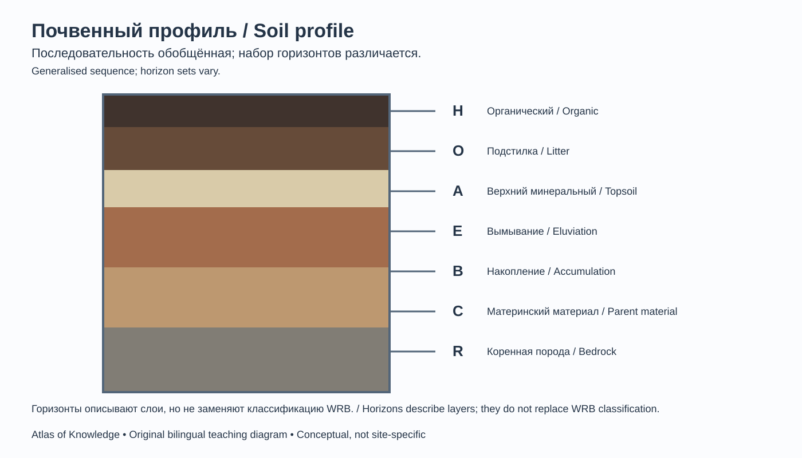
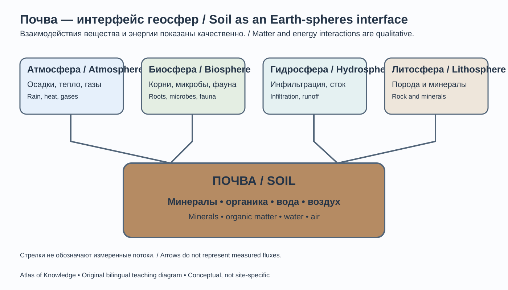
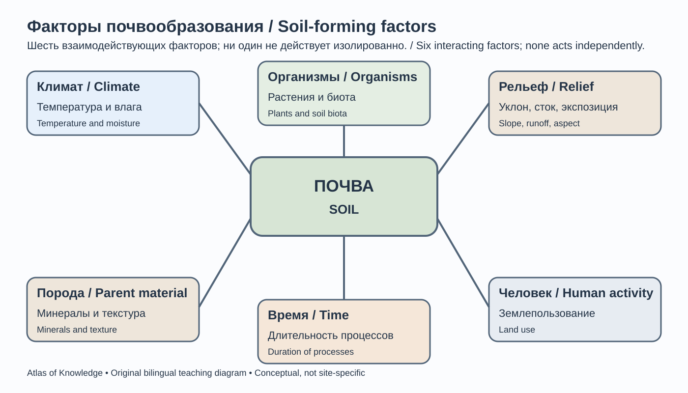
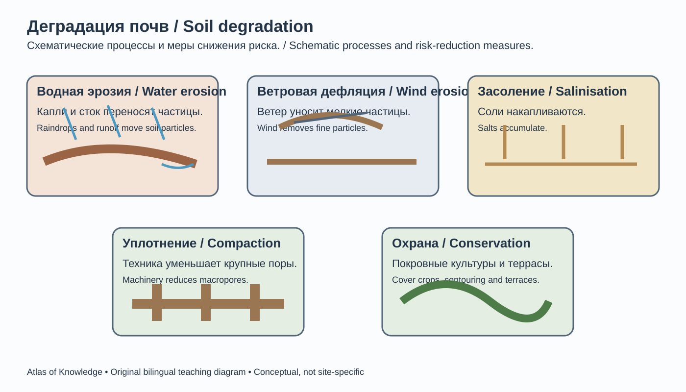
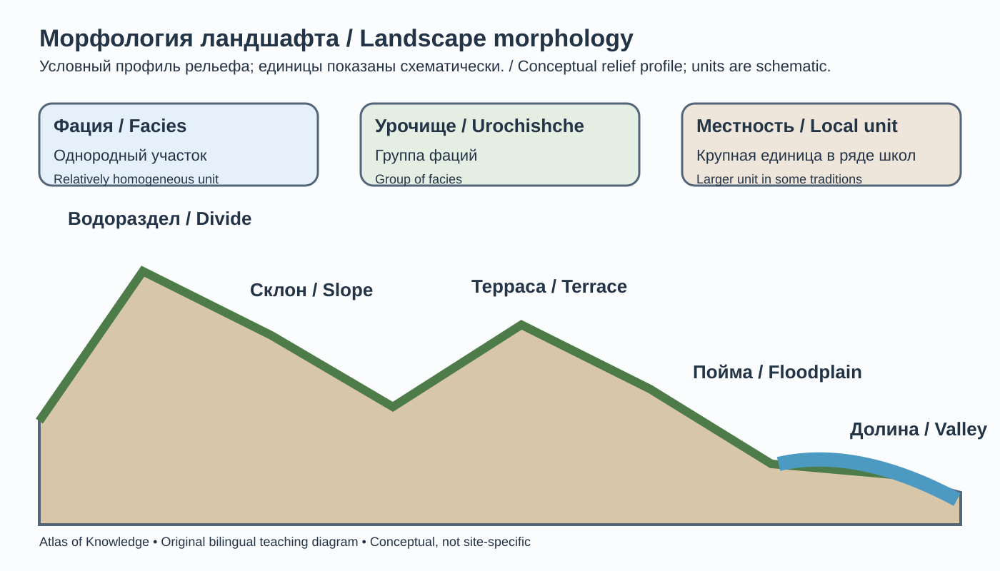
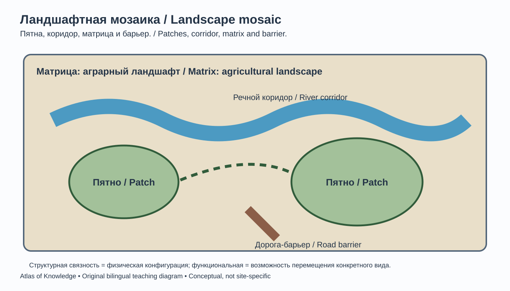

# Глава 8. Почвы и география ландшафтов
# Chapter 8. Soils and Landscape Geography

> **Часть I. Фундаментальная география / Part I. Fundamental Geography**  
> Научно-образовательный атлас географии / Scientific and Educational Geography Atlas

## Цели главы / Chapter objectives

После изучения главы читатель сможет объяснять происхождение и строение почв, различать почвообразующие факторы и процессы, читать почвенные профили, понимать географические закономерности распространения почв, анализировать структуру ландшафтов и оценивать последствия деградации земель.  
After studying this chapter, readers will be able to explain soil formation and structure, distinguish soil-forming factors and processes, interpret soil profiles, understand the geographical distribution of soils, analyse landscape structure, and assess land degradation.

## 8.1. Почва как природное тело / Soil as a Natural Body
<!-- VISUAL ID 08-A — integrated bilingual SVG below -->

*08-A. Авторская двуязычная схема; обозначения описывают горизонты и не заменяют классификацию WRB. / Original bilingual diagram; horizon symbols describe layers and do not replace WRB classification.*

Почва — природное тело, которое формируется у поверхности Земли при длительном взаимодействии минерального материала, органического вещества, воды, воздуха и живых организмов. У неё есть собственные свойства, строение и способность поддерживать рост растений. Почва не равна горной породе: порода может быть её исходным материалом, но почва развивается благодаря выветриванию, накоплению и преобразованию органического вещества, перемещению веществ и деятельности организмов.

Почва выполняет множество функций:
- обеспечивает среду обитания для микроорганизмов, грибов, растений и почвенных животных;
- участвует в круговоротах углерода, азота, фосфора и других элементов;
- регулирует инфильтрацию, накопление и фильтрацию воды;
- служит основой для сельского и лесного хозяйства;
- накапливает органический углерод и влияет на климатическую систему;
- сохраняет природно-историческую информацию о развитии ландшафтов.

Почвоведение — наука о почвах, их происхождении, строении, свойствах, классификации, географии и функциях. Рациональное использование и охрана почв относятся к важным прикладным направлениям почвоведения. В становлении генетического почвоведения важную роль сыграли исследования Василия Докучаева, рассматривавшего почву как самостоятельное природное тело, формирующееся под воздействием комплекса факторов.

<!-- VISUAL ID 08-D — integrated bilingual SVG below -->

*08-D. Авторская двуязычная схема; стрелки обозначают взаимодействия, а не измеренные потоки. / Original bilingual diagram; arrows indicate interactions, not measured fluxes.*

**Рисунок 8.1 / Figure 8.1 — Почва как зона взаимодействия геосфер / Soil as an interface among Earth's spheres.**  
Техническое задание: показать почвенный профиль между атмосферой, растительным покровом, водами и материнской породой; отобразить корни, почвенную фауну, поры с водой и воздухом, органические остатки и минеральные частицы; все элементы подписать на двух языках.
**EN production brief:** Show a soil profile as an interface among the atmosphere, vegetation, water and parent material. Include roots, soil fauna, pores containing water and air, organic remains and mineral particles; label every element in both languages.

## 8.2. Почвообразующие факторы / Soil-Forming Factors

Классическая модель выделяет пять основных факторов почвообразования: климат, организмы, рельеф, материнская порода и время. В современных моделях дополнительно подчёркивается влияние человека и исторического землепользования.

**Климат** определяет температурный и водный режимы, скорость химических реакций, выветривание, разложение органики и вымывание растворимых веществ. Влажные и тёплые условия обычно ускоряют многие процессы, но конкретный результат зависит от растительности, породы и дренажа.

**Организмы** формируют и преобразуют органическое вещество. Растения поставляют опад и корневые выделения; микроорганизмы разлагают органику; почвенные животные перемешивают материал и создают поры. Состав растительного покрова влияет на кислотность, структуру и круговорот питательных элементов.

**Рельеф** влияет на сток, эрозию, увлажнение, освещённость и накопление наносов. На крутых склонах почвы часто тоньше из-за смыва, а в понижениях могут накапливаться вода и тонкодисперсный материал.

**Материнская порода** задаёт исходный минеральный состав, гранулометрические свойства и часть химических характеристик. Однако свойства зрелой почвы не определяются одной породой: они изменяются под действием почвообразования.

**Время** позволяет развиваться горизонтам и накапливаться результатам процессов. Скорость формирования зависит от среды; молодые почвы могут возникать на свежих наносах, лавовых потоках и ледниковых отложениях.

**Человек** меняет почвы распашкой, орошением, осушением, выпасом, строительством, загрязнением, внесением удобрений и лесовосстановлением. Антропогенные воздействия могут как ухудшать, так и улучшать отдельные свойства почвы, но часто создают долгосрочные последствия.

<!-- VISUAL ID 08-E — integrated bilingual SVG below -->

*08-E. Авторская двуязычная схема; факторы показаны как взаимосвязанная система. / Original bilingual diagram; factors are shown as an interacting system.*

**Рисунок 8.2 / Figure 8.2 — Факторы почвообразования / Soil-forming factors.**  
Техническое задание: центральная схема «почва» и шесть связанных блоков: климат, организмы, рельеф, материнская порода, время, человек; показать взаимодействие факторов двунаправленными стрелками, не изображать их как независимые причины.
**EN production brief:** Place “Soil” at the centre and connect it to six interacting factors: climate, organisms, relief, parent material, time and human activity. Use two-way arrows and do not depict the factors as independent causes.

## 8.3. Строение почвенного профиля / Soil Profile and Horizons

Почвенный профиль — вертикальный разрез от поверхности вниз, в котором различают генетические горизонты. Набор и выраженность горизонтов зависят от типа почвы и условий формирования.

В описании почвенных профилей широко используются обозначения главных горизонтов и слоёв H, O, A, E, B, C и R. Эти символы помогают описывать строение профиля, но сами по себе не определяют классификационную группу почвы; наличие и последовательность горизонтов зависят от типа почвы:
- **H** — органический горизонт или слой, обычно связанный с длительным переувлажнением и торфяным материалом;
- **O** — органический горизонт или слой, не относящийся к торфяным и лимническим отложениям, обычно состоящий из растительных остатков и другого органического материала;
- **A** — верхний минеральный горизонт, часто с накоплением гумуса и активной биологической переработкой;
- **E** — горизонт элювиального вымывания, часто более светлый из-за потери глины, железа, алюминия или органических соединений;
- **B** — горизонт накопления или преобразования веществ, вынесенных из верхних горизонтов, либо формирования специфической структуры;
- **C** — слабопреобразованный материал, из которого формируется почва;
- **R** — плотная коренная порода.

Не все профили содержат все перечисленные горизонты. Переходы между ними могут быть постепенными или резкими. В полевых описаниях фиксируют мощность, цвет, структуру, влажность, корни, включения, новообразования и характер границ.

Гумус — сложная совокупность преобразованных органических соединений почвы, а не одно конкретное химическое вещество. Органическое вещество влияет на агрегатную структуру, водоудержание, ёмкость катионного обмена и биологическую активность.

**Рисунок 8.3 / Figure 8.3 — Типовой почвенный профиль / Typical soil profile.**  
Техническое задание: вертикальный разрез с горизонтами H–O–A–E–B–C–R; обозначить корни, гумус, зоны вымывания и накопления, материнский материал и коренную породу; использовать условную цветовую шкалу и пояснить, что не каждая почва имеет все горизонты.
**EN production brief:** Draw a vertical profile showing the H–O–A–E–B–C–R horizons/layers. Label roots, humus, zones of eluviation and accumulation, parent material and bedrock. Use a schematic colour key and state that not every soil contains all these horizons.

## 8.4. Физические свойства почв / Physical Properties of Soils

**Гранулометрический состав** — соотношение частиц разного размера. В распространённой системе выделяют песок, ил (пылеватые частицы) и глину; точные размерные границы зависят от принятого стандарта. Песчаные почвы обычно быстро пропускают воду и слабо удерживают питательные элементы, глинистые обладают большей удельной поверхностью и часто удерживают больше воды, но могут иметь низкую водопроницаемость. Суглинки сочетают свойства разных фракций.

**Структура почвы** — организация частиц в агрегаты. Хорошая агрегатная структура способствует инфильтрации, аэрации и развитию корней. Уплотнение разрушает поровое пространство и затрудняет проникновение воды и воздуха.

**Пористость** — доля объёма почвы, занятая порами. В крупных порах преимущественно движется воздух и быстро проходит вода, в мелких удерживается капиллярная влага. Соотношение пор зависит от текстуры, структуры, органического вещества и уплотнения.

**Плотность сложения** — масса сухой почвы на единицу общего объёма образца, включая поры. Она отличается от плотности твёрдой фазы. Повышенная плотность сложения может ограничивать рост корней и инфильтрацию.

**Водные свойства** включают влагоёмкость, водопроницаемость, капиллярный подъём и доступность влаги растениям. Не вся вода, содержащаяся в почве, доступна растениям: часть удерживается слишком сильно, а часть быстро дренируется.

### 8.4.1. Практический пример: расчёт плотности сложения и пористости почвы / Worked Example: Calculating Soil Bulk Density and Porosity

Для оценки физических свойств почвы можно определить плотность сложения — массу сухой почвы, приходящуюся на единицу общего объёма образца.

**Условный пример.** Из ненарушенного образца известного объёма после высушивания получили 1 300 г почвы. Объём цилиндра для отбора образца составлял 1 000 см³.

**Шаг 1. Рассчитываем плотность сложения.**

Плотность сложения = сухая масса / общий объём образца.

1 300 г / 1 000 см³ = **1,3 г/см³**.

**Шаг 2. Оцениваем общую пористость.**

Для ориентировочного расчёта примем плотность твёрдых минеральных частиц равной 2,65 г/см³. Тогда:

Пористость = (1 − плотность сложения / плотность частиц) × 100%.

(1 − 1,3 / 2,65) × 100% ≈ **50,9%**.

Получается, что около половины общего объёма образца приходится на поры. Это оценка, основанная на принятой плотности частиц, а не прямое измерение каждого вида пор.

**Важно учитывать:** расчёт предполагает преимущественно минеральную почву и незначительное содержание крупных камней. В почвах с большим количеством органического вещества или вулканического материала плотность твёрдых частиц может заметно отличаться. Пористость сама по себе также не показывает, сколько воды доступно растениям: важны размеры пор, структура и влажность.

**Проверьте себя:** образец объёмом 500 см³ после высушивания весит 700 г. Рассчитайте его плотность сложения. **Ответ для самопроверки:** 700 / 500 = 1,4 г/см³.

---

## 8.5. Химические и биологические свойства / Chemical and Biological Properties

Почвенная реакция (pH) характеризует кислотность или щёлочность почвенной среды и связана с активностью ионов водорода. Шкала pH логарифмическая: разница в одну единицу соответствует примерно десятикратной разнице активности ионов водорода. pH влияет на доступность элементов питания, активность микроорганизмов и токсичность некоторых соединений. Оптимальный диапазон зависит от культуры и экосистемы; универсального значения для всех почв нет. Лабораторный результат зависит от метода: pH измеряют, например, в водной или солевой вытяжке при заданном отношении почвы к раствору. Поэтому сравнивать значения следует только при известной и сопоставимой методике.

Ёмкость катионного обмена отражает способность почвы удерживать и обменивать положительно заряженные ионы, включая кальций, магний, калий и аммоний. Она зависит от содержания и типа глинистых минералов и органического вещества.

Засоление связано с накоплением растворимых солей в почве. Оно может снижать способность растений поглощать воду и вызывать ионную токсичность. Осолонцевание, связанное с повышенной долей обменного натрия, может разрушать структуру почвы и ухудшать её водопроницаемость. Засоление и осолонцевание — разные, хотя иногда совместно встречающиеся процессы.

Почвенная биота включает бактерии, археи, грибы, водоросли, простейших, нематод, дождевых червей, членистоногих и других организмов. Она участвует в разложении органики, формировании агрегатов, фиксации азота, минерализации и подавлении некоторых патогенов.

## 8.6. Основные почвообразовательные процессы / Major Soil-Forming Processes

Почвы формируются в результате сочетания процессов, которые могут усиливать или ослаблять друг друга.

- **Гумусообразование** — поступление, разложение и преобразование органических остатков с образованием почвенного органического вещества.
- **Минерализация** — разложение органических соединений до более простых неорганических форм.
- **Элювиирование** — вынос растворимых или тонкодисперсных веществ из верхних горизонтов.
- **Иллювиирование** — накопление вынесенных веществ в нижележащих горизонтах.
- **Кальцификация (накопление карбонатов)** — накопление и преобразование карбонатов кальция и магния в почвенном профиле.
- **Оглеение** — восстановительные процессы при длительном переувлажнении и недостатке кислорода, часто сопровождающиеся характерными серовато-голубыми оттенками.
- **Подзолообразование** — комплекс процессов выноса органо-минеральных соединений и формирования осветлённого горизонта в определённых кислых, промывных условиях.
- **Ферраллитизация** — интенсивное выветривание и относительное накопление оксидов железа и алюминия в тёплых влажных условиях.
- **Засоление и осолонцевание** — накопление солей и/или обменного натрия.
- **Криотурбация** — перемешивание материала в результате процессов замерзания и оттаивания в холодных областях.

## 8.7. География и классификация почв / Soil Geography and Classification

<!-- VISUAL ID 08-B — ISRIC WRB 2014 global map, reproduced unchanged -->

*08-B. Карта ISRIC World Soil Information воспроизведена без изменений. Составители карты: Thomas Caspari и Peter Schad; исходная компиляция — 2015 год, публикация технической записки — 2023 год. © 2022 ISRIC. ISRIC разрешает воспроизведение и распространение при полном указании источника; этот сторонний материал не переводится на CC BY-NC 4.0. [Полный постер и техническая записка](https://files.isric.org/public/WRB/ISRIC_WRB-map_2015_final.pdf). / ISRIC World Soil Information map reproduced unchanged. Map compilers: Thomas Caspari and Peter Schad; original compilation: 2015; technical note published: 2023. © 2022 ISRIC. ISRIC permits reproduction and dissemination provided the source is fully acknowledged; this third-party material is not relicensed under CC BY-NC 4.0. [Full poster and technical note](https://files.isric.org/public/WRB/ISRIC_WRB-map_2015_final.pdf).*

**Как читать карту / Reading the map.** Карта основана на HWSD v1.2 и показывает обобщённое распределение почв по WRB 2014. Несколько RSG объединены в общие классы легенды; карта не отображает все 32 группы отдельными цветами, не является полевой съёмкой и не представляет обновление WRB 2022. Дополнительные категории включают ледники и постоянный снег, внутренние воды и территории без данных. Используйте карту для глобального обзора, а не для оценки отдельного участка. / The map is based on HWSD v1.2 and presents a generalised distribution of soils according to WRB 2014. Several RSGs are combined in shared legend classes; the map does not display all 32 groups as separate colours, is not a field survey, and is not an update to WRB 2022. Ancillary categories include glaciers and permanent snow, inland water, and no-data areas. Use it for global overview, not site-level assessment.

Распределение почв закономерно связано с климатом, растительностью, рельефом, породами и историей территории. В равнинных областях часто проявляется широтная смена почв, а в горах — высотная поясность. Однако почвенная карта не является простым повторением карты климатических поясов: на неё влияют локальный дренаж, экспозиция, материнские породы и землепользование.

Существуют различные системы классификации почв. Международная реферативная база почвенных ресурсов WRB (World Reference Base for Soil Resources; 4-е издание, 2022, с исправлениями 2024 года) используется для международного сопоставления. В национальных системах могут применяться другие диагностические горизонты, критерии и названия. Нельзя механически считать названия почв разных систем полными синонимами. Обозначения H, O, A, E, B, C и R в описании профиля — это главные символы горизонтов и слоёв, а не полный ключ классификации WRB и не универсальная последовательность для каждой почвы. Формальная классификация требует проверки диагностических горизонтов, свойств и материалов по правилам выбранной системы; одного внешнего сходства профиля недостаточно.

В системе WRB 4-го издания выделяют 32 реферативные почвенные группы (Reference Soil Groups, RSG). Это первый уровень классификации; квалификаторы формируют более подробное название второго уровня. Среди RSG — Histosols, Cryosols, Podzols, Chernozems, Kastanozems, Solonchaks, Solonetz, Arenosols, Ferralsols, Fluvisols и Leptosols. Это названия единиц международной классификации, а не просто описания природных зон.

В обзорных учебных материалах также встречаются описательные выражения вроде «тёмные гумусовые почвы степей», «засушливые почвы полупустынь», «аллювиальные почвы долин» или «горные почвы». Они полезны для объяснения географических закономерностей, но не всегда соответствуют одной конкретной RSG. Поэтому на карте и в легенде нельзя смешивать формальные единицы WRB, национальные названия и обобщённые ландшафтные описания. Если используется упрощённая карта, это должно быть прямо указано в заголовке и легенде.

При использовании слоя почвенных групп SoilGrids 2.0 важно учитывать его отдельное происхождение: он основан на агрегированных прогнозах версии 2017 года и классификации WRB 2006, включает 30 групп и не является новой картой по WRB 4-го издания (2022). Эти данные нельзя подписывать как современную карту всех 32 групп WRB 2022.

**Рисунок 8.4 / Figure 8.4 — Глобальная карта почв / Global soil map.**  
Техническое задание: выбрать один из двух разных продуктов — карту почвенных групп по WRB (с указанием редакции классификации и происхождения данных) либо карту отдельных свойств почвы (например, pH или органического углерода) по SoilGrids; не объединять их в одну неразличимую легенду. Указать год/версию набора, пространственное разрешение, глубину, единицы, метод получения и неопределённость; показать пробелы и зоны низкой плотности полевых наблюдений.
**EN production brief:** Choose one of two distinct products: a WRB soil-group map (identify the classification edition and data provenance) or a map of a specific soil property (for example, pH or organic carbon) from SoilGrids. Do not combine them in one ambiguous legend. State dataset version/date, spatial resolution, depth interval, units, method and uncertainty; show data gaps and areas with sparse field observations.

## 8.8. Почвы основных природных зон / Soils Across Major Natural Zones

Влажные тропические области часто характеризуются интенсивным химическим выветриванием и вымыванием оснований. При этом высокая продуктивность лесов может поддерживаться быстрым круговоротом элементов в биомассе, а не высоким запасом питательных веществ в минеральной почве.

В саваннах и сезонных тропических лесах почвы отличаются по режиму увлажнения, глубине профиля, содержанию железа и органического вещества. Чередование влажного и сухого сезонов влияет на вымывание и накопление веществ.

В умеренных степях при подходящих условиях формируются тёмные гумусовые почвы с мощным верхним горизонтом. Их плодородие связано с накоплением органического вещества и структурой, однако распашка и эрозия могут быстро уменьшать запасы гумуса.

В пустынях и полупустынях дефицит влаги ограничивает вымывание. В некоторых районах накапливаются карбонаты, гипс и растворимые соли. Орошаемое земледелие без эффективного дренажа может усиливать вторичное засоление.

В бореальных лесах кислые условия и промывной водный режим могут способствовать формированию элювиальных и иллювиальных горизонтов. В тундре низкие температуры замедляют разложение органики, а мерзлота влияет на дренаж и строение профиля.

В горах почвенный покров часто мозаичен: на склонах развиваются маломощные почвы, в долинах накапливаются аллювиальные отложения, а на разных высотах меняются температура, влажность и растительность.

## 8.9. Почвенная эрозия и деградация земель / Soil Erosion and Land Degradation
<!-- VISUAL ID 08-C — integrated bilingual SVG below -->

*08-C. Авторская двуязычная схема; процессы показаны концептуально, не в масштабе и без количественных оценок. / Original bilingual diagram; processes are conceptual, not to scale and not quantified.*

Деградация земель — снижение биологической продуктивности, экологических функций и/или хозяйственной ценности земель вследствие природных и антропогенных процессов. Это широкое учебное определение следует отличать от специального определения Конвенции ООН по борьбе с опустыниванием (UNCCD), применяемого к засушливым, полузасушливым и сухим субгумидным территориям.

**Водная эрозия** возникает при отделении и переносе частиц дождевыми каплями и поверхностным стоком. Она проявляется плоскостным смывом, образованием промоин и оврагов. Риск возрастает при удалении растительного покрова, уплотнении почвы, крутых склонах и интенсивных осадках.

**Ветровая эрозия** переносит мелкие частицы с открытых сухих поверхностей. Ей способствуют засушливость, сильный ветер, отсутствие растительного покрова и чрезмерная распашка.

Другие формы деградации:
- уплотнение почв тяжёлой техникой и чрезмерным выпасом;
- потеря органического вещества и снижение плодородия;
- засоление при неправильном орошении и недостаточном дренаже;
- загрязнение тяжёлыми металлами, нефтепродуктами, пестицидами и отходами;
- заболачивание при нарушении водного режима;
- опустынивание — деградация земель в засушливых, полузасушливых и сухих субгумидных областях, обусловленная различными климатическими и антропогенными факторами.

Опустынивание не означает простое «движение пустыни» и не тождественно естественному существованию пустынных экосистем. Согласно определению UNCCD, это деградация земель в аридных, полузасушливых и сухих субгумидных районах под воздействием различных факторов, включая климатические колебания и деятельность человека.

**Рисунок 8.5 / Figure 8.5 — Формы почвенной эрозии / Types of soil erosion.**  
Техническое задание: три панели — плоскостной смыв, овражная эрозия и дефляция; показать направление переноса частиц, роль растительного покрова и меры снижения риска; не преувеличивать масштабы для иллюстративной ясности.
**EN production brief:** Use three panels to show sheet erosion, gully erosion and wind deflation. Indicate particle movement, the role of vegetation cover and risk-reduction measures; do not exaggerate process scale for visual effect.

## 8.10. Охрана и устойчивое управление почвами / Soil Conservation and Sustainable Management

Почвы формируются медленно, а плодородный верхний слой при интенсивной эрозии может теряться значительно быстрее. Поэтому рациональное управление направлено на сохранение структуры, органического вещества, водного режима и биологической активности.

К эффективным мерам относятся:
- контурная обработка склонов и террасирование там, где это обосновано;
- покровные культуры, мульчирование и сохранение растительных остатков;
- севообороты и поддержание разнообразия культур;
- минимизация ненужного уплотнения тяжёлой техникой;
- регулируемый выпас и восстановление растительного покрова;
- лесополосы и защитные полосы вдоль водотоков;
- рациональное орошение и дренаж с контролем солевого баланса;
- предотвращение загрязнения и безопасное обращение с отходами;
- восстановление деградированных почв с учётом местной экологии.

Нулевая или минимальная обработка почвы может уменьшать эрозию в ряде условий, но её результат зависит от климата, почвы, севооборота, техники и управления остатками. Ни одна агротехнология не является универсальной для всех регионов.

## 8.11. Ландшафт как географическая система / Landscape as a Geographical System

Ландшафт — территориальная система взаимосвязанных природных и антропогенно изменённых компонентов, обладающая определённой структурой, функционированием и историей развития. В физической географии термин может использоваться в разных масштабах: от локального урочища до крупного регионального комплекса. Поэтому при анализе всегда следует указывать масштаб и принятую классификацию.

Компоненты ландшафта:
- геологическое основание и рельеф;
- климат и микроклимат;
- поверхностные и подземные воды;
- почвы;
- растительность и животный мир;
- хозяйственная деятельность и созданная человеком инфраструктура.

Ландшафтная структура включает взаимное расположение природных комплексов, их границы, связность, мозаичность и иерархию. Функционирование отражает обмен энергией, водой, веществом и организмами. Динамика — изменения в течение сезонов, лет и геологических периодов.

Природные ландшафты редко бывают полностью изолированными. Вода и наносы перемещаются по склонам и долинам, организмы расселяются, а пожары и паводки могут воздействовать на большие площади. Поэтому границы ландшафтных единиц часто являются переходными.

## 8.12. Классификация и морфология ландшафтов / Landscape Classification and Morphology

Ландшафты классифицируют по происхождению, рельефу, климату, увлажнению, растительности, почвам и степени антропогенного преобразования.

По ведущим природным условиям выделяют, например, равнинные, горные, прибрежные, речные, болотные, пустынные и лесные ландшафты. По степени преобразования различают природные, слабоизменённые, культурные, аграрные, городские и техногенные ландшафты. Эти категории не всегда взаимоисключающие: городской ландшафт может включать речные террасы, природные склоны и искусственные поверхности.

В ландшафтном анализе применяют понятия:
- **ландшафтная фация** — относительно однородный небольшой природный участок; уточнение «ландшафтная» отличает эту единицу от геологической фации;
- **урочище** — закономерно связанная группа ландшафтных фаций, часто приуроченная к определённой форме рельефа;
- **местность** — более крупная морфологическая единица в ряде отечественных школ;
- **ландшафт** — целостная территориальная система более высокого уровня.

Точные определения и иерархия этих единиц зависят от научной школы. В атласе следует придерживаться одной терминологической системы и объяснять её читателю.

<!-- VISUAL ID 08-F — integrated bilingual SVG below -->

*08-F. Авторская двуязычная схема; рельеф и границы не обозначают конкретную территорию, терминологическая иерархия зависит от научной школы. / Original bilingual diagram; relief and boundaries do not represent a real location, and terminology varies by scholarly tradition.*

**Рисунок 8.6 / Figure 8.6 — Морфологическая структура ландшафта / Morphological structure of a landscape.**  
Техническое задание: схематический блок-диаграммный ландшафт с водоразделом, склоном, террасой, поймой и долиной; выделить фации и урочища условными контурами; подписать взаимосвязи стока и переноса вещества.
**EN production brief:** Create a schematic block diagram of a landscape with a watershed divide, slope, terrace, floodplain and valley. Outline facies and landscape units schematically, and label runoff and material-transfer connections.

## 8.13. Антропогенные ландшафты и землепользование / Human-Modified Landscapes and Land Use

Человек преобразует ландшафты через сельское хозяйство, урбанизацию, транспорт, промышленность, добычу полезных ископаемых, водохранилища и лесное хозяйство. Эти изменения влияют на микроклимат, сток, эрозию, биоразнообразие и круговорот вещества.

Аграрные ландшафты обеспечивают продовольствие, но могут быть связаны с монокультурами, потерей местообитаний, эрозией и химической нагрузкой. Городские ландшафты характеризуются высокой долей искусственных покрытий, изменённым водным балансом, эффектом городского острова тепла и фрагментацией природных территорий.

Ландшафтное планирование стремится согласовать размещение хозяйственной деятельности с природными ограничениями и экологическими функциями территории. Важны водосборный подход, сохранение экологических коридоров, защита склонов и пойм, а также оценка кумулятивного воздействия нескольких проектов.

## 8.14. Ландшафтная экология и пространственные процессы / Landscape Ecology and Spatial Processes

Ландшафтная экология исследует, как пространственная структура территории влияет на экологические процессы. Часто анализируют три элемента:
- **пятна** — участки относительно однородного покрова;
- **коридоры** — линейные элементы, связывающие пятна или обеспечивающие перемещение;
- **матрица** — преобладающий фон ландшафта, внутри которого расположены пятна и коридоры.

Связность может быть структурной — физическая непрерывность элементов — и функциональной — возможность перемещения конкретного организма или потока вещества. Коридор, полезный для одного вида, может быть барьером или источником риска для другого.

Краевой эффект проявляется в изменении условий на границе двух типов местообитаний: освещённости, ветра, влажности, температуры, состава видов и давления хищников. Сильная фрагментация увеличивает долю краевых участков и может уменьшать площадь внутреннего местообитания.

<!-- VISUAL ID 08-G — integrated bilingual SVG below -->

*08-G. Авторская двуязычная схема; структурная и функциональная связность различаются, конкретные маршруты видов не изображены. / Original bilingual diagram; structural and functional connectivity are distinguished, with no species-specific routes represented.*

**Рисунок 8.7 / Figure 8.7 — Мозаика ландшафта: пятна, коридоры и матрица / Landscape mosaic: patches, corridors and matrix.**  
Техническое задание: плановая схема природной территории с лесными пятнами, речным коридором, аграрной матрицей и дорогой-барьером; показать структурную и функциональную связность разными условными обозначениями.
**EN production brief:** Create a plan-view diagram of a natural area with forest patches, a river corridor, an agricultural matrix and a road acting as a barrier. Use different symbols to distinguish structural from functional connectivity.

## 8.15. Методы почвенных и ландшафтных исследований / Methods in Soil and Landscape Studies

Исследования объединяют полевые наблюдения, лабораторные анализы, картографирование и геоинформационные методы.

| Метод / Method | Объект и данные / Object and data | Назначение / Purpose |
|---|---|---|
| Почвенный разрез / Soil pit | Горизонты, структура, корни, включения / Horizons, structure, roots | Описание профиля / Profile description |
| Бурение и отбор проб / Soil augering and sampling | Образцы с заданной глубины / Samples at specified depths | Анализ свойств / Soil analysis |
| Гранулометрический анализ / Particle-size analysis | Доля песка, ила и глины / Sand, silt and clay fractions | Классификация текстуры / Texture classification |
| Химический анализ / Chemical analysis | pH, органический углерод, соли, элементы / pH, organic carbon, salts, elements | Оценка плодородия и загрязнения / Fertility and contamination assessment |
| Инфильтрационные измерения / Infiltration measurements | Скорость поступления воды / Water infiltration rate | Оценка водного режима / Hydrological assessment |
| Геоботанические описания / Vegetation surveys | Состав и покрытие растительности / Species composition and cover | Ландшафтная характеристика / Landscape characterization |
| Дистанционное зондирование / Remote sensing | Спектральные характеристики поверхности / Surface spectral properties | Мониторинг земного покрова / Land-cover monitoring |
| ГИС-анализ / GIS analysis | Рельеф, почвы, землепользование / Terrain, soils, land use | Пространственное моделирование / Spatial modelling |

Полевые и лабораторные данные должны сопровождаться координатами, датой, глубиной отбора, методикой, единицами измерения и сведениями о качестве. Спутниковые индексы растительности не являются прямым измерением плодородия почвы: их интерпретация требует наземной проверки и учёта сезонности.

**Цифровые почвенные карты.** SoilGrids — глобальный продукт цифрового картографирования, в котором свойства почв моделируются по данным почвенных профилей и экологическим переменным. Для версии SoilGrids 2.0 публикуются прогнозы с размером ячейки 250 м для шести стандартных интервалов глубины: 0–5, 5–15, 15–30, 30–60, 60–100 и 100–200 см. Неопределённость прогноза для каждого свойства и интервала глубины представлена 90%-м прогнозным интервалом (5-й–95-й процентили). Размер ячейки характеризует пространственное разрешение, но не гарантирует точность прогноза на таком же расстоянии. Это модельные прогнозы, а не измерения в каждой точке и не замена местной почвенной съёмке. Плотность исходных наблюдений неодинакова: в документации ISRIC отдельно отмечены пробелы для Центральной Азии, поэтому для Кыргызстана нельзя трактовать пиксельную детализацию как подтверждённую точность на местности. При использовании таких карт нужно указывать версию, свойство, глубину, единицы, интервал неопределённости и дату доступа; для локальных решений результаты следует проверять полевыми пробами.

### 8.15.1. Как выявлять и оценивать засоление почв / Identifying and Assessing Soil Salinity

Засоление — накопление растворимых солей в почве до уровня, который может ухудшать рост растений и свойства почвенной среды. Оно часто связано с сочетанием природных условий и управления водой: испарением, слабым дренажом, близким залеганием минерализованных грунтовых вод и неправильным орошением. Белая корка на поверхности может быть признаком, но не является достаточным подтверждением и не показывает степень засоления.

**Как проводят обследование:** описывают рельеф, землепользование, полив и дренаж; отбирают почвенные пробы на нескольких глубинах и в повторностях; измеряют электропроводность почвенной вытяжки по установленному протоколу; при необходимости определяют состав солей, pH и свойства грунтовых вод. Для сопоставимых лабораторных оценок часто используют электропроводность вытяжки из насыщенной почвенной пасты (ECe), приводимую к 25 °C и выражаемую в дСм/м. Показатели для вытяжек с другими отношениями почва:вода (например, 1:5) и полевые показания кажущейся электропроводности не являются взаимозаменяемыми с ECe: результат зависит от разбавления, текстуры, влажности и минералогии. Поэтому в отчёте обязательно указывают тип вытяжки или прибора, отношение почва:вода, температуру и единицы.

**Пространственная неоднородность.** Засоление может резко меняться на небольшом расстоянии — например, вдоль оросительного канала, в понижении или у края поля. Поэтому одна проба не характеризует весь участок. Схема отбора должна учитывать рельеф, тип почвы, режим полива и видимые различия растительности.

**Не путать засоление и осолонцевание.** Засоление связано с избытком растворимых солей; осолонцевание — с повышенной долей обменного натрия и изменением структуры почвы. Эти процессы могут сочетаться, но требуют разных диагностических показателей и мер управления.

Пороговые значения засоления также зависят от принятой классификации и метода. Исторически часто приводится ECe около 4 дСм/м при 25 °C, но это не универсальная граница вреда для всех культур и почв: чувствительные растения могут реагировать на более низкие значения, а устойчивость культур различается. Не следует переносить порог для ECe на результаты вытяжки 1:5 без валидированной для конкретных условий процедуры пересчёта. Электропроводность характеризует суммарное содержание растворённых ионов, но сама по себе не показывает, какие именно соли присутствуют и насколько выражено осолонцевание; для этих выводов нужны отдельные химические и обменные показатели.

**Учебное задание.** Разработайте схему отбора проб для орошаемого участка: обозначьте не менее трёх типов микроположений и две глубины. Укажите, какие данные о поливе и дренаже нужно собрать, прежде чем рекомендовать меры по улучшению почвы.

## English-language chapter text

### 8.1. Soil as a Natural Body

Soil is a natural body that forms near Earth's surface through the long-term interaction of mineral material, organic matter, water, air and living organisms. It has its own properties and structure and can support plant growth. Soil is not the same as rock: rock may provide its parent material, but soil develops through weathering, the accumulation and transformation of organic matter, the movement of substances and biological activity.

Soil performs many functions:
- provides habitat for microorganisms, fungi, plants and soil animals;
- participates in the cycles of carbon, nitrogen, phosphorus and other elements;
- regulates water infiltration, storage and filtration;
- provides the foundation for agriculture and forestry;
- stores organic carbon and influences the climate system; and
- preserves natural and historical information about landscape development.

Pedology is the study of soil formation, morphology, properties, classification and geographical distribution. The sustainable use and conservation of soils are important applied fields of soil science. Vasily Dokuchaev played an important role in the development of genetic soil science by treating soil as an independent natural body formed through the combined influence of several factors.

### 8.2. Soil-Forming Factors

The classical model identifies five main soil-forming factors: climate, organisms, relief, parent material and time. Modern models also emphasise human influence and the history of land use.

**Climate** determines temperature and moisture regimes, the rate of chemical reactions, weathering, organic-matter decomposition and the leaching of soluble substances. Warm, humid conditions often accelerate many processes, but the outcome also depends on vegetation, parent material and drainage.

**Organisms** create and transform organic matter. Plants supply litter and root exudates; microorganisms decompose organic matter; soil animals mix material and create pores. Vegetation affects acidity, structure and nutrient cycling.

**Relief** influences runoff, erosion, moisture, sunlight and sediment accumulation. Soils on steep slopes are often thin because of material removal, while water and fine sediments may accumulate in depressions.

**Parent material** provides the initial mineral composition, particle-size properties and some chemical characteristics. However, mature soil properties are not determined by parent material alone; they are modified by soil-forming processes.

**Time** allows horizons to develop and the results of processes to accumulate. Formation rates depend on environmental conditions. Young soils may develop on fresh alluvium, lava flows and glacial deposits.

**People** alter soils through ploughing, irrigation, drainage, grazing, construction, pollution, fertiliser use and forest restoration. Human impacts can improve or worsen particular soil properties, but they often have long-term consequences.

### 8.3. Soil Profile and Horizons

A soil profile is a vertical section from the surface downwards in which genetic horizons can be distinguished. The number and expression of horizons depend on soil type and formation conditions.

Soil-profile descriptions commonly use the master-horizon and layer symbols H, O, A, E, B, C and R. These symbols help describe profile structure, but they do not by themselves determine a soil's classification group; the presence and sequence of horizons depend on the soil:

- **H:** an organic horizon or layer generally associated with prolonged water saturation and peat material;
- **O:** an organic horizon or layer that is not peat or limnic material, usually consisting of plant remains and other organic matter;
- **A:** upper mineral horizon, often with humus accumulation and active biological processing;
- **E:** eluviated horizon, often lighter in colour because clay, iron, aluminium or organic compounds have been removed;
- **B:** horizon where materials from upper layers accumulate or are transformed, or where a distinctive structure develops;
- **C:** weakly altered material from which the soil develops; and
- **R:** hard bedrock.

Not every soil profile contains all these horizons. Boundaries may be gradual or sharp. Field descriptions record horizon thickness, colour, structure, moisture, roots, inclusions, new formations and boundary characteristics.

Humus is a complex mixture of transformed organic compounds in soil, not one specific chemical substance. Organic matter influences aggregate structure, water retention, cation-exchange capacity and biological activity.

### 8.4. Physical Properties of Soils

**Soil texture** is the proportion of particles of different sizes. Common systems distinguish sand, silt and clay, although exact particle-size boundaries depend on the standard used. Sandy soils usually transmit water quickly and retain fewer nutrients. Clay soils have a larger specific surface area and often retain more water, but may have low permeability. Loams combine properties of different particle-size fractions.

**Soil structure** is the arrangement of particles into aggregates. Good aggregate structure supports infiltration, aeration and root growth. Compaction destroys pore space and restricts the movement of water and air.

**Porosity** is the share of total soil volume occupied by pores. Large pores mainly transmit air and allow rapid water movement; small pores retain capillary water. The pore-size distribution depends on texture, structure, organic matter and compaction.

**Bulk density** is the mass of dry soil per unit of total sample volume, including pores. It differs from particle density. High bulk density may restrict root growth and infiltration.

**Soil-water properties** include water-holding capacity, permeability, capillary rise and plant-available water. Not all water in soil is available to plants: some is held too strongly, while some drains rapidly.

### 8.4.1. Worked Example: Calculating Soil Bulk Density and Porosity

Soil bulk density is the mass of dry soil per unit of the sample's total volume.

**Hypothetical example.** An undisturbed soil sample has a dry mass of 1,300 g. The sampling cylinder has a volume of 1,000 cm³.

**Step 1. Calculate bulk density.**

Bulk density = dry mass / total sample volume.

1,300 g / 1,000 cm³ = **1.3 g/cm³**.

**Step 2. Estimate total porosity.**

For an approximate calculation, assume a particle density of 2.65 g/cm³ for mineral soil. Then:

Porosity = (1 − bulk density / particle density) × 100%.

(1 − 1.3 / 2.65) × 100% ≈ **50.9%**.

This means that about half of the sample's total volume consists of pores. It is an estimate based on the assumed particle density, not a direct measurement of every pore type.

**Important limitations:** the calculation assumes predominantly mineral soil with few coarse stones. In soils rich in organic matter or volcanic material, particle density may differ substantially. Porosity alone also does not show how much water is available to plants; pore sizes, soil structure and moisture conditions matter.

**Check your understanding:** An oven-dry sample has a volume of 500 cm³ and a mass of 700 g. Calculate its bulk density. **Answer:** 700 / 500 = 1.4 g/cm³.

---

### 8.5. Chemical and Biological Properties

Soil reaction (pH) describes the acidity or alkalinity of the soil environment and is related to hydrogen-ion activity. The pH scale is logarithmic: a difference of one unit corresponds to an approximately tenfold difference in hydrogen-ion activity. Soil pH affects nutrient availability, microbial activity and the toxicity of some compounds. The optimum range depends on the crop or ecosystem; there is no universal value for all soils. Laboratory results depend on the method: pH may be measured, for example, in a water or salt extract at a specified soil-to-solution ratio. Values should therefore be compared only when the methods are known and comparable.

Cation-exchange capacity describes the ability of soil to retain and exchange positively charged ions, including calcium, magnesium, potassium and ammonium. It depends on the amount and type of clay minerals and organic matter.

Salinisation is associated with the accumulation of soluble salts in soil. It can reduce plants' ability to absorb water and cause ion toxicity. Sodicity, in which the proportion of exchangeable sodium is elevated, can damage soil structure and reduce permeability. Salinity and sodicity are different processes, although they may occur together.

Soil biota include bacteria, archaea, fungi, algae, protozoa, nematodes, earthworms, arthropods and other organisms. They contribute to organic-matter decomposition, aggregate formation, nitrogen fixation, mineralisation and the suppression of some pathogens.

### 8.6. Major Soil-Forming Processes

Soils develop through combinations of processes that may reinforce or counteract one another.

- **Humus formation:** the input, decomposition and transformation of organic remains into soil organic matter.
- **Mineralisation:** the breakdown of organic compounds into simpler inorganic forms.
- **Eluviation:** the removal of soluble or fine materials from upper horizons.
- **Illuviation:** the accumulation of materials transported from upper horizons into lower ones.
- **Calcification (carbonate accumulation):** the accumulation and transformation of calcium and magnesium carbonates within the soil profile.
- **Gleying:** reducing processes under prolonged waterlogging and low oxygen, often associated with greyish-blue colours.
- **Podzolisation:** a group of processes involving the removal of organic-mineral compounds and formation of a bleached horizon under certain acidic, leaching conditions.
- **Ferralitisation:** intense weathering and relative accumulation of iron and aluminium oxides under warm, humid conditions.
- **Salinisation and sodification:** accumulation of soluble salts and/or exchangeable sodium.
- **Cryoturbation:** mixing of soil material through freezing and thawing in cold regions.

### 8.7. Soil Geography and Classification

<!-- VISUAL ID 08-B — ISRIC WRB 2014 global map, reproduced unchanged -->

*08-B. ISRIC World Soil Information map reproduced unchanged. Map compilers: Thomas Caspari and Peter Schad; original compilation: 2015; technical note published: 2023. © 2022 ISRIC. ISRIC permits reproduction and dissemination provided the source is fully acknowledged; this third-party material is not relicensed under CC BY-NC 4.0. [Full poster and technical note](https://files.isric.org/public/WRB/ISRIC_WRB-map_2015_final.pdf).*

**Reading the map.** The map is based on HWSD v1.2 and presents a generalised distribution of soils according to WRB 2014. Several RSGs are combined in shared legend classes; the map does not display all 32 groups as separate colours, is not a field survey, and is not an update to WRB 2022. Ancillary categories include glaciers and permanent snow, inland water, and no-data areas. Use it for global overview, not site-level assessment.

Soil distribution is systematically related to climate, vegetation, relief, parent material and regional history. In plains, latitudinal soil zonation may be evident; in mountains, soils often show altitudinal belts. However, soil maps do not simply reproduce climate-zone maps: local drainage, slope aspect, parent material and land use also matter.

Different soil-classification systems exist. The World Reference Base for Soil Resources (WRB; 4th edition, 2022, with corrections published in 2024) is widely used for international comparison. National systems may use different diagnostic horizons, criteria and names. Soil names from different systems should not automatically be treated as exact synonyms. The H, O, A, E, B, C and R labels used in a general soil-profile description are master horizon and layer designations, not the complete WRB classification key and not a universal sequence present in every soil. Formal classification requires checking diagnostic horizons, properties and materials under the rules of the selected system; visual resemblance alone is insufficient.

The fourth edition of WRB recognises 32 Reference Soil Groups (RSGs). These form the first classification level; qualifiers provide the more detailed second-level name. Examples of RSGs include Histosols, Cryosols, Podzols, Chernozems, Kastanozems, Solonchaks, Solonetz, Arenosols, Ferralsols, Fluvisols and Leptosols. These are units of an international classification, not simply descriptions of natural zones.

Global teaching materials also use descriptive expressions such as “dark humus-rich steppe soils”, “dryland soils of semi-deserts”, “alluvial valley soils” and “mountain soils”. These are useful for explaining geographical patterns, but they do not always correspond to one specific RSG. A map legend must therefore not mix formal WRB units, national soil names and broad landscape descriptions. If a simplified map is used, this must be stated clearly in its title and legend.

When using the SoilGrids 2.0 soil-group layer, its separate provenance must be considered: it aggregates predictions from the 2017 release based on WRB 2006, covers 30 groups and is not a new map using the fourth edition of WRB (2022). It must not be labelled as a current map of all 32 WRB 2022 groups.

### 8.8. Soils Across Major Natural Zones

Humid tropical regions often have intense chemical weathering and leaching of base cations. Forest productivity may be sustained by rapid nutrient cycling in biomass rather than by large nutrient stores in mineral soil.

In savannas and seasonal tropical forests, soils differ in moisture regime, profile depth, iron content and organic matter. The alternation of wet and dry seasons influences leaching and the accumulation of substances.

In temperate steppes, suitable conditions may produce dark humus-rich soils with a thick upper horizon. Their fertility is associated with organic-matter accumulation and soil structure, but ploughing and erosion can rapidly reduce humus stocks.

In deserts and semi-deserts, moisture deficit limits leaching. Carbonates, gypsum and soluble salts may accumulate in some areas. Irrigated agriculture without effective drainage can intensify secondary salinisation.

In boreal forests, acidic conditions and leaching water regimes may promote eluviated and illuviated horizons. In tundra, low temperatures slow organic-matter decomposition, while permafrost affects drainage and profile development.

Mountain soils are often patchy: slopes may have shallow soils, valleys accumulate alluvial deposits, and temperature, moisture and vegetation change with elevation.

### 8.9. Soil Erosion and Land Degradation

Land degradation is a decline in the biological productivity, ecological functions and/or economic value of land caused by natural and human-driven processes. This broad teaching definition should be distinguished from the specific UNCCD Convention definition, which applies to arid, semi-arid and dry sub-humid areas.

**Water erosion** occurs when raindrops and surface runoff detach and transport soil particles. It may appear as sheet wash, rills and gullies. Risk increases when vegetation is removed, soil is compacted, slopes are steep and rainfall is intense.

**Wind erosion** transports fine particles from exposed, dry surfaces. It is promoted by aridity, strong winds, lack of vegetation cover and excessive cultivation.

Other forms of degradation include soil compaction by heavy machinery and excessive grazing; loss of organic matter and fertility; salinisation under inappropriate irrigation and inadequate drainage; contamination by heavy metals, petroleum products, pesticides and waste; waterlogging caused by altered water regimes; and **desertification**—land degradation in arid, semi-arid and dry sub-humid areas caused by various climatic and human factors.

Desertification does not simply mean the “movement of the desert”, and it is not the same as the natural existence of desert ecosystems. Under the UNCCD definition, it is land degradation in arid, semi-arid and dry sub-humid areas resulting from various factors, including climatic variations and human activities.

### 8.10. Soil Conservation and Sustainable Management

Soils form slowly, while the fertile top layer may be lost much faster through intensive erosion. Sustainable management therefore aims to conserve soil structure, organic matter, water regime and biological activity.

Effective measures include contour cultivation and terracing where appropriate; cover crops, mulching and retention of plant residues; crop rotation and crop diversity; avoiding unnecessary compaction by heavy machinery; regulated grazing and vegetation restoration; shelterbelts and riparian buffer strips; appropriate irrigation and drainage with salt-balance monitoring; pollution prevention and safe waste management; and restoration of degraded soils according to local ecology.

No-till or reduced-tillage practices can reduce erosion in some conditions, but outcomes depend on climate, soil, crop rotation, machinery and residue management. No single agricultural technique is universal.

### 8.11. Landscape as a Geographical System

A landscape is a territorial system of interacting natural and human-modified components with a particular structure, functioning and developmental history. In physical geography, the term is used at different scales, from a local landscape unit to a large regional complex. The scale and classification used should therefore always be stated.

Landscape components include geological foundation and relief; climate and microclimate; surface and groundwater; soils; vegetation and wildlife; and human activity and infrastructure.

Landscape structure includes the relative arrangement of natural complexes, their boundaries, connectivity, mosaic pattern and hierarchy. Functioning refers to the exchange of energy, water, matter and organisms. Dynamics describe changes over seasons, years and geological periods.

Natural landscapes are rarely completely isolated. Water and sediment move along slopes and valleys, organisms disperse, and fires or floods may affect large areas. Landscape-unit boundaries are therefore often transitional.

### 8.12. Landscape Classification and Morphology

Landscapes may be classified by origin, relief, climate, moisture, vegetation, soils and degree of human transformation.

Depending on dominant natural conditions, examples include plains, mountains, coasts, river landscapes, wetlands, deserts and forests. By degree of transformation, landscapes may be natural, slightly modified, cultural, agricultural, urban or industrial. These categories are not always mutually exclusive: an urban landscape may include river terraces, natural slopes and artificial surfaces.

Landscape analysis uses concepts such as:
- **landscape facies:** a relatively small, internally uniform natural site; the qualifier “landscape” distinguishes this unit from geological facies;
- **urochishche:** a group of related landscape facies, often associated with a particular landform;
- **mestnost:** a larger landscape-morphological unit in some Eastern European schools; and
- **landscape:** an integrated territorial system at a higher level.

Exact definitions and hierarchy depend on the scientific school. An atlas should use one terminology system consistently and explain it to readers.

### 8.13. Human-Modified Landscapes and Land Use

People transform landscapes through agriculture, urbanisation, transport, industry, mining, reservoirs and forestry. These changes affect microclimate, runoff, erosion, biodiversity and matter cycles.

Agricultural landscapes provide food but may involve monocultures, habitat loss, erosion and chemical pressures. Urban landscapes have a high share of artificial surfaces, altered water balance, urban heat-island effects and fragmented natural areas.

Landscape planning aims to align economic activity with natural constraints and ecological functions. Important approaches include catchment-based planning, conservation of ecological corridors, protection of slopes and floodplains, and assessment of cumulative impacts from multiple projects.

### 8.14. Landscape Ecology and Spatial Processes

Landscape ecology studies how spatial structure influences ecological processes. Three common elements are:
- **patches:** areas with relatively uniform cover;
- **corridors:** linear features that connect patches or facilitate movement; and
- **matrix:** the dominant landscape background within which patches and corridors occur.

Connectivity may be **structural**, meaning physical continuity of landscape elements, or **functional**, meaning the ability of a particular organism or material flow to move through the landscape. A corridor that benefits one species may be a barrier or source of risk for another.

The **edge effect** is the change in conditions along the boundary between two habitat types, including light, wind, moisture, temperature, species composition and predator pressure. Strong fragmentation increases the share of edge habitat and may reduce the area of interior habitat.

### 8.15. Methods in Soil and Landscape Studies

Soil and landscape research combines field observations, laboratory analyses, mapping and geospatial methods.

Common methods include soil pits for describing horizons, structure and roots; soil augering and sampling at specified depths; particle-size analysis of sand, silt and clay; chemical analysis of pH, organic carbon, salts and elements; infiltration measurements; vegetation surveys; remote sensing of surface spectral properties; and GIS analysis of relief, soils and land use.

Field and laboratory data should include coordinates, date, sampling depth, method, units and quality information. Satellite vegetation indices are not direct measurements of soil fertility: interpretation requires ground validation and consideration of seasonality.

**Digital soil maps.** SoilGrids is a global digital soil-mapping product in which soil properties are modelled from soil-profile observations and environmental covariates. SoilGrids 2.0 provides predictions at a 250 m grid-cell size for six standard depth intervals: 0–5, 5–15, 15–30, 30–60, 60–100 and 100–200 cm. Prediction uncertainty is represented by a 90% prediction interval (5th–95th percentiles) for each property and depth interval. Grid-cell size describes spatial resolution; it does not guarantee prediction accuracy at the same distance scale. These are model predictions, not measurements at every location and not a substitute for local soil surveys. Input observations are unevenly distributed; ISRIC documentation specifically identifies data gaps in Central Asia. Pixel-level detail must therefore not be mistaken for verified local accuracy in Kyrgyzstan. When using these maps, report the version, property, depth interval, units, prediction-uncertainty interval and access date; validate results with field samples before local decisions.

### 8.15.1. Identifying and Assessing Soil Salinity

Soil salinisation is the accumulation of soluble salts to levels that can impair plant growth and soil conditions. It often results from an interaction of natural conditions and water management: evaporation, poor drainage, shallow saline groundwater and inappropriate irrigation. A white surface crust may be an indicator, but it is not sufficient confirmation and does not show the degree of salinity.

**How assessment is carried out:** describe topography, land use, irrigation and drainage; collect replicated soil samples at several depths; measure the electrical conductivity of a soil extract using a specified protocol; and, where needed, analyse salt composition, pH and groundwater properties. For comparable laboratory assessments, electrical conductivity of the saturated-paste extract (ECe), referenced to 25 °C and expressed in dS/m, is commonly used. Values from other soil-to-water extract ratios (for example, 1:5) and field apparent-conductivity readings are not interchangeable with ECe: results depend on dilution, texture, moisture and mineralogy. Reports must therefore state the extract or instrument method, soil-to-water ratio, temperature and units.

**Spatial variability.** Salinity can change sharply over short distances, for example along an irrigation canal, in a depression or near a field edge. One sample therefore cannot represent an entire field. Sampling design should account for topography, soil type, irrigation regime and visible vegetation differences.

**Do not confuse salinity with sodicity.** Salinity involves excess soluble salts; sodicity involves a high proportion of exchangeable sodium and changes in soil structure. The processes may occur together, but they require different diagnostic indicators and management measures.

Salinity thresholds also depend on the classification and measurement method. An ECe value near 4 dS/m at 25 °C is often cited historically, but it is not a universal threshold for damage across all crops and soils: sensitive plants may respond at lower values, and crop tolerance varies. A threshold for ECe must not be applied directly to a 1:5 extract result without a conversion procedure validated for the relevant conditions. Electrical conductivity reflects the combined concentration of dissolved ions; by itself it does not identify which salts are present or establish the degree of sodicity. Those questions require separate chemical and exchange-related measurements.

**Activity.** Design a sampling plan for an irrigated field: identify at least three micro-landscape positions and two sampling depths. State which irrigation and drainage data should be collected before recommending soil-improvement measures.

## 8.16. Итоги главы / Chapter Summary

1. Почва — самостоятельное природное тело, возникающее при взаимодействии минерального материала, органики, воды, воздуха и организмов.
2. Почвообразование зависит от климата, организмов, рельефа, материнской породы, времени и человеческой деятельности.
3. Почвенный профиль состоит из генетических горизонтов, набор которых зависит от условий формирования; формальная классификация требует диагностических признаков выбранной системы.
4. Физические, химические и биологические свойства совместно определяют функции почвы и её пригодность для различных видов использования.
5. География почв связана с широтной зональностью, высотной поясностью и локальными условиями; цифровые карты свойств почв показывают модельные оценки и их неопределённость, а не полевые измерения в каждой точке.
6. Эрозия, засоление, уплотнение, загрязнение и потеря органического вещества относятся к важнейшим формам деградации земель.
7. Ландшафт — пространственно организованная система взаимосвязанных природных и антропогенных компонентов.
8. Ландшафтная экология анализирует мозаику пятен, коридоров и матрицы, а также связность и краевые эффекты.
9. Сохранение почв и устойчивое управление ландшафтами необходимы для продовольственной безопасности, водного регулирования и биоразнообразия.

### English Summary

1. Soil is an independent natural body formed through interactions among mineral material, organic matter, water, air and organisms.
2. Soil formation depends on climate, organisms, relief, parent material, time and human activity.
3. Soil profiles contain genetic horizons whose development depends on formation conditions; formal classification requires diagnostic evidence under the selected system.
4. Physical, chemical and biological properties jointly determine soil functions and suitability for different uses.
5. Soil geography is related to latitudinal zonation, altitudinal belts and local conditions; digital soil-property maps show modelled estimates and their uncertainty, not field measurements at every location.
6. Erosion, salinisation, compaction, pollution and loss of organic matter are major forms of land degradation.
7. A landscape is a spatially organised system of interacting natural and human-modified components.
8. Landscape ecology analyses patches, corridors and matrix, as well as connectivity and edge effects.
9. Soil conservation and sustainable landscape management are essential for food security, water regulation and biodiversity.

## 8.17. Ключевые понятия / Key Terms

Почва — Soil; почвообразование — Pedogenesis; кальцификация — Calcification; материнская порода — Parent material; почвенный профиль — Soil profile; генетический горизонт — Soil horizon; органический горизонт H — H organic horizon; органический горизонт O — O organic horizon; гумус — Humus; гранулометрический состав — Soil texture; структура почвы — Soil structure; пористость — Porosity; плотность сложения — Bulk density; ёмкость катионного обмена — Cation exchange capacity; электропроводность вытяжки из насыщенной пасты (ECe) — Saturated-paste extract electrical conductivity (ECe); засоление — Salinization; осолонцевание — Sodification; эрозия — Erosion; дефляция — Wind erosion/deflation; опустынивание — Desertification; ландшафт — Landscape; ландшафтная фация — Landscape facies; урочище — Urochishche (landscape unit); местность — Mestnost (landscape-morphological unit); экотон — Ecotone; ландшафтная экология — Landscape ecology; связность — Connectivity; матрица — Matrix; коридор — Corridor.

## 8.18. Контрольные вопросы и задания / Review Questions and Activities

### Вопросы для самопроверки / Review questions

1. Чем почва отличается от материнской горной породы?
2. Какие факторы почвообразования выделяет классическая модель?
3. Что обозначают главные горизонты и слои H, O, A, E, B, C и R?
4. Как гранулометрический состав влияет на водные свойства почвы?
5. Чем засоление отличается от осолонцевания?
6. Что такое элювиирование и иллювиирование?
7. Почему география почв не повторяет в точности климатическую зональность?
8. Какие процессы вызывают водную и ветровую эрозию?
9. Почему опустынивание не является синонимом естественной пустыни?
10. Что такое ландшафт и почему важно указывать масштаб его анализа?
11. Чем ландшафтная фация отличается от урочища в принятой ландшафтной классификации?
12. Что означают пятно, коридор и матрица в ландшафтной экологии?
13. В чём разница между структурной и функциональной связностью?
14. Почему спутниковые индексы не заменяют полевые почвенные исследования?
15. Какие меры помогают сохранять почвенное плодородие и снижать эрозию?

### English Review Questions

1. How does soil differ from its parent rock?
2. Which soil-forming factors are identified by the classical model?
3. What do the H, O, A, E, B, C and R master horizons and layers represent?
4. How does soil texture affect water properties?
5. How does salinisation differ from sodification?
6. What are eluviation and illuviation?
7. Why does soil geography not exactly reproduce climatic zonation?
8. Which processes cause water and wind erosion?
9. Why is desertification not a synonym for a natural desert?
10. What is a landscape, and why should its analytical scale be stated?
11. How does a landscape facies differ from an urochishche in the adopted landscape classification?
12. What do patch, corridor and matrix mean in landscape ecology?
13. What is the difference between structural and functional connectivity?
14. Why do satellite indices not replace field soil studies?
15. Which measures help conserve soil fertility and reduce erosion?

### Практическая работа 1. Описание почвенного профиля / Practical activity 1. Describing a soil profile

По учебной фотографии или безопасно доступному обнажению выделите видимые горизонты. Опишите цвет, мощность, структуру, корни и включения. Не присваивайте почве классификационное название без достаточного набора диагностических признаков.

### Практическая работа 2. Сравнение почвенных образцов / Practical activity 2. Comparing soil samples

Сравните образцы песчаной, суглинистой и глинистой почвы по текстуре, скорости впитывания воды и устойчивости агрегатов. Работайте с небольшими образцами, не пробуйте почву на вкус и соблюдайте гигиену после контакта.

### Практическая работа 3. Анализ ландшафтной мозаики / Practical activity 3. Analysing a landscape mosaic

На спутниковом снимке выделите пятна, коридоры и матрицу. Определите возможные барьеры и участки краевого воздействия. Объясните, как выбранный масштаб изображения влияет на результат.

### Практическая работа 4. Оценка эрозионного риска / Practical activity 4. Assessing erosion risk

Сопоставьте крутизну склона, растительный покров, тип поверхности и признаки стока на учебной карте или снимке. Предложите меры противоэрозионной защиты и укажите, какие полевые данные необходимы для проверки выводов.

### English Practical Activities

**1. Describing a soil profile.** Use a teaching photograph or a safely accessible exposure to identify visible horizons. Describe colour, thickness, structure, roots and inclusions. Do not assign a formal soil-classification name without sufficient diagnostic evidence.

**2. Comparing soil samples.** Compare sandy, loamy and clayey samples by texture, water infiltration rate and aggregate stability. Use small samples, do not taste soil and observe hygiene after handling.

**3. Analysing a landscape mosaic.** On a satellite image, identify patches, corridors and matrix. Locate possible barriers and edge-effect zones. Explain how image scale influences the analysis.

**4. Assessing erosion risk.** Compare slope steepness, vegetation cover, surface type and signs of runoff on a teaching map or image. Suggest erosion-control measures and identify the field data needed to test the conclusions.

## Научные редакционные примечания / Scientific editorial notes

- При описании почвенных горизонтов использовать принятую международную систему обозначений, поясняя её отличие от национальных классификаций.
- Все почвенные карты должны указывать классификационную систему, масштаб, дату и источник данных.
- Не использовать термины «гумус» и «органический углерод» как полные синонимы; при количественных сравнениях указывать метод определения.
- Для засоления и осолонцевания применять отдельные диагностические критерии.
- Оценки темпов эрозии, запасов углерода и площадей деградированных земель должны сопровождаться источником, периодом и методикой.
- В ландшафтных схемах обозначать масштаб и принятую иерархию морфологических единиц.
- Все иллюстрации пока представлены техническими заданиями. Карты, профили и схемы перед публикацией должны пройти научную и языковую редактуру.

## Основные источники и рекомендуемая литература / Core Sources and Further Reading

1. IUSS Working Group WRB. **World Reference Base for Soil Resources**, 4th edition (2022; corrected 2024) — international soil classification system. https://wrb.isric.org/documents.html
2. FAO and Intergovernmental Technical Panel on Soils (ITPS). **Status of the World's Soil Resources** (2015) — first global assessment. Updated edition: **Status of the World's Soil Resources 2026** (launched 27 August 2026; DOI: https://doi.org/10.4060/ce0792en). The 2026 assessment includes a dedicated Europe and Central Asia regional chapter; regional findings should not be inferred from global averages. https://www.fao.org/global-soil-partnership/Scientific-and-technical-support/itps/status-of-the-worlds-soil-resources/en
3. FAO. **Voluntary Guidelines for Sustainable Soil Management** (2017) — voluntary technical recommendations for sustainable soil management. https://www.fao.org/land-water/home/voluntary-guidelines-for-sustainable-soil-management/
4. USDA Natural Resources Conservation Service. **Soil Survey Manual** — methods for soil profile description and survey. https://www.nrcs.usda.gov/resources/guides-and-instructions/soil-survey-manual
5. Intergovernmental Panel on Climate Change (IPCC). **Climate Change and Land: An IPCC Special Report** (2019) — links among land use, land degradation and climate change. https://www.ipcc.ch/srccl/
6. United Nations Convention to Combat Desertification (UNCCD). **Global Land Outlook** — land status and sustainable-use scenarios. https://www.unccd.int/resources/global-land-outlook
7. European Commission Joint Research Centre. **European Soil Data Centre (ESDAC)** — open soil data and mapping products. https://esdac.jrc.ec.europa.eu/
8. Turner, M. G., Gardner, R. H., & O'Neill, R. V. (2001). *Landscape Ecology in Theory and Practice: Pattern and Process* (1st ed.). Springer. https://doi.org/10.1007/b97434
9. FAO. **Soil Salinity Assessment: Methods and Interpretation of Electrical Conductivity Measurements** — laboratory methods for saturated-paste extracts and interpretation of soil salinity. https://www.fao.org/4/x2002e/x2002e.pdf
10. USDA Natural Resources Conservation Service. **Field Book for Describing and Sampling Soils**, Version 4.0 (2024) — distinguishes saturated-paste ECe from other extract ratios and field apparent EC. https://www.nrcs.usda.gov/sites/default/files/2025-04/Field-Book-for-Describing-and-Sampling-Soils-v4.pdf
11. ISRIC — World Soil Information. **SoilGrids 2.0 documentation and FAQ** — global modelled soil-property maps at 250 m, six depth intervals and mapped prediction uncertainty; includes limitations in regions with sparse profile observations. https://docs.isric.org/globaldata/soilgrids/SoilGrids_faqs.html
12. Poggio, L. et al. (2021). **SoilGrids 2.0: producing soil information for the globe with quantified spatial uncertainty.** *SOIL*, 7, 217–240. https://doi.org/10.5194/soil-7-217-2021
13. United Nations Convention to Combat Desertification (UNCCD). **Convention text, Article 1: Use of terms** — formal definitions of desertification, land degradation and drylands. https://www.unccd.int/article-1-use-terms
14. ISRIC — World Soil Information. **SoilGrids FAQ: soil classification maps** — documents that the SoilGrids 2.0 soil-group layers aggregate the 2017 predictions based on WRB 2006 and cover 30 Reference Soil Groups; they are not a new classification map based on WRB 2022. https://docs.isric.org/globaldata/soilgrids/SoilGrids_faqs_03.html
15. FAO and Global Soil Partnership. **Mapping of Salt-Affected Soils: Technical Manual** (2020) — explains why EC values from different soil-to-water extract ratios require locally validated conversion models before comparison with saturated-paste extract conductivity. https://fao-sid.github.io/GSSmap/methods-for-mapping-salt-affected-soils.html
16. FAO and Intergovernmental Technical Panel on Soils. **Status of the World's Soil Resources 2026** — updated global assessment with regional chapters, including Europe and Central Asia. https://doi.org/10.4060/ce0792en

**Примечание:** почвенные классификации, методы отбора проб и показатели деградации могут различаться между странами. В каждом практическом исследовании необходимо указывать применённую методику, глубину отбора проб, дату и источник данных.

В 2026 году ФАО опубликовала обновлённую глобальную оценку состояния почв *Status of the World's Soil Resources 2026*, включающую отдельные региональные главы, в том числе по Европе и Центральной Азии. Глобальные выводы нельзя автоматически переносить на конкретную страну или участок: для региональной оценки следует обращаться к соответствующей главе и национальным данным.

**Note:** soil classifications, sampling methods and land-degradation indicators may differ among countries. Every practical study should identify the method used, sampling depth, date and data source.

In 2026, FAO published the updated global assessment *Status of the World's Soil Resources 2026*, which includes separate regional chapters, including one for Europe and Central Asia. Global findings should not automatically be transferred to a particular country or site; regional assessment should use the relevant chapter and national data.

Численные примеры в этой главе являются учебными и не представляют результаты конкретного полевого исследования или статистику отдельной страны. При добавлении региональных почвенных карт и измерений необходимо указывать набор данных, год, масштаб, систему классификации, глубину и метод отбора проб.

The numerical examples in this chapter are instructional; they are not results from a specific field study or statistics for a particular country. Any regional soil map or measurement added later must identify the dataset, year, scale, classification system, sampling depth and sampling method.

---
**Конец главы 8 / End of Chapter 8**

## Focused scientific and editorial audit record — 6 November 2026

- **UNCCD terminology:** distinguished the chapter's broad teaching description of land degradation from the Convention's formal dryland definition; aligned the desertification wording in both languages with UNCCD Article 1 and added the official Convention text to the bibliography.
- **Bilingual structure and placement:** moved the English salinity subsection directly after English methods, the English summary after the Russian summary, English review questions alongside the Russian questions, and English practical activities alongside the Russian activities. The RU/EN sequence now follows the same section order.
- **Terminology:** replaced the ambiguous soil-process label “carbonation” with “calcification (carbonate accumulation)” and qualified “landscape facies” in both languages to distinguish it from geological facies.
- **SoilGrids uncertainty:** specified that the 90% prediction interval is represented by the 5th and 95th percentiles for each mapped property and depth interval.

- **WRB classification versus descriptive soil geography:** added the 32 Reference Soil Groups (RSGs) framework and clarified that broad expressions such as “steppe soils” or “mountain soils” are not automatically formal WRB units. Revised the bilingual map brief to prevent mixing WRB groups, national classes and modelled soil-property layers.
- **SoilGrids interpretation:** added the 250 m / six-depth-interval / prediction-uncertainty explanation in both languages, including the documented Central Asian observation gap and a requirement for field validation before local decisions.
- **Soil profile classification:** revised the profile explanation to include the WRB H and O organic horizons and to avoid implying that every soil has a fixed, complete H–O–A–E–B–C–R sequence. The bilingual review question and glossary were aligned.
- **Bulk density and porosity:** retained the worked example (1,300 g / 1,000 cm³ = 1.3 g/cm³; estimated porosity ≈50.9% using an assumed particle density of 2.65 g/cm³). The text identifies this as an estimate and states its assumptions; it must not be presented as a direct measurement of pore space.
- **Salinity measurement:** clarified that ECe from a saturated-paste extract at 25 °C is not interchangeable with EC from a 1:5 extract or field apparent-conductivity readings. The method, ratio, temperature and units must be stated.
- **Salinity versus sodicity:** clarified that electrical conductivity alone does not identify salt composition or diagnose exchangeable-sodium effects; separate chemical and exchange-related measurements are required. The historical ECe value near 4 dS/m is explicitly not a universal crop-damage threshold.
- **Visual production:** checked all seven unique bilingual visual IDs against the repository. Six SVG assets (08-A, 08-C, 08-D, 08-E, 08-F and 08-G) exist and are referenced as integrated; 08-B remains a placeholder because its referenced SVG is absent. No visual files or image references were changed.
- **Bilingual structure:** the previous heading-ID audit found 17 matched numbered teaching headings in Russian and English; sentence-level translation proofreading remains a separate release task.

