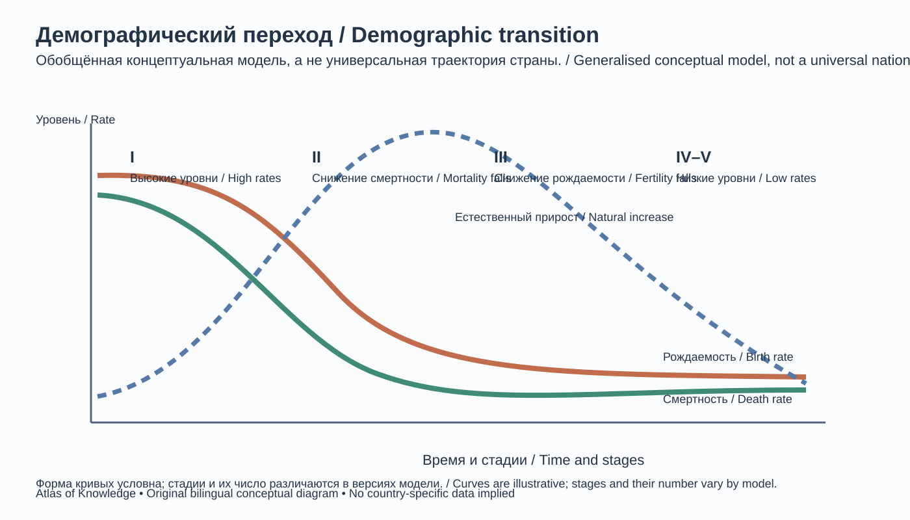
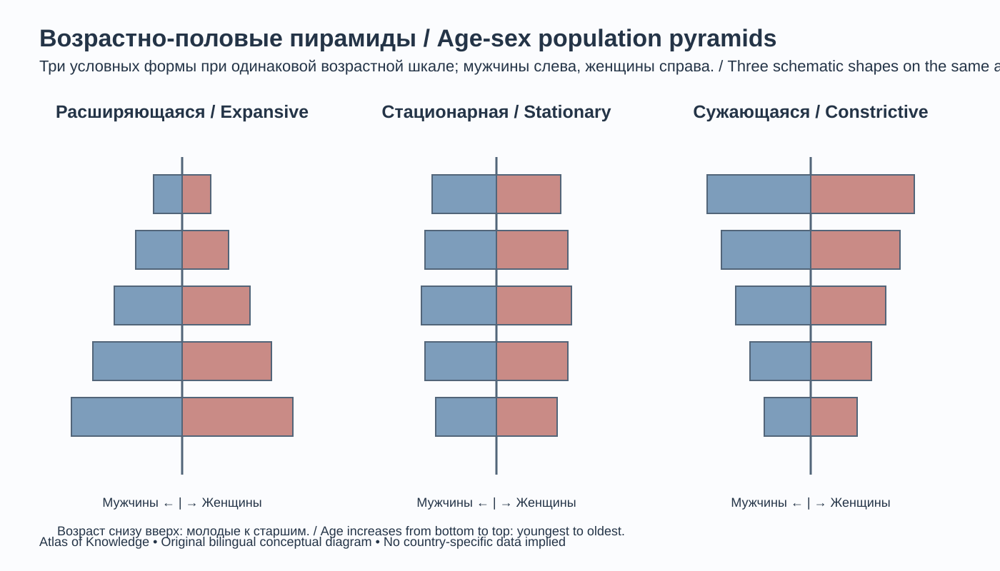
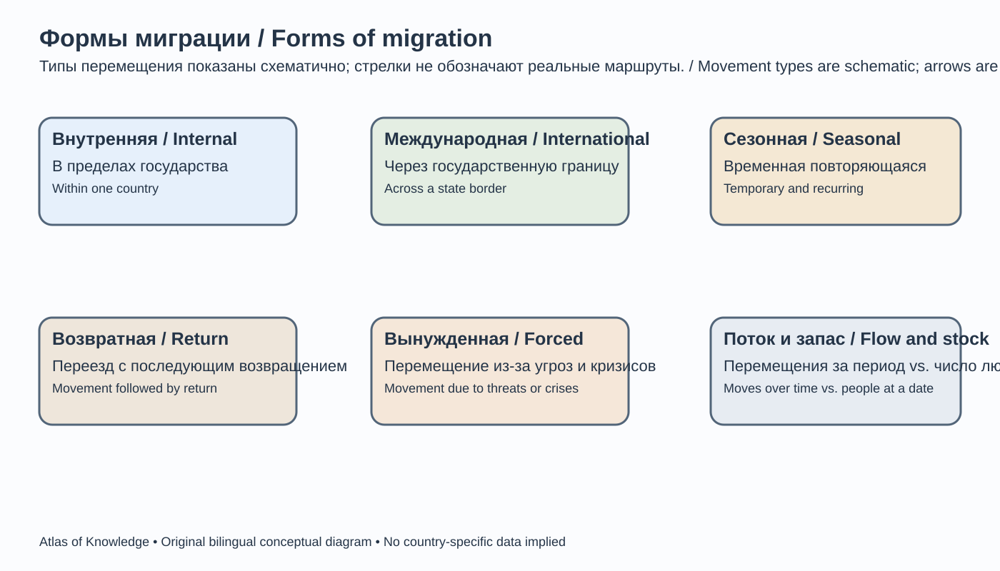

# Глава 9. Население и демография
# Chapter 9. Population and Demography

> **Часть II. Человек и география общества / Part II. People and the Geography of Society**  
> Научно-образовательный атлас географии / Scientific and Educational Geography Atlas

## Цели главы / Chapter objectives

Изучив главу, читатель сможет объяснять основные понятия демографии, анализировать численность и структуру населения, рассчитывать базовые демографические показатели, интерпретировать возрастно-половые пирамиды, описывать миграционные процессы и оценивать пространственные различия расселения.  
After studying this chapter, readers will be able to explain core demographic concepts, analyse population size and structure, calculate basic demographic indicators, interpret age-sex pyramids, describe migration processes, and assess spatial differences in settlement patterns.

## 9.1. Население как объект географического изучения / Population as an Object of Geographical Study

Население территории — люди, относимые к ней по определённым правилам учёта на конкретную дату. Демография изучает численность, состав, размещение и воспроизводство населения. География населения рассматривает, как эти характеристики и процессы различаются между территориями и как они связаны с природными, социальными, экономическими и политическими условиями.

Демографические данные всегда относятся к определённой территории, дате и статистическому определению населения. Постоянное население, наличное население, граждане страны, зарегистрированные жители и фактически присутствующие люди — не обязательно одна и та же совокупность. При сравнении стран и регионов важно проверять методологию учёта.

Основные источники сведений:
- переписи населения;
- текущая регистрация рождений и смертей;
- административные регистры;
- обследования домохозяйств и выборочные опросы;
- оценки и прогнозы национальных статистических органов и международных организаций;
- геопространственные данные и дистанционное зондирование, используемые для анализа расселения.

Перепись стремится охватить всё население в установленный период и по единым правилам. Между переписями численность обычно оценивается с учётом рождений, смертей и миграции. Качество статистики зависит от полноты охвата, своевременности регистрации, точности ответов и прозрачности методик.

<!-- VISUAL ID 09-G — integrated bilingual SVG below -->

*09-G. Авторская двуязычная схема; источники имеют разный охват и не являются взаимозаменяемыми. / Original bilingual diagram; sources have different coverage and are not interchangeable.*

**Рисунок 9.1 / Figure 9.1 — Источники демографических данных / Sources of demographic data.**  
Техническое задание: центральный блок «население» соединить с переписью, регистрацией актов гражданского состояния, обследованиями, административными данными и геопространственными источниками; показать, какие показатели даёт каждый источник; все подписи двуязычные.
**EN production brief:** Place “Population” in the centre and connect it to census data, civil registration, surveys, administrative records and geospatial sources. Show which indicators each source provides; all labels must be bilingual.

## 9.2. Численность населения и её изменение / Population Size and Change
> **[МЕТКА ИЛЛЮСТРАЦИИ 09-A / IMAGE PLACEHOLDER 09-A]** График численности населения мира; наблюдения и прогнозы показать раздельно. / World population trend chart, separating observations from projections.
**Рисунок 9.2 / Figure 9.2 — Изменение численности населения мира / World population change.**  
Техническое задание: показать исторический ряд оценок отдельно от прогнозной части; обозначить базовый год, горизонт и сценарий WPP 2024; если используются интервалы неопределённости, объяснить их значение; не соединять наблюдения и прогнозы как один непрерывный ряд без визуального разграничения.
**EN production brief:** Separate historical estimates from the projection period; identify the base year, horizon and WPP 2024 scenario. If uncertainty intervals are shown, explain them. Do not present observations and projections as one undifferentiated continuous series.

Численность населения территории изменяется под влиянием естественного движения и миграции. Базовое демографическое уравнение:

`P_{end}=P_{start}+B-D+I-E+A`

где \(P_{start}\) и \(P_{end}\) — численность населения в начале и конце периода; \(B\) — число рождений; \(D\) — число смертей; \(I\) — число прибывших; \(E\) — число выбывших; \(A\) — статистические корректировки и другие согласованные изменения, например пересмотр оценок. Если границы территории изменились, показатели необходимо пересчитать для сопоставимых границ либо отдельно и прозрачно учесть эффект изменения границ: само уравнение не делает несопоставимые территории сравнимыми. В учебных примерах без корректировок принимают \(A=0\).

**Естественный прирост** — разность между числом родившихся и умерших за период. Если смертей больше, возникает естественная убыль. **Миграционный прирост** — разность прибытий и выбытий. Общий прирост учитывает оба компонента.

Абсолютное изменение численности не следует путать с темпом роста. Темп прироста выражает относительное изменение за период. Для учебного сравнения часто используют коэффициент естественного прироста и коэффициент миграционного прироста на 1 000 жителей:

\[
r_{ест} = \frac{B-D}{P_{mid}}\times 1000, \qquad r_{мигр} = \frac{I-E}{P_{mid}}\times 1000,
\]

где \(P_{mid}\) — численность населения на середину года, обычно используемая как приближение среднегодовой численности при расчёте годовых коэффициентов; при сравнении следует придерживаться определения конкретного источника. Сумма естественного и миграционного компонентов даёт общий прирост в расчёте на 1 000 жителей только при согласованных периодах, территориях и методах учёта. Для среднего экспоненциального темпа роста за период используют формулу \(r = \ln(P_2/P_1)/n\times100\), где \(P_1\) и \(P_2\) — численность в начале и конце периода, а \(n\) — его продолжительность в годах. В показателе годового темпа изменения населения UN World Population Prospects 2024 сравниваются оценки на 1 января двух последовательных лет; результат выражается в процентах. Это не то же самое, что простое процентное изменение или геометрический темп сложного роста. Перед сравнением необходимо проверить определение и временные точки в метаданных конкретного источника. Относительные показатели позволяют сравнивать территории разной численности, но не устраняют различия в определениях и качестве данных.

## 9.3. Рождаемость и плодовитость / Births and Fertility

Рождаемость характеризует фактическое число рождений в населении за определённое время. Общий коэффициент рождаемости рассчитывается как число живорождений за год, делённое на численность населения на середину года и умноженное на 1 000:

`CBR = (B / P_{mid}) × 1000`

где CBR — общий коэффициент рождаемости, B — число живорождений, (P_{mid}) — численность населения на середину года. Показатель выражается в промилле (‰).

Общий коэффициент зависит не только от репродуктивного поведения, но и от возрастной структуры: в населении с большой долей людей репродуктивного возраста он может быть выше даже при сходных возрастных коэффициентах рождаемости.

**Суммарный коэффициент рождаемости (СКР)** — расчётное среднее число детей, которое родила бы одна женщина на протяжении репродуктивного периода, если бы на неё в каждом возрасте действовали наблюдаемые в данном периоде возрастные коэффициенты рождаемости. Это периодический синтетический показатель, а не прогноз фактического числа детей у конкретной женщины. При использовании пятилетних возрастных групп его обычно рассчитывают как сумму возрастных коэффициентов рождаемости, умноженную на 5 и разделённую на 1 000, если коэффициенты выражены на 1 000 женщин. Возрастной коэффициент для каждой группы — число живорождений у женщин этой группы на 1 000 женщин соответствующего возраста.

СКР около уровня простого воспроизводства часто оценивают примерно в 2,1 рождения на женщину в странах с низкой смертностью и без учёта миграции, однако точный уровень зависит от смертности, соотношения полов при рождении и других условий. Он не является универсальной неизменной константой для всех обществ.

На рождаемость влияют возраст вступления в брак или партнёрство, образование, занятость, доступность здравоохранения и контрацепции, стоимость жилья и воспитания детей, нормы семьи, урбанизация и государственная политика.

## 9.4. Смертность и продолжительность жизни / Mortality and Life Expectancy

Общий коэффициент смертности — число умерших за год на 1 000 человек при использовании численности населения на середину года:

`CDR = (D / P_{mid}) × 1000`

Он зависит от возрастной структуры: стареющее население может иметь более высокий общий коэффициент смертности даже при низких возрастных рисках смерти. Поэтому для сопоставления стран используют возрастные коэффициенты и стандартизованные показатели.

Младенческая смертность — вероятность того, что новорождённый умрёт до достижения возраста одного года при сохранении возрастных уровней смертности данного периода; её выражают на 1 000 живорождений. Строго говоря, это вероятность, получаемая из таблицы смертности, а не просто отношение всех зарегистрированных в календарном году смертей младенцев к числу рождений в том же году. Национальные источники могут публиковать упрощённые текущие коэффициенты или оценки, поэтому необходимо указывать метод расчёта и источник.

**Ожидаемая продолжительность жизни при рождении** — число лет, которое в среднем прожил бы условный новорождённый при сохранении возрастных уровней смертности данного периода на протяжении его жизни. Это показатель таблицы смертности, а не предсказание продолжительности жизни конкретного человека.

На смертность и продолжительность жизни влияют питание, санитария, безопасность, доходы, образование, условия труда, доступность медицинской помощи, эпидемии, войны и экологическая среда.

## 9.5. Естественное движение и воспроизводство населения / Natural Change and Population Reproduction

Воспроизводство населения — непрерывное обновление поколений через рождения и смерти. Различают расширенное воспроизводство, когда поколения численно увеличиваются, простое — когда условные поколения замещают друг друга, и суженное — когда последующие поколения меньше предыдущих.

Демографические показатели нельзя интерпретировать изолированно. Высокая рождаемость при высокой смертности может сочетаться с относительно умеренным ростом, тогда как снижение смертности при сохраняющейся высокой рождаемости обычно ускоряет рост населения.

Для анализа поколений используют когортный подход: прослеживают группу людей, объединённых общим событием или периодом рождения, во времени. Когортный анализ помогает отличать изменения поведения поколений от временных колебаний показателей.

## 9.6. Демографический переход / Demographic Transition

Модель демографического перехода описывает долгосрочное изменение режимов рождаемости и смертности в ходе социально-экономических преобразований. В упрощённой схеме выделяют несколько этапов:

1. **Традиционный режим:** высокая рождаемость и высокая смертность, значительные колебания численности.
2. **Ранний переход:** смертность снижается благодаря улучшению питания, санитарии и здравоохранения, рождаемость остаётся высокой; рост ускоряется.
3. **Поздний переход:** рождаемость начинает снижаться, темпы роста постепенно замедляются.
4. **Низкие уровни:** рождаемость и смертность относительно низки; население может расти медленно, стабилизироваться или сокращаться.
5. **Возможная стадия длительно низкой рождаемости:** рождаемость устойчиво ниже уровня простого воспроизводства, усиливаются старение и риск естественной убыли.

Число стадий и их названия различаются между версиями модели. Это аналитическая схема, а не универсальный закон: войны, эпидемии, миграция, государственная политика и культурные особенности могут менять траектории.

<!-- VISUAL ID 09-D — integrated bilingual SVG below -->

*09-D. Авторская двуязычная концептуальная схема; стадии и траектории различаются между странами и версиями модели. / Original bilingual conceptual diagram; stages and trajectories vary across countries and model versions.*

**Рисунок 9.3 / Figure 9.3 — Модель демографического перехода / Demographic transition model.**  
Техническое задание: график с условными кривыми рождаемости, смертности и естественного прироста по стадиям; оси и легенда на двух языках; явно обозначить, что это концептуальная модель, а не данные конкретной страны.
**EN production brief:** Draw a graph with illustrative curves for birth rate, death rate and natural increase across the stages. Use bilingual axes and legend, and label it clearly as a conceptual model rather than data from a particular country.

## 9.7. Возрастная и половая структура населения / Age and Sex Structure
<!-- VISUAL ID 09-B — integrated bilingual SVG below -->

*09-B. Авторская двуязычная схема; условные формы не описывают конкретную страну или год. / Original bilingual diagram; hypothetical shapes do not describe a particular country or year.*

Возрастная структура показывает распределение населения по возрастным группам, а половая — соотношение мужчин и женщин. Они влияют на рынок труда, спрос на образование и здравоохранение, пенсионную систему и будущую динамику численности.

Часто выделяют три крупные возрастные группы: дети и подростки, население трудоспособного возраста и старшие возрастные группы. Возрастные границы трудоспособности зависят от законодательства и методологии, поэтому при международном сравнении необходимо указывать конкретные интервалы, например 0–14, 15–64 и 65 лет и старше.

**Возрастно-половая пирамида** — графическое представление населения по возрасту и полу. Её форма помогает выявлять:
- широкое основание — относительно высокую долю детей и молодые поколения;
- суженное основание — снижение рождаемости;
- расширенную верхнюю часть — рост доли пожилых;
- провалы и выступы — последствия войн, миграции, кризисов рождаемости и особенностей учёта.

Пирамида отражает не только рождаемость и смертность, но и миграцию, исторические события и статистические ошибки. Для анализа полезно сравнивать несколько дат и изучать абсолютные числа вместе с долями.

**Рисунок 9.4 / Figure 9.4 — Типы возрастно-половых пирамид / Types of age-sex pyramids.**  
Техническое задание: три условные пирамиды — расширяющаяся, стационарная и сужающаяся; мужчины слева, женщины справа; возрастные группы снизу вверх; использовать одинаковую шкалу и объяснить, что формы схематические.
**EN production brief:** Show three hypothetical population pyramids: expanding, stationary and contracting. Place males on the left and females on the right, arrange age groups from youngest at the bottom to oldest at the top, use the same scale for all three, and identify the shapes as schematic.

## 9.8. Старение населения и демографическая нагрузка / Population Ageing and Dependency

Старение населения — увеличение доли и/или численности людей старших возрастов. Оно может быть вызвано снижением рождаемости, увеличением продолжительности жизни и миграцией молодых возрастных групп.

Коэффициент демографической нагрузки часто рассчитывают как отношение численности населения младших и старших условно зависимых возрастов к населению условно трудоспособного возраста. Например:

`DR = ((P_{0-14}+P_{65+})/P_{15-64}) × 100`

Результат выражается числом условно зависимых людей на 100 человек в возрастах 15–64 года. Это возрастной, а не фактический экономический показатель: не все люди трудоспособного возраста работают, а часть людей старших возрастов продолжает трудовую деятельность.

Старение требует адаптации систем здравоохранения, ухода, пенсионного обеспечения, транспорта и городской среды. Молодая возрастная структура, в свою очередь, создаёт потребность в школах, рабочих местах, жилье и услугах для семей.

### 9.8.1. Разобранный пример: расчёт демографической нагрузки / Worked Example: Calculating the Age Dependency Ratio

Рассмотрим условное население: 18 000 человек в возрасте 0–14 лет, 50 000 человек в возрасте 15–64 лет и 7 000 человек в возрасте 65 лет и старше.

1. Численность условно зависимых возрастов: 18 000 + 7 000 = **25 000 человек**.
2. Коэффициент демографической нагрузки: (25 000 / 50 000) × 100 = **50 человек на 100 человек в возрасте 15–64 лет**.
3. Детская нагрузка: (18 000 / 50 000) × 100 = **36 на 100**; нагрузка старшими возрастами: (7 000 / 50 000) × 100 = **14 на 100**.

Итак, на каждые 100 жителей в возрасте 15–64 лет приходится 50 человек младших и старших возрастов вместе. Это не означает, что каждый из этих 100 человек работает и содержит 50 иждивенцев: расчёт основан только на возрасте. Для оценки реальной экономической нагрузки нужны сведения о занятости, безработице, доходах и участии людей разных возрастов в уходе и оплачиваемом труде.

## 9.9. Миграция: понятия и виды / Migration: Concepts and Types
<!-- VISUAL ID 09-C — integrated bilingual SVG below -->

*09-C. Авторская двуязычная схема; она не показывает реальные географические маршруты или объёмы миграции. / Original bilingual diagram; it does not show real geographic routes or migration volumes.*

Миграция — перемещение людей, связанное со сменой места проживания. Для внутренней миграции учитывается изменение места проживания внутри страны; для международной — изменение страны проживания. Пересечение государственной границы без смены страны проживания относится к международной временной мобильности, а не автоматически к международной миграции. В рекомендациях Статистического отдела ООН 2025 года для определения проживания предлагается использовать один из двух критериев длительности: проживание большую часть предшествующих 12 месяцев (не менее 6 месяцев и одного дня) либо проживание не менее 12 месяцев; допускается учитывать намерение проживать соответствующий срок. Страны должны согласовывать критерии определения населения и миграционных потоков внутри своей статистической системы. На практике национальные правила и источники могут различаться, поэтому их необходимо указывать.

Основные виды:
- внутренняя и международная;
- временная, сезонная и постоянная;
- добровольная и вынужденная;
- трудовая, образовательная, семейная и связанная с образом жизни;
- возвратная и повторная.

Не каждое перемещение является миграцией в статистическом смысле: поездки на работу, туризм и кратковременные визиты обычно учитываются отдельно. Вынужденное перемещение включает ситуации, когда люди покидают дома из-за конфликтов, преследования, насилия, стихийных бедствий или иных угроз. Если люди вынуждены покинуть дом, но остаются в пределах международно признанных границ своей страны, их называют внутренне перемещёнными лицами (ВПЛ); они не являются беженцами только на основании такого перемещения. Для статуса беженца требуется пересечение международной границы и соответствие применимому правовому определению. Поэтому термины «вынужденное перемещение», «ВПЛ», «беженец» и «мигрант» нельзя использовать как взаимозаменяемые.

**Рисунок 9.5 / Figure 9.5 — Формы миграции / Forms of migration.**  
Техническое задание: схема внутренней и международной миграции, сезонного перемещения, возвратной миграции и вынужденного перемещения; не изображать стрелки как реальные маршруты без подтверждённых данных.
**EN production brief:** Diagram internal and international migration, seasonal movement, return migration and forced displacement. Do not present arrows as real routes unless supported by verified data.

## 9.10. Причины и последствия миграции / Drivers and Consequences of Migration

Причины миграции часто рассматривают через сочетание факторов выталкивания и притяжения. К первым относятся безработица, низкие доходы, конфликты, небезопасность, экологические риски и недостаток услуг. Ко вторым — рабочие места, образование, безопасность, семейные связи, более высокий доход и доступ к инфраструктуре.

Такое деление упрощает сложную реальность. Решение о переезде зависит от ресурсов домохозяйства, сетей контактов, транспортной доступности, правового режима, личных обстоятельств и представлений о возможностях.

Миграция может:
- менять возрастную и квалификационную структуру регионов;
- поддерживать доходы семей через денежные переводы;
- способствовать обмену знаниями и навыками;
- создавать дефицит работников в отдельных отраслях и территориях;
- усиливать нагрузку на жильё, транспорт и социальные услуги в быстрорастущих центрах;
- приводить к разлуке семей и социальным издержкам;
- формировать транснациональные сообщества и культурные связи.

Последствия различаются для территории происхождения, территории назначения, самих мигрантов и их семей. Нельзя считать миграцию исключительно положительным или отрицательным явлением.

## 9.11. Размещение населения и плотность / Population Distribution and Density

Население размещено на Земле крайне неравномерно. На его распределение влияют климат, рельеф, доступность воды, почвы, природные ресурсы, транспорт, история освоения, безопасность, экономические возможности и политические решения.

**Средняя арифметическая плотность населения** — отношение численности населения к площади территории:

`D = P / A`

где D — плотность, P — численность населения, A — площадь. Обычно выражается в количестве человек на квадратный километр (чел./км²). При сравнении источников необходимо проверить, что именно считается площадью: суша, вся территория или только обитаемая площадь. Численность населения, площадь и дата должны относиться к одной и той же территории и сопоставимому периоду.

Средняя плотность может скрывать резкие внутренние контрасты. Для более точного анализа применяют плотность по обитаемой площади, сельскохозяйственной площади, сетке регулярных ячеек и локальным административным единицам. Следует различать общую площадь страны и площадь, реально пригодную или используемую для проживания.

Крупные зоны концентрации населения исторически формировались в районах благоприятных условий земледелия, речных долин, побережий, промышленных узлов и транспортных коридоров. Большие пустынные, высокогорные, полярные и удалённые районы обычно заселены реже, но и там существуют локальные центры расселения.

> **[МЕТКА ИЛЛЮСТРАЦИИ 09-E / IMAGE PLACEHOLDER 09-E]** Карта глобальной плотности населения на сопоставимую дату с единицами, источником и проекцией. / **EN:** Global population-density map for a stated reference date, with units, source and projection.
**Рисунок 9.6 / Figure 9.6 — Глобальная плотность населения / Global population density.**  
Техническое задание: карта плотности населения на основе одной согласованной даты и пространственной сетки; использовать логарифмическую или категориальную шкалу, если диапазон значений велик; указать источник, год, проекцию и разрешение; не подменять плотность населения картой административных средних.
**EN production brief:** Map population density using a consistent reference date and spatial grid. Use a logarithmic or categorical scale if the value range is large; state the source, year, projection and resolution. Do not substitute administrative-area averages for a gridded density surface.

## 9.12. Сельское и городское население / Rural and Urban Population

Сельское население проживает в поселениях и территориях, которые национальная статистика относит к сельским. Городское население определяется по национальным критериям, которые могут включать численность, плотность, занятость, административный статус и наличие инфраструктуры. Поэтому доли городского населения не всегда напрямую сопоставимы между странами.

Для международных сравнений ООН использует также функциональные и геопространственные подходы. Методика «Степень урбанизации» (Degree of Urbanization), интегрированная в World Urbanization Prospects 2025, включает два этапа. Сначала ячейки сетки размером 1 км² классифицируют по плотности населения, смежности и порогам общей численности кластера. На втором этапе небольшие административные или статистические единицы относят к классу по тому, в каких классах сетки проживает большая часть их населения. Глобальные оценки WUP 2025 используют стандартизованную сеточную классификацию, чтобы обеспечить сопоставимость между странами; поэтому их не следует автоматически отождествлять с национальными административными категориями. На уровне 1 города — это кластеры смежных ячеек с плотностью не менее 1 500 человек на км² и общей численностью не менее 50 000 человек; малые города и территории средней плотности — кластеры с плотностью не менее 300 человек на км² и численностью не менее 5 000 человек. Остальные ячейки относятся к сельским территориям. Это пороги уровня 1 методики WUP 2025, а не универсальные определения города для национального законодательства; методика также предусматривает более детальную классификацию второго уровня. Любой показатель урбанизации должен сопровождаться указанием применённого определения и метода.

Сельские поселения различаются по размеру, функциям, удалённости и связи с аграрной экономикой. Городские поселения могут выполнять административные, промышленные, транспортные, образовательные, финансовые и культурные функции.

## 9.13. Урбанизация и агломерации / Urbanisation and Urban Agglomerations

Урбанизация — рост доли городского населения, расширение городских территорий и усиление роли городского образа жизни и городских функций. Она связана с индустриализацией, изменением структуры занятости, миграцией, естественным приростом и административным преобразованием поселений.

**Городская агломерация** — компактная система города и связанных с ним населённых пунктов, объединённых интенсивными трудовыми, транспортными и хозяйственными связями. Административные границы города часто не совпадают с фактической городской зоной.

Крупные агломерации могут создавать преимущества концентрации: доступ к рынкам труда, образованию, медицине, инновациям и инфраструктуре. Одновременно они сталкиваются с перегрузкой транспорта, высокой стоимостью жилья, загрязнением воздуха, неравенством, рисками наводнений и перегревом городской среды.

Планирование устойчивой урбанизации включает общественный транспорт, доступное жильё, смешанное землепользование, зелёную инфраструктуру, защиту водосборов, управление отходами и участие жителей.

<!-- VISUAL ID 09-F — integrated bilingual SVG below -->

*09-F. Авторская двуязычная схема; временные срезы и границы условны, не являются результатом дистанционного мониторинга. / Original bilingual diagram; time slices and boundaries are hypothetical, not remote-sensing observations.*

**Рисунок 9.7 / Figure 9.7 — Рост городской агломерации / Growth of an urban agglomeration.**  
Техническое задание: последовательные карты условной агломерации в три временных среза; показать ядро, пригородное расширение, транспортные связи и зелёные зоны; подчеркнуть, что административная граница и функциональная зона различаются.
**EN production brief:** Create a sequence of three maps showing a hypothetical urban agglomeration at different dates. Show the urban core, suburban expansion, transport links and green spaces; emphasise that the administrative boundary and functional urban area are not the same.

## 9.14. Демографическая политика и человеческое развитие / Population Policy and Human Development

Демографическая политика — совокупность государственных и общественных мер, влияющих на демографические процессы и условия жизни населения. Она может касаться охраны материнства и детства, репродуктивного здоровья, поддержки семей, образования, занятости, миграции, старения и регионального развития.

Эффективная политика опирается на права человека, доступность услуг, достоверные данные и добровольный выбор. Принудительное вмешательство в репродуктивные решения нарушает права и может приводить к тяжёлым социальным последствиям.

Человеческое развитие шире экономического роста. Оно включает здоровье, образование, достойный уровень жизни, возможности участия в общественной жизни и равенство возможностей. Индекс человеческого развития (ИЧР) сводит три измерения в один показатель: здоровье (ожидаемая продолжительность жизни при рождении), образование (ожидаемая продолжительность обучения детей школьного возраста и средняя продолжительность обучения взрослых от 25 лет) и уровень жизни (валовой национальный доход на душу населения с поправкой на паритет покупательной способности). Два показателя образования сначала переводятся в индексы, которые усредняются арифметически и образуют индекс образования. Затем индексы здоровья, образования и дохода объединяются как геометрическое среднее; для дохода применяется логарифмическое преобразование. ИЧР удобен для общего сравнения, но отражает средние достижения и сам по себе не показывает неравенство, бедность, безопасность, расширение прав и другие стороны благополучия.

## 9.15. Демографические прогнозы и неопределённость / Population Projections and Uncertainty

Демографический прогноз строится на предположениях о будущей рождаемости, смертности и миграции. Когортно-компонентный метод последовательно перемещает возрастные группы во времени, учитывая выживаемость, рождения и миграционные потоки.

Прогнозы обычно включают несколько сценариев — например, низкий, средний и высокий варианты. Они не являются точными предсказаниями: чем дальше горизонт, тем выше неопределённость. Особенно трудно предвидеть миграцию, кризисы, эпидемии, конфликты и быстрые изменения репродуктивного поведения.

При чтении прогноза необходимо проверять:
- базовый год и охват населения;
- предположения о рождаемости, смертности и миграции;
- диапазон неопределённости и сценарии;
- дату выпуска и возможные пересмотры;
- сопоставимость с предыдущими прогнозами.

## 9.16. Демографические данные, этика и визуализация / Demographic Data, Ethics and Visualisation

Демографические карты и диаграммы должны показывать не только числа, но и определения, период, территориальную единицу и источник. При сравнении абсолютных величин полезно использовать относительные показатели, но относительные показатели также требуют корректного знаменателя.

Картограммы административных единиц могут визуально преувеличивать большие по площади малонаселённые территории. Карты по регулярной сетке или точечные карты иногда лучше передают пространственную концентрацию, но требуют оценки качества геокодирования и защиты конфиденциальности.

Данные о малых группах могут позволить косвенно идентифицировать людей. Поэтому публикация детализированной статистики должна учитывать приватность, согласие, агрегирование и правила статистической тайны. Географическая точность не должна достигаться ценой раскрытия персональных данных.

### 9.16.1. Как измерять миграцию и не путать разные показатели / Measuring Migration Without Confusing Indicators

Для статистики международной мобильности ООН различает международную миграцию и международную временную мобильность. Первая означает смену страны проживания; вторая охватывает пересечения границы, не приводящие к такой смене. Рекомендации ООН 2025 года предлагают два варианта критерия проживания: пребывание большую часть последних 12 месяцев (не менее 6 месяцев и одного дня) либо не менее 12 месяцев; может учитываться и намерение проживать соответствующий срок. Это международная рекомендация, а не утверждение, что все страны уже применяют одинаковое правило. Поэтому в публикации следует указывать национальное определение и согласованность критериев учёта населения и миграционных потоков.

**Основные показатели.** Число прибывших и выбывших за период — абсолютные миграционные потоки. В зависимости от системы регистрации статистика может учитывать события перемещения, а не уникальных людей: один человек, переехавший несколько раз, способен попасть в поток более одного раза. Поэтому перед сравнением регионов и стран необходимо проверить единицу учёта и правила регистрации. Миграционный прирост (сальдо) равен прибытию минус выбытию. Миграционный запас (stock) — число людей, относимых к мигрантам по определению конкретного источника и проживающих на территории на определённую дату; это показатель состояния на момент времени, а не число перемещений за год. В международных базах определение может опираться, например, на страну рождения или гражданство, поэтому его необходимо проверять. Коэффициенты обычно рассчитывают на 1 000 жителей с использованием численности населения на середину года, часто как приближения среднегодовой численности; необходимо указывать методику источника. Важно указывать, используется ли регистрация по месту жительства, перепись, выборочное обследование или административные данные.

**Условный пример.** В регионе с населением 100 000 человек за год зарегистрировано 2 400 прибывших и 1 900 выбывших. Сальдо составляет +500 человек, а коэффициент миграционного прироста — 5 на 1 000 жителей при численности населения на середину года 100 000. Это не означает, что все прибывшие остались навсегда: показатель зависит от определения мигранта и полноты регистрации.

**Ограничения данных.** Незарегистрированная, сезонная, вынужденная и повторная миграция могут учитываться неполно. Изменение правил регистрации или границ территории создаёт разрывы временного ряда. Среднее сальдо скрывает различия по возрасту, полу, квалификации и причинам перемещения; при публикации важно защищать персональные данные и не раскрывать малые группы, позволяющие идентифицировать людей.

**Учебное задание.** Для двух регионов рассчитайте миграционное сальдо и коэффициент на 1 000 жителей. Затем объясните, почему одинаковое сальдо может иметь разные последствия для возрастной структуры и рынка труда.

## English-language chapter text

### 9.1. Population as an Object of Geographical Study

A population is the group of people counted within a defined territory at a specified date, according to stated statistical rules. Demography studies population size, composition, distribution and change through births, deaths and migration. Population geography examines how these characteristics and processes vary from place to place and how they relate to natural, social, economic and political conditions.

Demographic data always refer to a defined territory, date and statistical definition of population. Usual residents, present population, citizens, registered residents and people physically present are not necessarily the same group. Comparisons between countries and regions require checking the methods used.

Main sources include population censuses; current registration of births and deaths; administrative registers; household surveys and sample studies; estimates and projections from national statistical offices and international organisations; and geospatial data or remote sensing used to analyse settlement.

A census aims to enumerate the entire population during a specified period using consistent rules. Between censuses, population size is usually estimated from births, deaths and migration. Statistical quality depends on coverage, timely registration, response accuracy and transparent methods.

### 9.2. Population Size and Change

The size of a population changes through natural change and migration. A basic demographic equation is:

P(end) = P(start) + B − D + I − E + A

where P(start) and P(end) are the population at the beginning and end of the period; B is births; D is deaths; I is arrivals; E is departures; and A represents statistical adjustments and other reconciled changes, such as revised estimates. If territorial boundaries change, population counts should be recalculated for comparable boundaries or the boundary effect should be explicitly quantified; the equation alone does not make different territories comparable. In classroom examples without adjustments, A is set to zero.

**Natural increase** is the difference between births and deaths during a period. If deaths exceed births, natural decrease occurs. **Net migration** is arrivals minus departures. Total population change includes both components.

Absolute change should not be confused with the growth rate. The growth rate expresses relative change over a period. For classroom comparisons, the crude rates of natural change and net migration per 1,000 residents can be written as:

\[
r_{natural} = \frac{B-D}{P_{mid}}\times 1,000, \qquad r_{migration} = \frac{I-E}{P_{mid}}\times 1,000,
\]

where \(P_{mid}\) is the mid-year population, commonly used as an approximation of the average population for annual rates. Follow the specific source definition when comparing datasets. Their sum gives the total change per 1,000 only when periods, territorial boundaries and counting methods are consistent. The average exponential growth rate over a period can be calculated as \(r = \ln(P_2/P_1)/n\times100\), where \(P_1\) and \(P_2\) are population sizes at the beginning and end of the period and \(n\) is the number of years. The annual rate-of-population-change indicator in UN World Population Prospects 2024 compares estimates on 1 January in two consecutive years and is expressed as a percentage. This is not the same as a simple percentage change or a geometric compound-growth rate. Check the indicator metadata and time points before comparing rates. Relative indicators help compare territories of different sizes, but they do not remove differences in definitions or data quality.

### 9.3. Births and Fertility

Birth rate describes the actual number of births in a population during a given period. The **crude birth rate (CBR)** is calculated as annual live births divided by the mid-year population and multiplied by 1,000:

CBR = (B / Pmid) × 1,000

The result is expressed per thousand (‰).

The crude rate depends not only on reproductive behaviour but also on age structure. A population with a large share of people of reproductive age may have a higher crude birth rate even when age-specific fertility rates are similar.

The **total fertility rate (TFR)** is the hypothetical average number of children a woman would have over her reproductive lifetime if she experienced the age-specific fertility rates observed in the given period at every age. It is a synthetic period indicator, not a prediction of the actual number of children a particular woman will have. When five-year age groups are used, it is commonly calculated as five times the sum of the age-specific fertility rates divided by 1,000, if those rates are expressed per 1,000 women. Each age-specific rate is the number of live births to women in an age group per 1,000 women in that same age group.

A TFR of about 2.1 is often used as an approximate replacement-level benchmark in low-mortality populations without migration, but the precise level depends on mortality, the sex ratio at birth and other conditions. It is not a universal constant for every society.

Fertility is influenced by age at marriage or partnership, education, employment, access to health care and contraception, housing and child-rearing costs, family norms, urbanisation and public policy.

### 9.4. Mortality and Life Expectancy

The **crude death rate (CDR)** is the number of deaths per year per 1,000 people in the mid-year population:

CDR = (D / Pmid) × 1,000

It depends on age structure. An ageing population may have a higher crude death rate even when age-specific mortality risks are low. Age-specific rates and standardised indicators are therefore used for comparisons between countries.

Infant mortality is the probability that a newborn will die before reaching age one if exposed to the age-specific mortality rates of the period, expressed per 1,000 live births. Strictly speaking, it is a life-table probability, not simply the number of infant deaths registered in a calendar year divided by the number of births in that same year. National sources may publish simplified period indicators or modelled estimates, so the calculation method and source must be stated.

**Life expectancy at birth** is the average number of years a hypothetical newborn would live if the age-specific mortality rates of the observed period remained constant throughout their life. It is a life-table measure, not a prediction of how long a particular person will live.

Mortality and life expectancy are influenced by nutrition, sanitation, safety, income, education, working conditions, access to health care, epidemics, wars and environmental conditions.

### 9.5. Natural Change and Population Reproduction

Population reproduction is the continuous renewal of generations through births and deaths. **Expanded reproduction** occurs when successive generations increase in size; **simple reproduction** occurs when generations replace one another; and **contracted reproduction** occurs when later generations are smaller than earlier ones.

Demographic indicators should not be interpreted in isolation. High fertility combined with high mortality may produce only moderate growth, while declining mortality with persistently high fertility usually accelerates population growth.

Cohort analysis follows a group of people who share an event or birth period over time. It helps distinguish changes in the behaviour of generations from temporary fluctuations in indicators.

### 9.6. Demographic Transition

The demographic transition model describes long-term changes in fertility and mortality during socio-economic transformation. A simplified version identifies several stages:

1. **Traditional regime:** high fertility and high mortality, with substantial fluctuations in population size.
2. **Early transition:** mortality falls due to improved nutrition, sanitation and health care, while fertility remains high; population growth accelerates.
3. **Late transition:** fertility begins to decline and growth gradually slows.
4. **Low levels:** fertility and mortality are relatively low; population may grow slowly, stabilise or decline.
5. **Possible prolonged low-fertility stage:** fertility remains below replacement level, ageing intensifies and natural decrease becomes more likely.

The number and names of stages vary among versions of the model. It is an analytical framework, not a universal law: wars, epidemics, migration, public policy and cultural factors can change demographic trajectories.

### 9.7. Age and Sex Structure

Age structure shows the distribution of a population across age groups; sex structure shows the balance of males and females. Both affect labour markets, demand for education and health care, pension systems and future population dynamics.

Three broad age groups are often used: children and adolescents, the working-age population and older people. Working-age boundaries depend on legislation and methodology. International comparisons should therefore state the exact intervals, for example 0–14, 15–64 and 65 years and over.

An **age-sex pyramid** displays population by age and sex. A broad base suggests a relatively high share of children and younger generations; a narrow base may indicate declining fertility; a wider upper section indicates a growing share of older people; and dents or bulges may reflect wars, migration, fertility crises or statistical issues.

A population pyramid reflects not only fertility and mortality but also migration, historical events and statistical errors. It is useful to compare several dates and examine absolute numbers alongside percentages.

### 9.8. Population Ageing and Dependency

Population ageing is an increase in the share and/or number of older people. It may result from declining fertility, rising life expectancy and migration of younger age groups.

The **age dependency ratio** is often calculated as the population in younger and older conventionally dependent age groups divided by the population in the conventionally working-age group. Using the age bands 0–14 and 65+ as the dependent groups and 15–64 as the working-age group:

`DR = ((P_{0-14} + P_{65+}) / P_{15-64}) × 100`

It is expressed as the number of dependants per 100 people aged 15–64. Other age bands may be used by national or international sources, so the selected limits must be stated.

This is an age-based indicator, not a measure of actual economic dependency: not everyone of working age is employed, and some older people continue to work.

Ageing requires adaptation in health care, long-term care, pensions, transport and the built environment. A young age structure, in turn, creates demand for schools, jobs, housing and family services.

### 9.8.1. Worked Example: Calculating the Age Dependency Ratio

Consider a hypothetical population with 18,000 people aged 0–14, 50,000 aged 15–64, and 7,000 aged 65 and over.

1. Population in the conventionally dependent age groups: 18,000 + 7,000 = **25,000 people**.
2. Age dependency ratio: (25,000 / 50,000) × 100 = **50 people per 100 people aged 15–64**.
3. Child dependency ratio: (18,000 / 50,000) × 100 = **36 per 100**; old-age dependency ratio: (7,000 / 50,000) × 100 = **14 per 100**.

Thus, for every 100 people aged 15–64, there are 50 people in the younger and older age groups combined. This does not mean that all 100 people are employed or that they financially support 50 dependants: the calculation is based on age alone. Assessing the actual economic burden also requires information on employment, unemployment, income, and participation in paid work and care across age groups.

### 9.9. Migration: Concepts and Types

Migration is a movement involving a change of place of residence. Internal migration involves a change of residence within a country; international migration involves a change of country of residence. For international statistics, border crossings that do not result in a change of country of residence are classified as international temporary mobility, not automatically as migration. The 2025 United Nations Statistics Division recommendations propose two possible duration criteria for residence: living in a place for most of the previous 12 months (at least six months and one day), or for at least 12 months; intended duration may also be used. National definitions and data sources may differ, so comparisons must state the criteria used.

Main types include internal and international; temporary, seasonal and permanent; voluntary and forced; labour, educational, family-related and lifestyle migration; and return and repeat migration.

Not every movement is migration in the statistical sense: commuting, tourism and short visits are usually counted separately. Forced displacement includes situations in which people leave their homes because of conflict, persecution, violence, natural disasters or other threats. People forced to leave home but who remain within the internationally recognised borders of their country are internally displaced persons (IDPs); they do not become refugees solely through such internal movement. Refugee status requires crossing an international border and meeting the applicable legal definition. The terms “forced displacement”, “IDP”, “refugee” and “migrant” are therefore not interchangeable.

### 9.10. Drivers and Consequences of Migration

Migration is often analysed through a combination of push and pull factors. Push factors may include unemployment, low incomes, conflict, insecurity, environmental risks and limited services. Pull factors may include jobs, education, safety, family ties, higher incomes and access to infrastructure.

This distinction simplifies a complex reality. A decision to move also depends on household resources, social networks, transport access, legal status, personal circumstances and perceptions of opportunity.

Migration may change the age and skill structure of regions; support household incomes through remittances; promote the exchange of knowledge and skills; create labour shortages in particular sectors or areas; increase pressure on housing, transport and social services in fast-growing centres; separate families and create social costs; and form transnational communities and cultural connections.

Consequences differ for places of origin, destinations, migrants themselves and their families. Migration should not be treated as exclusively positive or negative.

### 9.11. Population Distribution and Density

Population is distributed very unevenly across Earth. Its distribution is influenced by climate, relief, water availability, soils, natural resources, transport, settlement history, safety, economic opportunities and political decisions.

**Arithmetic population density** is the population divided by the area of a territory:

D = P / A

where D is density, P is population and A is area. It is usually expressed as people per square kilometre. When comparing sources, check whether the denominator is land area, total area or inhabited area. The population count, area and reference date must refer to the same territory and a comparable period.

Average density can conceal sharp internal contrasts. More detailed analysis may use density per inhabited area, agricultural area, regular grid cell or local administrative unit. Total national area must be distinguished from land that is actually suitable for or used for settlement.

Major population concentrations historically developed in areas with favourable agricultural conditions, river valleys, coasts, industrial centres and transport corridors. Large deserts, high mountains, polar regions and remote areas are generally more sparsely populated, although local settlement centres exist there as well.

### 9.12. Rural and Urban Population

Rural population lives in settlements and areas classified as rural by national statistics. Urban population is defined by national criteria, which may include population size, density, employment, administrative status and infrastructure. Urban shares are therefore not always directly comparable between countries.

International comparisons also use functional and geospatial approaches. The UN Degree of Urbanization methodology, integrated into World Urbanization Prospects 2025, has two stages. First, 1 km² grid cells are classified using population density, contiguity and the total population of each cluster. In the second stage, smaller administrative or statistical units are assigned a class according to the grid-cell classes in which most of their population resides. WUP 2025 global estimates use the standardised grid classification to ensure comparability between countries; they should therefore not be treated as automatically equivalent to national administrative categories. At level 1, cities are clusters of contiguous cells with a density of at least 1,500 people per km² and a total population of at least 50,000; towns and semi-dense areas are clusters with a density of at least 300 people per km² and a population of at least 5,000. Remaining cells are classified as rural. These are the level-1 thresholds used in WUP 2025, not universal definitions of a city in national law; the methodology also provides a more detailed level-2 classification. Every urbanisation indicator should state the definition and method used.

Rural settlements differ in size, function, remoteness and relationship with agriculture. Urban settlements may perform administrative, industrial, transport, educational, financial and cultural functions.

### 9.13. Urbanisation and Urban Agglomerations

Urbanisation is the increase in the share of urban population, the expansion of urban areas and the growing role of urban lifestyles and functions. It is associated with industrialisation, changes in employment, migration, natural increase and the administrative reclassification of settlements.

An **urban agglomeration** is a compact system consisting of a city and connected settlements linked by intensive commuting, transport and economic relationships. Administrative city boundaries often do not match the actual urban area.

Large agglomerations can create economies of concentration, including access to labour markets, education, health care, innovation and infrastructure. They may also face traffic congestion, high housing costs, air pollution, inequality, flood risks and urban overheating.

Sustainable urban planning includes public transport, affordable housing, mixed land use, green infrastructure, catchment protection, waste management and public participation.

### 9.14. Population Policy and Human Development

Population policy is the set of public and social measures that influence demographic processes and people's living conditions. It may address maternal and child health, reproductive health, family support, education, employment, migration, ageing and regional development.

Effective policy is based on human rights, access to services, reliable evidence and voluntary choice. Coercive interference in reproductive decisions violates rights and may cause serious social harm.

Human development is broader than economic growth. It includes health, education, a decent standard of living, opportunities for participation in society and equality of opportunity. The **Human Development Index (HDI)** combines three dimensions: health (life expectancy at birth); education (expected years of schooling for children of school-entry age and mean years of schooling among adults aged 25 and over); and standard of living (gross national income per capita adjusted for purchasing power parity). The two education indicators are first converted into indices and averaged arithmetically to form the education index. The health, education and income indices are then combined using a geometric mean; income is transformed logarithmically. The HDI is useful for broad comparisons, but it measures average achievement and does not by itself show inequality, poverty, human security, empowerment or other aspects of well-being.

### 9.15. Population Projections and Uncertainty

Population projections are based on assumptions about future fertility, mortality and migration. The cohort-component method moves age groups forward through time, accounting for survival, births and migration flows.

Projections usually include several scenarios, such as low, medium and high variants. They are not exact predictions: uncertainty increases with the length of the projection horizon. Migration, crises, epidemics, conflict and rapid changes in reproductive behaviour are particularly difficult to predict.

When reading a projection, check the base year and population coverage; assumptions about fertility, mortality and migration; uncertainty ranges and scenarios; publication date and possible revisions; and comparability with earlier projections.

### 9.16. Demographic Data, Ethics and Visualisation

Demographic maps and charts should show not only numbers but also definitions, reference periods, territorial units and sources. Relative indicators are useful when comparing absolute values, but they also require an appropriate denominator.

Choropleth maps of administrative units may visually exaggerate large, sparsely populated areas. Regular-grid or dot-density maps may better represent spatial concentration, but require assessment of geocoding quality and privacy protection.

Data about small groups may make individuals indirectly identifiable. Detailed statistical publication must therefore consider privacy, consent, aggregation and statistical confidentiality rules. Geographic precision must not come at the cost of revealing personal information.

### 9.16.1. Measuring Migration Without Confusing Indicators

For international mobility statistics, the United Nations distinguishes international migration from international temporary mobility. The former involves a change of country of residence; the latter covers border crossings that do not result in such a change. The 2025 UN recommendations propose two possible residence-duration criteria: living in a place for most of the previous 12 months (at least six months and one day), or for at least 12 months; intended duration may also be considered. This is an international recommendation, not a claim that all countries already apply one identical rule. Publications should therefore state the national definition and whether population and migration-flow criteria are aligned.

**Core indicators.** The numbers of arrivals and departures during a period are absolute migration flows. Depending on the registration system, statistics may count movement events rather than unique people: a person who moves more than once can contribute more than one event to a flow. Before comparing regions or countries, check the unit counted and the registration rules. Net migration equals arrivals minus departures. The migrant stock is the number of people classified as migrants under a source's definition and living in a territory on a specified date; it is a point-in-time measure, not the number of moves during a year. International datasets may define migrants by country of birth or citizenship, for example, so the operational definition must be checked. Rates are commonly calculated per 1,000 people using the mid-year population, allowing comparison between areas of different sizes. Always state whether the data come from residence registration, a census, a sample survey or administrative records.

**Hypothetical example.** A region with a population of 100,000 records 2,400 arrivals and 1,900 departures in one year. Net migration is +500 people, and the net migration rate is 5 per 1,000 when the mid-year population is 100,000. This does not mean every arrival stayed permanently: the indicator depends on the definition of a migrant and the completeness of registration.

**Data limitations.** Unregistered, seasonal, forced and repeat migration may be incompletely recorded. Changes in registration rules or territorial boundaries can create breaks in a time series. A net figure hides differences by age, sex, skills and reasons for moving; publication must protect personal data and avoid disclosing small groups that could identify individuals.

**Activity.** Calculate net migration and the rate per 1,000 residents for two regions. Explain why the same net balance can have different effects on age structure and the labour market.

## 9.17. Итоги главы / Chapter Summary

1. Демография изучает численность, состав и воспроизводство населения, а география населения раскрывает пространственные различия этих процессов.
2. Изменение численности определяется рождениями, смертями, прибытием и выбытием, а также возможными статистическими корректировками.
3. Общие коэффициенты рождаемости и смертности зависят от возрастной структуры и требуют осторожной интерпретации.
4. Демографический переход описывает типичные долгосрочные изменения рождаемости и смертности, но не является универсальным законом.
5. Возрастно-половая структура влияет на будущую динамику, рынок труда и потребность в социальных услугах.
6. Миграцию и вынужденное перемещение следует различать; международная миграция не тождественна временной мобильности, а ВПЛ — беженцам. Причины и последствия этих процессов различаются для территорий происхождения и назначения.
7. Население распределено неравномерно; средняя плотность не раскрывает локальные контрасты.
8. Урбанизация меняет расселение и экономические связи, создавая как возможности, так и управленческие вызовы.
9. Прогнозы зависят от предположений и должны сопровождаться оценкой неопределённости.
10. Демографические данные требуют методологической прозрачности, этики и защиты конфиденциальности.

## 9.18. Ключевые понятия / Key Terms

Демография — Demography; население — Population; перепись населения — Population census; естественный прирост — Natural increase; миграционный прирост — Net migration; общий коэффициент рождаемости — Crude birth rate; суммарный коэффициент рождаемости — Total fertility rate; общий коэффициент смертности — Crude death rate; ожидаемая продолжительность жизни — Life expectancy; демографический переход — Demographic transition; когорта — Cohort; возрастно-половая пирамида — Age-sex pyramid; старение населения — Population ageing; демографическая нагрузка — Age dependency ratio; миграция — Migration; миграционный поток — Migration flow; миграционный запас — Migrant stock; численность населения на середину года — Mid-year population; плотность населения — Population density; степень урбанизации — Degree of Urbanization; урбанизация — Urbanisation; агломерация — Urban agglomeration; человеческое развитие — Human development; демографический прогноз — Population projection; международная временная мобильность — International temporary mobility; внутренне перемещённое лицо (ВПЛ) — Internally displaced person (IDP); обычное место проживания / страна проживания — Usual place of residence / country of residence

## 9.19. Контрольные вопросы и практические задания / Review Questions and Practical Activities

### Вопросы для самопроверки / Review questions

1. Чем демография отличается от географии населения?
2. Почему при сравнении численности населения важно знать определение учитываемой совокупности?
3. Какие компоненты входят в уравнение изменения численности населения?
4. Чем общий коэффициент рождаемости отличается от суммарного коэффициента рождаемости?
5. Почему общий коэффициент смертности может быть высоким в стране с высокой продолжительностью жизни?
6. Что показывает модель демографического перехода и каковы её ограничения?
7. Какие исторические события могут отражаться на возрастно-половой пирамиде?
8. Почему коэффициент демографической нагрузки не равен реальной экономической нагрузке?
9. Какие критерии используются для определения международной миграции?
10. Назовите возможные последствия миграции для территории происхождения и назначения.
11. Почему население размещено на Земле неравномерно?
12. Чем городская агломерация отличается от административной территории города?
13. Какие преимущества и проблемы связаны с урбанизацией?
14. Почему демографические прогнозы следует рассматривать как сценарии?
15. Какие этические ограничения существуют при публикации мелкомасштабных демографических данных?

### Практическая работа 1. Демографический баланс / Practical activity 1. Demographic balancing

Используя условные данные региона, рассчитайте изменение численности: начальное население — 500 000 человек, рождения — 7 500, смерти — 4 000, прибывшие — 3 200, выбывшие — 2 700. Определите естественный прирост, миграционный прирост и итоговую численность при отсутствии иных корректировок.

### Практическая работа 2. Расчёт демографических коэффициентов / Practical activity 2. Calculating demographic rates

Для условной территории с численностью населения на середину года 250 000 человек за год зарегистрировано 3 250 живорождений и 2 000 смертей. Рассчитайте общий коэффициент рождаемости и общий коэффициент смертности на 1 000 жителей. Объясните, почему этих данных недостаточно для оценки суммарной рождаемости и возрастных рисков смерти.

### Разобранный пример: демографический баланс / Worked example: demographic balance

Возьмём данные из практической работы 1.

1. **Естественный прирост** = рождения − смерти = 7 500 − 4 000 = **3 500 человек**.
2. **Миграционный прирост** = прибывшие − выбывшие = 3 200 − 2 700 = **500 человек**.
3. **Общее изменение** = 3 500 + 500 = **4 000 человек**.
4. **Численность в конце года** = 500 000 + 4 000 = **504 000 человек**.

Проверка по полному уравнению: 500 000 + 7 500 − 4 000 + 3 200 − 2 700 = 504 000. Расчёт верен при условии, что нет изменений границ территории, статистических корректировок и неучтённых перемещений.

### Разобранный пример: коэффициенты рождаемости и смертности / Worked example: birth and death rates

Для условной территории численность населения на середину года — 250 000 человек, число живорождений — 3 250, число умерших — 2 000.

- Общий коэффициент рождаемости: (3 250 / 250 000) × 1 000 = **13‰**.
- Общий коэффициент смертности: (2 000 / 250 000) × 1 000 = **8‰**.

Это означает соответственно 13 рождений и 8 смертей на каждую тысячу жителей при использовании численности населения на середину года. Разность 5‰ соответствует положительному естественному движению в расчёте на тысячу жителей, но не учитывает миграцию. Эти общие коэффициенты не показывают возрастные риски и не заменяют суммарный коэффициент рождаемости или возрастно-стандартизованную смертность.

### Практическая работа 3. Чтение возрастно-половой пирамиды / Practical activity 3. Reading an age-sex pyramid

Сравните три учебные пирамиды из рисунка 9.4. Опишите различия в основании и верхней части, сформулируйте гипотезы о рождаемости и старении. Укажите, какие дополнительные данные нужны для проверки гипотез.

### Практическая работа 4. Пространственная плотность / Practical activity 4. Spatial density

Рассчитайте среднюю плотность населения условной страны с населением 6 млн человек и площадью 120 000 км². Затем объясните, почему этот показатель не раскрывает различия между густонаселённой долиной и малонаселёнными горными районами.

### Практическая работа 5. Анализ миграции и урбанизации / Practical activity 5. Migration and urbanisation analysis

На основе открытых официальных данных выберите регион происхождения и регион назначения мигрантов. Проверьте период, определения и полноту данных. Сопоставьте возрастную структуру, занятость и доступность услуг; не делайте причинных выводов только на основании корреляции.

### English Summary

1. Demography studies population size, composition and reproduction, while population geography explains the spatial differences in these processes.
2. Population change is determined by births, deaths, arrivals and departures, as well as possible statistical adjustments.
3. Crude birth and death rates depend on age structure and require careful interpretation.
4. The demographic transition describes typical long-term changes in fertility and mortality, but is not a universal law.
5. Age-sex structure affects future population dynamics, labour markets and demand for social services.
6. Migration and forced displacement are distinct concepts; international migration is distinguished from temporary mobility, and IDPs from refugees. Their causes and consequences differ for origin and destination areas.
7. Population is unevenly distributed; average density does not reveal local contrasts.
8. Urbanisation changes settlement patterns and economic connections, creating both opportunities and management challenges.
9. Projections depend on assumptions and should be accompanied by an assessment of uncertainty.
10. Demographic data require methodological transparency, ethical practice and confidentiality protection.

### English Review Questions

1. How does demography differ from population geography?
2. Why is it important to know the definition of the population being counted when comparing population size?
3. Which components are included in the population-change equation?
4. How does the crude birth rate differ from the total fertility rate?
5. Why may the crude death rate be high in a country with high life expectancy?
6. What does the demographic transition model show, and what are its limitations?
7. Which historical events may be reflected in an age-sex pyramid?
8. Why is the age dependency ratio not the same as the actual economic burden?
9. Which criteria are used to define international migration?
10. What are possible consequences of migration for origin and destination areas?
11. Why is population unevenly distributed across Earth?
12. How does an urban agglomeration differ from a city's administrative territory?
13. What opportunities and challenges are associated with urbanisation?
14. Why should demographic projections be treated as scenarios?
15. Which ethical restrictions apply to publishing highly detailed demographic data?

### English Practical Activities

**1. Demographic balance.** Using hypothetical regional data, calculate population change: initial population 500,000; births 7,500; deaths 4,000; arrivals 3,200; departures 2,700. Determine natural increase, net migration and the final population, assuming no other adjustments.

**2. Calculating demographic rates.** A hypothetical area has a mid-year population of 250,000, with 3,250 live births and 2,000 deaths during the year. Calculate the crude birth and death rates per 1,000 residents. Explain why these data are insufficient to estimate total fertility or age-specific mortality risks.

**3. Reading an age-sex pyramid.** Compare the three teaching pyramids in Figure 9.4. Describe differences in their bases and upper sections and formulate hypotheses about fertility and ageing. Identify additional data needed to test those hypotheses.

**4. Spatial density.** Calculate the average population density of a hypothetical country with 6 million people and an area of 120,000 km². Explain why this indicator does not reveal the difference between a densely populated valley and sparsely populated mountain areas.

**5. Migration and urbanisation analysis.** Use official open data to select a region of origin and a region of destination for migrants. Check the reference period, definitions and data coverage. Compare age structure, employment and access to services; do not infer causation from correlation alone.

## Источники и дальнейшее чтение / Selected References

1. United Nations Department of Economic and Social Affairs, Population Division. **World Population Prospects 2024** — official estimates from 1950 and projections to 2100 for 237 countries and areas; use the named dataset, table and projection scenario. https://population.un.org/wpp/
2. United Nations Department of Economic and Social Affairs, Population Division. **World Population Prospects 2024: Methodology Report** — methods and assumptions underlying the estimates and projections. https://www.un.org/development/desa/pd/content/world-population-prospects-2024-methodology-report
3. United Nations Department of Economic and Social Affairs, Population Division. **World Urbanization Prospects 2025** — urban, town and rural population estimates and projections; includes the Degree of Urbanization approach and national definitions. https://www.un.org/development/desa/pd/world-urbanization-prospects-2025
   Methodological report: **World Urbanization Prospects 2025: Methodology of the United Nations Urbanization Estimates and Projections** (published 27 January 2026). https://www.un.org/development/desa/pd/content/wup-2025-methodology-report
4. United Nations Statistics Division. **Principles and Recommendations for Population and Housing Censuses, Revision 3** (2017); see also **Revision 4** (2025, English unedited and not-typeset edition), adopted by the UN Statistical Commission at its 56th session in 2025 and recommended as the international standard for the 2030 census round. https://unstats.un.org/unsd/demographic-social/census/
5. United Nations Statistics Division. **Demographic and Social Statistics: Standards and Methods** — census, vital statistics, migration and demographic definitions. https://unstats.un.org/unsd/demographic-social/Standards-and-Methods/
6. International Organization for Migration. **World Migration Report 2024** — global migration data, concepts and policy context. https://worldmigrationreport.iom.int/
7. UN-Habitat. **World Cities Report 2024: Cities and Climate Action** — urbanisation, city systems, vulnerability and urban development. https://unhabitat.org/world-cities-report-2024-cities-and-climate-action
8. World Bank. **World Development Indicators** — population size, density and vital rates. Indicator metadata define EN.POP.DNST using land area, and SP.DYN.CBRT.IN and SP.DYN.CDRT.IN using mid-year population for crude birth and death rates. Consult the metadata for each series before comparison: https://data.worldbank.org/indicator/SP.POP.TOTL; https://data.worldbank.org/indicator/EN.POP.DNST; https://databank.worldbank.org/metadataglossary/world-development-indicators/series/SP.DYN.CBRT.IN; https://databank.worldbank.org/metadataglossary/world-development-indicators/series/SP.DYN.CDRT.IN
9. United Nations Development Programme. **Human Development Data Center** — HDI methodology and country-level indicators. https://hdr.undp.org/data-center
10. United Nations Population Division. **World Population Prospects 2024 Data Portal: Indicator Metadata** — definitions and calculation methods for population change, natural change and their rates. https://population.un.org/dataportal/
11. United Nations Statistics Division. **Population and Vital Statistics Report, Vol. LXXVIII (January 2026)** — latest census and national population estimates, live births, deaths and vital rates; Tables 2 and 3 are updated periodically. Consult the technical notes and record the table update date. https://unstats.un.org/unsd/demographic/products/vitstats/default.htm
12. United Nations Department of Economic and Social Affairs, Population Division. **DemoData** — empirical source collection used in the preparation of UN population estimates and projections, including census, register, survey, fertility, mortality, age-sex and migration data. The portal reports data through 2026 and, at the time of this audit, lists its last update as 4 September 2026; record the selected series and extraction date. https://population.un.org/demodata/
13. United Nations Statistics Division. **Recommendations on Statistics of International Migration and Temporary Mobility** (2025, unedited version; revisions noted through 24 March 2026) — revised statistical distinction between international migration and temporary mobility, residence-duration criteria, and alignment of population stocks and migration flows. https://unstats.un.org/go/migrrec
14. United Nations Development Programme, Human Development Report Office. **Human Development Report 2025: Technical Note 1 — Human Development Index** — current definitions and calculation of the health, education and income dimensions, including the geometric mean and PPP-adjusted GNI per capita. https://hdr.undp.org/sites/default/files/2025_HDR/hdr2025_technical_notes.pdf
15. United Nations High Commissioner for Refugees. **IDP definition** — explains the distinction between internally displaced persons, who have not crossed an internationally recognised state border, and refugees. See also the UN Guiding Principles on Internal Displacement. https://emergency.unhcr.org/protection/legal-framework/idp-definition
16. World Health Organization. **Infant mortality rate — indicator definition and measurement** — defines infant mortality as the probability of dying before age one, derived from life-table or other specified estimation methods, rather than simply a same-year count ratio. https://www.who.int/data/gho/data/indicators/indicator-details/GHO/infant-mortality-rate-%28probability-of-dying-between-birth-and-age-1-per-1000-live-births%29
17. United Nations Department of Economic and Social Affairs, Population Division. **World Urbanization Prospects 2025: Methodology of the United Nations Urbanization Estimates and Projections** — details the Degree of Urbanization grid classification, two-stage method, level-1 thresholds and limitations of global spatial units. https://population.un.org/wup/assets/Publications/undesa_pd_2025_wup2025_methodological_report.pdf
18. United Nations Department of Economic and Social Affairs, Population Division. **World Population Prospects 2024: Methodology Report** — definitions and calculation of crude rates, population change, demographic balancing and projection methods. https://www.un.org/development/desa/pd/content/world-population-prospects-2024-methodology-report

## Научные редакционные примечания / Scientific editorial notes

- Для каждого статистического показателя указывать определение, знаменатель, единицу измерения, период и источник.
- Различать миграционные потоки за период и миграционный запас на определённую дату; проверять, основано ли определение мигранта на стране рождения, гражданстве или другом критерии.
- Distinguish migration flows over a period from migrant stock at a specified date; check whether the migrant definition is based on country of birth, citizenship or another criterion.
- В международных сравнениях проверять различия в определениях постоянного, наличного, городского и мигрирующего населения.
- Не смешивать общий коэффициент рождаемости с суммарным коэффициентом рождаемости, а общий коэффициент смертности — с возрастно-стандартизованной смертностью.
- Уровень простого воспроизводства около 2,1 является ориентиром для условий низкой смертности, а не универсальной константой.
- Возрастные границы для расчёта нагрузки и трудоспособного населения всегда обозначать явно.
- Карты населения и урбанизации должны иметь базовый год, пространственное разрешение, проекцию и источник.
- Демографические прогнозы не представлять как гарантированные предсказания.
- Для UN World Population Prospects 2024 указывать конкретную таблицу/индикатор, сценарий (например, medium, low или high), территорию и год извлечения. Ревизия 2024 охватывает оценки с 1950 года и прогнозы до 2100 года; прогнозные значения зависят от сценария и не являются наблюдениями. Не смешивать оценочные ряды WPP с национальными переписями без пояснения методики.
- При использовании World Urbanization Prospects 2025 явно различать международную Degree of Urbanization и национальные определения города/сельской местности; одинаковые термины могут описывать разные статистические единицы.
- For UN World Population Prospects 2024, identify the exact table or indicator, projection scenario (for example, medium, low or high), territory and extraction date. The 2024 revision provides estimates from 1950 and projections to 2100; projected values depend on the scenario and are not observations. Do not merge WPP estimates with national census counts without explaining the method.
- When using World Urbanization Prospects 2025, distinguish the international Degree of Urbanization from national definitions of urban and rural areas; identical labels may refer to different statistical units.
- Все реальные численные сравнения стран и регионов перед публикацией сверять с актуальными переписями и статистическими базами; не переносить условные учебные числа в фактические карты.
- Числовые примеры в текущей главе являются условными учебными данными; они не описывают фактическое население конкретной страны или региона. Для реальных сравнений и карт указывать точную таблицу/индикатор, сценарий, территорию, базовый год и дату извлечения.
- The numerical examples in the current chapter are hypothetical teaching data; they do not describe the actual population of a particular country or region. Real comparisons and maps must identify the exact table/indicator, scenario, territory, reference year and extraction date.

---
**Конец главы 9 / End of Chapter 9**

## Focused scientific and editorial audit record — 6 November 2026
- **Infant mortality:** corrected the definition in both languages. It is a probability of dying before age one derived from a life table or a specified estimation method, not simply the ratio of all infant deaths registered in a calendar year to births in that same year. Added the WHO indicator definition.
- **Total fertility rate:** added the age-specific fertility-rate basis and the standard calculation for five-year age groups in RU and EN.
- **HDI calculation:** clarified that the expected-years and mean-years-of-schooling indices are averaged arithmetically to form the education index before the three dimension indices are combined geometrically.
- **Population balance:** made the start/end population notation explicit and added a term for statistical adjustments and other reconciled changes; the teaching examples assume this term is zero.
- **English section structure:** moved the English 9.16.1 migration-measurement subsection into its correct position under English section 9.16, rather than leaving it between the Russian practical tasks and the English chapter.
- **Source expansion:** added WHO infant-mortality metadata and the official WUP 2025 and WPP 2024 methodology reports.

- **International migration and temporary mobility:** updated the bilingual text against the UN Statistics Division's 2025 revised recommendations. It now distinguishes a change of country of residence from other international border crossings and explains the two recommended residence-duration criteria (most of the preceding 12 months / at least 6 months and 1 day, or at least 12 months), including intended duration. The text does not imply universal adoption by national systems.
- **Human Development Index:** specified the three current dimensions and component indicators in both languages: life expectancy at birth; expected and mean years of schooling; and PPP-adjusted GNI per capita. Added the geometric-mean aggregation and logarithmic income transformation, while retaining the limitations of a composite average.
- **Current demographic evidence:** added the UN Population Division's DemoData portal, which reports data through 2026 and, at the time of this audit, lists its last update as 4 September 2026; the selected series and extraction date should be recorded. Added the 2025 UN migration recommendations and the 2025 UNDP HDI technical note to the bibliography.

- **Migration measurement:** clarified that administrative flow datasets may count movement events rather than unique people; repeat moves can therefore appear more than once. The unit of count and registration rules must be checked before comparing places or periods.
- **Flow versus stock:** distinguished arrivals/departures and net migration during a period from migrant stock measured at a specified date; the operational definition (for example, country of birth or citizenship) must be stated.
- **Worked migration example:** verified 2,400 arrivals minus 1,900 departures = +500; with a mid-year population of 100,000, the net migration rate is +5 per 1,000. RU/EN examples and units agree.
- **Demographic dependency:** clarified that the age dependency ratio is an age-structure indicator, not a direct measure of actual economic dependency; age bands and denominator must be stated.
- **Urban statistics:** retained the distinction between the UN Degree of Urbanization and national definitions of urban/rural areas; do not combine unlike statistical units without explanation.
- **Visual inventory (existence check only; no visual files edited):** checked seven unique bilingual visual IDs (09-A–09-G) and seven figure captions in sequence (Figures 9.1–9.7). Five linked SVG assets exist (09-B, 09-C, 09-D, 09-F and 09-G); two are still missing and remain placeholders (09-A and 09-E). This check confirms file presence only, not visual/scientific/accessibility acceptance. Figure numbering and the age-sex-pyramid activity references were aligned.
- **Bilingual structure and text audit:** completed a further full non-visual review of the Russian and English chapter sections, corrected the infant-mortality definition and TFR calculation explanation in both languages, moved English subsection 9.16.1 into the matching section, and verified all 19 main numbered section IDs (9.1–9.19) and both numbered subsections (9.8.1 and 9.16.1) in the Russian and English structures, 15/15 review questions and 5/5 practical activities. Remaining chapter work is the seven visual assets 09-A–09-G and their later scientific/accessibility review; final rendered-site checks must be performed after visual integration.

- **Population balance and boundary changes:** clarified in both languages that population counts must be harmonised to comparable territorial boundaries; the balancing equation does not itself correct incompatible geographic units.
- **Population growth-rate methodology:** distinguished the average exponential rate from simple percentage and geometric growth; specified that the UN WPP 2024 annual rate compares population estimates on 1 January of consecutive years.
- **Degree of Urbanization:** revised the description in both languages to distinguish WUP 2025 global grid-cell estimates from the second-stage classification of smaller spatial units, avoiding an unsupported explanation based on global boundary-data availability.
