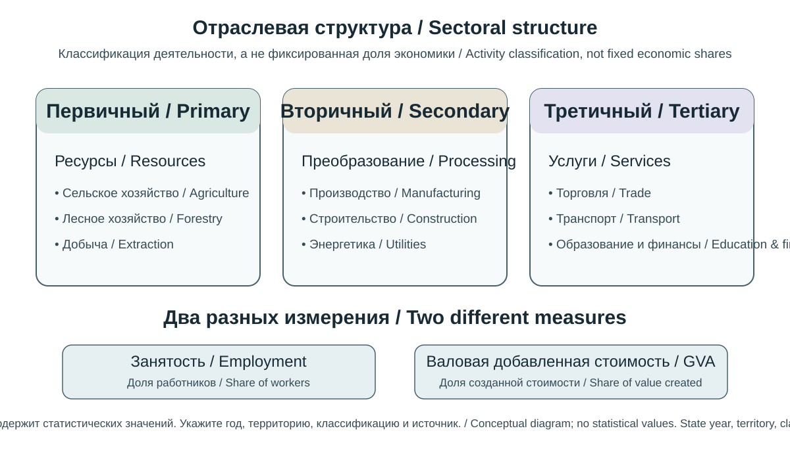
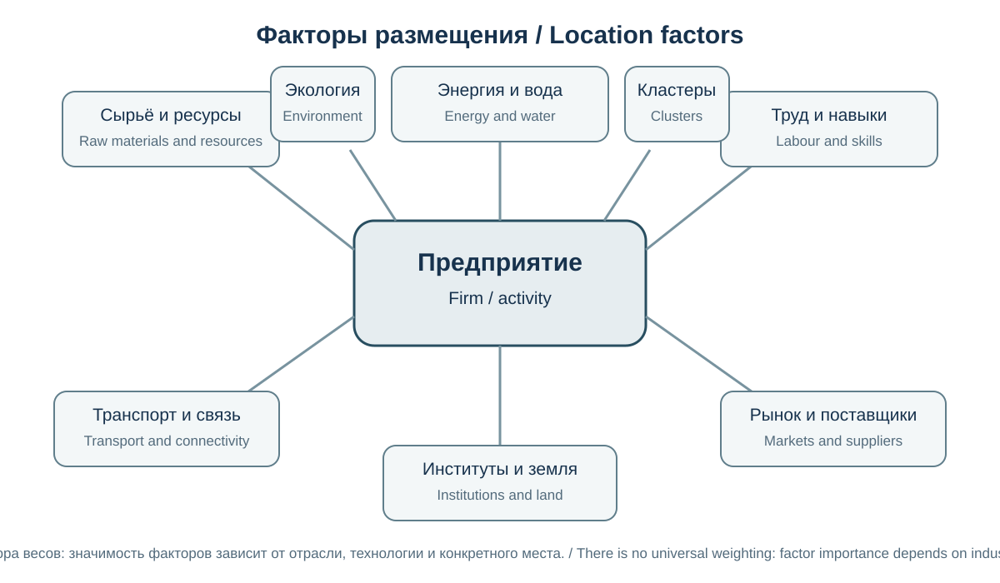
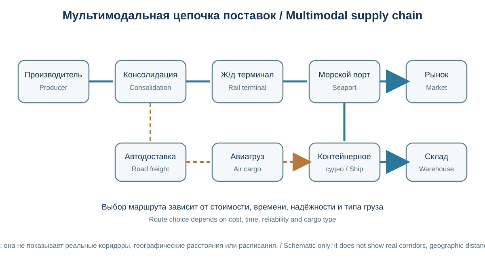

# Глава 11. Экономическая география
# Chapter 11. Economic Geography

> **Часть II. Человек и география общества / Part II. People and the Geography of Society**  
> Научно-образовательный атлас географии / Scientific and Educational Geography Atlas

## Цели главы / Chapter objectives

Экономическая география изучает пространственную организацию хозяйственной деятельности, размещение производства и услуг, территориальные различия развития, экономические связи и взаимодействие общества с природной средой. После изучения главы читатель сможет анализировать отраслевую и территориальную структуру экономики, объяснять факторы размещения предприятий, интерпретировать транспортные и торговые потоки, оценивать региональное неравенство и применять базовые методы пространственного экономического анализа.

Economic geography studies the spatial organisation of economic activity, the location of production and services, territorial differences in development, economic networks, and interactions between society and the natural environment. Readers will learn to analyse sectoral and territorial economic structures, explain location factors, interpret transport and trade flows, assess regional inequality, and apply basic methods of spatial economic analysis.

## 11.1. Предмет экономической географии / Scope of Economic Geography

Экономическая география исследует, где и почему размещаются виды хозяйственной деятельности, как они связаны между собой и как меняются во времени. Её объект — хозяйство в пространстве: предприятия, отрасли, рынки, рабочая сила, инфраструктура, природные ресурсы, потоки товаров, капитала, информации и услуг.

В отличие от общего экономического анализа, который часто рассматривает рынки и решения в абстрактной модели, экономическая география подчёркивает значение расстояния, доступности, масштаба, местных условий, исторического наследия и территориальных институтов.

Основные направления:
- география промышленности, сельского хозяйства и сферы услуг;
- география транспорта, торговли и логистики;
- региональная экономика и территориальное развитие;
- география труда, инноваций и финансов;
- ресурсная и энергетическая география;
- география туризма;
- экологическая экономика и устойчивое развитие территорий.

Экономическая карта постоянно меняется. Новые технологии, инфраструктурные проекты, торговые соглашения, изменение цен, конфликты, климатические риски и решения компаний могут изменить конкурентные преимущества регионов.

Economic geography examines where and why economic activities are located, how they are connected, and how they change over time. Its subject is the economy in space: enterprises, industries, markets, labour, infrastructure, natural resources, and flows of goods, capital, information and services.

Unlike general economic analysis, which often studies markets and decisions through abstract models, economic geography emphasises distance, accessibility, scale, local conditions, historical legacies and territorial institutions.

Its main fields include:
- the geography of industry, agriculture and services;
- transport, trade and logistics;
- regional economies and territorial development;
- the geography of labour, innovation and finance;
- resource and energy geography;
- tourism geography; and
- environmental economics and sustainable territorial development.

The economic map is constantly changing. New technologies, infrastructure projects, trade agreements, price changes, conflicts, climate risks and business decisions can alter the competitive advantages of regions.
## 11.2. Экономическая система и территориальное разделение труда / Economic Systems and the Territorial Division of Labour

Экономическая система включает производство, распределение, обмен и потребление товаров и услуг. Эти процессы организованы через рынки, государственные институты, предприятия, домохозяйства и общественные организации.

**Территориальное разделение труда** — специализация территорий на определённых видах деятельности и обмен результатами этой деятельности. Оно формируется под влиянием природных условий, ресурсов, квалификации работников, технологий, инфраструктуры, спроса, институтов и исторических связей.

Специализация может повышать производительность за счёт концентрации знаний и инфраструктуры, но чрезмерная зависимость от одной отрасли делает территорию уязвимой к падению спроса, технологическим изменениям и внешним шокам. Поэтому важны диверсификация экономики и развитие взаимосвязанных отраслей.

**Экономический район** — территория, выделенная по сочетанию хозяйственной специализации, внутренних связей, ресурсов и исторически сложившейся организации экономики. Границы экономических районов не всегда совпадают с административными границами.

An economic system includes the production, distribution, exchange and consumption of goods and services. These processes are organised through markets, public institutions, firms, households and civil-society organisations.

**The territorial division of labour** is the specialisation of places in particular activities and the exchange of the results of those activities. It is shaped by natural conditions, resources, workers' skills, technology, infrastructure, demand, institutions and historical connections.

Specialisation can raise productivity by concentrating knowledge and infrastructure. However, excessive dependence on a single industry makes a territory vulnerable to falling demand, technological change and external shocks. Economic diversification and the development of connected industries therefore matter.

**An economic region** is an area identified through a combination of economic specialisation, internal connections, resources and historically developed economic organisation. Economic-region boundaries do not always coincide with administrative boundaries.
## 11.3. Отраслевая структура хозяйства / Sectoral Structure of the Economy

*Оригинальная двуязычная учебная схема. Статистические значения не заданы: для реального сравнения используйте данные одной территории, одного года и сопоставимой классификации. / Original bilingual teaching diagram. No statistical values are supplied: for a real comparison, use data for the same territory and year under a comparable classification.*

Для общего описания экономики используют деление на сектора. Классическая трёхсекторная схема включает:

1. **Первичный сектор:** добыча природных ресурсов, сельское, лесное и рыбное хозяйство.
2. **Вторичный сектор:** обрабатывающая промышленность, строительство и преобразование сырья в продукцию; в некоторых учебных моделях к нему также относят энергетику и коммунальные услуги.
3. **Третичный сектор:** торговля и услуги — транспорт, связь, образование, здравоохранение, финансы, туризм и другие виды деятельности.

В расширенных моделях отдельно выделяют **четвертичный сектор**, связанный с информацией, исследованиями, разработками и высококвалифицированными интеллектуальными услугами, а иногда и **пятеричный сектор**, связанный с высшим управлением и принятием стратегических решений. Эти категории не являются универсальной статистической классификацией.

Международная стандартная отраслевая классификация всех видов экономической деятельности ООН (ISIC) обеспечивает более детальное и сопоставимое описание видов деятельности. В 2024 году была принята пятая редакция (ISIC Rev. 5), которая учитывает новые виды экономической деятельности и изменения структуры мировой экономики. Однако многие национальные и международные статистические ряды по-прежнему основаны на ISIC Rev. 4 или национальных классификациях. Поэтому перед сравнением стран и лет необходимо проверить редакцию классификатора и таблицы соответствия: одинаковое название отрасли ещё не гарантирует одинаковый состав деятельности.

Доля сектора в занятости и добавленной стоимости может различаться. Например, автоматизация способна уменьшать долю работников в промышленности при сохранении или росте промышленного выпуска.

**Рисунок 11.1 / Figure 11.1 — Сектора экономики и межотраслевые связи / Economic sectors and intersectoral links.**  
Техническое задание: схема первичного, вторичного и третичного секторов с потоками сырья, полуфабрикатов, готовой продукции, услуг и информации; показать, что границы между секторами условны и цепочки создания стоимости пересекают их.

### 11.3.1. Разобранный пример: сравнение отраслевой структуры занятости и выпуска / Worked Example: Comparing the Sectoral Structure of Employment and Output

В условной экономике заняты 120 000 человек: 18 000 работают в первичном секторе, 30 000 — во вторичном и 72 000 — в третичном.

Доли занятых рассчитываются делением числа работников сектора на общую занятость:
- первичный сектор: 18 000 / 120 000 × 100 = **15%**;
- вторичный сектор: 30 000 / 120 000 × 100 = **25%**;
- третичный сектор: 72 000 / 120 000 × 100 = **60%**.

Предположим также, что доли этих секторов в общей добавленной стоимости составляют соответственно 8%, 32% и 60%. Тогда доля занятости и доля выпуска заметно различаются в первичном и вторичном секторах. Это может быть связано с различиями в капиталоёмкости, технологиях, ценах, организации производства и составе видов деятельности. По одним этим долям нельзя заключить, что работники одного сектора «лучше» или «хуже» работают: для оценки производительности нужны сопоставимые данные о реальном выпуске и затратах труда, а также корректная отраслевая классификация.

In a hypothetical economy, 120,000 people are employed: 18,000 in the primary sector, 30,000 in the secondary sector, and 72,000 in the tertiary sector.

Each employment share is calculated by dividing the number employed in a sector by total employment:
- primary sector: 18,000 / 120,000 × 100 = **15%**;
- secondary sector: 30,000 / 120,000 × 100 = **25%**;
- tertiary sector: 72,000 / 120,000 × 100 = **60%**.

Assume that the sectors account for 8%, 32%, and 60% of total value added, respectively. The employment and output shares therefore differ notably in the primary and secondary sectors. Possible reasons include differences in capital intensity, technology, prices, production organisation, and the mix of activities. These shares alone do not show that workers in one sector are more or less productive: assessing productivity requires comparable data on real output and labour input, as well as a consistent industry classification.

## 11.4. Валовой внутренний продукт и другие экономические показатели / GDP and Other Economic Indicators

**Валовой внутренний продукт (ВВП)** — показатель стоимости конечного производства на экономической территории страны за определённый период. Производственным методом он равен сумме валовой добавленной стоимости резидентных производителей и налогов на продукты за вычетом субсидий на продукты. В национальных счетах учитывается как рыночное, так и соответствующее правилам системы нерыночное производство. ВВП также можно рассчитать распределительным (по доходам) и методом конечного использования (по расходам); при согласованной системе национальных счетов результаты должны быть согласованы. Промежуточные товары не прибавляют к конечному выпуску отдельно, чтобы избежать двойного счёта.

ВВП на душу населения — ВВП, делённый на численность населения; для годовых рядов обычно используют среднегодовую численность или другое значение, прямо указанное в метаданных показателя. При сравнении необходимо применять одинаковое определение знаменателя. Показатель полезен для сопоставления среднего масштаба экономического производства, но не показывает распределение доходов, неоплачиваемый труд, качество окружающей среды или все аспекты благополучия.

Необходимо различать:
- **номинальный ВВП:** оценивается в текущих ценах;
- **реальный ВВП:** скорректирован на изменение цен, чтобы оценивать динамику объёма производства;
- **ВВП по паритету покупательной способности (ППС):** пересчитывается с помощью коэффициентов ППС, чтобы привести расходы и выпуск к сопоставимому уровню цен. ППС — это способ пространственного пересчёта, а не отдельный тип цен: необходимо уточнять, выражен ли показатель в текущих или постоянных международных долларах и какой год принят за ценовую базу. Рыночный валютный курс сам по себе не устраняет различия в уровнях цен между странами;
- **валовой национальный доход (ВНД):** учитывает первичные доходы, полученные резидентами, в том числе из-за рубежа, за вычетом соответствующих доходов нерезидентов.

**Добавленная стоимость и ВВП.** Добавленная стоимость показывает, какую новую стоимость создаёт производитель: из стоимости выпуска вычитают стоимость промежуточных товаров и услуг, использованных при производстве. В системе национальных счетов ВВП производственным методом получают суммированием валовой добавленной стоимости всех производителей и добавлением налогов на продукты за вычетом субсидий на продукты. Это предотвращает повторный счёт стоимости сырья и компонентов на последовательных стадиях производства. Поэтому валовую стоимость продаж или экспорта нельзя автоматически считать вкладом предприятия или страны в ВВП.

Дополнительные показатели:
- производительность труда;
- уровень занятости и безработицы;
- инфляция;
- инвестиции и накопление капитала;
- экспорт и импорт;
- бедность и неравенство доходов;
- государственные доходы и расходы;
- индекс человеческого развития и многомерные показатели качества жизни.

Ни один показатель не описывает экономику полностью. ВВП измеряет производство, а не распределение выгод и не является прямой мерой экологической устойчивости или субъективного благополучия.

**Gross domestic product (GDP)** measures the value of final production within a country's economic territory during a given period. Under the production approach, it equals the gross value added of resident producers plus taxes on products less subsidies on products. National accounts include both market output and non-market production that falls within the SNA production boundary. GDP can also be measured using the income and expenditure approaches; under a consistent system of national accounts, the results should reconcile. Intermediate goods are not added separately to final output, which avoids double counting.

GDP per capita is GDP divided by the population. It is useful for comparing the average scale of economic production, but it does not show how income is distributed, unpaid work, environmental quality or every aspect of well-being.

Important distinctions include:
- **Nominal GDP:** measured at current prices.
- **Real GDP:** adjusted for price changes to estimate changes in the volume of production.
- **GDP at purchasing power parity (PPP):** converted using PPP rates so that output or expenditure can be compared at a more comparable price level. PPP is a spatial conversion method, not a separate type of price: state whether the indicator is expressed in current or constant international dollars and identify the price-base year. Market exchange rates alone do not remove differences in price levels between countries.
- **Gross national income (GNI):** includes primary income received by residents, including from abroad, minus the corresponding income received by non-residents.

**Value added and GDP.** Value added measures the new value created by a producer: the value of output minus the value of intermediate goods and services used in production. In the national accounts, GDP by the production approach is calculated by summing the gross value added of all producers and adding taxes on products less subsidies on products. This avoids counting the value of raw materials and components repeatedly at successive production stages. The gross value of sales or exports therefore cannot automatically be treated as a firm's or country's contribution to GDP.

Other indicators include labour productivity; employment and unemployment; inflation; investment and capital formation; exports and imports; poverty and income inequality; government revenue and expenditure; and the Human Development Index and multidimensional measures of quality of life.

No single indicator describes an economy in full. GDP measures production, not the distribution of its benefits, and it is not a direct measure of environmental sustainability or subjective well-being.
## 11.5. Факторы размещения производства / Factors Influencing the Location of Economic Activity

*Оригинальная двуязычная схема; значимость факторов зависит от отрасли, технологии и конкретного места. / Original bilingual diagram; factor importance depends on industry, technology and place.*
> **EN:** Diagram of business-location factors: raw materials, energy, water, labour, transport, markets, agglomeration, institutions and environmental constraints.

Размещение предприятия зависит от сочетания затрат, доступа к рынкам и рабочей силе, инфраструктуры, регулирования, технологий и экологических ограничений.

Основные факторы:
- **сырьевой:** близость к месторождениям и источникам сельскохозяйственного сырья;
- **энергетический:** надёжность и стоимость энергоснабжения;
- **водный:** доступ к воде и условия её использования;
- **трудовой:** численность, квалификация и стоимость рабочей силы;
- **транспортный:** доступ к дорогам, железным дорогам, портам, аэропортам и логистическим узлам;
- **потребительский:** близость к рынкам сбыта;
- **агломерационный:** выгоды соседства с поставщиками, клиентами, научными центрами и специализированным рынком труда;
- **институциональный:** налоги, регулирование, защита прав, качество управления и торговые режимы;
- **экологический:** требования к выбросам, воде, земле и обращению с отходами;
- **технологический:** доступ к инновациям, цифровой инфраструктуре и знаниям.

Значимость факторов различается по отраслям. Металлургический завод, дата-центр, туристический комплекс и фермерское хозяйство имеют разные требования к местоположению. Технологические изменения могут уменьшать значение одних факторов и усиливать другие.

**Рисунок 11.2 / Figure 11.2 — Факторы размещения предприятия / Location factors of a firm.**  
Техническое задание: центральный блок «предприятие» и радиальные факторы размещения; для каждого фактора привести краткий пример отрасли; не ранжировать факторы как универсальные.

A firm's location depends on a combination of costs, access to markets and labour, infrastructure, regulation, technology and environmental constraints.

The main factors include:
- **raw materials:** proximity to mineral deposits and agricultural sources;
- **energy:** reliability and cost of energy supply;
- **water:** access to water and the conditions governing its use;
- **labour:** workforce size, skills and cost;
- **transport:** access to roads, railways, ports, airports and logistics hubs;
- **markets:** proximity to customers and sales markets;
- **agglomeration:** benefits from being near suppliers, customers, research centres and specialised labour markets;
- **institutions:** taxes, regulation, property rights, governance quality and trade regimes;
- **environment:** requirements for emissions, water, land and waste management; and
- **technology:** access to innovation, digital infrastructure and knowledge.

The importance of these factors varies by industry. A steel mill, data centre, tourist complex and farm have different location requirements. Technological change can reduce the importance of some factors and increase that of others.

## 11.6. Промышленность и индустриальные районы / Industry and Industrial Regions

В широком употреблении **промышленность** может охватывать добывающие и обрабатывающие производства, энергетику и коммунальную инфраструктуру; точные границы зависят от классификации. В трёхсекторной учебной модели добывающие отрасли обычно относят к первичному сектору, а обрабатывающие производства и строительство — ко вторичному; энергетику и коммунальные услуги разные модели могут группировать по-разному. Поэтому широкое понятие промышленности не следует автоматически отождествлять со вторичным сектором.

Промышленные районы формируются вокруг ресурсных баз, транспортных узлов, портов, крупных рынков, научных центров или исторически сложившихся производственных кластеров. В одних регионах преобладают тяжёлые отрасли, в других — машиностроение, электроника, химическая промышленность, пищевая переработка или высокотехнологичные производства.

**Промышленный кластер** — географическая концентрация взаимосвязанных предприятий, поставщиков, исследовательских организаций и институтов, взаимодействующих через конкуренцию и сотрудничество. Кластер может повышать обмен знаниями и эффективность, но его преимущества зависят от квалификации кадров, инноваций и связей с внешними рынками.

Деиндустриализация означает сокращение относительной роли промышленности в занятости или выпуске; она может быть связана с автоматизацией, переносом производства, ростом производительности и увеличением доли услуг. Реиндустриализация — попытка укрепить производственные компетенции и технологическую базу. Эти процессы не обязательно означают простое возвращение прежних заводов.

In broad usage, **industry** may include extractive and manufacturing activities, energy production and utility services; exact boundaries depend on the classification used. In the three-sector teaching model described above, extractive activities are usually assigned to the primary sector, while manufacturing and construction are assigned to the secondary sector. Different models may group energy and utility services differently. The broad term *industry* should therefore not automatically be equated with the secondary sector.

Industrial regions develop around resource bases, transport hubs, ports, large markets, research centres or historically established production clusters. Some regions specialise in heavy industry, while others focus on engineering, electronics, chemicals, food processing or high-technology manufacturing.

An **industrial cluster** is a geographic concentration of interconnected firms, suppliers, research organisations and institutions that interact through both competition and cooperation. A cluster can encourage knowledge exchange and efficiency, but its advantages depend on workforce skills, innovation and links to external markets.

Deindustrialisation is a decline in industry's relative share of employment or output. It may be associated with automation, relocation of production, productivity growth and an expanding services sector. Reindustrialisation seeks to strengthen manufacturing capabilities and the technological base. These processes do not necessarily mean simply reopening former factories.
## 11.7. Сельское хозяйство и аграрные системы / Agriculture and Agrarian Systems

Сельское хозяйство зависит от климата, почв, рельефа, водных ресурсов, сезонности, технологий, земельных отношений, рынков и государственной политики. Его география включает растениеводство, животноводство, агролесоводство, рыболовство и связанные цепочки хранения и переработки.

Основные типы аграрных систем:
- натуральное и мелкотоварное хозяйство;
- интенсивное товарное земледелие;
- плантационное производство;
- пастбищное животноводство;
- смешанные растениеводческо-животноводческие системы;
- тепличное и защищённое земледелие;
- орошаемое земледелие;
- высокомеханизированное крупномасштабное производство.

Интенсивность земледелия определяется не только количеством удобрений и техники, но и урожайностью, использованием воды, трудом, знаниями и воздействием на экосистемы. Высокая урожайность может сочетаться с деградацией почв и водных ресурсов, если управление неустойчиво.

**Продовольственная безопасность** существует, когда все люди в любое время имеют физический, социальный и экономический доступ к достаточному количеству безопасной и питательной пищи, соответствующей их потребностям и предпочтениям для активной и здоровой жизни. В анализе выделяют четыре взаимосвязанных измерения: наличие продовольствия (производство, запасы и торговля); физический и экономический доступ к нему; использование пищи (питательная ценность, безопасность, приготовление, вода, санитария и состояние здоровья); стабильность всех трёх измерений во времени. Производство продовольствия в стране само по себе не гарантирует продовольственную безопасность всех домохозяйств.

*Оригинальная учебная схема, не карта конкретного района; факторы взаимодействуют и не имеют универсальных весов. / Original teaching diagram, not a map of a specific area; factors interact and have no universal weights.*

**Рисунок 11.3 / Figure 11.3 — Географические факторы сельского хозяйства / Geographical factors of agriculture.** Схема показывает взаимодействие природных условий, водных ресурсов и землепользования; она не задаёт универсальные веса факторов. / The diagram shows the interaction of natural conditions, water resources and land use; it does not assign universal weights to the factors.

Agriculture depends on climate, soils, relief, water resources, seasonality, technology, land tenure, markets and public policy. Its geography includes crop production, livestock, agroforestry, fisheries, and the related storage and processing chains.

Major types of agricultural systems include:
- subsistence and smallholder farming;
- intensive commercial crop production;
- plantation agriculture;
- pastoral livestock systems;
- mixed crop-livestock systems;
- greenhouse and protected cultivation;
- irrigated agriculture; and
- large-scale, highly mechanised production.

Agricultural intensity is not determined only by the amount of fertiliser and machinery used. It also involves yields, water use, labour, knowledge and ecosystem impacts. High yields may coexist with soil and water degradation if management is unsustainable.

**Food security** exists when all people, at all times, have physical, social and economic access to sufficient, safe and nutritious food that meets their dietary needs and preferences for an active and healthy life. Four interrelated dimensions are commonly identified: food availability (production, stocks and trade); physical and economic access to food; food utilisation (nutritional quality, safety, preparation, water, sanitation and health); and the stability of all three dimensions over time. Domestic food production alone does not guarantee food security for every household.

## 11.8. Энергетическая география / Energy Geography

Энергетическая география изучает размещение источников энергии, производство, преобразование, передачу и потребление энергетических ресурсов. Энергетические системы включают добычу топлива, электростанции, сети, хранилища, рынки и конечных потребителей.

Источники энергии обычно группируют на:
- ископаемые: уголь, нефть и природный газ;
- ядерную энергию;
- возобновляемые: гидроэнергию, солнечную, ветровую, геотермальную энергию и устойчиво используемую биоэнергию.

Возобновляемость источника не означает отсутствия экологического воздействия. Гидроэнергетика может менять речные экосистемы и режим стока; ветровые и солнечные установки требуют земли, материалов, сетевой интеграции и систем балансировки. Ископаемое топливо связано с выбросами парниковых газов и загрязнением воздуха.

Энергетическая безопасность включает надёжность поставок, доступность цен, устойчивость инфраструктуры, диверсификацию источников и способность системы выдерживать кризисы. Энергетический переход предполагает изменение технологий, инфраструктуры, структуры потребления и институтов, а не только замену одного вида электростанций другим.

*Схема отделяет генерацию, передачу, распределение и снабжение. Показатели 2025 года округлены и не являются полным энергетическим балансом. / The diagram separates generation, transmission, distribution and supply. 2025 indicators are rounded and do not constitute a full energy balance.*

**Рисунок 11.4 / Figure 11.4 — Энергетическая система и показатели Кыргызстана за 2025 год / Energy system and Kyrgyzstan's 2025 indicators.** Значения отражают опубликованные показатели производства, потребления и импорта; их нельзя трактовать как полный баланс без учёта экспорта, потерь и методики учёта. / Values show published generation, consumption and import indicators; they should not be treated as a complete balance without exports, losses and accounting methodology.

Energy geography studies the location of energy sources, production, conversion, transmission and consumption. Energy systems include fuel extraction, power plants, networks, storage, markets and end users.

Energy sources are commonly grouped as:
- **fossil fuels:** coal, oil and natural gas;
- **nuclear energy;** and
- **renewables:** hydropower, solar, wind, geothermal energy and sustainably used bioenergy.

A renewable source does not mean an absence of environmental impacts. Hydropower can alter river ecosystems and flow regimes; wind and solar facilities require land, materials, grid integration and balancing systems. Fossil fuels are associated with greenhouse-gas emissions and air pollution.

Energy security includes reliability of supply, price affordability, infrastructure resilience, source diversification and the ability of the system to withstand crises. The energy transition involves changes in technology, infrastructure, consumption patterns and institutions—not simply replacing one type of power plant with another.

## 11.9. Транспортная география и логистика / Transport Geography and Logistics

*Схематическая сеть, а не карта реальных транспортных коридоров; расстояния и время не заданы. / Schematic network, not a map of real transport corridors; distances and travel times are not specified.*

Транспорт обеспечивает перемещение людей, сырья и товаров, а также предоставление транспортных услуг. География транспорта исследует сети, узлы, коридоры, доступность, стоимость и время перемещения, а также воздействие транспортной инфраструктуры на территорию.

Основные виды транспорта:
- автомобильный;
- железнодорожный;
- морской и внутренний водный;
- воздушный;
- трубопроводный;
- городской общественный и активная мобильность — пешее и велосипедное передвижение.

Каждый вид имеет собственные преимущества и ограничения по скорости, вместимости, стоимости, гибкости, энергопотреблению и экологическому воздействию. Интермодальные перевозки используют несколько видов транспорта в единой логистической цепочке.

**Логистика** — планирование и управление потоками товаров, услуг, информации и связанных ресурсов от источника до потребителя. Логистические центры часто размещаются в узлах пересечения транспортных сетей, рядом с рынками, портами, промышленными районами и таможенной инфраструктурой.

Доступность территории можно оценивать не только расстоянием, но и временем поездки, стоимостью, частотой перевозок, сезонностью, надёжностью и доступностью для разных групп населения. Горные, островные, пустынные и удалённые территории могут иметь высокие транспортные издержки даже при сравнительно небольшом расстоянии по прямой.

**Рисунок 11.5 / Figure 11.5 — Транспортная сеть и логистические узлы / Transport network and logistics hubs.**  
Техническое задание: условная сеть с узлами, магистралями, терминалами и потоками; толщина линий может отражать интенсивность только при наличии данных; добавить пример мультимодальной цепочки.

Transport moves people, raw materials, goods and services. Transport geography studies networks, nodes, corridors, accessibility, cost and travel time, as well as the territorial impacts of transport infrastructure.

Main transport modes include:
- road;
- rail;
- maritime and inland waterway;
- air;
- pipeline; and
- urban public transport and active mobility, including walking and cycling.

Each mode has its own advantages and limitations in speed, capacity, cost, flexibility, energy use and environmental impact. Intermodal transport uses several modes within a single logistics chain.

**Logistics** is the planning and management of goods, services, information and related resources from source to consumer. Logistics centres are often located at transport-network intersections, near markets, ports, industrial areas and customs infrastructure.

Territorial accessibility can be assessed not only by distance but also by travel time, cost, service frequency, seasonality, reliability and accessibility for different population groups. Mountainous, island, desert and remote areas may face high transport costs even when their straight-line distance is relatively short.

## 11.10. Международная торговля и глобальные цепочки создания стоимости / International Trade and Global Value Chains

*Схема концептуальная: конкретная цепочка может включать другие стадии и географию; она не изображает конкретный товар или торговый маршрут. / Conceptual diagram: an actual chain may include different stages and geographies; it does not depict a specific product or trade route.*

Международная торговля включает обмен товарами и услугами между странами. В статистике внешнего сектора экспорт отражает операции резидентов с нерезидентами, а импорт — обратные операции. При учёте товаров в платёжном балансе в общем случае важен переход экономической собственности, поэтому физическое пересечение границы и экспорт по платёжному балансу не всегда совпадают. Таможенная статистика может использовать критерий физического перемещения товаров через границу; услуги учитываются как операции между резидентами и нерезидентами. При сравнении данных необходимо проверять применяемую методологию, период и классификацию.

Торговая география исследует направления потоков, специализацию стран, транспортные коридоры, тарифные и нетарифные барьеры, торговые соглашения и зависимость от внешних рынков.

**Глобальная цепочка создания стоимости** — система этапов проектирования, производства компонентов, сборки, маркетинга, транспортировки и обслуживания, распределённых между несколькими странами и компаниями. Страна может экспортировать готовую продукцию, созданную с использованием импортных компонентов, технологий и услуг.

Участие в глобальных цепочках может обеспечивать доступ к рынкам, технологиям и рабочим местам. Риски включают зависимость от ограниченного числа поставщиков, логистические сбои, изменение торговой политики, неравномерное распределение добавленной стоимости и экологические издержки.

**Рисунок 11.6 / Figure 11.6 — Глобальная цепочка создания стоимости / Global value chain.**  
Техническое задание: условный пример товара, проходящего этапы исследования, добычи материалов, производства компонентов, сборки, перевозки, продажи и утилизации в разных странах; подчеркнуть распределённость добавленной стоимости.

### 11.10.1. Разобранный пример: добавленная стоимость в экспортном товаре / Worked Example: Value Added in an Exported Product

Предположим, предприятие собирает товар и экспортирует его за 100 условных денежных единиц. Импортные комплектующие и материалы стоят 60 единиц, а отечественные промежуточные товары и услуги, использованные при производстве, — 15 единиц. Тогда добавленная стоимость на данном этапе производства составляет:

100 − 60 − 15 = **25 условных денежных единиц**.

Эти 25 единиц включают оплату труда, валовой операционный излишек, смешанный доход некорпоративных предприятий и другие налоги на производство за вычетом субсидий. Валовой операционный излишек включает потребление основного капитала (амортизацию); валовая добавленная стоимость не равна прибыли предприятия. Расчёт показывает, почему стоимость экспорта нельзя автоматически приравнивать к доходу, созданному внутри страны: часть стоимости может быть сформирована импортными ресурсами и на предыдущих этапах цепочки.

Это упрощённый пример для одного этапа производства. Для полноценного анализа глобальной цепочки нужны согласованные таблицы затрат-выпуска и данные о происхождении промежуточных ресурсов; нельзя просто суммировать валовую стоимость экспорта разных этапов, иначе возникает двойной счёт.

Assume a firm assembles a product and exports it for 100 monetary units. Imported components and materials cost 60 units, while domestic intermediate goods and services used in production cost 15 units. The value added at this production stage is:

100 − 60 − 15 = **25 monetary units**.

This 25 includes compensation of employees, gross operating surplus, gross mixed income of unincorporated enterprises, and other taxes on production less subsidies. Gross operating surplus includes consumption of fixed capital (depreciation); gross value added is not the same as the firm's profit. The calculation shows why the gross value of exports cannot automatically be treated as income created domestically: part of the value may have been generated by imported inputs and at earlier stages of the chain.

This is a simplified example for one production stage. A full global value-chain analysis requires consistent input-output tables and information on the origin of intermediate inputs; simply adding the gross export values of different stages would create double counting.

## 11.11. География услуг, финансов и цифровой экономики / Geography of Services, Finance and the Digital Economy

Сфера услуг включает деятельность, результатом которой часто является нематериальный продукт или обслуживание: образование, здравоохранение, торговлю, транспорт, туризм, финансы, государственное управление, связь и профессиональные услуги.

Финансовые центры формируются благодаря концентрации банков, рынков капитала, правовых и деловых услуг, квалифицированных кадров и цифровой инфраструктуры. Финансовые потоки способны быстро пересекать границы, но регулируются национальными и международными правилами.

Цифровая экономика опирается на телекоммуникационные сети, дата-центры, программное обеспечение, цифровые платформы и данные. Её пространственная организация не является полностью «безместной»: дата-центрам необходимы электроэнергия, охлаждение, связь и физическая безопасность; цифровые услуги зависят от навыков работников, регулирования и доступа к сетям.

Цифровой разрыв — различия в доступе к интернету, устройствам, навыкам и возможностям использования цифровых сервисов. Он может усиливать существующее региональное и социальное неравенство.

The services sector includes activities whose output is often an intangible product or service: education, healthcare, trade, transport, tourism, finance, public administration, communications and professional services.

Financial centres develop through the concentration of banks, capital markets, legal and business services, skilled workers and digital infrastructure. Financial flows can cross borders rapidly, but they are governed by national and international rules.

The digital economy relies on telecommunications networks, data centres, software, digital platforms and data. Its geography is not entirely “placeless”: data centres require electricity, cooling, connectivity and physical security, while digital services depend on workforce skills, regulation and network access.

The **digital divide** refers to differences in access to the internet and devices, digital skills and the ability to use digital services. It can reinforce existing regional and social inequalities.
## 11.12. Туризм и рекреационная география / Tourism and Recreation Geography

Туризм связан с временными поездками за пределы обычной среды проживания с различными целями, включая отдых, деловые поездки, посещение родственников, образование и лечение. География туризма изучает туристские ресурсы, потоки, инфраструктуру, сезонность, воздействие на территории и устойчивость дестинаций.

Туристская привлекательность может основываться на природных ландшафтах, климате, культурном наследии, событиях, доступности и качестве услуг. Туристский поток зависит от транспортных связей, доходов, безопасности, визового режима, информации и стоимости поездки.

Туризм способен поддерживать занятость и местный бизнес, стимулировать сохранение наследия и улучшать инфраструктуру. Одновременно он может создавать сезонную нагрузку на воду и энергию, отходы, давление на экосистемы, рост стоимости жилья и культурную коммерциализацию.

Устойчивое управление туризмом включает мониторинг посещаемости, участие местных сообществ, защиту природных и культурных объектов, управление отходами, водопользованием и транспортом, а также распределение экономических выгод.

*Схема связывает ресурсы, инфраструктуру, услуги, посетителей, местные сообщества и экологические ограничения; это концептуальная модель, а не оценка конкретной дестинации. / The diagram links assets, infrastructure, services, visitors, local communities and environmental limits; it is a conceptual model, not an assessment of a specific destination.*

**Рисунок 11.7 / Figure 11.7 — Туристская система территории / Tourism destination system.** Концептуальная схема показывает связи между туристскими ресурсами, доступом, предприятиями, посетителями, местными сообществами и экологическими пределами. / The conceptual diagram shows links among tourism assets, access, businesses, visitors, local communities and environmental limits.

Tourism involves temporary travel outside a person's usual environment for a range of purposes, including leisure, business, visiting friends and relatives, education and medical treatment. Tourism geography studies tourism resources, flows, infrastructure, seasonality, territorial impacts and destination sustainability.

A destination's appeal may be based on natural landscapes, climate, cultural heritage, events, accessibility and service quality. Tourist flows depend on transport links, income, safety, visa rules, information and travel costs.

Tourism can support employment and local businesses, encourage heritage conservation and improve infrastructure. At the same time, it can create seasonal pressure on water and energy, generate waste, damage ecosystems, increase housing costs and commercialise cultural practices.

Sustainable tourism management includes monitoring visitor numbers, involving local communities, protecting natural and cultural sites, managing waste, water use and transport, and distributing economic benefits fairly.

## 11.13. Региональное развитие и экономическое неравенство / Regional Development and Economic Inequality

Экономическая активность распределена неравномерно. Крупные города и транспортные узлы часто концентрируют рабочие места, капитал, университеты и инфраструктуру, тогда как периферийные территории могут сталкиваться с оттоком населения, ограниченным доступом к услугам и узкой отраслевой базой.

Региональное неравенство измеряют различными показателями:
- ВРП на душу населения;
- производительность труда;
- доходы и бедность домохозяйств;
- занятость и безработица;
- доступность образования, медицины и транспорта;
- инвестиции и инфраструктурная обеспеченность;
- индекс человеческого развития и его компоненты.

**Валовой региональный продукт (ВРП)** оценивает добавленную стоимость, созданную в регионе за период. Его расчёт и сопоставимость зависят от национальной статистической методологии. Высокий ВРП на душу населения в регионе с добывающей отраслью не обязательно означает высокие доходы большинства жителей.

Региональная политика может включать инвестиции в инфраструктуру, образование, инновации, местное предпринимательство, цифровую связь и межрегиональную связанность. Важно оценивать не только объём вложений, но и доступность выгод для населения, экологические последствия и долгосрочную устойчивость.

Economic activity is unevenly distributed. Large cities and transport hubs often concentrate jobs, capital, universities and infrastructure, while peripheral areas may experience population loss, limited access to services and a narrow industrial base.

Regional inequality can be measured using different indicators:
- gross regional product per capita;
- labour productivity;
- household income and poverty;
- employment and unemployment;
- access to education, healthcare and transport;
- investment and infrastructure provision; and
- the Human Development Index and its components.

**Gross regional product (GRP)** estimates the value added created in a region during a given period. Its calculation and comparability depend on national statistical methods. A high GRP per capita in a region dominated by extractive industries does not necessarily mean that most residents have high incomes.

Regional policy may include investment in infrastructure, education, innovation, local enterprise, digital connectivity and links between regions. It is important to assess not only the volume of investment but also who benefits, the environmental consequences and long-term sustainability.
## 11.14. Агломерационные эффекты и пространственная концентрация / Agglomeration Economies and Spatial Concentration

Агломерационные эффекты возникают, когда близость предприятий, работников, поставщиков и потребителей повышает эффективность экономической деятельности. Обычно выделяют:
- **эффекты совместного использования:** общая инфраструктура, поставщики и специализированные услуги;
- **эффекты согласования:** более широкий рынок труда и лучшее соответствие работников рабочим местам;
- **эффекты обучения:** распространение знаний, технологий и деловых практик.

Концентрация имеет и издержки: дорожные заторы, дорогую землю и жильё, загрязнение, перегрузку инфраструктуры и уязвимость к локальным кризисам. Поэтому экономическая эффективность агломерации зависит от качества планирования, транспорта, жилья и управления землепользованием.

Agglomeration effects arise when the proximity of firms, workers, suppliers and consumers increases the efficiency of economic activity. Three common types are:
- **sharing effects:** access to shared infrastructure, suppliers and specialised services;
- **matching effects:** a larger labour market and a better match between workers and jobs; and
- **learning effects:** the spread of knowledge, technologies and business practices.

Concentration also creates costs: traffic congestion, expensive land and housing, pollution, overloaded infrastructure and vulnerability to local crises. The economic benefits of an agglomeration therefore depend on the quality of planning, transport, housing and land-use management.
## 11.15. Природные ресурсы, экономика и экологические ограничения / Natural Resources, Economy and Environmental Limits

Природные ресурсы — компоненты и свойства природной среды, используемые или потенциально пригодные для удовлетворения потребностей общества. Их классифицируют по происхождению, степени возобновляемости, хозяйственному назначению и доступности.

Экономическое использование ресурсов связано с экологическими пределами. Добыча полезных ископаемых может создавать рабочие места и экспортные доходы, но также приводить к нарушению земель, загрязнению воды, накоплению отходов и конфликтам землепользования. Сельское хозяйство может обеспечивать продовольствие, одновременно воздействуя на почвы, биоразнообразие и водные системы.

Важные подходы:
- оценка жизненного цикла продукции;
- принцип «загрязнитель платит»;
- циркулярная экономика и повторное использование материалов;
- экологическая оценка проектов и стратегическая экологическая оценка планов;
- учёт экосистемных услуг;
- снижение ресурсной и энергетической интенсивности.

**Циркулярная экономика** стремится уменьшить потребление первичных ресурсов и образование отходов через долговечный дизайн, ремонт, повторное использование, восстановление и переработку. Она не означает полного отсутствия отходов или воздействия.

Natural resources are components and properties of the natural environment that society uses, or may potentially use, to meet its needs. They can be classified by origin, renewability, economic purpose and accessibility.

The economic use of resources is constrained by environmental limits. Mineral extraction can create jobs and export revenue, but it can also damage land, pollute water, generate waste and cause land-use conflicts. Agriculture provides food while also affecting soils, biodiversity and water systems.

Important approaches include life-cycle assessment; the polluter-pays principle; circular-economy practices and material reuse; environmental impact assessment of projects and strategic environmental assessment of plans; accounting for ecosystem services; and reducing resource and energy intensity.

A **circular economy** seeks to reduce the use of virgin resources and the generation of waste through durable design, repair, reuse, refurbishment and recycling. It does not mean that waste or environmental impacts can be eliminated entirely.
## 11.16. Экономическая устойчивость и глобальные изменения / Economic Resilience and Global Change

Экономическая устойчивость — способность предприятий, отраслей и территорий выдерживать потрясения, адаптироваться и восстанавливаться, сохраняя ключевые функции. Источники потрясений включают финансовые кризисы, пандемии, природные опасности, изменение климата, конфликты, сбои цепочек поставок и технологические сдвиги.

Устойчивость повышают диверсификация, надёжная инфраструктура, квалифицированные кадры, доступ к финансированию, эффективные институты, социальная защита и сотрудничество между территориями. Однако универсального решения нет: меры должны учитывать отраслевую структуру, ресурсы, уязвимости и возможности конкретного региона.

Изменение климата влияет на сельское хозяйство, энергетику, транспорт, туризм, страхование и инфраструктуру. Экономическая адаптация требует сценарного анализа, оценки рисков и учёта неопределённости.

Economic resilience is the ability of firms, industries and territories to withstand shocks, adapt and recover while maintaining essential functions. Shocks may include financial crises, pandemics, natural hazards, climate change, conflicts, supply-chain disruptions and technological shifts.

Resilience can be strengthened through diversification, reliable infrastructure, skilled workers, access to finance, effective institutions, social protection and cooperation among territories. There is no universal solution: measures must reflect the industrial structure, resources, vulnerabilities and opportunities of each region.

Climate change affects agriculture, energy, transport, tourism, insurance and infrastructure. Economic adaptation requires scenario analysis, risk assessment and explicit consideration of uncertainty.
## 11.17. Методы экономико-географического исследования / Methods in Economic Geography

Экономико-географические исследования используют количественные, качественные и пространственные методы.

**Статистические методы:**
- анализ структуры и динамики;
- расчёт темпов роста и индексов;
- сравнение региональных показателей;
- анализ производительности и отраслевой специализации;
- оценка концентрации и диверсификации.

**Пространственные методы:**
- картографирование предприятий, занятости и потоков;
- сетевой анализ транспортной доступности;
- анализ зон обслуживания;
- пространственная статистика и выявление кластеров;
- моделирование размещения объектов.

**Качественные методы:**
- интервью с предприятиями и местными сообществами;
- анализ документов и стратегий;
- полевые исследования;
- наблюдение за производственными и логистическими процессами;
- сравнительные региональные исследования.

При интерпретации важно учитывать масштаб анализа, качество данных, изменение административных границ, неформальную экономику и причинно-следственные ограничения. Пространственная корреляция не доказывает причинность.

### Коэффициент локализации / Location Quotient

Для предварительной оценки отраслевой специализации региона применяют коэффициент локализации:

`LQ = (e_i / e) / (E_i / E)`

где (e_i) — занятость в отрасли i в регионе, (e) — общая занятость региона, (E_i) — занятость в той же отрасли на национальном уровне, (E) — общая занятость страны.

При (LQ>1) доля отрасли в региональной занятости выше её доли в национальной занятости. Это указывает на относительную специализацию, но само по себе не доказывает конкурентоспособность, высокую производительность или экспортную ориентацию.

### 11.17.1. Как интерпретировать коэффициент локализации / Interpreting a Location Quotient

Коэффициент локализации (Location Quotient, LQ) сравнивает долю отрасли в экономике территории с долей той же отрасли в выбранной базовой экономике:

`LQ = (занятость отрасли в регионе / вся занятость региона) ÷ (занятость отрасли в базе / вся занятость базы)`

При одинаковых определениях отрасли и занятости значение выше 1 указывает на относительную концентрацию отрасли в регионе по сравнению с базой; значение ниже 1 — на относительную недопредставленность. Это описательный показатель структуры, а не доказательство конкурентоспособности, производительности или экспортного успеха.

**Условный пример.** В регионе отрасль обеспечивает 12% занятости, а в стране в целом — 8%. LQ = 0,12 / 0,08 = 1,5. Отраслевая доля в регионе в полтора раза выше национальной доли. Но это может быть связано как с сильной специализацией, так и с малым размером других секторов, сезонной занятостью или особенностями классификации.

**Проверки перед выводом:** совпадают ли годы и территориальные границы; одинаково ли определена занятость (рабочие места или занятые жители); сопоставимы ли отраслевые классификаторы; не искажают ли результат маятниковая миграция и неформальная занятость; насколько устойчив результат при смене базовой территории. Для малых регионов небольшое изменение числа рабочих мест может заметно изменить коэффициент.

**Учебное задание.** Рассчитайте LQ для двух отраслей по условным долям занятости. Для каждой сформулируйте один обоснованный вывод и два вывода, которые по одному LQ делать нельзя.

A Location Quotient (LQ) compares an industry's share of employment in a region with the share of the same industry in a chosen reference economy:

`LQ = (regional industry employment / total regional employment) ÷ (reference industry employment / total reference employment)`

With consistent definitions of industry and employment, a value above 1 indicates that the industry is relatively concentrated in the region compared with the reference economy; a value below 1 indicates relative under-representation. It is a descriptive structural indicator, not proof of competitiveness, productivity or export success.

**Hypothetical example.** An industry accounts for 12% of regional employment and 8% of national employment. LQ = 0.12 / 0.08 = 1.5. The industry's employment share is one and a half times the national share. This may reflect genuine specialisation, but it may also result from a small size of other sectors, seasonal employment or classification choices.

**Checks before drawing conclusions:** Are years and territorial boundaries consistent? Is employment defined in the same way (jobs or employed residents)? Are industry classifications comparable? Do commuting and informal work distort the result? Is the finding robust if the reference area changes? In small regions, a modest change in jobs can substantially alter the quotient.

**Activity.** Calculate LQ for two industries using hypothetical employment shares. For each, formulate one justified conclusion and two conclusions that cannot be drawn from LQ alone.

## English-language chapter text

### 11.1. Scope of Economic Geography

Economic geography studies where and why economic activities are located, how they are connected and how they change over time. Its subject is the economy in space: enterprises, industries, markets, labour, infrastructure, natural resources, and flows of goods, capital, information and services.

Unlike general economic analysis, which often considers markets and decisions in abstract models, economic geography emphasises distance, accessibility, scale, local conditions, historical legacies and territorial institutions.

Main fields include the geography of industry, agriculture and services; transport, trade and logistics; regional economies and territorial development; labour, innovation and finance; resources and energy; tourism; and environmental economics and sustainable territorial development.

The economic map is constantly changing. New technologies, infrastructure projects, trade agreements, price changes, conflicts, climate risks and company decisions can alter the competitive advantages of regions.

### 11.2. Economic Systems and the Territorial Division of Labour

An economic system includes the production, distribution, exchange and consumption of goods and services. These processes are organised through markets, public institutions, enterprises, households and civil-society organisations.

The **territorial division of labour** is the specialisation of territories in particular activities and the exchange of their outputs. It is shaped by natural conditions, resources, workforce skills, technology, infrastructure, demand, institutions and historical connections.

Specialisation can raise productivity through the concentration of knowledge and infrastructure, but excessive dependence on one industry makes a territory vulnerable to falling demand, technological change and external shocks. Economic diversification and the development of connected industries are therefore important.

An **economic region** is a territory identified by a combination of economic specialisation, internal connections, resources and historically formed economic organisation. Its boundaries do not always coincide with administrative boundaries.

### 11.3. Sectoral Structure of the Economy

A common way to describe an economy is to divide it into sectors. The classical three-sector model includes:

1. **Primary sector:** extraction of natural resources, agriculture, forestry and fishing.
2. **Secondary sector:** manufacturing, construction and the transformation of raw materials into products; some teaching models also include energy and utility services.
3. **Tertiary sector:** trade and services, including transport, communications, education, health care, finance, tourism and other activities.

Extended models sometimes identify a **quaternary sector**, associated with information, research, development and highly skilled knowledge services, and a **quinary sector**, associated with high-level management and strategic decision-making. These categories are not universal statistical classifications.

The UN International Standard Industrial Classification of All Economic Activities (ISIC) provides a more detailed and comparable description of economic activities. The fifth revision (ISIC Rev. 5) was adopted in 2024 to reflect new activities and changes in the structure of the world economy. However, many national and international statistical series still use ISIC Rev. 4 or national classifications. Before comparing countries or years, check the classification revision and any correspondence tables: an identical industry label does not necessarily represent an identical set of activities.

A sector's share of employment may differ from its share of value added. Automation, for example, may reduce industry's share of workers while industrial output is maintained or increases.

### 11.4. GDP and Other Economic Indicators

**Gross domestic product (GDP)** is the monetary value of final goods and services produced within a country's economic territory during a given period. GDP can be calculated using the production, income and expenditure approaches. Within a consistent system of national accounts, the results should be reconciled.

GDP per capita is GDP divided by population; annual series usually use average annual population or another denominator explicitly specified in the indicator metadata. Comparisons should use the same denominator definition. The indicator is useful for comparing the average scale of economic production, but does not show income distribution, unpaid work, environmental quality or every aspect of well-being.

Important distinctions include:
- **nominal GDP:** measured at current prices;
- **real GDP:** adjusted for price changes to measure changes in production volume;
- **GDP at purchasing power parity (PPP):** converted using PPPs to make output and expenditure comparable at a common price level. PPP is a spatial conversion method, not a separate price concept: specify whether the indicator is in current or constant international dollars and state the price-reference year. A market exchange rate alone does not remove differences in price levels between countries; and
- **gross national income (GNI):** includes primary income received by residents, including from abroad, less relevant income paid to non-residents.

**Value added and GDP.** Value added measures the new value created by a producer: the value of output minus the value of intermediate goods and services used in production. Under the production approach in the System of National Accounts, GDP is obtained by summing gross value added across producers and adding taxes on products less subsidies on products. This avoids counting the value of raw materials and components repeatedly at successive stages of production. Gross sales or exports therefore cannot automatically be treated as a firm's or country's contribution to GDP.

Additional indicators include labour productivity; employment and unemployment rates; inflation; investment and capital formation; exports and imports; poverty and income inequality; public revenue and expenditure; and the Human Development Index and multidimensional quality-of-life measures.

No single indicator describes an economy fully. GDP measures production, not the distribution of benefits, and is not a direct measure of environmental sustainability or subjective well-being.

### 11.5. Factors Influencing the Location of Economic Activity

The location of an enterprise depends on a combination of costs, access to markets and labour, infrastructure, regulation, technology and environmental constraints.

Main factors include:
- **raw materials:** proximity to mineral deposits and agricultural inputs;
- **energy:** reliability and cost of energy supply;
- **water:** access to water and the conditions governing its use;
- **labour:** workforce size, skills and cost;
- **transport:** access to roads, railways, ports, airports and logistics hubs;
- **markets:** proximity to consumers;
- **agglomeration:** benefits from being near suppliers, customers, research centres and specialised labour markets;
- **institutions:** taxes, regulation, property rights, governance quality and trade regimes;
- **environment:** requirements concerning emissions, water, land and waste; and
- **technology:** access to innovation, digital infrastructure and knowledge.

The importance of each factor differs by industry. A steel plant, data centre, tourist complex and farm have different location requirements. Technological change may reduce the importance of some factors and increase that of others.

### 11.6. Industry and Industrial Regions

Industry transforms raw materials and inputs into goods, equipment, energy and intermediate products. It includes extractive and manufacturing activities, energy production and utilities, although exact statistical boundaries depend on the classification used.

Industrial regions develop around resource bases, transport hubs, ports, large markets, research centres or historically established production clusters. Some regions specialise in heavy industry; others in machinery, electronics, chemicals, food processing or high-technology production.

An **industrial cluster** is a geographic concentration of interconnected firms, suppliers, research organisations and institutions that interact through competition and cooperation. Clusters may increase knowledge exchange and efficiency, but their advantages depend on workforce skills, innovation and links with external markets.

**Deindustrialisation** is a decline in industry's relative role in employment or output. It may be associated with automation, relocation of production, productivity growth and the expansion of services. **Reindustrialisation** seeks to strengthen manufacturing capabilities and the technological base. These processes do not necessarily mean simply rebuilding former factories.

### 11.7. Agriculture and Agrarian Systems

Agriculture depends on climate, soils, relief, water resources, seasonality, technology, land tenure, markets and public policy. Its geography includes crop production, livestock, agroforestry, fisheries and related storage and processing chains.

Major agrarian systems include subsistence and smallholder farming; intensive commercial agriculture; plantation production; pastoral livestock systems; mixed crop–livestock systems; greenhouse and protected cultivation; irrigated agriculture; and large-scale mechanised production.

Agricultural intensity is not determined only by fertiliser and machinery use. It also involves yields, water use, labour, knowledge and environmental impacts. High yields may coexist with soil and water degradation if management is unsustainable.

Food security includes the physical and economic availability of sufficient, safe and nutritious food, the ability to use it effectively, and the stability of these conditions over time. A country's food production alone does not guarantee food security for every household.

### 11.8. Energy Geography

Energy geography studies the location of energy sources, production, conversion, transmission and consumption. Energy systems include fuel extraction, power plants, networks, storage, markets and end users.

Energy sources are commonly grouped into fossil fuels (coal, oil and natural gas), nuclear energy, and renewables (hydropower, solar, wind, geothermal and sustainably used bioenergy).

Renewability does not mean the absence of environmental impacts. Hydropower can alter river ecosystems and flow regimes; wind and solar installations require land, materials, grid integration and balancing systems. Fossil fuels are associated with greenhouse-gas emissions and air pollution.

**Energy security** includes reliability of supply, affordability, infrastructure resilience, diversification of sources and the ability of a system to withstand crises. The **energy transition** involves changes in technology, infrastructure, consumption patterns and institutions, not merely replacing one type of power plant with another.

### 11.9. Transport Geography and Logistics

Transport enables the movement of people, raw materials and goods, and provides transport services. Transport geography studies networks, nodes, corridors, accessibility, cost and travel time, as well as the effects of transport infrastructure on territories.

Main transport modes include road, rail, maritime and inland waterway, air, pipeline, urban public transport and active mobility (walking and cycling).

Each mode has advantages and limitations in speed, capacity, cost, flexibility, energy use and environmental impact. **Intermodal transport** uses several modes within one logistics chain.

**Logistics** is the planning and management of flows of goods, services, information and related resources from source to consumer. Logistics centres are often located at intersections of transport networks, near markets, ports, industrial regions and customs infrastructure.

Accessibility can be assessed not only by distance but also by travel time, cost, service frequency, seasonality, reliability and access for different population groups. Mountainous, island, desert and remote areas may face high transport costs even when straight-line distances are relatively short.

### 11.10. International Trade and Global Value Chains

International trade is the exchange of goods and services between countries. In external-sector statistics, exports are transactions from residents to non-residents, while imports are the reverse. For goods recorded in the balance of payments, a change in economic ownership is generally central; physical movement across a border and balance-of-payments exports therefore do not always coincide. Customs statistics may instead use the physical movement of goods across the border. Services are recorded as transactions between residents and non-residents. When comparing data, check the applicable methodology, period and classification.

Trade geography studies the direction of flows, national specialisation, transport corridors, tariff and non-tariff barriers, trade agreements and dependence on external markets.

A **global value chain (GVC)** is a system in which stages such as design, component production, assembly, marketing, transport and servicing are distributed among several countries and companies. A country may export a finished product made using imported components, technologies and services.

Participation in global value chains can provide access to markets, technology and employment. Risks include dependence on a limited number of suppliers, logistics disruptions, changes in trade policy, unequal distribution of value added and environmental costs.

### 11.11. Geography of Services, Finance and the Digital Economy

Services include activities whose output is often intangible or involves the provision of assistance, such as education, health care, trade, transport, tourism, finance, public administration, communications and professional services.

Financial centres develop through the concentration of banks, capital markets, legal and business services, skilled workers and digital infrastructure. Financial flows can cross borders rapidly but are regulated by national and international rules.

The digital economy relies on telecommunications networks, data centres, software, digital platforms and data. Its spatial organisation is not completely “placeless”: data centres need electricity, cooling, connectivity and physical security; digital services depend on workforce skills, regulation and network access.

The **digital divide** refers to differences in access to the internet, devices, skills and opportunities to use digital services. It may reinforce existing regional and social inequalities.

### 11.12. Tourism and Recreation Geography

Tourism involves temporary travel outside a person's usual environment for purposes such as leisure, business, visiting relatives, education and health care. Tourism geography studies tourism resources, flows, infrastructure, seasonality, territorial impacts and destination sustainability.

Tourist attractiveness may be based on natural landscapes, climate, cultural heritage, events, accessibility and service quality. Visitor flows depend on transport connections, income, safety, visa rules, information and travel costs.

Tourism can support employment and local business, encourage heritage conservation and improve infrastructure. It can also create seasonal pressure on water and energy, waste, ecosystem disturbance, higher housing costs and the commercialisation of culture.

Sustainable tourism management includes visitor monitoring, community participation, protection of natural and cultural sites, and management of waste, water use and transport, together with fair distribution of economic benefits.

### 11.13. Regional Development and Economic Inequality

Economic activity is unevenly distributed. Large cities and transport hubs often concentrate jobs, capital, universities and infrastructure, while peripheral areas may experience population outflow, limited access to services and a narrow industrial base.

Regional inequality can be measured using GDP per capita, labour productivity, household income and poverty, employment and unemployment, access to education, health care and transport, investment and infrastructure provision, and the Human Development Index and its components.

**Gross regional product (GRP)** estimates the value added produced in a region during a period. Its calculation and comparability depend on national statistical methodology. A high GRP per capita in a region with an extractive industry does not necessarily mean that most residents have high incomes.

Regional policy may include investment in infrastructure, education, innovation, local entrepreneurship, digital connectivity and links between regions. It is important to assess not only the amount invested but also who can access the benefits, the environmental consequences and long-term sustainability.

### 11.14. Agglomeration Economies and Spatial Concentration

Agglomeration effects arise when proximity among firms, workers, suppliers and consumers improves economic efficiency. Common types include:
- **sharing effects:** shared infrastructure, suppliers and specialised services;
- **matching effects:** a larger labour market and better matching between workers and jobs; and
- **learning effects:** the spread of knowledge, technologies and business practices.

Concentration also creates costs, including traffic congestion, expensive land and housing, pollution, infrastructure overload and vulnerability to local crises. The economic efficiency of an agglomeration therefore depends on the quality of planning, transport, housing and land-use management.

### 11.15. Natural Resources, the Economy and Environmental Limits

Natural resources are components and properties of the natural environment used, or potentially suitable for use, to meet society's needs. They may be classified by origin, renewability, economic purpose and accessibility.

Economic use of resources is constrained by environmental limits. Mining can create jobs and export revenue but may also disturb land, pollute water, generate waste and create land-use conflicts. Agriculture provides food while affecting soils, biodiversity and water systems.

Important approaches include life-cycle assessment; the polluter-pays principle; circular-economy practices and material reuse; environmental impact assessment and strategic environmental assessment; accounting for ecosystem services; and reducing resource and energy intensity.

A **circular economy** seeks to reduce the consumption of primary resources and the generation of waste through durable design, repair, reuse, refurbishment and recycling. It does not mean that waste or environmental impacts can be eliminated entirely.

### 11.16. Economic Resilience and Global Change

Economic resilience is the ability of enterprises, industries and territories to withstand shocks, adapt and recover while maintaining key functions. Sources of shocks include financial crises, pandemics, natural hazards, climate change, conflicts, supply-chain disruptions and technological shifts.

Resilience can be strengthened through diversification, reliable infrastructure, skilled workers, access to finance, effective institutions, social protection and cooperation between territories. There is no universal solution: measures must reflect the sectoral structure, resources, vulnerabilities and opportunities of each region.

Climate change affects agriculture, energy, transport, tourism, insurance and infrastructure. Economic adaptation requires scenario analysis, risk assessment and attention to uncertainty.

### 11.17. Methods in Economic Geography

Economic-geographical research uses quantitative, qualitative and spatial methods.

**Statistical methods** include analysis of structure and change; calculation of growth rates and indices; comparison of regional indicators; assessment of productivity and industrial specialisation; and measurement of concentration and diversification.

**Spatial methods** include mapping firms, employment and flows; network analysis of transport accessibility; service-area analysis; spatial statistics and cluster detection; and modelling the location of facilities.

**Qualitative methods** include interviews with firms and local communities; analysis of documents and strategies; fieldwork; observation of production and logistics processes; and comparative regional studies.

Interpretation must account for analytical scale, data quality, changes in administrative boundaries, the informal economy and limits on causal inference. Spatial correlation does not prove causation.

## 11.18. Итоги главы / Chapter Summary

1. Экономическая география изучает пространственную организацию хозяйства и территориальные различия развития.
2. Территориальное разделение труда формирует специализацию и экономические связи между регионами.
3. Отраслевые сектора помогают описывать структуру экономики, но статистические классификации могут различаться.
4. ВВП измеряет выпуск, но не отражает полностью распределение доходов, качество жизни и экологическую устойчивость.
5. Размещение предприятий зависит от ресурсов, труда, энергии, рынков, транспорта, институтов и экологических ограничений.
6. Промышленность, сельское хозяйство и услуги формируют сложные взаимозависимые системы.
7. Энергетические и транспортные сети определяют доступность ресурсов и рынков.
8. Глобальные цепочки создания стоимости распределяют этапы производства между странами и регионами.
9. Туризм и цифровая экономика имеют собственную пространственную инфраструктуру и риски неравенства.
10. Региональная политика должна учитывать агломерационные эффекты, периферийность, человеческий капитал и экологические пределы.
11. Экономическая устойчивость требует адаптации, диверсификации и надёжных институтов.
12. Пространственные показатели необходимо интерпретировать с учётом методологии, масштаба и качества данных.

1. Economic geography studies the spatial organisation of the economy and territorial differences in development.
2. The territorial division of labour creates specialisation and economic links among regions.
3. Sectoral categories help describe economic structure, but statistical classifications may differ.
4. GDP measures output, but does not fully describe income distribution, quality of life or environmental sustainability.
5. The location of firms depends on resources, labour, energy, markets, transport, institutions and environmental constraints.
6. Industry, agriculture and services form complex, interdependent systems.
7. Energy and transport networks shape access to resources and markets.
8. Global value chains distribute stages of production among countries and regions.
9. Tourism and the digital economy have their own spatial infrastructure and risks of inequality.
10. Regional policy should consider agglomeration effects, peripherality, human capital and environmental limits.
11. Economic resilience requires adaptation, diversification and reliable institutions.
12. Spatial indicators must be interpreted in light of methodology, scale and data quality.
## 11.19. Ключевые понятия / Key Terms

Экономическая география — Economic geography; территориальное разделение труда — Territorial division of labour; экономический район — Economic region; первичный сектор — Primary sector; вторичный сектор — Secondary sector; третичный сектор — Tertiary sector; валовой внутренний продукт — Gross domestic product; паритет покупательной способности — Purchasing power parity; производительность труда — Labour productivity; фактор размещения — Location factor; промышленный кластер — Industrial cluster; аграрная система — Agrarian system; продовольственная безопасность — Food security; энергетическая безопасность — Energy security; энергетический переход — Energy transition; логистика — Logistics; глобальная цепочка создания стоимости — Global value chain; региональное неравенство — Regional inequality; агломерационный эффект — Agglomeration effect; циркулярная экономика — Circular economy; экономическая устойчивость — Economic resilience; коэффициент локализации — Location quotient.

## 11.20. Контрольные вопросы и практические задания / Review Questions and Practical Activities

### Вопросы для самопроверки / Review questions

1. Что является предметом экономической географии?
2. Как территориальное разделение труда влияет на специализацию регионов?
3. Чем первичный, вторичный и третичный сектора отличаются друг от друга?
4. Почему рост ВВП не обязательно означает улучшение положения всех жителей?
5. Какие факторы влияют на размещение предприятия?
6. Что такое промышленный кластер и какие преимущества он может создавать?
7. Какие природные и социально-экономические факторы определяют географию сельского хозяйства?
8. Почему возобновляемая энергетика также требует оценки экологических последствий?
9. Чем логистика отличается от транспорта?
10. Что такое глобальная цепочка создания стоимости?
11. Почему цифровая экономика сохраняет пространственную зависимость?
12. Какие выгоды и риски может создавать туризм?
13. Как измеряют региональное экономическое неравенство?
14. Что такое агломерационные эффекты и какие издержки сопровождают концентрацию?
15. Как интерпретировать коэффициент локализации?
16. Почему пространственная корреляция не доказывает причинно-следственную связь?

### Практическая работа 1. Отраслевая структура / Practical activity 1. Sectoral structure

Выберите страну и по официальным данным определите доли первичного, вторичного и третичного секторов в занятости и добавленной стоимости. Сопоставьте показатели и объясните возможные различия. Проверьте год и классификацию видов деятельности.

### Практическая работа 2. Факторы размещения предприятия / Practical activity 2. Location factors

Выберите условное место для пищевого перерабатывающего предприятия. Сравните три возможные площадки по доступу к сырью, воде, энергии, рабочей силе, рынку, дорогам и экологическим ограничениям. Обоснуйте выбор и укажите, какие данные отсутствуют.

### Практическая работа 3. Коэффициент локализации / Practical activity 3. Location quotient

Условный регион имеет 20 000 занятых, из них 4 000 работают в обрабатывающей промышленности. В стране в целом занято 1 000 000 человек, из них 150 000 — в этой отрасли. Рассчитайте LQ и объясните результат. Не делайте вывод о производительности только по этому коэффициенту.

**Разобранный пример / Worked example**

Сначала найдём долю обрабатывающей промышленности в занятости региона: 4 000 ÷ 20 000 = 0,20, или 20%. Затем найдём её долю в занятости страны: 150 000 ÷ 1 000 000 = 0,15, или 15%.

Подставим значения в формулу:

LQ = 0,20 ÷ 0,15 ≈ 1,33

Полученный коэффициент выше 1. Это означает, что доля обрабатывающей промышленности в занятости условного региона примерно на треть выше, чем в стране в целом. Следовательно, регион относительно специализируется на этой отрасли. Однако по одному LQ нельзя заключить, что предприятия региона производительнее, прибыльнее или экологичнее: для таких выводов нужны другие показатели.

**English explanation.** Manufacturing accounts for 4,000 ÷ 20,000 = 20% of regional employment and 150,000 ÷ 1,000,000 = 15% of national employment. Therefore, LQ = 0.20 ÷ 0.15 ≈ 1.33. The region has a higher-than-national employment share in manufacturing, indicating relative specialisation—not necessarily higher productivity or profitability.

### Практическая работа 4. Транспортная доступность / Practical activity 4. Transport accessibility

На карте выбранного района отметьте транспортные узлы и населённые пункты. Оцените доступность рынков и социальных услуг по времени поездки, если данные доступны. Сравните расстояние по прямой и фактическую сетевую доступность.

### Практическая работа 5. Региональное неравенство / Practical activity 5. Regional inequality

Выберите не менее пяти регионов одной страны и сравните ВРП на душу населения, занятость, бедность и доступность услуг. Обсудите, почему один показатель не может служить полной оценкой регионального развития.

### Практическая работа 6. Цепочка создания стоимости / Practical activity 6. Value chain mapping

Выберите повседневный товар и проследите его путь от сырья до потребителя. Отметьте географию основных этапов, транспорт, используемые ресурсы и возможные экологические воздействия. Разделите подтверждённые сведения и предположения.

### English Summary

1. Economic geography studies the spatial organisation of the economy and territorial differences in development.
2. The territorial division of labour creates regional specialisation and economic connections.
3. Sectoral models help describe economic structure, but statistical classifications may differ.
4. GDP measures output but does not fully reflect income distribution, quality of life or environmental sustainability.
5. Enterprise location depends on resources, labour, energy, markets, transport, institutions and environmental limits.
6. Industry, agriculture and services form complex interdependent systems.
7. Energy and transport networks shape access to resources and markets.
8. Global value chains distribute production stages among countries and regions.
9. Tourism and the digital economy have their own spatial infrastructure and inequality risks.
10. Regional policy must consider agglomeration effects, peripherality, human capital and environmental limits.
11. Economic resilience requires adaptation, diversification and reliable institutions.
12. Spatial indicators must be interpreted in light of methodology, scale and data quality.

### English Review Questions

1. What is the subject of economic geography?
2. How does the territorial division of labour influence regional specialisation?
3. How do the primary, secondary and tertiary sectors differ?
4. Why does GDP growth not necessarily mean that all residents are better off?
5. Which factors influence the location of an enterprise?
6. What is an industrial cluster, and which benefits can it create?
7. Which natural and socio-economic factors shape the geography of agriculture?
8. Why does renewable energy also require assessment of environmental impacts?
9. How does logistics differ from transport?
10. What is a global value chain?
11. Why does the digital economy remain spatially dependent?
12. What benefits and risks can tourism create?
13. How is regional economic inequality measured?
14. What are agglomeration effects, and what costs may accompany concentration?
15. How should a location quotient be interpreted?
16. Why does spatial correlation not prove a causal relationship?

### English Practical Activities

**1. Sectoral structure.** Select a country and use official data to determine the shares of the primary, secondary and tertiary sectors in employment and value added. Compare the indicators and explain possible differences. Check the year and industry classification.

**2. Enterprise location factors.** Select a hypothetical site for a food-processing enterprise. Compare three possible locations by access to raw materials, water, energy, labour, markets, roads and environmental constraints. Justify the choice and identify missing information.

**3. Location quotient.** A hypothetical region has 20,000 employed people, of whom 4,000 work in manufacturing. The country has 1,000,000 employed people, of whom 150,000 work in manufacturing. Calculate the LQ and explain the result. Do not infer productivity from this indicator alone.

**Worked example.** Manufacturing accounts for 4,000 ÷ 20,000 = 20% of regional employment and 150,000 ÷ 1,000,000 = 15% of national employment. Therefore, LQ = 0.20 ÷ 0.15 ≈ 1.33. The region has a higher-than-national employment share in manufacturing, indicating relative specialisation—not necessarily higher productivity or profitability.

**4. Transport accessibility.** Mark transport nodes and settlements on a map of a selected district. Assess access to markets and social services by travel time, where data are available. Compare straight-line distance with actual network accessibility.

**5. Regional inequality.** Select at least five regions in one country and compare GRP per capita, employment, poverty and access to services. Discuss why no single indicator provides a complete assessment of regional development.

**6. Value-chain mapping.** Select an everyday product and trace its path from raw material to consumer. Identify the geography of the main stages, transport, resources used and possible environmental impacts. Separate confirmed information from assumptions.

## Научные редакционные примечания / Scientific editorial notes

- При сравнении национальных счетов указывать версию СНС: 2008 SNA и 2025 SNA — разные редакции международного стандарта; переход национальных статистических систем может происходить поэтапно. Для сопоставления данных проверять, какая редакция фактически применена в конкретном национальном ряду.
- When comparing national accounts, state the SNA version: the 2008 SNA and 2025 SNA are distinct editions of the international standard, and national statistical systems may transition gradually. Check which edition is actually applied in each national time series.
- Для статистики платёжного баланса также указывать применяемую редакцию руководства МВФ: BPM6 или BPM7. Выпуск BPM7 в 2025 году не означает, что все страны уже перешли на него; международный целевой период внедрения — 2029–2030 годы.
- For balance-of-payments statistics, also state the IMF manual edition used: BPM6 or BPM7. The release of BPM7 in 2025 does not mean that all countries have already adopted it; the international target implementation window is 2029–2030.

- Все фактические экономические показатели должны иметь год, единицу измерения, источник и описание методологии.
- При сравнении ВВП указывать, используются ли текущие цены, постоянные цены или ППС.
- Не смешивать ВВП и ВНД, номинальные и реальные величины, абсолютные показатели и показатели на душу населения.
- При анализе отраслевой структуры указывать используемую классификацию экономической деятельности.
- Для карт потоков и транспортных коридоров использовать подтверждённые данные, не изображать условные маршруты как действующие коммерческие линии.
- Региональные сравнения должны учитывать различия стоимости жизни, административных границ и полноты статистики.
- Коэффициент локализации трактовать как показатель относительной специализации, а не как самостоятельную оценку эффективности.
- Экологические последствия хозяйственной деятельности оценивать по жизненному циклу и с учётом местного контекста.

## Основные источники и рекомендуемая литература / Core Sources and Further Reading

1. United Nations Statistics Division. **International Standard Industrial Classification of All Economic Activities (ISIC), Rev. 5** (adopted 2024). https://unstats.un.org/unsd/classifications/Family/Detail/2095
2. United Nations Statistics Division. **International Standard Industrial Classification of All Economic Activities (ISIC), Rev. 4** (2008; legacy edition used in many historical statistical series). https://digitallibrary.un.org/record/641645
3. United Nations Statistics Division. **System of National Accounts 2008 (2008 SNA)** and **System of National Accounts 2025 (2025 SNA)**. The 2025 SNA was adopted by the UN Statistical Commission at its 56th session in 2025; the dedicated 2025 SNA page provides the adopted standard's pre-edit text and implementation material; the separate SNA page provides the 2008 edition. Use the version specified by the national statistical authority and the metadata of each statistical series. https://unstats.un.org/unsd/econstats/national-accounts/sna2025 (2025 SNA); https://unstats.un.org/unsd/Nationalaccount/sna.asp (2008 SNA and historical editions).
4. World Bank. **World Development Indicators** — international economic and social data series. https://databank.worldbank.org/source/world-development-indicators
5. International Monetary Fund. **World Economic Outlook Database** — macroeconomic indicators and forecasts. https://www.imf.org/en/Publications/WEO/weo-database
6. International Labour Organization. **ILOSTAT** — labour and employment statistics. https://ilostat.ilo.org/data/
7. Food and Agriculture Organization of the United Nations. **FAOSTAT** — agriculture, food and land-use data. https://www.fao.org/faostat/en/#data
8. International Energy Agency. **World Energy Outlook** and energy datasets. https://www.iea.org/reports/world-energy-outlook-2025
9. UN Trade and Development (UNCTAD). **UNCTADstat** — trade, investment and development data. https://unctadstat.unctad.org/
10. OECD. **Regional Statistics and Regional Development Policy** — regional development data and methods. https://www.oecd.org/en/data/datasets/oecd-regional-statistics.html
11. Coe, N. M., Kelly, P. F., Yeung, H. W. C. **Economic Geography: A Contemporary Introduction**. Wiley.
12. United Nations Conference on Trade and Development (UNCTAD). **Global Value Chains and World Trade**, chapter “Mapping global value chains” (2014). https://doi.org/10.18356/8ad97673-en
13. United Nations Industrial Development Organization (UNIDO). **EQuIP Tool 4 — Global Value Chains** (2024). https://www.unido.org/learning-resources/equip-tool-4-global-value-chains
14. National Investment Agency of the Kyrgyz Republic. **Energy Sector — Invest Compass** (data current to June 2026). Sector structure, licensing and separation of generation, transmission, distribution and retail supply. https://invest.gov.kg/en/invest-compass/sectors/energy
15. Ministry of Energy of the Kyrgyz Republic. **2025 energy-sector results and 2026 work plan.** Published 2026; electricity generation and consumption indicators. https://minenergo.gov.kg/ru/news/936
16. CAWater-Info. **Key Water Developments in the Countries of Central Asia, 2025: Kyrgyz Republic.** Electricity production, consumption and import indicators for 2025. https://www.cawater-info.net/yearbook/2025/05_yearbook2025_kg_en.htm
17. UNESCO World Heritage Centre. **Guide 1: Understanding Tourism at Your Destination.** Destination supply, demand, infrastructure and community context. https://whc.unesco.org/en/sustainabletourismtoolkit/guide1/
18. UN Tourism. **Mountain Tourism.** Definition and sustainable-development context for mountain destinations. https://www.untourism.int/mountain-tourism
19. Food and Agriculture Organization of the United Nations. **An Introduction to the Basic Concepts of Food Security** (2008). Four dimensions: availability, access, utilisation and stability. https://www.fao.org/4/al936e/al936e00.pdf
20. International Monetary Fund. **Integrated Balance of Payments and International Investment Position Manual, Seventh Edition (BPM7)** (White Cover, pre-edited version, March 2025). Use alongside the national statistical authority's stated implementation basis. https://data.imf.org/-/media/iData/External-Storage/Documents/5B776E0E552E4881AF24042EAE7D049B/en/1-BPM7-White-Cover.pdf
---
**Конец главы 11 / End of Chapter 11**
