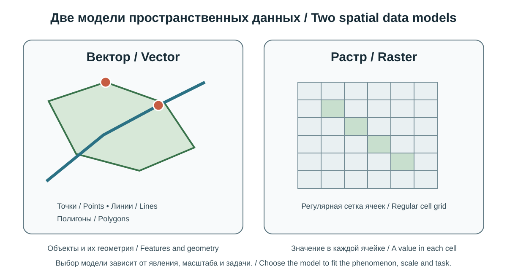
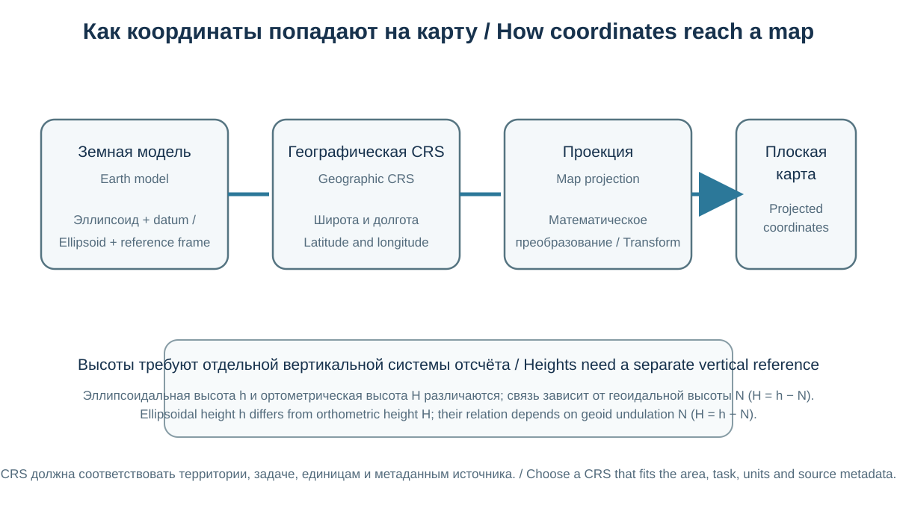
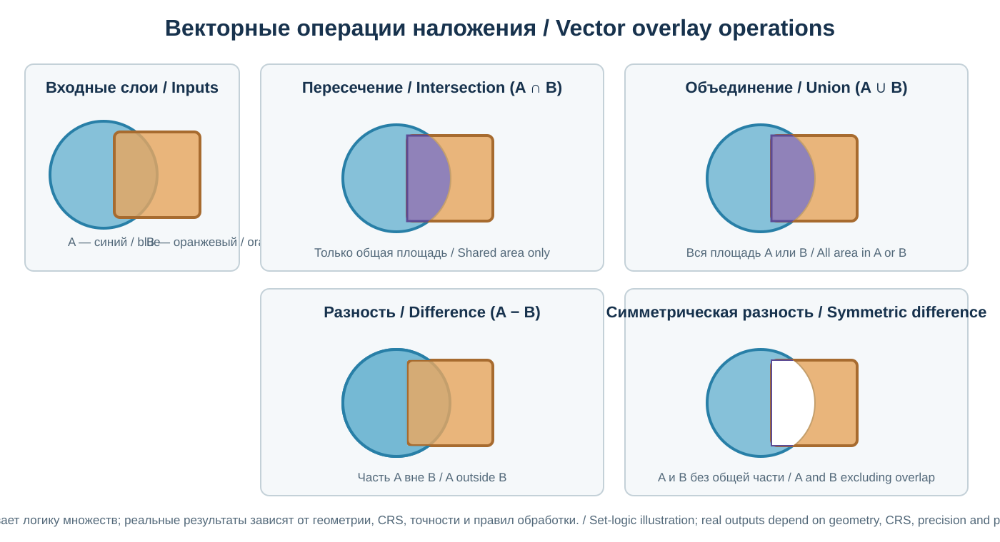
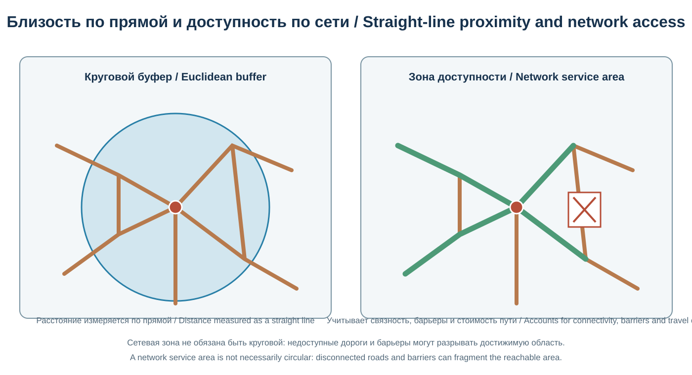
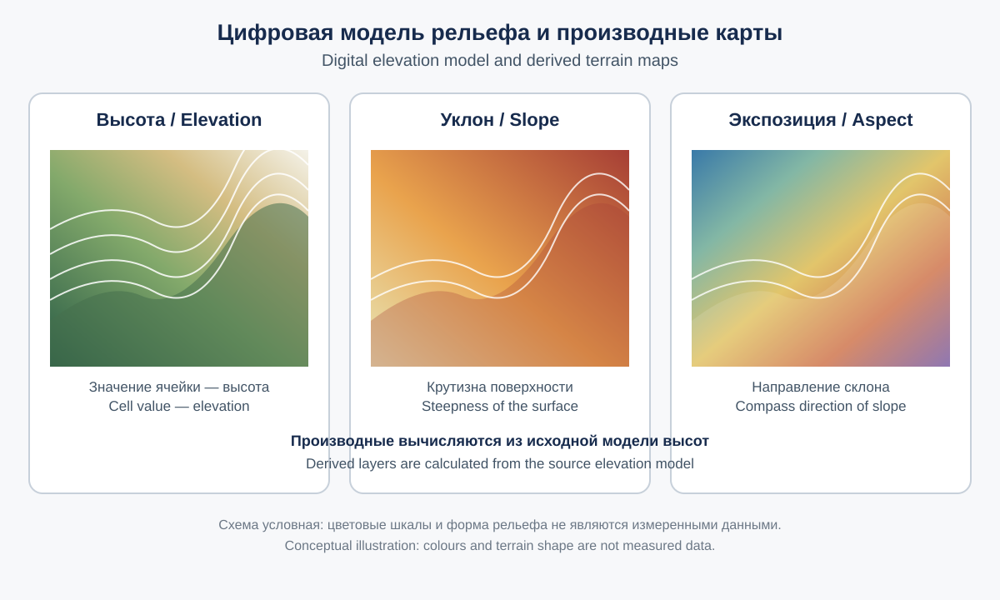
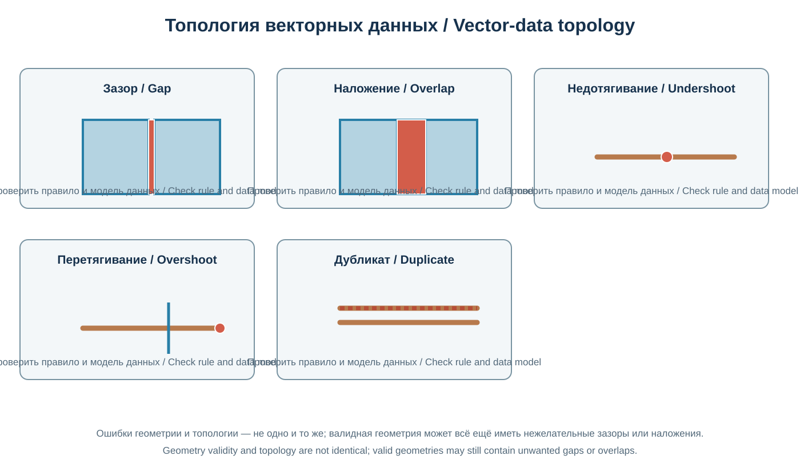
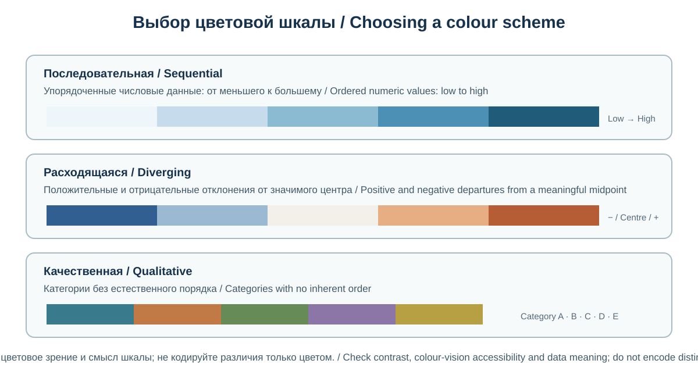

# Глава 14. Геоинформационные системы
# Chapter 14. Geographic Information Systems

> **Часть III. Современная география и технологии / Part III. Modern Geography and Technology**  
> Научно-образовательный атлас географии / Scientific and Educational Geography Atlas

## Цели главы / Chapter objectives

Геоинформационные системы (ГИС, GIS) — совокупность методов, программных средств, данных и организационных процедур для сбора, хранения, управления, анализа и представления информации, связанной с географическим положением объектов и явлений. ГИС позволяют объединять карты, спутниковые снимки, статистику, полевые наблюдения и модели в единой пространственной среде.

Глава рассматривает основы пространственных данных, координатные системы, модели представления географической информации, анализ, картографическую визуализацию, управление качеством, веб-ГИС, этику и практические рабочие процессы.

Geographic Information Systems (GIS) combine methods, software, data and organisational procedures for collecting, storing, managing, analysing and presenting information linked to the geographic location of features and phenomena. GIS integrates maps, satellite imagery, statistics, field observations and models in a common spatial environment.

This chapter introduces spatial data, coordinate reference systems, geographic data models, spatial analysis, cartographic visualisation, data quality, web GIS, ethics and practical workflows.

## 14.1. Понятие ГИС и её компоненты / The Concept of GIS and Its Components

*ГИС включает людей, данные, программное обеспечение, оборудование и методы; схема не сводит ГИС к одной программе. / GIS includes people, data, software, hardware and methods; the diagram does not reduce GIS to a single application.*

ГИС — не просто электронная карта. Это информационная система, в которой географическое положение связано с описательными характеристиками, а данные могут анализироваться с учётом пространственных отношений.

Основные компоненты ГИС:
1. **Данные:** координаты, геометрия, атрибуты, изображения, таблицы и метаданные.
2. **Программное обеспечение:** инструменты ввода, редактирования, анализа, хранения и визуализации.
3. **Аппаратная инфраструктура:** компьютеры, серверы, GNSS-приёмники, мобильные устройства, датчики и сетевые ресурсы.
4. **Методы и процедуры:** стандарты, модели данных, правила обработки и проверки качества.
5. **Люди и организации:** специалисты, пользователи, владельцы данных и органы управления.

ГИС применяется в кадастре, городском планировании, природоохранной деятельности, транспорте, сельском хозяйстве, управлении водными ресурсами, чрезвычайных ситуациях, здравоохранении и бизнесе.

A GIS is more than an electronic map. It is an information system in which geographic location is linked to descriptive characteristics and data can be analysed through spatial relationships.

The main components of a GIS are:
1. **Data:** coordinates, geometry, attributes, imagery, tables and metadata.
2. **Software:** tools for data entry, editing, analysis, storage and visualisation.
3. **Hardware and infrastructure:** computers, servers, GNSS receivers, mobile devices, sensors and network resources.
4. **Methods and procedures:** standards, data models, processing rules and quality checks.
5. **People and organisations:** specialists, users, data owners and public authorities.

GIS is used in cadastre, urban planning, nature conservation, transport, agriculture, water-resource management, emergency response, healthcare and business.

## 14.2. Пространственные объекты и атрибутивные данные / Spatial Features and Attribute Data

Географический объект обычно описывается геометрией и набором атрибутов.

Основные геометрические типы:
- **точка (point):** источник воды, метеостанция, дерево, остановка;
- **линия (line):** река, дорога, трубопровод, граница маршрута;
- **полигон (polygon):** озеро, административный район, лесной массив, земельный участок;
- **поверхность или объём:** рельеф, температурное поле, подземное геологическое тело.

Атрибутивная таблица содержит характеристики объектов: название, категория, дата наблюдения, площадь, длина, численность населения, состояние или другие параметры. Каждая запись должна быть связана с геометрическим объектом через устойчивый идентификатор.

Важно различать объект реального мира и его цифровую модель. Реальная река имеет ширину, глубину и изменяющееся русло, тогда как её представление на мелкомасштабной карте может быть одной линией.

A geographic feature is usually described by its geometry and a set of attributes.

Main geometry types include:
- **point:** a water source, weather station, tree or bus stop;
- **line:** a river, road, pipeline or route boundary;
- **polygon:** a lake, administrative district, forest area or land parcel; and
- **surface or volume:** terrain, a temperature field or a subsurface geological body.

An attribute table stores feature characteristics such as name, category, observation date, area, length, population, condition or other parameters. Each record should be linked to its geographic feature through a stable identifier.

It is important to distinguish a real-world feature from its digital representation. A real river has width and depth, and its channel may change over time, whereas on a small-scale map it may be represented by a single line.

## 14.3. Векторная и растровая модели / Vector and Raster Data Models

*Оригинальная двуязычная схема типов пространственных данных; она не сравнивает точность или качество конкретных наборов данных. / Original bilingual diagram of spatial-data models; it does not compare the accuracy or quality of particular datasets.*

### Векторная модель / Vector model

Векторные данные описывают объекты точками, линиями и полигонами. Они удобны для представления дорог, границ, зданий, участков и сетей.

Преимущества:
- точное описание геометрии отдельных объектов;
- удобная связь с атрибутивными таблицами;
- эффективное представление дискретных объектов;
- поддержка топологических и сетевых операций.

Ограничения:
- сложные поверхности и непрерывные поля могут требовать большого числа объектов;
- качество зависит от масштаба и точности исходной геометрии;
- ошибки топологии могут приводить к разрывам, наложениям и неверным связям.

### Растровая модель / Raster model

Растр представляет пространство сеткой ячеек (пикселей). Каждая ячейка содержит значение: высоту, температуру, отражательную способность, класс земного покрова или вероятность явления.

Преимущества:
- естественное представление непрерывных полей;
- удобство математических операций с ячейками;
- широкое применение в дистанционном зондировании и моделировании.

Ограничения:
- разрешение влияет на детализацию;
- объём данных может быть большим;
- границы объектов представлены ступенчато;
- значения ячеек зависят от способа измерения и агрегирования.

**Разрешение растра** — размер ячейки на местности или пространственный масштаб пикселя. Более мелкая ячейка не гарантирует более высокую фактическую точность: важны качество сенсора, метод обработки и исходные данные.

### Vector model

Vector data represent features as points, lines and polygons. They are useful for roads, boundaries, buildings, parcels and networks.

Advantages include:
- precise representation of individual feature geometry;
- convenient links to attribute tables;
- efficient representation of discrete features; and
- support for topology and network operations.

Limitations include:
- complex surfaces and continuous fields may require very large numbers of features;
- quality depends on the scale and accuracy of the source geometry; and
- topology errors can create gaps, overlaps and incorrect connections.

### Raster model

A raster represents space as a grid of cells (pixels). Each cell stores a value such as elevation, temperature, reflectance, land-cover class or the probability of a phenomenon.

Advantages include:
- natural representation of continuous fields;
- convenient mathematical operations on cells; and
- wide use in remote sensing and spatial modelling.

Limitations include:
- resolution affects the level of detail;
- data volumes can be large;
- feature boundaries appear stepped; and
- cell values depend on the measurement and aggregation methods.

**Raster resolution** is the ground size of a cell or the spatial size of a pixel. A smaller cell does not guarantee higher actual accuracy: sensor quality, processing methods and source data also matter.

## 14.4. Координаты и системы координат / Coordinates and Coordinate Reference Systems

*Оригинальная двуязычная схема; геоид и эллипсоид не тождественны, а вертикальная система отсчёта выбирается отдельно. / Original bilingual diagram; the geoid and ellipsoid are not identical, and a vertical reference is selected separately.*

Координатная система позволяет определить положение объекта на Земле или на плоскости. Географические координаты обычно задаются широтой и долготой, а проецированные координаты — линейными величинами, например метрами.

**Система координат (CRS)** определяет, как координаты связаны с Землёй, включая геодезическую основу, параметры координат и, для проецированных систем, картографическую проекцию.

Основные понятия:
- геодезическая система отсчёта (datum);
- эллипсоид и геоид;
- географическая широта и долгота;
- картографическая проекция;
- единицы координат;
- эпоха координат для динамических систем, если она имеет значение.

Широко используемая глобальная геодезическая основа — WGS 84. Для многих глобальных навигационных и картографических задач применяются географические координаты WGS 84, но не все наборы данных используют одну и ту же систему.

**EPSG-коды** — идентификаторы объектов геодезических и координатных систем в реестре EPSG. Указание только числа EPSG без проверки его смысла и области применения может привести к ошибке.

### Географическая и проецированная система / Geographic and projected CRS

Широта и долгота задают положение на поверхности референц-эллипсоида и обычно выражаются в угловых единицах. Для расчёта площадей, расстояний и буферов часто нужна подходящая проецированная система, параметры которой минимизируют искажения в рассматриваемом районе.

Нельзя бездумно измерять расстояния в градусах: один градус долготы соответствует разной линейной длине на разных широтах. Перед пространственными измерениями следует проверить CRS и единицы.

**Порядок осей — отдельная проверка.** В официальном определении EPSG:4326 оси идут в порядке «широта, долгота», тогда как многие ГИС-интерфейсы, форматы и программные библиотеки для привычной пары x/y используют порядок «долгота, широта». Поведение зависит от формата и версии протокола или API. Поэтому нельзя определять порядок координат только по подписи EPSG:4326: нужно читать метаданные и документацию конкретного обменного формата или сервиса, а затем проверять контрольную точку. Перестановка осей может перенести объект в совершенно другой регион.

**Преобразование между системами отсчёта.** Если исходная и целевая CRS основаны на разных геодезических датумах или реализациях, программное обеспечение должно применить координатную операцию (трансформацию), а не просто сменить подпись CRS. Между двумя CRS может существовать несколько допустимых операций с разной точностью и разными областями применения. Перед выбором проверьте область действия, заявленную точность, необходимые файлы сеток и эпоху координат, если система динамическая. Если требуемая сетка отсутствует, программа может предложить менее точный запасной вариант или предупредить о недоступности операции. Не принимайте автоматически первый вариант и не считайте перепроецирование «на лету» доказательством геодезической точности результата.

**Axis order requires a separate check.** The formal EPSG:4326 definition lists its axes as latitude, longitude, while many GIS interfaces, formats and software libraries use longitude, latitude for the familiar x/y pair. Behaviour depends on the format and the version of the protocol or API. Do not infer coordinate order from the EPSG:4326 label alone: read the metadata and documentation for the specific exchange format or service, then test a known control point. Swapped axes can place a feature in a completely different region.

### Geographic and projected coordinate systems — English explanation

A coordinate reference system (CRS) defines how coordinate values are related to the Earth. Its definition includes a geodetic reference frame or datum, an ellipsoid, coordinate axes and units, and, for a projected CRS, a map projection and its parameters.

WGS 84 is a widely used global geodetic reference system for satellite navigation and mapping. However, datasets may use different datums, realizations, coordinate epochs or national reference systems. An EPSG code identifies a registered CRS or geodetic object; it does not by itself prove that the selected transformation is appropriate for every dataset or location.

Geographic coordinates are angular values, usually latitude and longitude. Projected coordinates are planar values, commonly expressed in metres. For distance, area and buffer analysis, choose a suitable projected CRS whose area of use and distortion characteristics fit the study region and task. A GIS may reproject layers for display “on the fly”, but this does not rewrite the source coordinates or remove errors in the source data.

## 14.5. Картографические проекции в ГИС / Map Projections in GIS

Картографическая проекция преобразует координаты поверхности Земли в плоскую систему. Любая проекция искажает некоторые свойства — площадь, форму, расстояние или направление.

Выбор проекции зависит от задачи:
- для региональных карт — проекция, подходящая по положению и форме территории;
- для сравнения площадей — равновеликая проекция;
- для навигационных и угловых задач — соответствующая конформная или специализированная проекция;
- для локальных инженерных работ — официальная национальная или местная система координат.

В ГИС слои могут отображаться совместно благодаря перепроецированию «на лету», однако это не устраняет ошибок исходных координат. При экспорте и анализе необходимо проверять, в какой CRS реально сохранены данные.

### 14.5.1. Практический пример: почему перед буферным анализом проверяют CRS / Worked Example: Why CRS Must Be Checked Before Buffer Analysis

Предположим, координаты объекта записаны как широта 42° и долгота 74°. Это угловые координаты в географической системе, а не расстояния в метрах. Если программное обеспечение построит буфер радиусом «500» непосредственно в такой системе, значение может быть интерпретировано как градусы, а не как 500 м, что даст бессмысленный результат для задачи локальной доступности.

Правильный рабочий порядок:

1. Проверить метаданные исходного слоя и подтвердить его систему координат, включая порядок осей.
2. Выбрать подходящую местную или региональную проецированную CRS, единицы которой — метры и искажения которой приемлемы для исследуемой территории.
3. Создать перепроецированную копию данных, не подменяя сведения об исходной CRS простым изменением подписи.
4. Построить буфер радиусом 500 м и проверить результат на карте и по контрольным расстояниям.
5. Сохранить в проекте информацию об исходной и целевой CRS и параметрах операции.

Числа 42° и 74° здесь условны и не обозначают точный адрес. Важно не запоминать одну CRS для всех задач, а проверять область применения, единицы, точность и требования анализа.

Assume a feature is stored at latitude 42° and longitude 74°. These are angular coordinates in a geographic coordinate reference system, not distances in metres. If software creates a buffer with a radius of “500” directly in that system, the value may be interpreted as degrees rather than 500 m, producing a meaningless result for a local accessibility study.

A sound workflow is:

1. Inspect the source layer metadata and confirm its coordinate reference system, including axis order.
2. Choose an appropriate local or regional projected CRS whose units are metres and whose distortion is acceptable for the study area.
3. Create a reprojected copy of the data; do not replace the source CRS definition merely by changing its label.
4. Create the 500 m buffer and check it on the map and against known distances.
5. Record both the source and target CRS and the operation parameters in the project metadata.

The coordinates 42° and 74° are illustrative and do not identify an exact address. The important lesson is not to memorise one CRS for every task, but to check its area of use, units, accuracy and suitability for the analysis.

## 14.6. Сбор пространственных данных / Spatial Data Acquisition

Источники пространственных данных:
- геодезическая съёмка и GNSS;
- топографические и тематические карты;
- спутниковые и аэрофотоснимки;
- беспилотные летательные аппараты;
- лазерное сканирование и LiDAR;
- государственная статистика и кадастры;
- датчики и системы мониторинга;
- полевые обследования и краудсорсинг.

При сборе данных следует фиксировать дату, метод, оборудование, координатную систему, масштаб или разрешение, точность и ограничения. Данные, собранные разными методами и в разные сезоны, могут быть несопоставимы без предварительной обработки.

GNSS — общее название спутниковых навигационных систем. GPS — одна из таких систем; существуют также Galileo, GLONASS, BeiDou и другие. Точность позиционирования зависит от приёмника, условий приёма, геометрии спутников, коррекций и метода измерения. Одно измерение обычным ручным GNSS-приёмником не означает автоматически геодезическую точность: на результат влияют многолучевое распространение сигнала, здания, кроны деревьев, закрытый рельеф, атмосферные условия и продолжительность наблюдения. Фиксируйте тип решения — автономное, дифференциальное или RTK/PPK, используемую систему отсчёта и эпоху (если применимо), оценку неопределённости, установку антенны и способ повторного или усреднённого измерения.

Sources of spatial data include:
- geodetic surveys and GNSS;
- topographic and thematic maps;
- satellite and aerial imagery;
- unmanned aerial vehicles;
- laser scanning and LiDAR;
- official statistics and cadastral records;
- sensors and monitoring systems;
- field surveys and crowdsourcing.

When collecting data, record the date, method, equipment, coordinate reference system, scale or resolution, accuracy and limitations. Data collected using different methods or in different seasons may not be comparable without preprocessing.

GNSS is the general term for satellite navigation systems. GPS is one such system; others include Galileo, GLONASS and BeiDou. Positioning accuracy depends on the receiver, signal conditions, satellite geometry, corrections and measurement method.

При геопривязке сканированной карты или изображения необходимо различать подгонку преобразования по опорным точкам и независимую оценку точности. Остаточные ошибки на опорных точках показывают, насколько хорошо выбранное преобразование описывает именно эти точки, но сами по себе не доказывают точность в других местах. По возможности выделяйте независимые контрольные точки, не участвовавшие в расчёте преобразования, распределяйте их по всей территории изображения и документируйте тип преобразования, остатки и ограничения эталонных данных.

## 14.7. Геокодирование и адресные данные / Geocoding and Address Data

**Геокодирование** преобразует текстовое описание местоположения, например адрес или название объекта, в координаты. Обратное геокодирование связывает координаты с ближайшим адресом или географическим описанием.

Результат геокодирования может быть неоднозначным. Один адрес может соответствовать зданию, входу, центроиду участка или приблизительной точке улицы. Поэтому необходимо проверять:
- точность и тип возвращённого местоположения;
- совпадение населённого пункта и административной единицы;
- качество и полноту адресной базы;
- дату обновления данных;
- правила обработки персональных данных.

Для анализа доступности услуг точка геокодированного адреса не всегда равна фактическому входу или маршруту движения. Оценка совпадения (match score) или метка «точный адрес» у конкретного сервиса не заменяет визуальную и полевую проверку: результат может быть интерполированной точкой на улице, центроидом здания или участком с неполной адресной нумерацией. Например, один из коммерческих геокодеров различает типы результата ROOFTOP, RANGE_INTERPOLATED, GEOMETRIC_CENTER и APPROXIMATE. Это названия конкретного поставщика, а не универсальные категории всех геокодеров: всегда читайте документацию фактически используемого сервиса. При массовом геокодировании адресов людей проверьте условия сервиса, правовое основание передачи данных и возможность обработки персональных данных вне вашей организации.

**Geocoding** converts a textual description of a location, such as an address or place name, into coordinates. Reverse geocoding links coordinates to a nearby address or geographic description.

A geocoding result may be ambiguous. An address may correspond to a building, an entrance, a parcel centroid or an approximate point on a street. It is therefore necessary to check:
- the accuracy and type of the returned location;
- whether the settlement and administrative unit match;
- the quality and completeness of the address database;
- the date when the data were updated; and
- the rules for processing personal data.

For service-accessibility analysis, a geocoded address point is not necessarily the actual entrance or a point on the route people use. A match score or a provider's “exact address” label does not replace visual or field verification: a result may be an interpolated street point, a building centroid or a location in an area with incomplete address numbering. For example, one commercial geocoder distinguishes ROOFTOP, RANGE_INTERPOLATED, GEOMETRIC_CENTER and APPROXIMATE result types. These are provider-specific labels, not universal categories for all geocoders; always consult the documentation of the service actually used. For bulk geocoding of people's addresses, check the provider's terms, the legal basis for transferring the data and whether personal data may be processed outside your organisation.

## 14.8. Пространственные запросы и операции / Spatial Queries and Operations

*Схема логики множеств; фактические результаты зависят от геометрии, CRS и точности исходных данных. / Set-logic diagram; actual outputs depend on geometry, CRS and input-data precision.*

Пространственный анализ отвечает на вопросы о взаимном расположении объектов, расстояниях, пересечениях, соседстве и распределении явлений.

Основные операции:
- **буферизация (buffer):** создание зоны заданного расстояния вокруг объекта;
- **пересечение (intersection):** выделение общей части пространственных объектов;
- **объединение (union):** формирование совокупной геометрии и атрибутов;
- **разность (difference):** выделение части одного объекта за пределами другого;
- **пространственное соединение (spatial join):** перенос атрибутов на основе пространственного отношения;
- **выбор по расположению (select by location):** отбор объектов, удовлетворяющих пространственному условию;
- **наложение слоёв (overlay):** совместный анализ нескольких тематических слоёв.

Пример: для оценки доступности медицинских учреждений можно построить зоны расстояния или времени поездки, сопоставить их с населением и определить территории с ограниченным доступом. Простая круговая зона не учитывает дорожную сеть, рельеф, реку или фактические барьеры. Операции наложения могут создавать узкие остаточные полигоны и мелкие фрагменты, если исходные границы смещены или имеют разную позиционную точность. Перед интерпретацией проверьте валидность геометрии, CRS, точность координат и обоснованность допуска привязки (snapping tolerance); не удаляйте мелкие полигоны автоматически — они могут соответствовать реальным объектам.

Spatial analysis answers questions about the relative locations of features, distances, intersections, neighbourhoods and the distribution of phenomena.

Common operations include:
- **buffer:** create a zone at a specified distance around a feature;
- **intersection:** identify the shared area of spatial features;
- **union:** combine geometries and attributes;
- **difference:** identify the part of one feature outside another;
- **spatial join:** transfer attributes based on a spatial relationship;
- **select by location:** select features that meet a spatial condition; and
- **overlay:** analyse several thematic layers together.

For example, to assess access to healthcare facilities, an analyst can create zones based on distance or travel time, compare them with population data and identify areas with limited access. A simple circular buffer does not account for road networks, relief, rivers or actual barriers.

## 14.9. Сетевой анализ и транспорт / Network Analysis and Transport

*Круговой буфер измеряет расстояние по прямой; сетевая зона учитывает связность дорог и стоимость пути. Схема условная. / A circular buffer measures straight-line distance; a network service area accounts for road connectivity and travel cost. Conceptual diagram.*

Сетевой анализ изучает движение по связанным линиям и узлам: дорогам, улицам, железным дорогам, трубопроводам и другим сетям.

Основные задачи:
- поиск кратчайшего или быстрейшего маршрута;
- анализ доступности и времени поездки;
- определение зон обслуживания;
- размещение объектов с учётом спроса;
- моделирование потоков и узких мест;
- анализ связности и устойчивости сети.

«Кратчайший» маршрут не всегда является «быстрейшим»: стоимость перемещения может учитывать скорость, ограничения поворотов, пробки, уклоны, качество покрытия, сезонность и другие факторы.

Результаты сетевого анализа зависят от полноты сети, направления движения, правил связности и актуальности атрибутов. Отсутствие дороги в базе не обязательно означает отсутствие реального пути. Важно также проверить привязку начальных и конечных точек к сети: некоторые инструменты автоматически «прищёлкивают» удалённую точку к ближайшему сегменту. Если не задать допустимое максимальное расстояние, точка может оказаться привязанной к неверной дороге через реку, ограждение или другой барьер. Проверьте допуск привязки, направленность рёбер, запреты поворотов, непроходимые участки и объекты, которые алгоритм не смог включить в маршрут. **Зона обслуживания — не обязательно сплошной полигон вокруг точки.** В сетевом анализе она может быть представлена достижимыми рёбрами и узлами сети в пределах заданной стоимости (расстояния или времени). Если результат преобразуют в полигон для оформления карты, граница такого полигона является способом визуализации и не доказывает, что каждая точка внутри него доступна по сети. Проверьте, что именно выдаёт выбранный алгоритм, и не смешивайте сетевую достижимость с площадной доступностью.

Network analysis studies movement through connected lines and nodes such as roads, streets, railways, pipelines and other networks.

Common tasks include:
- finding the shortest or fastest route;
- analysing accessibility and travel time;
- defining service areas;
- locating facilities in relation to demand;
- modelling flows and bottlenecks; and
- assessing network connectivity and resilience.

The “shortest” route is not always the “fastest”. A travel-cost model may take account of speed, turn restrictions, congestion, slope, road-surface quality, seasonality and other factors.

Network-analysis results depend on network completeness, travel direction, connectivity rules and the currency of attributes. A road missing from a database does not necessarily mean that no real route exists. Also check how start and end points are connected to the network: some tools automatically snap a point to the nearest segment. Without a maximum permitted distance, a point may be attached to the wrong road across a river, fence or other barrier. Check the snapping tolerance, edge direction, turn restrictions, impassable segments and any input features that the algorithm could not route.

## 14.10. Анализ растров и пространственное моделирование / Raster Analysis and Spatial Modelling

*Учебная схема производных поверхностей. Реальные значения зависят от разрешения, вертикальной точности, источника и алгоритмов обработки DEM. / Educational diagram of derived surfaces. Actual values depend on DEM resolution, vertical accuracy, source and processing algorithms.*

Растровый анализ применяется к непрерывным полям и пространственным моделям.

Распространённые методы:
- классификация и переклассификация;
- арифметические и логические операции с растрами;
- анализ плотности;
- интерполяция измерений;
- анализ уклонов, экспозиции и кривизны рельефа по цифровой модели высот;
- гидрологическое моделирование стока;
- оценка пригодности территории;
- выявление изменений во временных рядах.

Интерполяция оценивает значения между точками наблюдений. Её результат зависит от пространственного распределения измерений, выбранного метода, структуры данных и предположений модели. Интерполированная поверхность не является прямым измерением в каждой ячейке.

При анализе цифровых моделей рельефа следует учитывать разрешение, вертикальную точность, артефакты, заполнение ложных впадин и особенности алгоритма. Производные показатели, например уклон, могут усиливать ошибки исходной модели.

**Передискретизация требует осторожности.** Метод ближайшего соседа обычно подходит для категориальных растров, поскольку сохраняет исходные коды классов. Билинейная и кубическая интерполяция чаще применяются к непрерывным поверхностям, но рассчитывают новые значения по соседним ячейкам и могут сглаживать экстремумы. Передискретизация меняет сетку и может изменить значения пикселей; она не создаёт новых измеренных деталей и не повышает точность исходных данных. Указывайте выбранный метод и размер выходной ячейки.

**Уклон и экспозиция требуют явного указания соглашений.** Уклон может выражаться в градусах или процентах: процентный уклон — это отношение перепада высоты к горизонтальному расстоянию, умноженное на 100; например, 100% соответствует углу 45°, а не 100°. Экспозиция обычно задаётся азимутом от севера по часовой стрелке (0°/360° — север, 90° — восток, 180° — юг, 270° — запад), но конкретный алгоритм может использовать другое соглашение. Для почти горизонтальных ячеек направление склона не имеет устойчивого смысла и может кодироваться как NoData или специальное значение.

Перед расчётом проверьте единицы горизонтальных координат и высот. Если горизонтальные расстояния заданы в метрах, а высоты — в футах (или наоборот), нужен корректный коэффициент преобразования вертикальных единиц; в некоторых инструментах он задаётся параметром Z factor или scale. Неверный коэффициент искажает уклон.

Raster analysis is used for continuous fields and spatial models.

Common methods include:
- classification and reclassification;
- arithmetic and logical operations on rasters;
- density analysis;
- interpolation of measurements;
- analysis of slope, aspect and terrain curvature from a digital elevation model;
- hydrological runoff modelling;
- land-suitability assessment; and
- change detection in time series.

Interpolation estimates values between observation points. The result depends on the spatial distribution of measurements, the selected method, the data structure and model assumptions. An interpolated surface is not a direct measurement in every cell.

When analysing digital elevation models, consider resolution, vertical accuracy, artefacts, the filling of spurious depressions and the selected algorithm. Derived measures such as slope can amplify errors in the source model.

**Slope and aspect require explicit conventions.** Slope may be expressed in degrees or percent. Percent slope is the vertical rise divided by horizontal distance, multiplied by 100; for example, a 100% slope is an angle of 45°, not 100°. Aspect is commonly expressed as an azimuth measured clockwise from north (0°/360° north, 90° east, 180° south and 270° west), but a particular algorithm may use a different convention. For nearly flat cells, slope direction has no stable meaning and may be encoded as NoData or a special value.

Before processing, check the units of horizontal coordinates and elevation. If horizontal distances are in metres but elevations are in feet (or vice versa), the vertical units must be converted correctly; some tools expose this through a Z factor or scale parameter. An incorrect factor distorts the slope values.

## 14.11. Топология и качество пространственных данных / Topology and Spatial Data Quality

*Проверочные правила зависят от модели данных: не каждый зазор или висячий узел является ошибкой в каждом наборе. / Validation rules depend on the data model: not every gap or dangling node is an error in every dataset.*

Топология описывает пространственные отношения между объектами: смежность, связность, вложенность и пересечение.

Примеры топологических правил:
- полигоны административных единиц не должны иметь непредусмотренных зазоров или наложений;
- линии дорожной сети должны соединяться в узлах там, где допускается движение;
- здания не должны пересекать границы участков, если это запрещено моделью данных;
- водотоки должны сохранять логическую связность в пределах принятой схемы.

Качество пространственных данных включает:
- позиционную точность;
- тематическую точность;
- полноту;
- логическую согласованность;
- временную актуальность;
- происхождение и прослеживаемость;
- пригодность для конкретной задачи.

**Точность** и **разрешение** — разные характеристики. Набор данных может иметь высокое пространственное разрешение, но низкую позиционную точность или устаревшие атрибуты.

Оценка качества начинается с требований задачи: сначала определяют, какие ошибки допустимы для конкретного применения, затем выбирают показатели и контрольные данные. Универсального порога «хорошего качества» для всех задач нет. Например, слой масштаба района может подходить для регионального планирования, но быть непригодным для определения положения конкретного здания. Топологическое правило должно соответствовать назначению слоя: например, висячая линия может быть ошибкой в непрерывной дорожной сети, но допустимым концом тупика; зазор между полигонами может быть ошибкой покрытия территории, но допустимым водным объектом или исключённой зоной. Исправлять геометрию автоматически без проверки смысла нельзя.

Topology describes spatial relationships among features, including adjacency, connectivity, containment and intersection.

Examples of topology rules include:
- administrative polygons should not have unintended gaps or overlaps;
- road-network lines should connect at nodes where movement is allowed;
- buildings should not cross parcel boundaries when the data model prohibits this; and
- streams should maintain logical connectivity within the adopted network model.

Spatial-data quality includes:
- positional accuracy;
- thematic accuracy;
- completeness;
- logical consistency;
- temporal currency;
- provenance and traceability; and
- fitness for the intended task.

**Accuracy** and **resolution** are different characteristics. A dataset may have high spatial resolution but low positional accuracy or outdated attributes.

Quality assessment starts with the requirements of the intended use: define which errors are tolerable, then select measures and reference data. There is no universal threshold for “good quality” across all applications. A dataset suitable for regional planning may be unsuitable for locating an individual building. A topology rule must match the purpose of the layer. A dangling line may be an error in a continuous road network but a valid dead end; a gap between polygons may indicate a coverage error or represent a water body or excluded area. Do not repair geometry automatically without checking its meaning.

## 14.12. Метаданные, стандарты и совместимость / Metadata, Standards and Interoperability

Метаданные описывают содержание, происхождение, качество, структуру, пространственный охват, временной период, лицензию и условия использования данных.

Без метаданных пользователь может не знать, когда и каким методом получен слой, в какой системе координат он хранится и для каких задач пригоден.

Международные стандарты и спецификации поддерживают совместимость:
- стандарты ISO серии 19100 по географической информации; в частности, ISO 19115-1 описывает структуру метаданных для идентификации, охвата, качества, временных и пространственных характеристик, системы координат, представления и распространения геоданных;
- спецификации Open Geospatial Consortium (OGC);
- форматы GeoPackage, GeoTIFF, GeoJSON и другие;
- традиционные веб-сервисы карт и объектов WMS и WFS;
- современные веб-API OGC API — Features для доступа к пространственным объектам и OGC API — Maps для получения картографических изображений.

WMS и WFS остаются широко используемыми стандартами, поэтому их необходимо уметь распознавать и документировать. Для новых веб-сервисов OGC рекомендует рассматривать современные OGC API: они используют ресурсно-ориентированную архитектуру и подходы REST/OpenAPI. При этом нельзя считать, что каждый существующий сервер уже поддерживает новые API или что все функции старых сервисов автоматически доступны в любой реализации новых стандартов. При чтении OGC API — Features важно учитывать CRS: базовая часть Part 1 использует WGS 84 с порядком координат «долгота, широта», а Part 2 расширяет поддержку других систем координат. Это конкретный пример того, почему порядок осей следует проверять по спецификации API, а не выводить только из EPSG-кода.

Формат файла и наличие стандартного интерфейса сами по себе не гарантируют качество и совместимость. При обмене данными следует проверять кодировку, CRS, типы геометрии, систему идентификаторов, ограничения атрибутов, реализацию конкретной версии стандарта и лицензию.

Metadata describe the content, provenance, quality, structure, spatial extent, time period, licence and conditions of use of a dataset.

Without metadata, a user may not know when or how a layer was created, which coordinate reference system it uses or which tasks it is suitable for.

International standards and specifications support interoperability:
- the ISO 19100 series of geographic-information standards;
- Open Geospatial Consortium (OGC) specifications;
- GeoPackage, GeoTIFF, GeoJSON and other formats;
- established web map and feature services, WMS and WFS; and
- modern OGC API — Features for access to geographic features and OGC API — Maps for map images.

WMS and WFS remain widely used and should be recognised and documented. For new web services, OGC recommends considering modern OGC APIs, which use resource-oriented architecture and REST/OpenAPI approaches. However, not every existing server supports the newer APIs, and functions available in older services are not automatically available in every implementation of the new standards.

A file format or standard interface alone does not guarantee quality or interoperability. Data exchange should include checks of character encoding, CRS, geometry types, identifier systems, attribute constraints, the implemented standard version and the licence.

## 14.13. Картографическая визуализация и дизайн / Cartographic Visualisation and Design

*Выбирайте палитру по смыслу данных; цвет дополняйте подписями и контрастом. / Match the palette to the data meaning; supplement colour with labels and contrast.*

Карта — средство передачи пространственной информации, а не просто изображение данных. Её оформление должно соответствовать цели, аудитории и масштабу.

Ключевые элементы:
- заголовок и назначение;
- легенда и единицы измерения;
- масштабная линейка, если она уместна;
- указание источника и даты;
- координатная сетка или ориентиры при необходимости;
- понятная иерархия подписей;
- цветовая шкала, соответствующая типу данных;
- пояснение ограничений.

Выбор способа изображения зависит от данных:
- качественные категории — различимые оттенки или символы;
- количественные значения по территориям — последовательная цветовая шкала;
- отклонения относительно нуля — расходящаяся шкала;
- потоки — линии или стрелки с ясной семантикой;
- плотность — карты плотности или агрегированные поверхности с пояснением метода.

Хороплетная карта должна использовать нормированные показатели, например долю или плотность, а не абсолютные величины, если площади территорий и численность населения существенно различаются. Для абсолютных значений могут лучше подходить пропорциональные символы.

Следует избегать ложной точности, чрезмерного числа классов, визуально вводящих в заблуждение цветовых шкал и обрезания важных географических контекстов. Для хороплетов укажите знаменатель нормирования (например, население, площадь или число домохозяйств), период и метод классификации. Квантили, равные интервалы и естественные разрывы по-разному распределяют территории по классам; смена метода или границ классов может изменить визуальный вывод, даже если исходные значения не изменились. Не сравнивайте карты разных лет или регионов без проверки сопоставимости показателя, границ и метода классификации. Если задача состоит именно в сравнении динамики, используйте одинаковые границы классов и одну легенду для всех карт либо явно объясните причину изменения шкалы. Отдельная классификация каждого года может визуально скрыть рост или снижение показателя.

A map communicates spatial information; it is not merely a picture of data. Its design should match the purpose, audience and scale.

Key map elements include:
- a title and statement of purpose;
- a legend and units of measurement;
- a scale bar, where appropriate;
- source and date information;
- a coordinate grid or orientation features, where needed;
- a clear hierarchy of labels;
- a colour scheme that fits the data type; and
- an explanation of limitations.

The choice of display method depends on the data:
- qualitative categories — distinct hues or symbols;
- quantitative values by area — a sequential colour scheme;
- deviations around a reference value — a diverging scheme;
- flows — lines or arrows with clear meaning; and
- density — density maps or aggregated surfaces with the method explained.

A choropleth map should normally use normalised indicators, such as a share or density, rather than absolute totals when areas and populations differ substantially. Proportional symbols may be more appropriate for absolute values.

Avoid false precision, too many classes, visually misleading colour schemes and the removal of important geographic context. For a choropleth, state the normalisation denominator (for example, population, area or number of households), reference period and classification method. Quantiles, equal intervals and natural breaks distribute areas among classes differently; changing the method or class boundaries can change the visual message even when the underlying values have not changed. Do not compare maps from different years or regions without checking that the indicator, boundaries and classification method are comparable. If the purpose is to compare change over time, use the same class boundaries and legend for all maps, or explicitly explain why the scale changes. Classifying each year separately can visually conceal an increase or decrease in the indicator.

## 14.14. Веб-ГИС, облачные платформы и открытые данные / Web GIS, Cloud Platforms and Open Data

Веб-ГИС предоставляет пространственные данные и инструменты через браузер или сетевые приложения. Пользователь может просматривать слои, выполнять запросы, создавать карты и совместно работать с данными.

Типичная архитектура включает:
1. источники пространственных данных;
2. сервер или облачное хранилище;
3. сервисы публикации и обработки;
4. веб-клиент или мобильное приложение;
5. механизмы аутентификации, доступа и резервного копирования.

Открытые геоданные облегчают исследования и повторное использование информации, но условия лицензирования различаются. Открытость не означает отсутствие требований к атрибуции, ограничений на повторное использование или обязанности защищать чувствительные данные. **Примеры показывают, почему лицензию нужно проверять для каждого источника.** Данные OpenStreetMap распространяются по ODbL: при публичном использовании требуется заметная атрибуция и указание лицензии; если создаётся и распространяется производная база данных, могут применяться условия share-alike. Для картографического изображения и производной базы данных правовые последствия могут различаться. Данные спутников Sentinel в рамках Copernicus предоставляются на бесплатной, полной и открытой основе, однако для данных сторонних миссий, сервисной информации и материалов портала могут действовать отдельные условия; также учитывайте оговорки об отсутствии гарантии пригодности для конкретной задачи. Данные Landsat, полученные от USGS, находятся в общественном достоянии США и могут использоваться и распространяться без разрешения, но USGS просит указывать источник. Эти примеры не заменяют чтение актуальной лицензии конкретного продукта и проверку прав на сторонние слои, подложки и производные материалы.

Краудсорсинговые карты могут быстро обновляться, но качество отдельных объектов требует проверки. Для критической инфраструктуры и безопасности нельзя полагаться на непроверенный пользовательский ввод.

Web GIS provides spatial data and tools through a browser or networked applications. Users can view layers, run queries, create maps and collaborate on data.

A typical architecture includes:
1. spatial data sources;
2. a server or cloud storage;
3. publication and processing services;
4. a web client or mobile application; and
5. authentication, access-control and backup mechanisms.

Open geodata make research and information reuse easier, but licence conditions differ. “Open” does not mean that attribution requirements, non-commercial-use restrictions or protections for sensitive data disappear.

Crowdsourced maps can be updated quickly, but individual features still require verification. Unverified user input should not be relied on for critical infrastructure or safety decisions.

## 14.15. ГИС и управление территориями / GIS in Territorial Management

ГИС поддерживает принятие решений, когда необходимо сопоставить пространственные данные из разных отраслей.

Примеры применения:
- градостроительство: зонирование, инфраструктура, зелёные пространства;
- сельское хозяйство: мониторинг посевов, орошение, оценка земель;
- водное хозяйство: бассейновое управление, водозаборы, паводковые зоны;
- охрана природы: местообитания, экологические коридоры, мониторинг изменений;
- транспорт: доступность, маршруты, транспортная безопасность;
- чрезвычайные ситуации: оценка опасностей, эвакуация, распределение ресурсов;
- здравоохранение: пространственная доступность услуг и эпидемиологический мониторинг;
- кадастр: учёт земель и недвижимости.

ГИС помогает выявить пространственные закономерности, но не заменяет экспертную оценку, общественные консультации и правовые процедуры. Карта является моделью реальности и должна рассматриваться вместе с неопределённостью и ограничениями данных.

GIS supports decision-making when spatial data from different sectors need to be compared.

Examples include:
- **urban planning:** zoning, infrastructure and green spaces;
- **agriculture:** crop monitoring, irrigation and land assessment;
- **water management:** basin management, water intakes and flood zones;
- **nature conservation:** habitats, ecological corridors and change monitoring;
- **transport:** accessibility, routes and transport safety;
- **emergency management:** hazard assessment, evacuation and resource allocation;
- **healthcare:** spatial access to services and epidemiological monitoring; and
- **cadastre:** land and property records.

GIS can reveal spatial patterns, but it does not replace expert judgement, public consultation or legal procedures. A map is a model of reality and must be considered together with the uncertainty and limitations of its data.

### Пример: национальная система пространственных данных Кыргызстана / Example: Kyrgyzstan's National Spatial Data Framework

В Кыргызстане правовая основа работы с пространственными данными включает Главу 12 Цифрового кодекса Кыргызской Республики от 31 июля 2025 года № 178 (статьи 92–98). Кодекс различает цифровые геодезические, картографические данные и данные о местоположении (статья 92), закрепляет принципы качества и защиты частной жизни (статья 93), а также устанавливает требования к пространственным метаданным (статья 94).

Статья 95 предусматривает Национальный ресурс пространственных данных — Георесурс. Важно правильно понимать условия доступа: плата за доступ не взимается, однако использование данных связано с лицензионным договором и обязанностями в отношении производных пространственных данных. Пользователь должен предоставить владельцу Георесурса права на использование таких производных данных и передать их вместе с метаданными в установленный срок, не превышающий одного года. Поэтому «доступ без платы» не означает автоматически «неограниченное повторное использование без условий».

Статья 96 описывает геосайт как портал для поиска пространственных данных и метаданных, получения открытых данных о местоположении и доступа к стандартам и форматам. Статьи 97–98 регулируют права субъектов данных, совместимость и переносимость пространственных записей. Отдельно действует Закон Кыргызской Республики от 29 апреля 2026 года № 58 «О геодезии, картографии и пространственных данных»; его не следует смешивать с положениями Цифрового кодекса.

Наличие правовой нормы о Георесурсе или геосайте само по себе не доказывает, что конкретный слой уже опубликован, доступен для скачивания, актуален, полон, проверен или разрешён к свободному повторному использованию. Для каждого набора данных нужно отдельно проверить фактический источник, метаданные, лицензию, дату, CRS, точность и ограничения.

Kyrgyzstan's legal framework for spatial data includes Chapter 12 (Articles 92–98) of the Digital Code of the Kyrgyz Republic, dated 31 July 2025, No. 178. The Code distinguishes digital geodetic data, digital cartographic data and location data (Article 92); establishes principles including data quality and personal privacy (Article 93); and provides for spatial metadata (Article 94).

Article 95 provides for the National Spatial Data Resource, known as the Georesource. The access conditions require careful interpretation: no access fee is charged, but use is governed by a licence agreement and obligations concerning derived spatial data. A user must grant the Georesource owner rights to use derived data and submit those data together with their metadata within the prescribed period, which may not exceed one year. Therefore, “free access” does not automatically mean “unrestricted reuse without conditions”.

Article 96 describes the geosite as a portal for searching spatial data and metadata, obtaining open location data and accessing standards and formats. Articles 97–98 address data-subject rights, interoperability and portability of spatial records. A separate Law of the Kyrgyz Republic dated 29 April 2026, No. 58, “On Geodesy, Cartography and Spatial Data”, also applies; it should not be conflated with the Digital Code.

The legal establishment of a Georesource or geosite does not by itself prove that a particular dataset has been published, can be downloaded, is current, complete or validated, or may be freely reused. Each dataset must be checked separately for its actual source, metadata, licence, date, CRS, accuracy and restrictions.

## 14.16. Этика, конфиденциальность и ответственное использование / Ethics, Privacy and Responsible Use

Географические данные могут раскрывать местоположение людей, жилищ, медицинских учреждений, объектов критической инфраструктуры, редких видов и культурно значимых мест.

Основные принципы ответственного использования:
- собирать только данные, необходимые для законной и понятной цели;
- учитывать согласие и правовые основания обработки персональных данных;
- минимизировать детализацию там, где она создаёт риск идентификации;
- ограничивать доступ и защищать хранилища;
- документировать источники и ограничения;
- проверять смещения и неравномерность охвата данных;
- не публиковать чувствительные координаты уязвимых видов и объектов без оценки риска.

Пространственная агрегация может снижать риск раскрытия персональных данных, но не всегда гарантирует анонимность. Сочетание нескольких наборов данных иногда позволяет повторно идентифицировать людей. Точные координаты уязвимых видов могут облегчить беспокойство животных, незаконный сбор или браконьерство. Перед публикацией применяйте оценку риска для конкретного вида, ограничение доступа или пространственное обобщение координат; точные записи храните только в надлежащим образом защищённых системах.

Geographic data may reveal the locations of people, homes, healthcare facilities, critical infrastructure, rare species and culturally significant places.

The main principles of responsible use are:
- collect only the data needed for a lawful and clearly stated purpose;
- consider consent and the legal basis for processing personal data;
- reduce spatial detail where it creates a risk of identification;
- restrict access and protect data storage;
- document sources and limitations;
- check for bias and uneven data coverage; and
- do not publish sensitive coordinates of vulnerable species or sites without assessing the risk.

Spatial aggregation can reduce the risk of disclosing personal data, but it does not always guarantee anonymity. Combining several datasets may sometimes make it possible to re-identify individuals.

## 14.17. Практический рабочий процесс ГИС / A Practical GIS Workflow

*Сохраняйте источники, лицензии, CRS, версии ПО, параметры обработки, скрипты и результаты проверки. / Preserve sources, licences, CRS, software versions, processing parameters, scripts and validation results.*

Типовой проект можно организовать поэтапно:

1. **Постановка задачи:** сформулировать вопрос, территорию, масштаб и конечного пользователя.
2. **Поиск данных:** определить источники, лицензии, даты и ограничения.
3. **Проверка данных:** изучить CRS, геометрию, атрибуты, пропуски и дубликаты.
4. **Подготовка:** исправить ошибки, привести слои к совместимым системам координат и единицам.
5. **Анализ:** выбрать операции, соответствующие вопросу и модели данных.
6. **Проверка результатов:** провести контроль на независимых данных или полевых наблюдениях, оценить неопределённость.
7. **Визуализация:** подготовить карту, легенду, подписи и пояснения.
8. **Документирование:** сохранить метаданные, параметры обработки, версии данных и программ.
9. **Публикация:** проверить права доступа, лицензию, конфиденциальность и доступность материалов.

Воспроизводимый проект должен позволять другому специалисту понять, какие данные, параметры и операции привели к результату. Для практического повторения полезно сохранять не только файл проекта, но и копии входных данных или устойчивые ссылки на их версии, дату загрузки, версии ГИС и подключаемых модулей, выбранную координатную операцию и её сетки, параметры обработки, настройки среды и итоговые файлы. Если алгоритм использует случайную выборку или случайное моделирование, зафиксируйте начальное значение генератора (seed), когда это поддерживается. Относительные пути и внешние сервисы следует проверить на другом компьютере: ссылка может перестать работать, а удалённый слой — измениться. **Важно:** файл проекта QGIS (.qgs/.qgz) сохраняет структуру проекта, настройки слоёв, стили и макеты, но сам по себе не гарантирует упаковку всех исходных наборов данных внутрь проекта. Перед передачей проекта отдельно включите исходные данные в комплект или обеспечьте доступ к стабильным версионированным источникам; проверьте, что пути к ним разрешаются на другом компьютере.

### 14.17.1. Как оценивать качество пространственных данных / Assessing Spatial Data Quality

Перед анализом в ГИС проверяют не только формат слоя, но и происхождение, точность, полноту и актуальность данных. Пять основных вопросов: кто создал данные и каким методом; насколько точно определены координаты; правильно ли классифицированы объекты; какие объекты или значения отсутствуют; когда данные собраны и подходят ли они для текущей задачи.

Дополнительно проверяют систему координат, единицы измерения, топологические ошибки, метаданные и лицензионные ограничения. Высокое пространственное разрешение не гарантирует высокой точности: детальный слой может содержать смещения или устаревшие объекты.

**Пример.** Для расчёта времени поездки к больнице дорожная сеть должна учитывать проходимость, ограничения движения, сезонные закрытия и реалистичные скорости. Если горные перевалы отмечены как доступные круглый год, расчёт доступности будет завышен.

**Задание.** Составьте карточку качества дорожного слоя: источник, дата, масштаб или разрешение, система координат, атрибуты, пробелы и допустимые способы использования.

Before GIS analysis, assess not only a layer's format but also its lineage, accuracy, completeness and currency. Ask five questions: who created the data and how; how accurate are feature coordinates; are features classified correctly; what features or values are missing; and when were the data collected?

Also check the coordinate reference system, units, topological errors, metadata and licence restrictions. High spatial resolution does not guarantee high accuracy: a detailed layer may still contain positional errors or outdated features.

**Example.** A road network used to calculate travel time to a hospital should account for passability, traffic restrictions, seasonal closures and realistic speeds. If mountain passes are shown as accessible all year, calculated accessibility will be overstated.

**Activity.** Prepare a road-layer quality record with source, date, scale or resolution, coordinate system, attributes, gaps and appropriate uses.

### 14.17.2. Как оценивать точность пространственных данных / Assessing the Accuracy of Spatial Data

Карта или ГИС-слой может выглядеть очень детально, но это не гарантирует точности. Необходимо различать пространственную точность положения объектов, тематическую точность классификации, полноту данных и их актуальность. Эти характеристики отвечают на разные вопросы и не заменяют друг друга.

**Точность положения.** Контрольные точки должны быть независимы от точек, использованных для расчёта преобразования при геопривязке, и распределены по всей исследуемой территории, а не сосредоточены в одном углу. Указывайте схему выборки, число и распределение контрольных точек, точность эталонных измерений, используемую статистику и смысл доверительной оценки. Остаточная RMS-ошибка, рассчитанная по тем же опорным точкам, которые использовались для подгонки преобразования, не является независимой проверкой точности. Координаты точек и линий сравнивают с независимыми контрольными измерениями более высокой точности. Ошибки могут выражаться через среднеквадратическое отклонение или другие статистики, соответствующие распределению ошибок и стандарту проекта.

**Тематическая точность.** Для классифицированной карты (например, типов земного покрова) результаты сравнивают с независимой эталонной выборкой и составляют матрицу ошибок. Общая доля правильных классификаций может скрывать слабое качество редких классов; поэтому полезно отдельно рассматривать ошибки пропуска и ложного отнесения для каждого класса.

**Масштаб, разрешение и дата.** Крупный масштаб отображения не добавляет исходным данным точности. Разрешение растрового пикселя не равно точности положения границы объекта. Указывайте дату съёмки или обследования, масштаб исходной карты, систему координат, метод обработки и ограничения использования.

**Связь со стандартами качества.** ISO 19157-1:2023 описывает компоненты качества географических данных, общие процедуры их оценки и принципы отчётности, но не устанавливает единый минимальный порог точности или полноты для всех наборов данных. Приёмочные пороги должны задаваться требованиями конкретной задачи или спецификацией продукта данных; ISO 19131:2022 описывает требования к таким спецификациям. Поэтому вывод «данные точны» без указания показателя, метода проверки, эталонных данных и допустимого порога недостаточен.

**Учебное задание.** Для слоя дорог и карты земного покрова составьте отдельные планы контроля качества. Укажите, какие независимые данные нужны, как выбрать контрольные точки или участки и почему одну общую цифру точности нельзя использовать для обоих слоёв.

A map or GIS layer may look highly detailed without being accurate. It is important to distinguish positional accuracy, thematic classification accuracy, data completeness and currency. These characteristics answer different questions and do not replace one another.

**Positional accuracy.** Compare point and line coordinates with independent reference measurements of higher accuracy. Errors may be expressed using root mean square error or other statistics appropriate to the error distribution and project standard. Checkpoints should be distributed across the study area rather than concentrated in one corner of the map.

**Thematic accuracy.** For a classified map, such as land-cover types, compare results with an independent reference sample and build an error matrix. Overall accuracy can conceal poor performance for rare classes; it is therefore useful to examine omission and commission errors for each class separately.

**Scale, resolution and date.** A large display scale does not add accuracy to the source data. Raster pixel size is not the same as the positional accuracy of an object's boundary. State the acquisition or survey date, source-map scale, coordinate reference system, processing method and limitations.

**Activity.** Prepare separate quality-control plans for a road layer and a land-cover map. Identify the independent reference data needed, how checkpoints or sample sites should be selected, and why one overall accuracy figure cannot be used for both layers.

## English-language chapter text

### 14.1. The Concept of GIS and Its Components

*GIS includes people, data, software, hardware and methods. / ГИС включает людей, данные, программное обеспечение, оборудование и методы.*

A Geographic Information System (GIS) is more than an electronic map. It is an information system in which geographic location is linked to descriptive characteristics and data can be analysed using spatial relationships.

The main components of GIS are:
1. **Data:** coordinates, geometry, attributes, imagery, tables and metadata.
2. **Software:** tools for data entry, editing, analysis, storage and visualisation.
3. **Hardware and infrastructure:** computers, servers, GNSS receivers, mobile devices, sensors and networks.
4. **Methods and procedures:** standards, data models, processing rules and quality checks.
5. **People and organisations:** specialists, users, data owners and decision-making bodies.

GIS is used in cadastre, urban planning, nature conservation, transport, agriculture, water management, emergency response, health care and business.

### 14.2. Spatial Features and Attribute Data

A geographic feature is usually described by its geometry and a set of attributes.

Main geometry types include:
- **point:** a water source, weather station, tree or bus stop;
- **line:** a river, road, pipeline or route;
- **polygon:** a lake, administrative district, forest or land parcel; and
- **surface or volume:** terrain, a temperature field or an underground geological body.

An attribute table contains feature characteristics such as name, category, observation date, area, length, population, condition or other parameters. Each record should be linked to its geometry through a stable identifier.

A real-world feature must be distinguished from its digital representation. A real river has width, depth and a changing channel, while a small-scale map may represent it as a single line.

### 14.3. Vector and Raster Data Models

*Conceptual comparison of spatial-data models. / Концептуальное сравнение моделей пространственных данных.*

**Vector data** represent features as points, lines and polygons. They are useful for roads, boundaries, buildings, land parcels and networks. Advantages include precise geometry for individual features, links to attribute tables, efficient representation of discrete objects, and support for topological and network operations. Limitations include the difficulty of representing complex continuous surfaces, dependence on source scale and geometry accuracy, and the possibility of topology errors.

**Raster data** represent space as a grid of cells or pixels. Each cell stores a value such as elevation, temperature, reflectance, land-cover class or event probability. Rasters are well suited to continuous fields, mathematical cell operations, remote sensing and spatial modelling. Limitations include dependence on resolution, potentially large file sizes, stair-step boundaries and sensitivity to measurement and aggregation methods.

**Raster resolution** is the ground size of a cell or pixel. A smaller cell does not automatically guarantee greater actual accuracy: sensor quality, processing and source data also matter.

### 14.4. Coordinates and Coordinate Reference Systems

*The ellipsoid, geoid, projection and vertical reference are distinct concepts. / Эллипсоид, геоид, проекция и вертикальная система отсчёта — разные понятия.*

A coordinate system specifies the position of a feature on Earth or on a plane. Geographic coordinates are usually latitude and longitude; projected coordinates are linear values, such as metres.

A **coordinate reference system (CRS)** defines how coordinates relate to Earth, including the geodetic reference frame, coordinate parameters and, for projected systems, the map projection.

Important concepts include geodetic datum, ellipsoid and geoid, geographic latitude and longitude, map projection, coordinate units and, where relevant, the coordinate epoch of a dynamic reference system.

WGS 84 is a widely used global geodetic reference system. Geographic coordinates based on WGS 84 are common in global navigation and mapping, but not all datasets use the same system.

**EPSG codes** identify geodetic and coordinate reference systems in the EPSG registry. Using a code without checking its meaning and area of use can lead to errors.

Latitude and longitude define a position on a reference ellipsoid and are usually expressed in angular units. Calculating areas, distances and buffers often requires an appropriate projected CRS whose distortion is acceptable for the study area. A degree of longitude has a different ground length at different latitudes, so distances should not be measured casually in geographic degrees.

**Check axis order separately.** The formal EPSG:4326 definition lists latitude before longitude, while many GIS interfaces, data formats and software libraries use longitude, latitude for x/y coordinates. The order depends on the exchange format and protocol or API version. Read the relevant metadata and specification, and verify the order with a known control point rather than relying on the CRS label alone.

**Coordinate transformations between reference systems.** When the source and target CRSs are based on different geodetic datums or realisations, software must apply a coordinate operation (transformation), not merely change the CRS label. More than one operation may be available, with different stated accuracies and areas of use. Before selecting one, check its area of use, stated accuracy, required grid files and coordinate epoch where a dynamic reference system is involved. If a required grid is unavailable, software may offer a less accurate fallback or warn that the operation cannot be used. Do not automatically accept the first option or treat on-the-fly reprojection as proof of geodetic accuracy.

### 14.5. Map Projections in GIS

A map projection transforms coordinates on Earth's curved surface into a plane. Every projection distorts some properties, such as area, shape, distance or direction.

The choice depends on the task: a regional map needs a projection appropriate to the territory's position and shape; area comparisons require an equal-area projection; navigation and angle-related tasks may require a conformal or specialised projection; and local engineering work should use an official national or local coordinate system.

GIS software may display layers together through on-the-fly reprojection, but this does not correct errors in the original coordinates. When exporting or analysing data, check the CRS in which the data are actually stored.

### 14.6. Spatial Data Acquisition

Spatial data sources include geodetic surveys and GNSS; topographic and thematic maps; satellite and aerial imagery; unmanned aerial vehicles; laser scanning and LiDAR; government statistics and cadastral systems; sensors and monitoring networks; field surveys and crowdsourcing.

When collecting data, record the date, method, equipment, coordinate system, scale or resolution, accuracy and limitations. Data collected using different methods or in different seasons may not be comparable without preprocessing.

GNSS is the general term for satellite navigation systems. GPS is one such system; others include Galileo, GLONASS and BeiDou. Positioning accuracy depends on the receiver, signal conditions, satellite geometry, correction services and measurement method. A single handheld GNSS reading is not automatically survey-grade: multipath reflections, buildings, tree cover, terrain obstruction, atmospheric conditions and observation time can affect the result. Record whether coordinates are autonomous, differential or RTK/PPK, the reference frame and epoch where relevant, estimated uncertainty, antenna setup and whether the point was averaged or independently reoccupied.

When georeferencing a scanned map or image, distinguish control-point fit from independent accuracy assessment. Residuals at ground control points describe how well the chosen transformation fits those points; they do not by themselves prove accuracy elsewhere. Where possible, reserve independent checkpoints that were not used to fit the transformation, distribute them across the image and report the transformation, residuals and reference-data limitations.

### 14.7. Geocoding and Address Data

**Geocoding** converts a textual location description, such as an address or place name, into coordinates. **Reverse geocoding** links coordinates to a nearby address or geographic description.

Geocoding results may be ambiguous. An address may be matched to a building, entrance, parcel centroid or approximate street point. Check the accuracy and type of returned location; the settlement and administrative unit; completeness of the address database; data-update date; and rules for handling personal data.

For service-accessibility analysis, a geocoded address point is not necessarily the actual entrance or a point on the travel network. A match score or a provider's “exact address” label does not replace visual or field verification: a result may be an interpolated street point, a building centroid or a location in an area with incomplete address numbering. For example, Google Maps Platform distinguishes ROOFTOP, RANGE_INTERPOLATED, GEOMETRIC_CENTER and APPROXIMATE result types. These are provider-specific labels, not universal categories; consult the documentation of the service actually used. For bulk geocoding of people's addresses, check the provider's terms, the legal basis for transferring the data and where personal data may be processed.

### 14.8. Spatial Queries and Operations

*Actual overlay outputs depend on geometry, CRS and source-data precision. / Результат наложения зависит от геометрии, CRS и точности исходных данных.*

Spatial analysis answers questions about the relative positions of features, distances, intersections, adjacency and spatial distribution.

Common operations include:
- **buffer:** creating a zone at a specified distance around a feature;
- **intersection:** extracting the shared part of spatial features;
- **union:** combining geometry and attributes;
- **difference:** extracting the part of one feature outside another;
- **spatial join:** transferring attributes based on a spatial relationship;
- **select by location:** selecting features that meet a spatial condition; and
- **overlay:** analysing several thematic layers together.

For example, to assess access to medical facilities, analysts can create distance or travel-time zones, compare them with population data and identify areas with limited access. A simple circular buffer does not account for roads, relief, rivers or actual barriers. Overlay operations can also create slivers or tiny fragments when input boundaries are misaligned or have different positional accuracy. Before interpreting them, check geometry validity, CRS, precision and whether a documented snapping or tolerance rule is appropriate; do not silently delete small polygons because they may represent real features.

### 14.9. Network Analysis and Transport

*Straight-line distance differs from network-based accessibility. / Расстояние по прямой отличается от доступности по дорожной сети.*

Network analysis studies movement along connected lines and nodes, such as roads, streets, railways, pipelines and other networks.

Common tasks include finding the shortest or fastest route; analysing accessibility and travel time; defining service areas; locating facilities according to demand; modelling flows and bottlenecks; and assessing network connectivity and resilience.

The “shortest” route is not always the “fastest”. Travel cost may account for speed, turn restrictions, congestion, gradients, road surface, seasonality and other factors.

Network-analysis results depend on network completeness, direction of travel, connectivity rules and the currency of attributes. A road missing from a database does not necessarily mean that no real route exists. Also check how start and end points are connected to the network: some tools automatically snap a point to the nearest segment. Without a maximum permitted distance, a point may be attached to the wrong road across a river, fence or other barrier. Check snapping tolerance, edge direction, turn restrictions, impassable segments and input features that the algorithm could not route. **A service area is not necessarily a continuous polygon around the starting point.** Network tools may return the reachable network edges and nodes within a specified cost (distance or time). If the result is converted into a polygon for map display, that polygon is a cartographic representation; it does not prove that every location inside it can be reached along the network. Check the actual output type of the selected algorithm and do not confuse network reachability with areal accessibility.

### 14.10. Raster Analysis and Spatial Modelling

*Derived terrain layers depend on source DEM resolution and accuracy. / Производные карты рельефа зависят от разрешения и точности исходной DEM.*

Raster analysis is used for continuous fields and spatial models. Common methods include classification and reclassification; raster arithmetic and logical operations; density analysis; interpolation; slope, aspect and curvature analysis from digital elevation models; hydrological flow modelling; land-suitability assessment; and change detection in time series.

Interpolation estimates values between observation points. Its result depends on the spatial distribution of measurements, the selected method, data structure and model assumptions. An interpolated surface is not a direct measurement at every cell.

When analysing digital elevation models, consider resolution, vertical accuracy, artefacts, filling of spurious depressions and algorithm characteristics. Derived indicators such as slope may amplify errors in the source model. Resampling changes the raster grid and may change pixel values; it does not create new measured detail or improve source accuracy. Nearest-neighbour resampling is commonly appropriate for categorical classes because it preserves original class codes. Bilinear or cubic methods are often used for continuous surfaces, but they calculate new values from neighbouring cells and may smooth extremes. Choose and document the method according to data type and analysis purpose.

**State the slope and aspect conventions.** Slope may be expressed in degrees or percent. Percent slope is the vertical rise divided by horizontal distance, multiplied by 100; a 100% slope is an angle of 45°, not 100°. Aspect is commonly an azimuth measured clockwise from north (0°/360° north, 90° east, 180° south and 270° west), but algorithms may use other conventions. For nearly flat cells, aspect has no stable directional meaning and may be stored as NoData or a special value.

Resampling and grid alignment require particular care. Nearest-neighbour resampling preserves original class codes and is generally suitable for categorical rasters. Bilinear and cubic resampling calculate values from neighbouring cells and are commonly used for continuous data, but they can smooth or alter extremes. Resampling changes the grid and may change pixel values; it does not create new measured detail or improve source accuracy. Record the method and target cell size.

Check the horizontal coordinate units and elevation units before processing. If horizontal distances and heights use different units, apply the correct vertical-to-horizontal conversion factor (often exposed as a Z factor or scale parameter). An incorrect factor distorts slope values.

### 14.11. Topology and Spatial Data Quality

*Validation rules depend on the data model; not every gap or dangling node is an error. / Правила проверки зависят от модели данных; не каждый зазор или висячий узел является ошибкой.*

Topology describes spatial relationships among features, including adjacency, connectivity, containment and intersection.

Examples of topological rules include: administrative polygons should not contain unintended gaps or overlaps; road lines should connect at nodes where movement is allowed; buildings should not cross parcel boundaries if the data model prohibits it; and watercourses should maintain logical connectivity within the adopted network model.

Spatial data quality includes positional accuracy, thematic accuracy, completeness, logical consistency, temporal currency, lineage and fitness for purpose.

**Accuracy** and **resolution** are different characteristics. A dataset may have high spatial resolution but low positional accuracy or outdated attributes. A topology rule must match the purpose of the layer. A dangling line may be an error in a continuous road network but a valid dead end; a gap between polygons may indicate a coverage error or represent a water body or excluded area. Do not repair geometry automatically without checking its meaning.

### 14.12. Metadata, Standards and Interoperability

Metadata describe the content, origin, quality, structure, spatial coverage, time period, licence and conditions of use of a dataset.

Without metadata, users may not know when and how a layer was created, which CRS it uses or which tasks it is suitable for.

International standards and specifications support interoperability. These include the ISO 19100 series on geographic information, including ISO 19115-1, which defines a metadata schema for identification, extent, quality, temporal and spatial characteristics, coordinate reference, portrayal and distribution; Open Geospatial Consortium (OGC) specifications; formats such as GeoPackage, GeoTIFF and GeoJSON; legacy map and feature services such as WMS and WFS; and modern web APIs such as OGC API – Features for accessing spatial features and OGC API – Maps for retrieving map images.

WMS and WFS remain widely used and should still be recognised and documented. For new web services, OGC encourages consideration of modern OGC APIs, which use resource-oriented architecture and REST/OpenAPI approaches. However, not every existing server supports the newer APIs, and capabilities of legacy services are not automatically available in every implementation of a newer standard. For OGC API – Features, the CRS detail matters: Part 1 (Core) uses WGS 84 with longitude/latitude axis order, while Part 2 extends support to other coordinate reference systems. This is a concrete example of why axis order must be checked against the API specification rather than inferred from an EPSG code alone.

Neither a file format nor the presence of a standard interface guarantees data quality or interoperability. When exchanging data, check encoding, CRS, geometry types, identifier systems, attribute constraints, the specific standard version and implementation, and licence conditions.

### 14.13. Cartographic Visualisation and Design

*Choose a colour scheme to match the data type and meaning. / Выбирайте цветовую шкалу в соответствии с типом и смыслом данных.*

A map is a means of communicating spatial information, not simply a picture of data. Its design should fit the purpose, audience and scale.

Key elements include a title and purpose; legend and units; a scale bar where appropriate; source and date; coordinate grid or reference features where needed; a clear hierarchy of labels; a colour scheme suited to the data type; and an explanation of limitations.

The method of representation depends on the data:
- qualitative categories: distinct hues or symbols;
- quantitative values by area: sequential colour schemes;
- deviations around zero: diverging schemes;
- flows: lines or arrows with clear meaning; and
- density: density maps or aggregated surfaces with the method explained.

A choropleth map should use normalised indicators, such as a share or density, rather than absolute values when areas and populations differ substantially. Proportional symbols may be more appropriate for absolute totals.

Avoid false precision, too many classes, misleading colour schemes and the removal of important geographic context. For a choropleth, state the normalisation denominator (for example, population, area or households), reference period and classification method. Quantiles, equal intervals and natural breaks distribute areas among classes differently. When comparing years, use the same class boundaries and legend, or explain why the scale changes; classifying each year separately can conceal change.

### 14.14. Web GIS, Cloud Platforms and Open Data

Web GIS provides spatial data and tools through browsers or network applications. Users can view layers, run queries, create maps and collaborate.

A typical architecture includes spatial data sources; a server or cloud store; publication and processing services; a web client or mobile application; and authentication, access-control and backup mechanisms.

Open geospatial data support research and reuse, but licence conditions differ. “Open” does not remove attribution requirements, all reuse conditions or the need to protect sensitive data. **Examples show why each source must be checked separately.** OpenStreetMap data are distributed under the ODbL: public use requires clear attribution and identification of the licence; a distributed derivative database may also be subject to share-alike obligations. The legal treatment of a map image and a derivative database can differ. Copernicus Sentinel data are provided on a free, full and open basis, but third-party contributing-mission data, service information and other portal materials may have separate terms; users should also note the stated absence of warranties about quality or fitness for a particular purpose. Landsat data obtained from the USGS are in the US public domain and may be used or redistributed without permission, although USGS requests source acknowledgement. These examples do not replace checking the current licence for the specific product or verifying rights for third-party layers, basemaps and derived materials.

Crowdsourced maps can be updated quickly, but individual features may require verification. Unverified user input should not be relied on for critical infrastructure or safety decisions.

### 14.15. GIS in Territorial Management

GIS supports decision-making when spatial data from different sectors need to be compared.

Applications include urban planning (zoning, infrastructure and green space); agriculture (crop monitoring, irrigation and land assessment); water management (basin planning, abstraction points and flood zones); conservation (habitats, ecological corridors and change monitoring); transport (accessibility, routes and safety); emergencies (hazard assessment, evacuation and resource allocation); health care (spatial access to services and epidemiological monitoring); and cadastre (land and property records).

GIS helps identify spatial patterns, but it does not replace expert judgement, public consultation or legal procedures. A map is a model of reality and must be considered together with data uncertainty and limitations.

#### Kyrgyzstan's National Spatial Data Framework

Kyrgyzstan's legal framework for spatial data includes Chapter 12 (Articles 92–98) of the Digital Code of the Kyrgyz Republic, dated 31 July 2025, No. 178. The Code distinguishes digital geodetic data, digital cartographic data and location data (Article 92); establishes principles including data quality and personal privacy (Article 93); and provides for spatial metadata (Article 94).

Article 95 provides for the National Spatial Data Resource, known as the Georesource. The access conditions require careful interpretation: no access fee is charged, but use is governed by a licence agreement and obligations concerning derived spatial data. A user must grant the Georesource owner rights to use derived data and submit those data together with their metadata within the prescribed period, which may not exceed one year. Free access therefore does not automatically mean unrestricted reuse without conditions.

Article 96 describes the geosite as a portal for searching spatial data and metadata, obtaining open location data and accessing standards and formats. Articles 97–98 address data-subject rights, interoperability and portability. A separate Law of the Kyrgyz Republic dated 29 April 2026, No. 58, “On Geodesy, Cartography and Spatial Data”, also applies; it should not be conflated with the Digital Code.

The legal establishment of a Georesource or geosite does not by itself prove that a particular dataset has been published, can be downloaded, is current, complete or validated, or may be freely reused. Each dataset must be checked separately for its actual source, metadata, licence, date, CRS, accuracy and restrictions.

### 14.16. Ethics, Privacy and Responsible Use

Geographic data may reveal the locations of people, homes, medical facilities, critical infrastructure, rare species and culturally significant sites.

Responsible use requires collecting only data necessary for a lawful and clearly defined purpose; considering consent and legal grounds for processing personal data; reducing detail where it creates identification risks; restricting access and securing storage; documenting sources and limitations; checking bias and uneven data coverage; and avoiding publication of sensitive coordinates of vulnerable species and sites without risk assessment.

Spatial aggregation may reduce privacy risks but does not always guarantee anonymity. Combining several datasets can sometimes make individuals identifiable again. For vulnerable species, exact coordinates can facilitate disturbance, collection or poaching; apply species-specific risk assessment, access controls or spatial generalisation before publication, and retain precise records only in appropriately protected systems.

### 14.17. A Practical GIS Workflow

*Preserve sources, licences, CRS, software versions and processing parameters. / Сохраняйте источники, лицензии, CRS, версии ПО и параметры обработки.*

A typical project can be organised into stages:

1. **Define the task:** formulate the question, territory, scale and end user.
2. **Find data:** identify sources, licences, dates and limitations.
3. **Check data:** examine CRS, geometry, attributes, missing values and duplicates.
4. **Prepare:** correct errors and make layers compatible in coordinate systems and units.
5. **Analyse:** select operations appropriate to the question and data model.
6. **Validate results:** use independent data or field observations and assess uncertainty.
7. **Visualise:** prepare the map, legend, labels and explanations.
8. **Document:** preserve metadata, processing parameters, data versions and software versions.
9. **Publish:** check access rights, licence, privacy and accessibility.

A reproducible project should allow another specialist to understand which data, parameters and operations produced the result. For practical reproducibility, preserve not only the project file but also copies of input data or stable links to versioned data, download dates, GIS and plugin versions, the selected coordinate operation and its grid files, processing parameters, environment settings and output files. If an algorithm uses random sampling or simulation, record the random seed where supported. Test relative paths and external services on another computer: a link may stop working or a remote layer may change. **Important:** a QGIS project file (.qgs/.qgz) stores the project structure, layer settings, styles and layouts, but it does not by itself guarantee that all source datasets are packaged inside the project. When sharing a project, include the source data separately or provide stable, versioned sources, and test that all paths resolve on another computer.

### 14.17.1. Assessing Spatial Data Quality

Before analysis, assess not only a layer's file format but also its lineage, accuracy, completeness and currency. Ask: who created the data and by what method; how accurately are locations represented; are features classified correctly; which features or values are missing; and when were the data collected?

Also inspect the coordinate reference system and units, geometry and topology, attribute domains, metadata, temporal coverage and licence restrictions. A high spatial resolution does not guarantee high accuracy: a detailed layer may still contain positional shifts, classification errors or outdated features.

**Example.** A road network used to estimate travel time to a hospital should account for passability, traffic restrictions, seasonal closures and realistic speeds. If mountain passes are incorrectly represented as open throughout the year, the calculated accessibility may be overstated.

**Activity.** Prepare a quality record for a road-network layer. Include its source and producer, collection/update date, scale or resolution where relevant, CRS and units, attribute definitions, known gaps, quality evidence, licence and appropriate uses.

### 14.17.2. Assessing the Accuracy of Spatial Data

A map or GIS layer may look highly detailed without being accurate. Distinguish at least four aspects: positional accuracy, thematic or classification accuracy, completeness and temporal currency. These characteristics answer different questions and cannot replace one another.

**Positional accuracy.** Compare coordinates with independent reference measurements of higher accuracy. For georeferenced imagery, checkpoints must not be the same points used to fit the transformation. Distribute checkpoints across the study area, including its edges and interior; document their number, selection method, reference-data accuracy and the statistic used. Residuals calculated from the same ground control points used to fit a transformation describe fit to those points, not independent positional accuracy. Report the metric and confidence interpretation required by the project specification; do not treat one RMSE threshold as universal.

**Thematic accuracy.** For a classified map, such as land-cover types, compare the classification with an independent reference sample and prepare an error or confusion matrix. Overall accuracy can conceal poor performance for rare classes, so examine omission and commission errors by class and consider whether the reference sample is representative.

**Scale, resolution and date.** A large display scale does not add accuracy to source data. Raster cell size is not the same as the positional accuracy of a feature boundary. Record the acquisition or survey date, source-map scale where applicable, CRS, processing method and known limitations.

**Quality standards and acceptance thresholds.** ISO 19157-1:2023 provides a framework for describing, evaluating and reporting geographic-data quality; it does not prescribe one minimum acceptable quality level for every dataset. The required threshold should come from the intended use, user requirements or a data-product specification. ISO 19131:2022 describes requirements for such specifications. A statement that data are “accurate” is incomplete unless it identifies the measure, evaluation method, reference data and applicable acceptance threshold.

**Activity.** Prepare separate quality-control plans for a road layer and a land-cover map. Identify the independent reference data needed, how checkpoints or sample sites should be selected, which quality measures are relevant and why one overall accuracy figure cannot be used for both layers.

## 14.18. Итоги главы / Chapter Summary

1. ГИС объединяет пространственные данные, программные средства, методы, инфраструктуру и пользователей.
2. Географические объекты описываются геометрией и атрибутами.
3. Векторная и растровая модели предназначены для разных типов пространственной информации.
4. Координатная система и проекция должны соответствовать территории и задаче.
5. Пространственные операции выявляют отношения между объектами и слоями.
6. Сетевой и растровый анализ позволяют решать задачи доступности и моделирования.
7. Качество данных включает точность, полноту, актуальность, согласованность и происхождение.
8. Метаданные и стандарты обеспечивают интерпретируемость и совместимость.
9. Картографический дизайн влияет на корректность восприятия данных.
10. Этика и защита конфиденциальности являются обязательной частью ГИС-практики.
11. Воспроизводимый рабочий процесс должен документировать данные и методы.

1. GIS combines spatial data, software, methods, infrastructure and users.
2. Geographic features are described through geometry and attributes.
3. Vector and raster models are designed for different types of spatial information.
4. The coordinate reference system and projection should suit the area and task.
5. Spatial operations reveal relationships among features and layers.
6. Network and raster analysis can address accessibility and modelling questions.
7. Data quality includes accuracy, completeness, currency, consistency and lineage.
8. Metadata and standards support interpretation and interoperability.
9. Cartographic design affects how data are understood.
10. Ethics and privacy protection are essential parts of GIS practice.
11. A reproducible workflow must document its data and methods.

## 14.19. Ключевые понятия / Key Terms

Ниже приведены ключевые термины главы и их английские эквиваленты. / The glossary below pairs the chapter's key terms with their English equivalents.

Геоинформационная система — Geographic Information System; пространственные данные — Spatial data; атрибутивные данные — Attribute data; векторная модель — Vector model; растровая модель — Raster model; координатная система — Coordinate reference system; геодезическая основа — Geodetic datum; картографическая проекция — Map projection; геокодирование — Geocoding; буферизация — Buffering; пространственное наложение — Spatial overlay; сетевой анализ — Network analysis; топология — Topology; пространственное разрешение — Spatial resolution; позиционная точность — Positional accuracy; метаданные — Metadata; интероперабельность — Interoperability; веб-ГИС — Web GIS; цифровая модель высот — Digital Elevation Model; дистанционное зондирование — Remote sensing.

## 14.20. Контрольные вопросы и практические задания / Review Questions and Practical Activities

### Вопросы для самопроверки / Review Questions

1. Чем ГИС отличается от обычной электронной карты?
2. Какие компоненты образуют ГИС?
3. В каких случаях целесообразна векторная модель, а в каких — растровая?
4. Почему размер пикселя не равен автоматически точности данных?
5. Что определяет система координат и зачем проверять CRS каждого слоя?
6. Почему расстояния нельзя бездумно измерять в географических градусах?
7. Чем геокодирование отличается от обратного геокодирования?
8. Для чего применяются буферизация, пересечение и пространственное соединение?
9. Чем кратчайший маршрут отличается от быстрейшего?
10. Что такое топология и какие ошибки она помогает обнаружить?
11. Какие характеристики входят в оценку качества пространственных данных?
12. Почему метаданные важны для воспроизводимости?
13. Как выбрать способ тематического картографирования?
14. Какие риски конфиденциальности могут возникать при публикации геоданных?

### Разобранный пример. Буферная зона вокруг объекта / Worked example: Creating a buffer around a feature

Предположим, что нужно предварительно оценить территорию в радиусе 500 м от поликлиники. Для учебного расчёта представим поликлинику точкой, а буфер — кругом.

**Шаг 1. Проверим систему координат.** Расчёт расстояния должен выполняться в подходящей проецированной системе координат с линейными единицами, например метрами. Если слой хранится в географических координатах широты и долготы, нельзя просто задать буфер «500» и считать, что это 500 м: единицы будут угловыми, а длина градуса долготы меняется с широтой.

**Шаг 2. Создадим буфер радиусом 500 м.** В ГИС выбираем операцию Buffer и задаём расстояние 500 м. Для идеального круга его площадь можно проверить по формуле \(S=\pi r^2\):

\(S \approx 3{,}1416 \times 500^2 = 785\,400\ м^2 \approx 0{,}785\ км^2\)

**Шаг 3. Правильно истолкуем карту.** Буфер показывает геометрическую зону на расстоянии до 500 м по прямой от точки. Он не показывает реальное время ходьбы и не гарантирует доступность поликлиники: на пути могут быть река, железная дорога, закрытая территория, отсутствие перехода или крутой склон.

**Вывод:** круговой буфер подходит для первичного пространственного отбора. Для оценки фактической доступности лучше использовать сетевой анализ по пешеходным маршрутам и проверенные данные о входах, переходах и препятствиях.

**Проверьте себя:** что произойдёт с площадью идеального буфера, если радиус увеличить с 500 до 1 000 м? Во сколько раз изменится площадь и почему?

**Ответ для проверки:** радиус увеличивается в 2 раза, а площадь круга пропорциональна квадрату радиуса. Поэтому площадь увеличится в 4 раза: примерно с 0,785 до 3,142 км².

Suppose we need a preliminary estimate of the area within 500 m of a clinic. For this learning example, represent the clinic as a point and the buffer as a circle.

**Step 1. Check the coordinate reference system.** Distance calculations should use a suitable projected coordinate system with linear units, such as metres. If the layer uses geographic latitude and longitude, do not enter “500” and assume it means 500 m: the units are angular, and the ground length of a degree of longitude varies with latitude.

**Step 2. Create a 500 m buffer.** In GIS, choose the Buffer operation and set the distance to 500 m. The area of an ideal circle can be checked using \(A=\pi r^2\):

\(A \approx 3.1416 \times 500^2 = 785,400\ m^2 \approx 0.785\ km^2\)

**Step 3. Interpret the map correctly.** The buffer represents a geometric zone within 500 m in a straight line from the point. It does not show actual walking time or guarantee access to the clinic: a river, railway, restricted area, missing crossing or steep slope may lie along the route.

**Conclusion:** A circular buffer is useful for an initial spatial selection. To estimate actual accessibility, use network analysis based on pedestrian routes and verified data about entrances, crossings and barriers.

**Check your understanding:** What happens to the area of an ideal buffer if its radius increases from 500 m to 1,000 m? By what factor does the area change, and why?

**Answer:** The radius doubles, while a circle's area is proportional to the square of its radius. The area therefore becomes four times larger, increasing from approximately 0.785 to 3.142 km².

### Практическая работа 1. Создание тематической карты / Practical Activity 1. Creating a Thematic Map

**Цель:** построить хороплетную карту и показать, почему для сравнения территорий часто нужен относительный, а не абсолютный показатель.

**Данные и программа:** бесплатная настольная ГИС QGIS; полигональный слой административных единиц и таблица с устойчивым общим идентификатором. Можно использовать собственные открытые данные с указанием источника и лицензии. Если подходящей статистики нет, создайте учебную таблицу с вымышленными значениями и обязательно подпишите её «синтетические данные — не статистика реальных территорий». Не соединяйте реальные границы с вымышленными числами так, чтобы карта выглядела как фактическая статистика.

**Порядок работы:**
1. Загрузите полигоны и таблицу CSV; проверьте, что идентификаторы имеют одинаковый формат и не содержат случайных пробелов.
2. Проверьте CRS слоя и географический охват. Для самой операции соединения перепроецирование не обязательно, но для измерений и оформления карты CRS должен быть осмысленным.
3. В панели Processing Toolbox запустите **Join attributes by field value** (`native:joinattributestable`): выберите полигональный слой как входной, CSV как второй слой и соответствующие поля кода. Сохраните выходной слой и, если доступно, отдельный список `NON_MATCHING`. Проверьте несколько записей вручную; алгоритм может создать новые FID/первичные ключи, поэтому не используйте прежний FID как устойчивый идентификатор.
4. Рассчитайте нормированный показатель, например население на 1 км², только если площадь и население относятся к сопоставимой территории и периоду. Не делите на нулевую или отсутствующую площадь.
5. Для числового показателя выберите стиль **Graduated** (градуированная символика) и последовательную цветовую шкалу. Запишите метод классификации и число классов; при сравнении нескольких лет используйте одинаковые границы классов. Укажите единицы, год, источник и лицензию.
6. Сохраните проект и экспортируйте карту в PDF или изображение.

**Результат:** карта, таблица соединения и короткое пояснение о том, почему выбранный показатель подходит для сравнения. **Проверка:** все ли полигоны получили ожидаемые значения; не перепутаны ли абсолютные и относительные величины; указаны ли год, единицы, источник, лицензия и ограничения. Если границы и статистика относятся к разным годам или уровням агрегации, это нужно явно отметить.

**Goal:** create a choropleth and explain why a relative indicator is often more suitable than an absolute count for comparing areas.

**Data and software:** the free QGIS desktop GIS; a polygon layer of administrative units and a table with a stable common identifier. Use open data with its source and licence recorded. If suitable statistics are unavailable, create a teaching table with invented values and label it clearly as **synthetic data — not statistics for real places**. Do not combine real boundaries with invented numbers in a way that makes the map look like factual statistics.

**Steps:**
1. Load the polygons and a CSV table. Check that the identifiers use the same format and contain no accidental spaces.
2. Check the layer CRS and geographic extent. Reprojection is not required merely to join a table, but the CRS used for measurements and map presentation must be appropriate.
3. In the Processing Toolbox, run **Join attributes by field value** (`native:joinattributestable`): choose the polygon layer as the input, the CSV as the second layer and the matching code fields. Save the output and, where available, the separate `NON_MATCHING` output. Inspect several records manually; the algorithm may regenerate FID/primary-key values, so do not treat the old FID as a stable identifier.
4. Calculate a normalised indicator, such as population per square kilometre, only if population and area refer to comparable territories and periods. Do not divide by zero or missing area.
5. For the numeric indicator, choose the **Graduated** renderer and a sequential colour ramp. Record the classification method and number of classes; when comparing several years, keep class breaks identical. State units, year, source and licence.
6. Save the project and export the map as a PDF or image.

**Deliverables:** the map, the joined attribute table and a short explanation of why the indicator is suitable for comparison. **Check:** did all expected polygons receive values; were absolute and relative quantities kept distinct; are the year, units, source, licence and limitations stated? If boundaries and statistics refer to different years or levels of aggregation, disclose this.

### Практическая работа 2. Вектор и растр / Practical Activity 2. Vector and Raster

**Цель:** сравнить дискретные объекты и непрерывную поверхность, не смешивая размер ячейки с точностью данных.

**Данные:** векторный слой водоёмов и цифровая модель высот (ЦМР/DEM). Подойдут учебные данные из официального учебного набора QGIS; можно взять местные открытые данные, если известны их происхождение, CRS и лицензия. Если растр недоступен, используйте небольшой учебный растр, созданный преподавателем, с пометкой «условный».

**Порядок работы:**
1. Откройте оба слоя в QGIS и проверьте их CRS, охват, формат и источник.
2. Изучите таблицу атрибутов водоёмов: какие характеристики относятся к объекту целиком, а какие нельзя надёжно вывести только из геометрии?
3. Изучите свойства ЦМР: размер ячейки, единицы высоты, NoData, дату и заявленную точность, если они документированы.
4. Сравните изображение растра при исходном масштабе и при увеличении. Объясните, почему увеличение на экране не добавляет измерительной детализации.
5. Сопоставьте границу водоёма с растром и перечислите возможные причины несовпадения: дата съёмки, разрешение, точность позиционирования, сезонность или различие источников.
6. Сохраните снимок карты и таблицу сравнения двух моделей.

**Результат:** карта двух слоёв и таблица «вектор / растр». **Проверка:** не названа ли мелкая ячейка доказательством высокой точности; указаны ли дата, разрешение, CRS и происхождение обоих слоёв?

**Goal:** compare discrete features with a continuous surface without confusing cell size with data accuracy.

**Data:** a vector water-body layer and a digital elevation model (DEM). Use the official QGIS training sample data or local open data whose provenance, CRS and licence are known. If no raster is available, use a small teacher-created raster clearly labelled **illustrative**.

**Steps:**
1. Open both layers in QGIS and check their CRS, extent, format and source.
2. Inspect the water-body attribute table. Which attributes describe each feature as a whole, and which cannot reliably be inferred from geometry alone?
3. Inspect the DEM properties: cell size, elevation units, NoData value, date and stated accuracy, where documented.
4. Compare the raster at its native scale and when zoomed in. Explain why enlarging it on screen does not add measured detail.
5. Compare a water-body boundary with the raster and list possible reasons for mismatch: acquisition date, resolution, positional accuracy, seasonality or different sources.
6. Save a map screenshot and a comparison table for the two data models.

**Deliverables:** a map containing both layers and a vector/raster comparison table. **Check:** have you avoided treating a smaller cell as proof of higher accuracy; are the date, resolution, CRS and provenance of both layers recorded?

### Практическая работа 3. Доступность услуг / Practical Activity 3. Service Accessibility

**Цель:** увидеть разницу между расстоянием по прямой и доступностью по дорожной сети.

**Данные:** точки населённых пунктов и объектов социальной инфраструктуры, а также дорожная сеть с известным источником и датой. Для проверки алгоритма используйте проект `exercise_data/network_analysis/network.qgz` из официального учебного набора QGIS 3.44 (ссылка на набор приведена в источнике 47): в нём есть слои `network_points` и `network_lines`. Это демонстрационная сеть, не реальная сеть Кыргызстана и не доказательство доступности местных услуг. Для исследования конкретной территории нужны отдельно проверенные точки услуг и актуальная дорожная сеть. Не используйте учебную сеть для выводов о реальной доступности.

**Порядок работы:**
1. Выберите одну услугу (например, школу или медицинский пункт) и ограниченную территорию исследования.
2. Проверьте CRS, единицы измерения и корректность геометрии точек и линий.
3. Запустите **Buffer** (`native:buffer`) для точек объектов услуги, задайте радиус и единицы в соответствии с проецированной CRS, при необходимости отключите объединение буферов, чтобы сохранить отдельные зоны. Зафиксируйте радиус, CRS и параметры. Это геометрическая зона по прямой, а не маршрутная доступность.
4. Если дорожная сеть достаточно полна и топологически связна, в Processing Toolbox используйте **Shortest path (point to point)** (`native:shortestpathpointtopoint`) для одного маршрута либо **Service area (from point)** (`native:serviceareafrompoint`) / **Service area (from layer)** (`native:serviceareafromlayer`) для зоны обслуживания. Для стратегии Shortest стоимость задаётся расстоянием в единицах сети; для Fastest — временем, с полем скорости или заданной скоростью по умолчанию. Проверьте направление линий, топологический допуск и `Maximum point distance from network`; сохраните слой недостижимых точек, если алгоритм его предлагает. Зафиксируйте правила движения, скорость (если используется), направление дорог, допуск привязки точек к сети и максимальное расстояние привязки.
5. Сравните населённые пункты, попавшие в буфер, с теми, которые достижимы по сети. Объясните, почему буфер не является зоной фактического обслуживания.
6. Если пригодной сети нет, не имитируйте сетевой результат: ограничьтесь буфером и опишите, каких данных не хватает.

**Результат:** две карты или одна карта сравнения и перечень допущений. **Проверка:** учтены ли разрывы сети, мосты, реки, рельеф, закрытые дороги и качество исходных данных? Зона обслуживания по сети может быть представлена достижимыми рёбрами, а её полигональная оболочка — лишь картографическим обобщением.

**Goal:** understand the difference between straight-line distance and accessibility along a road network.

**Data:** settlement points, social-service locations and a road network with a known source and date. To practise the algorithm, open `exercise_data/network_analysis/network.qgz` from the official QGIS 3.44 training dataset (the download is listed in source 47); it contains `network_points` and `network_lines`. This is a demonstration network, not a real Kyrgyzstan road network and not evidence of local service accessibility. A real territorial study requires separately verified service locations and a current road network. Do not use the teaching network for real-world accessibility conclusions.

**Steps:**
1. Choose one service (for example, a school or health facility) and a limited study area.
2. Check the CRS, measurement units and geometry validity of the points and lines.
3. Create a buffer of a stated radius around the service locations using a suitable projected CRS. Record the radius and measurement method.
4. If the road network is sufficiently complete and topologically connected, In the Processing Toolbox, use **Shortest path (point to point)** (`native:shortestpathpointtopoint`) for one route, or **Service area (from point)** (`native:serviceareafrompoint`) / **Service area (from layer)** (`native:serviceareafromlayer`) for a service area. With the Shortest strategy, cost is distance in network-layer units; with Fastest, cost is time, using a speed field or default speed. Check line direction, topology tolerance and `Maximum point distance from network`; retain the non-routable-points output if provided.
5. Compare settlements inside the buffer with those reachable through the network. Explain why a buffer is not an actual service catchment.
6. If no suitable network is available, do not fabricate a network result: limit the exercise to buffers and state which data are missing.

**Deliverables:** two maps or one comparison map, plus a list of assumptions. **Check:** have network breaks, bridges, rivers, terrain, restricted roads and source-data quality been considered? A network service area may consist of reachable edges; its polygon boundary is only a cartographic generalisation.

### Практическая работа 4. Анализ рельефа / Practical Activity 4. Terrain Analysis

**Цель:** получить уклон и экспозицию склонов из ЦМР и научиться проверять параметры исходного растра.

**Данные:** ЦМР с документированными CRS, размером ячейки, единицами высот, вертикальным масштабом, источником и датой. Для учебной работы подойдёт учебный DEM из набора QGIS или открытый DEM для выбранной территории. Не называйте учебный или груборазрешённый DEM точной моделью местности.

**Порядок работы:**
1. Загрузите ЦМР и проверьте, что горизонтальные и вертикальные единицы согласованы. При необходимости выберите подходящую проекцию и корректный вертикальный коэффициент масштаба.
2. Запишите размер ячейки, диапазон высот, NoData, дату и заявленную точность (если опубликована).
3. В Processing Toolbox откройте **Raster terrain analysis → Slope** (`native:slope`) и **Aspect** (`native:aspect`). Для обоих инструментов проверьте параметр `Z factor`; он должен учитывать отношение единиц высоты к горизонтальным единицам. `native:slope` выдаёт уклон в градусах; если нужны проценты, используйте алгоритм GDAL **Slope** (`gdal:slope`) и включите `Express slope as percent`. Не сравнивайте результаты в градусах и процентах без преобразования. Укажите, в каких единицах выведен уклон — градусы или проценты.
4. Проверьте легенду экспозиции: направление может быть задано азимутом, а плоские участки могут иметь специальное значение NoData/условный код.
5. Сопоставьте результат с исходной ЦМР и объясните влияние разрешения, вертикальной ошибки и сглаживания.
6. Сохраните карты уклона и экспозиции, параметры алгоритма и краткое описание ограничений.

**Результат:** две производные карты и карточка параметров исходной ЦМР. **Проверка:** не трактуется ли экспозиция как измерение температуры или освещённости; указаны ли единицы уклона, вертикальный коэффициент и источник DEM?

**Goal:** derive slope and aspect from a DEM and learn to check the input raster's properties.

**Data:** a DEM with documented CRS, cell size, elevation units, vertical scale, source and date. Use the QGIS training DEM or an open DEM for a chosen area. Do not describe a teaching or coarse-resolution DEM as a precise terrain survey.

**Steps:**
1. Load the DEM and check that horizontal and vertical units are consistent. If needed, choose a suitable projection and a correct vertical scale factor.
2. Record cell size, elevation range, NoData value, date and stated accuracy, if published.
3. In the Processing Toolbox, open **Raster terrain analysis → Slope** (`native:slope`) and **Aspect** (`native:aspect`). Check the `Z factor` in both tools; it must account for the ratio between elevation and horizontal units. `native:slope` outputs degrees; if percent slope is required, use GDAL **Slope** (`gdal:slope`) and enable `Express slope as percent`. Do not compare degree and percent outputs without conversion.
4. Check the aspect legend: direction may be expressed as an azimuth, while flat cells may receive a special NoData value or code.
5. Compare the outputs with the source DEM and explain the influence of resolution, vertical error and smoothing.
6. Save the slope and aspect maps, algorithm parameters and a short limitations note.

**Deliverables:** two derived maps and a source-DEM parameter sheet. **Check:** is aspect kept distinct from a direct measurement of temperature or sunlight; are slope units, vertical scale and DEM source stated?

### Практическая работа 5. Контроль качества данных / Practical Activity 5. Data Quality Control

**Цель:** провести проверку геометрии и атрибутов, различая техническую ошибку и допустимую особенность модели данных.

**Данные:** небольшой полигональный слой административных единиц или учебная копия. Если доступен только один полигон, можно создать несколько соседних тестовых полигонов и намеренно добавить учебные ошибки. Не исправляйте официальный набор данных без разрешения владельца.

**Порядок работы:**
1. Сохраните неизменённую копию исходного слоя и запишите его источник, дату, CRS и лицензию.
2. Проверьте пустые обязательные атрибуты, дублирующиеся идентификаторы и неожиданные значения.
3. Запустите **Check validity** (`native:checkvalidity`) и сохраните три результата: корректные объекты, некорректные объекты и точки ошибок. Эта проверка оценивает валидность каждой геометрии отдельно; она сама по себе не выявляет все зазоры и перекрытия между соседними полигонами.
4. Если по модели данных полигоны должны образовывать покрытие без зазоров и перекрытий, включите встроенный плагин **Topology Checker** (Plugins → Manage and Install Plugins) и задайте правила **Must not have gaps** и **Must not overlap**. Применяйте их только там, где это действительно требуется: острова, отверстия, перекрывающиеся тематические зоны и специальные административные модели могут требовать иных правил.
5. Создайте журнал: идентификатор объекта, тип проблемы, способ обнаружения, предполагаемая причина, предложенное исправление, кто и когда его подтвердил.
6. Исправляйте только копию и только после проверки источника. Сравните число объектов и геометрию до и после обработки.

**Результат:** отчёт проверки, журнал ошибок и отдельная исправленная копия (если исправления обоснованы). **Проверка:** сохранён ли оригинал; не удалены ли автоматически мелкие полигоны или фрагменты; отделены ли подтверждённые ошибки от подозрительных случаев?

**Goal:** check geometry and attributes while distinguishing a technical error from a valid feature of the data model.

**Data:** a small administrative polygon layer or a teaching copy. If only one polygon is available, create several adjacent test polygons and deliberately introduce practice errors. Do not edit an official dataset without the data owner's permission.

**Steps:**
1. Preserve an unchanged copy of the source layer and record its source, date, CRS and licence.
2. Check for missing required attributes, duplicate identifiers and unexpected values.
3. Run **Check validity** (`native:checkvalidity`) and save its three outputs: valid features, invalid features and error points. This checks each geometry individually; it does not by itself identify every gap or overlap between neighbouring polygons.
4. If the data model requires a polygon coverage without gaps or overlaps, enable the built-in **Topology Checker** plugin (Plugins → Manage and Install Plugins) and configure **Must not have gaps** and **Must not overlap** rules. Apply them only where the data model requires them: islands, holes, overlapping thematic zones or special administrative models may need different rules.
5. Create an issue log with feature ID, problem type, detection method, possible cause, proposed correction, and who confirmed it and when.
6. Make corrections only in a copy and only after checking the source. Compare feature counts and geometry before and after processing.

**Deliverables:** a validation report, an issue log and a separate corrected copy (if corrections are justified). **Check:** was the original preserved; were small polygons or fragments avoided being deleted automatically; are confirmed errors distinguished from suspicious cases?

### Практическая работа 6. Воспроизводимый ГИС-проект / Practical Activity 6. Reproducible GIS Project

**Цель:** подготовить проект, который другой учащийся сможет открыть и проверить без догадок о происхождении данных и шагах анализа.

**Данные и программа:** QGIS и небольшие наборы открытых или учебных данных. Проект должен оставаться учебным; не включайте персональные сведения и точные координаты уязвимых объектов.

**Порядок работы:**
1. Создайте отдельную папку проекта с понятной структурой: `project.qgz`, `data/original`, `data/processed`, `outputs`, `metadata`, `README`. Для файлов внутри этой папки используйте **относительные пути**; после переноса проверьте проект на другом компьютере.
2. Сохраните неизменённые исходные файлы отдельно от обработанных. Не полагайтесь на то, что один файл QGZ автоматически включает все внешние наборы данных.
3. Запишите для каждого слоя название, владельца/поставщика, URL или способ получения, дату загрузки, лицензию, CRS, охват, дату наблюдения и известные ограничения.
4. Сохраните последовательность обработки: названия инструментов, входные и выходные слои, параметры, версии QGIS и важных дополнений, выбранные координатные операции и необходимые сеточные файлы.
5. Создайте итоговую карту с заголовком, легендой, масштабом, источниками, датой и оговорками. Сохраните её в PDF.
6. Передайте папку другому участнику или откройте её на другом компьютере. Проверьте, что слои не потеряли пути, а основные операции можно повторить.

**Результат:** папка проекта, файл QGZ, итоговая карта, README и метаданные. **Проверка:** открывается ли проект после переноса; доступны ли все данные; можно ли восстановить шаги анализа; указаны ли версии, CRS, лицензии и ограничения? Отсутствующие внешние файлы и недоступные веб-сервисы должны быть явно отмечены.

**Goal:** prepare a project that another learner can open and check without guessing where the data came from or how the analysis was performed.

**Data and software:** QGIS and small open or teaching datasets. Keep the project educational; do not include personal information or exact coordinates of vulnerable sites.

**Steps:**
1. Create a dedicated project folder with a clear structure: `project.qgz`, `data/original`, `data/processed`, `outputs`, `metadata` and `README`. Set project data paths to **relative paths** for files inside this folder; after transfer, test the project on another computer.
2. Keep unchanged source files separate from processed data. Do not assume that a single QGZ file automatically contains every external dataset.
3. For each layer, record its title, owner/provider, URL or acquisition method, download date, licence, CRS, extent, observation date and known limitations.
4. Record the processing sequence: tool names, input and output layers, parameters, QGIS and important plugin versions, selected coordinate operations and required grid files.
5. Create a final map with title, legend, scale, sources, date and caveats. Export it as a PDF.
6. Transfer the folder to another learner or open it on another computer. Check that layer paths still work and that the main operations can be repeated.

**Deliverables:** the project folder, QGZ file, final map, README and metadata. **Check:** does the project open after transfer; are all data available; can the analysis steps be reconstructed; are versions, CRS, licences and limitations stated? Missing external files and unavailable web services must be clearly identified.

### English Summary

1. GIS combines spatial data, software, methods, infrastructure and users.
2. Geographic features are described by geometry and attributes.
3. Vector and raster models are suited to different types of spatial information.
4. Coordinate systems and projections must match the territory and analytical task.
5. Spatial operations identify relationships between features and layers.
6. Network and raster analysis support accessibility studies and spatial modelling.
7. Data quality includes accuracy, completeness, currency, consistency and lineage.
8. Metadata and standards support interpretation and interoperability.
9. Cartographic design influences how data are understood.
10. Ethics and privacy protection are essential parts of GIS practice.
11. A reproducible workflow documents data and methods.

### English Review Questions

1. How does GIS differ from an ordinary electronic map?
2. Which components make up a GIS?
3. When is a vector model more appropriate, and when is a raster model?
4. Why is pixel size not automatically the same as data accuracy?
5. What does a coordinate reference system define, and why should the CRS of every layer be checked?
6. Why should distances not be measured casually in geographic degrees?
7. How does geocoding differ from reverse geocoding?
8. What are buffers, intersections and spatial joins used for?
9. How does the shortest route differ from the fastest route?
10. What is topology, and which errors can it help identify?
11. Which characteristics are included in spatial data quality?
12. Why are metadata important for reproducibility?
13. How should a thematic mapping method be selected?
14. Which privacy risks may arise when geographic data are published?

### English Practical Activities

**1. Creating a thematic map.** Download open population data and administrative boundaries. Check the CRS, join the table to the geometry using an identifier and create a choropleth of a normalised indicator. State the year, source and limitations.

**2. Vector and raster.** Create or download a vector layer of water bodies and a raster elevation model. Compare how discrete features and continuous surfaces are represented. Explain how resolution affects the result.

**3. Service accessibility.** Select settlements and social-service facilities. First calculate simple distance zones, then network-based zones if a reliable road network is available. Compare the results and explain the differences.

**4. Terrain analysis.** Use a digital elevation model to create slope and aspect maps. Check the source raster's resolution and vertical accuracy. Describe possible applications and limitations.

**5. Data quality control.** Check an administrative polygon dataset for gaps, overlaps, self-intersections and missing attributes. Prepare a table of errors found, correction methods and remaining uncertainty.

**6. Reproducible GIS project.** Prepare a small project containing source data, CRS information, processing steps, a final map, metadata and a list of limitations. Another participant should be able to repeat the main operations.

## Реестр иллюстраций главы / Chapter Visual Register

Все девять иллюстраций ниже уже встроены в русскую и английскую части главы. Это учебные схемы, а не геопривязанные измерительные данные; там, где это существенно, подписи прямо указывают на условный характер изображения. / All nine illustrations below are already embedded in the Russian and English parts of the chapter. They are educational diagrams, not georeferenced measurements; captions identify their conceptual status where relevant.

- **14-A — Векторная и растровая модели / Vector and raster models.** Сопоставляет точки, линии и полигоны с растровой сеткой; не заявляет сравнительную точность наборов данных. / Compares points, lines and polygons with a raster grid; it does not claim comparative dataset accuracy.
- **14-B — Система координат / Coordinate reference system.** Различает модель Земли, географические координаты, проекцию и вертикальную систему отсчёта. / Distinguishes the Earth model, geographic coordinates, map projection and vertical reference.
- **14-C — Пространственное наложение / Spatial overlay.** Показывает логику геометрических операций; реальные результаты зависят от исходной геометрии и CRS. / Shows the logic of geometric overlay; actual results depend on source geometry and CRS.
- **14-D — Цветовые шкалы карты / Map colour schemes.** Иллюстрирует последовательную, расходящуюся и качественную палитры и соответствующие типы данных. / Illustrates sequential, diverging and qualitative palettes and their suitable data types.
- **14-E — Компоненты и рабочий цикл ГИС / GIS components and workflow.** Показывает взаимосвязь данных, программ, оборудования, методов и людей. / Shows how data, software, hardware, methods and people work together.
- **14-F — Буфер и сетевая доступность / Buffer and network accessibility.** Сравнивает расстояние по прямой с зоной достижимости по сети; схема условная. / Compares straight-line distance with network reachability; the diagram is conceptual.
- **14-G — Цифровая модель рельефа, уклон и экспозиция / DEM, slope and aspect.** Показывает производные поверхности; не является реальной моделью рельефа Кыргызстана. / Shows derived terrain surfaces; it is not a real elevation model of Kyrgyzstan.
- **14-H — Топологические ошибки / Topology errors.** Иллюстрирует возможные зазоры, наложения и нарушения связности; допустимые правила определяются моделью данных. / Illustrates possible gaps, overlaps and connectivity errors; valid rules depend on the data model.
- **14-I — Воспроизводимый ГИС-проект / Reproducible GIS project.** Показывает путь от постановки задачи и источников данных до проверки, документирования и публикации. / Shows the path from defining a task and sourcing data to validation, documentation and publication.

## Научные редакционные примечания / Scientific Editorial Notes

- Все примеры координатных систем должны сопровождаться корректными названиями и областью применения; EPSG-коды проверять по актуальному реестру.
- Не смешивать географические координаты, проецированные координаты, геодезический датум, эллипсоид и геоид.
- При измерении расстояний и площадей указывать CRS и метод расчёта.
- Утверждения о точности данных должны основываться на документации поставщика или независимой проверке.
- При анализе растров указывать размер ячейки, метод ресэмплинга, NoData и происхождение данных.
- Карты плотности и хороплеты должны использовать методически корректные знаменатели и классификацию.
- Для сетевого анализа документировать правила связности, направления, скорости и ограничения движения.
- При публикации геоданных проверять лицензии, персональные данные и чувствительные объекты.
- Иллюстрации должны сохранять научно корректную геометрию операций и не подменять реальные данные декоративными схемами.

## Основные источники и рекомендуемая литература / Core Sources and Further Reading

1. Open Geospatial Consortium (OGC). **Standards and Abstract Specifications** — standards for geospatial data exchange and publication. https://www.ogc.org/standards/
2. International Organization for Standardization (ISO). **ISO/TC 211 Geographic information/Geomatics catalogue** — current ISO 19100-series standards and their status. https://www.iso.org/committee/54904/x/catalogue/
3. EPSG Geodetic Parameter Dataset. **EPSG Registry** — definitions of coordinate reference systems and geodetic parameters. https://epsg.org/
4. QGIS Documentation. **QGIS User Guide and Training Manual** — official documentation for desktop GIS and spatial analysis. https://docs.qgis.org/latest/en/docs/
5. Esri. **GIS Dictionary and ArcGIS Pro Documentation** — reference definitions and GIS-method documentation. https://support.esri.com/en-us/gis-dictionary
6. Longley, P. A., Goodchild, M. F., Maguire, D. J., Rhind, D. W. **Geographic Information Science and Systems**. Wiley.
7. O'Sullivan, D., Unwin, D. J. **Geographic Information Analysis**. Wiley.
8. de Smith, M., Goodchild, M., Longley, P. **Geospatial Analysis: A Comprehensive Guide**.
9. United Nations Committee of Experts on Global Geospatial Information Management (UN-GGIM). **Integrated Geospatial Information Framework (IGIF).** https://ggim.un.org/IGIF/
10. National Geospatial-Intelligence Agency. **Department of Defense World Geodetic System 1984: Its Definition and Relationships with Local Geodetic Systems (TR8350.2).** https://earth-info.nga.mil/GandG/publications/tr8350.2/tr8350.2.html

11. Open Geospatial Consortium. **OGC API – Features** — modern web API standard for accessing geospatial features; includes core and CRS-by-reference parts. https://www.ogc.org/standards/ogcapi-features/
12. Open Geospatial Consortium. **OGC API – Maps** — standard API for serving styled, georeferenced maps. https://www.ogc.org/standards/ogcapi-maps/
13. QGIS Documentation. **Vector Spatial Analysis (Buffers), including spatial overlay operations.** Official explanation of buffers, intersection, union, symmetrical difference and difference; operation details depend on geometry and CRS. https://docs.qgis.org/latest/en/docs/gentle_gis_introduction/vector_spatial_analysis_buffers.html
14. QGIS Documentation. **Introducing GIS.** Overview of GIS data, hardware and software; the wider GIS system also involves people and methods. https://docs.qgis.org/3.44/en/docs/gentle_gis_introduction/introducing_gis.html
15. QGIS Documentation. **Network Analysis: Service Area.** Explains reachable road-network edges by distance or time, shortest/fastest strategies and ellipsoid-based measurement. https://docs.qgis.org/3.44/en/docs/user_manual/processing_algs/qgis/networkanalysis.html
16. QGIS Documentation. **Topology Checker.** Rules for gaps, duplicates, invalid geometries and network connectivity. https://docs.qgis.org/3.44/en/docs/user_manual/plugins/core_plugins/plugins_topology_checker.html
17. GDAL Documentation. **Geometry Validity.** Explains geometry validation and its limits, including the distinction between individual geometry validity and coverage gaps/overlaps. https://gdal.org/en/stable/user/geometry_validity.html
18. Scottish Government Design System. **Using colour in maps.** Guidance on choosing sequential, diverging and qualitative palettes and checking contrast/accessibility. https://designsystem.gov.scot/guidance/maps/using-colour-in-maps
19. QGIS Documentation. **Setting a Colour Ramp.** Official description of sequential and other colour-ramp construction in QGIS. https://docs.qgis.org/3.44/en/docs/user_manual/style_library/style_manager.html
20. QGIS Documentation. **Raster Terrain Analysis.** Official documentation of slope and aspect algorithms, output conventions and vertical scale factors. https://docs.qgis.org/3.44/en/docs/user_manual/processing_algs/qgis/rasterterrainanalysis.html
21. EPSG Geodetic Parameter Dataset. **WGS 84 (EPSG:4326).** CRS definition, formal latitude/longitude axis order and area of use; EPSG data record. https://epsg.io/4326
22. Open Geospatial Consortium. **Web Map Service (WMS) Implementation Specification, Version 1.3.0.** Defines CRS axis-order requirements and explains the EPSG:4326 latitude/longitude order. https://docs.ogc.org/is/06-042/06-042.pdf
23. QGIS Documentation. **GDAL Raster Analysis.** Documents slope output in degrees or percent and the vertical-to-horizontal scale parameter. https://docs.qgis.org/3.44/en/docs/user_manual/processing_algs/gdal/rasteranalysis.html
24. Kyrgyz Republic. **Digital Code**, 31 July 2025, No. 178, Chapter 12, Articles 92–98. Official published text. https://reestr.dpa.gov.kg/ru/npa/59
25. Kyrgyz Republic. **Law No. 58, On Geodesy, Cartography and Spatial Data**, 29 April 2026. Official Ministry of Justice legal database. https://cbd.minjust.gov.kg/230045410/edition/52293/ru
26. QGIS Documentation. **Datum Transformations.** Explains available coordinate operations, stated accuracy, areas of use, required transformation grids and fallback settings. https://docs.qgis.org/3.44/en/docs/user_manual/working_with_projections/working_with_projections.html#datum-transformations
27. Open Geospatial Consortium. **OGC API – Features Standard.** Part 1 Core uses WGS 84 longitude/latitude; Part 2 extends support to other CRSs. https://www.ogc.org/standards/ogcapi-features/
28. International Organization for Standardization. **ISO 19115-1:2014 — Geographic information — Metadata — Part 1: Fundamentals.** Metadata schema for geographic information and services. https://www.iso.org/standard/53798.html
29. International Organization for Standardization. **ISO 19157-1:2023 — Geographic information — Data quality — Part 1: General requirements.** Principles, components, evaluation procedures and reporting of geographic data quality. https://www.iso.org/standard/78900.html
30. QGIS Documentation 3.44. **Network analysis.** Service-area and shortest-path algorithms; snapping tolerance and maximum distance from a network. https://documentation.qgis.org/3.44/en/docs/user_manual/processing_algs/qgis/networkanalysis.html
31. QGIS Documentation 3.44. **Topology.** Topological relationships, digitising errors and data-model-dependent validation. https://docs.qgis.org/3.44/en/docs/gentle_gis_introduction/topology.html
32. Google Maps Platform. **Geocoding request and response.** Provider-specific result types distinguish rooftop, interpolated, geometric-centre and approximate locations. https://developers.google.com/maps/documentation/geocoding/guides-v3/requests-geocoding
33. Esri. **Data classification methods — ArcGIS Pro.** Explains natural breaks, quantiles, equal intervals and the limits of comparing data-specific class breaks. https://doc.esri.com/en/arcgis-pro/latest/help/mapping/layer-properties/data-classification-methods.html

34. QGIS Documentation 3.44. **Georeferencer.** Ground control points, transformation methods, residual reports and raster resampling options. https://docs.qgis.org/3.44/en/docs/user_manual/plugins/core_plugins/plugins_georeferencer.html
35. QGIS Documentation 3.44. **Raster tools — Align rasters.** Resampling methods and raster grid alignment. https://docs.qgis.org/3.44/en/docs/user_manual/processing_algs/qgis/rastertools.html
36. U.S. Geological Survey. **Adopt updated accuracy standards.** Summary of changes in the ASPRS Positional Accuracy Standards, second edition, including terminology and confidence reporting. https://www.usgs.gov/ngp-standards-and-specifications/adopt-updated-accuracy-standards
37. OpenStreetMap Foundation. **Attribution Guidelines** — ODbL attribution requirements for public maps, produced works and databases. https://osmfoundation.org/wiki/Attribution_Guidelines
38. European Commission. **Legal Notice on the Use of Copernicus Sentinel Data and Service Information** — free, full and open access, permitted uses and warranty limitations. https://cds.climate.copernicus.eu/licences/ec-sentinel
39. U.S. Geological Survey. **Restrictions on the Use or Redistribution of Landsat Data** — USGS Landsat public-domain status and requested source acknowledgement. https://www.usgs.gov/faqs/are-there-any-restrictions-use-or-redistribution-landsat-data?items_per_page=6&page=0
40. International Organization for Standardization. **ISO 19131:2022 — Geographic information — Data product specifications.** Requirements and guidance for specifying geographic data products for their intended purpose. https://www.iso.org/standard/85092.html
41. QGIS Documentation 3.44. **Working with Project Files.** Describes what QGIS project files store and the QGS/QGZ formats. https://docs.qgis.org/3.44/en/docs/user_manual/introduction/project_files.html
42. QGIS Documentation 3.44. **Metadata tools.** Layer metadata history and metadata-copying tools introduced in QGIS 3.42. https://docs.qgis.org/3.44/en/docs/user_manual/processing_algs/qgis/metadatatools.html
43. QGIS Documentation 3.44. **Training Manual and sample data.** Free classroom exercises and sample datasets covering thematic mapping, vector and raster data, network analysis, topology and terrain analysis. https://docs.qgis.org/3.44/en/docs/training_manual/
44. QGIS Documentation 3.44. **Join attributes by field value.** `native:joinattributestable`; matching fields, non-matching output and regenerated feature IDs. https://docs.qgis.org/3.44/en/docs/user_manual/processing_algs/qgis/vectorgeneral.html
45. QGIS Documentation 3.44. **Network analysis.** Shortest path and service-area algorithms, travel-cost units, speed, topology tolerance and maximum point-to-network distance. https://docs.qgis.org/3.44/en/docs/user_manual/processing_algs/qgis/networkanalysis.html
46. QGIS Documentation 3.44. **Raster terrain analysis; Check validity; Topology Checker.** Slope/aspect algorithms, geometry validity and coverage topology rules. https://docs.qgis.org/3.44/en/docs/user_manual/processing_algs/qgis/rasterterrainanalysis.html ; https://docs.qgis.org/3.44/en/docs/user_manual/processing_algs/qgis/vectorgeometry.html ; https://docs.qgis.org/3.44/en/docs/user_manual/plugins/core_plugins/plugins_topology_checker.html

---
**Конец главы 14 / End of Chapter 14**
