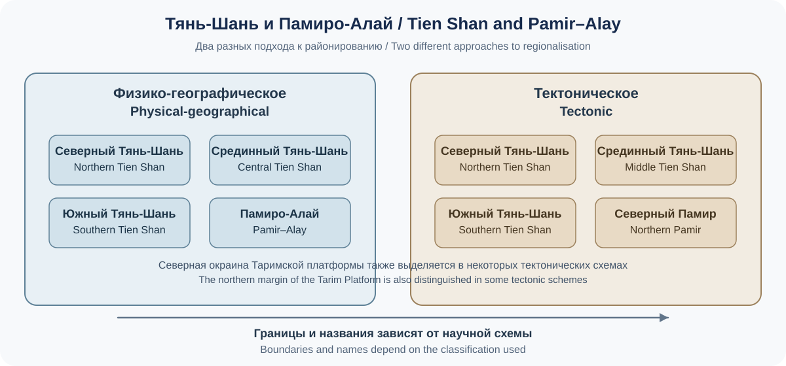
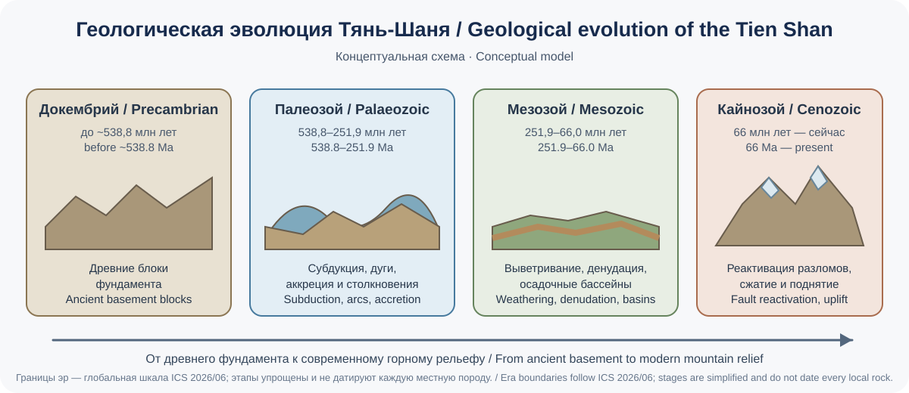
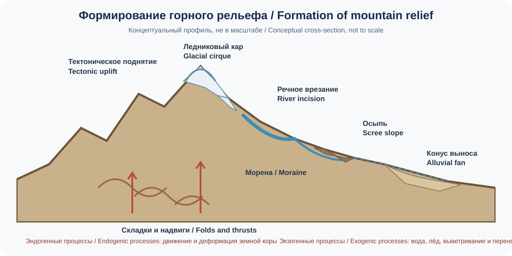

# Глава 17. Географическое положение и история формирования территории Кыргызстана
# Chapter 17. Geographic Location and Geological Evolution of Kyrgyzstan

> **Часть IV. Кыргызстан — природная и региональная энциклопедия / Part IV. Kyrgyzstan — A Natural and Regional Encyclopaedia**  
> Научно-образовательный атлас географии / Scientific and Educational Geography Atlas

## Цели главы / Chapter Objectives

После изучения главы читатель сможет:
- описывать географическое положение Кыргызстана и объяснять, как горный рельеф влияет на климат, водные ресурсы, расселение и транспорт;
- различать физико-географическое, тектоническое и административное районирование;
- объяснять основные этапы геологической эволюции Тянь-Шаня и связь современной тектоники с внутриконтинентальной деформацией;
- различать сейсмическую опасность и риск, а также геологическое проявление, ресурс, запас и добычу;
- оценивать надёжность географической карты по дате, масштабу, источнику, системе координат, вертикальной основе и правам использования.

After studying this chapter, readers should be able to:
- describe Kyrgyzstan's geographic location and explain how mountain relief affects climate, water resources, settlement and transport;
- distinguish physical-geographical, tectonic and administrative regionalisation;
- explain the main stages of Tien Shan geological evolution and relate modern tectonics to intracontinental deformation;
- distinguish seismic hazard from risk, and a mineral occurrence from a resource, reserve and actual production; and
- assess a geographic map by checking its date, scale, source, coordinate reference system, vertical reference and reuse conditions.

## Введение / Introduction

Кыргызстан — горная страна в северо-восточной части Центральной Азии, расположенная преимущественно в пределах Тянь-Шаня и частично Памиро-Алая. Его географический облик определяется сочетанием высоких хребтов, межгорных впадин, плато, долин, озёр и речных бассейнов. Такое положение формирует выраженную высотную поясность, сложную климатическую мозаику, разнообразие природных ресурсов и значительные различия в расселении и хозяйственной деятельности.

Территория Кыргызстана — результат длительной геологической эволюции. Древние континентальные блоки, океанические бассейны, островные дуги и зоны столкновения плит сформировали палеозойский фундамент Тянь-Шаня. В кайнозое столкновение Индии с Евразией привело к возобновлению тектонических движений, поднятию гор и развитию современных межгорных впадин. Землетрясения, поднятие рельефа, эрозия и оледенение продолжают изменять территорию и сегодня.

Kyrgyzstan is a mountainous country in northeastern Central Asia, situated mainly within the Tien Shan and partly within the Pamir–Alay. Its geography is defined by high mountain ranges, intermontane basins, plateaus, valleys, lakes and river catchments. This setting produces pronounced altitudinal zonation, a complex climatic mosaic, diverse natural resources and marked differences in settlement and economic activity.

The territory is the outcome of a long geological history. Ancient continental blocks, ocean basins, island arcs and collisional zones formed the Palaeozoic basement of the Tien Shan. During the Cenozoic, the India–Eurasia collision reactivated tectonic structures, uplifted mountain ranges and shaped modern intermontane basins. Earthquakes, uplift, erosion and glaciation continue to modify the landscape.

## 17.1. Географическое положение в Центральной Азии / Geographic Location in Central Asia

> **[МЕТКА ИЛЛЮСТРАЦИИ 17-A / IMAGE PLACEHOLDER 17-A]** Кыргызстан на карте Центральной Азии: соседние государства, основные региональные ориентиры и проверенная государственная граница с указанием даты источника.
> **EN:** Kyrgyzstan on a Central Asia map showing neighbouring states, key regional reference points and a verified state boundary with the source date stated.

Кыргызская Республика не имеет выхода к Мировому океану и находится внутри материка Евразия. Страна занимает стратегическое положение между крупными природно-географическими и историко-культурными регионами Центральной Азии. На севере она граничит с Казахстаном, на западе и юго-западе — с Узбекистаном, на юго-западе — с Таджикистаном, на востоке и юго-востоке — с Китаем.

Положение страны одновременно связывает её с Ферганской долиной, Туранскими низменностями, Казахским мелкосопочником, Таримской впадиной и высокогорными районами Памира и Тянь-Шаня. Границы проходят по разнообразным ландшафтам: долинам, предгорьям, хребтам и высокогорным участкам. В горной местности проведение и практическое использование границ осложняются рельефом, водоразделами, ледниками и труднодоступностью.

Кыргызстан расположен в глубине материка, поэтому океаническое влияние ослаблено. Континентальность климата сочетается с сильным воздействием высоты, экспозиции склонов и замкнутости межгорных котловин. Географическое положение не следует рассматривать отдельно от рельефа: именно горная структура существенно модифицирует климатические и гидрологические условия.

The Kyrgyz Republic is landlocked and lies within the Eurasian continent. It occupies a strategically important position between major physical-geographical and historical-cultural regions of Central Asia. It borders Kazakhstan to the north, Uzbekistan to the west and south-west, Tajikistan to the south-west, and China to the east and south-east.

The country's location connects it with the Fergana Valley, the Turan Lowlands, the Kazakh Uplands, the Tarim Basin and the high mountain regions of the Pamir and Tien Shan. State borders cross a variety of landscapes, including valleys, foothills, mountain ranges and high-altitude terrain. In mountainous areas, the practical delineation and use of borders are complicated by relief, watersheds, glaciers and difficult access.

Because Kyrgyzstan lies deep within the continent, oceanic influences are weak. Its continental climate is strongly modified by elevation, slope aspect and the enclosure of intermontane basins. Geographic location should not be considered separately from relief: the mountain structure substantially modifies both climatic and hydrological conditions.

## 17.2. Территория, протяжённость и крайние географические точки / Area, Extent and Geographic Extremes

В справочных материалах площадь Кыргызской Республики часто приводится как **199,9 тыс. км²**. Государственный портал Кыргызской Республики на странице «О Кыргызстане» указывает **199 951 км²** (проверено 1 ноября 2026 года), а Национальное агентство по инвестициям в справке с данными на июнь 2026 года использует значение **199,9 тыс. км²** [1, 24]. Эти значения близки, но математически 199 951 км² при обычном округлении до 0,1 тыс. км² составляет **200,0 тыс. км²**, а не 199,9 тыс. км². Разница может быть связана с усечением или использованием разных справочных представлений площади; без отдельного пояснения нельзя называть её обычным округлением. В атласе сохраняется точное значение государственного портала, а округлённая форма приводится только с указанием источника.

Страна вытянута преимущественно с запада на восток. Однако её географическую форму нельзя сводить к простой прямоугольной фигуре: хребты и долины образуют сложную конфигурацию, а транспортные и природные связи часто ориентированы вдоль межгорных коридоров.

Крайние точки и координаты следует показывать на карте по единой геодезической основе. В учебных и справочных материалах встречаются несовпадающие координаты крайних точек: различаются как сами значения, так и точность их записи. Поэтому в этой редакции не приводятся координаты, которые не удалось независимо подтвердить по доступному национальному геодезическому набору или официальной карте с метаданными. Для завершения картографической таблицы необходимо получить геометрию государственной границы и координаты крайних вершин из уполномоченного национального источника, зафиксировать дату и систему координат, а затем вычислить крайние точки по этой геометрии. Значения, снятые с обзорной карты или спутникового изображения, нельзя выдавать за официальные координаты.

**Важно:** площадь государства, длина государственной границы и координаты крайних точек — справочные характеристики, которые необходимо согласовывать между собой и сопровождать указанием источника. Не следует смешивать длину государственной границы с длиной отдельных участков, полученной по картам разного масштаба.

Reference publications often give the area of the Kyrgyz Republic as **199.9 thousand km²**. The State Portal of the Kyrgyz Republic lists **199,951 km²** on its country profile page (checked on 1 November 2026), while the National Investment Agency's summary with data as of June 2026 uses **199.9 thousand km²** [1, 24]. The values are close, but 199,951 km² conventionally rounds to **200.0 thousand km²**, not 199.9 thousand km², when rounded to the nearest 0.1 thousand. The difference may reflect truncation or different reference presentations of the area; it should not be described as ordinary rounding without explanation. This atlas retains the precise value from the State Portal and gives the rounded form only with its source identified.

The country extends mainly from west to east. Its geographical shape should not, however, be reduced to a simple rectangle: mountain ranges and valleys form a complex configuration, and transport and natural connections often follow intermontane corridors.

The extreme points and their coordinates should be shown on maps using one official geodetic reference framework. Reference publications contain conflicting coordinates and use different levels of precision. This edition therefore does not publish numerical coordinates that could not be independently verified against an accessible national geodetic dataset or an official map with metadata. To complete the coordinate table, obtain the state-boundary geometry and extreme vertices from an authorised national source, record the date and coordinate reference system, and calculate the extremes from that geometry. Coordinates measured from a small-scale map or satellite image must not be presented as official.

**Important:** the country's area, state-border length and the coordinates of its extreme points are reference characteristics that must be mutually consistent and accompanied by sources. Do not confuse the length of the state border with lengths of individual sections measured from maps at different scales.

## 17.3. Горная страна: высотный облик территории / A Mountainous Country: Elevation Structure

Рельеф — определяющая характеристика Кыргызстана. Большая часть территории относится к горным системам, а равнинные и низкогорные участки сосредоточены главным образом в межгорных долинах и котловинах, особенно на севере и юго-западе.

Высотный диапазон простирается от низких долин до вершин выше 7 000 м. Наиболее высокие вершины страны связаны с восточной частью Центрального Тянь-Шаня и районом хребта Какшаал-Тоо. Пик Победы (Жеңиш чокусу) достигает примерно 7 439 м; Хан-Тенгри — около 6 995 м по скальной вершине, тогда как при учёте ледниковой шапки в некоторых источниках приводится высота около 7 010 м. В атласе эти значения следует сопровождать пояснением методики измерения и не смешивать скальную высоту с высотой ледниковой поверхности.

Высота влияет на:
- температуру и продолжительность вегетационного периода;
- количество и сезонность осадков;
- типы почв и растительности;
- снегозапасы, ледники и сток рек;
- доступность пастбищ, поселений и транспортных путей;
- природные опасности и инженерные условия.

Горный рельеф создаёт множество локальных климатических условий. Две долины на близкой высоте могут различаться по увлажнению, инсоляции и температурному режиму из-за ориентации, высоты окружающих хребтов и открытости воздушным массам.

Relief is a defining characteristic of Kyrgyzstan. Most of the territory belongs to mountain systems, while plains and low mountain areas are concentrated mainly in intermontane valleys and basins, especially in the north and south-west.

The elevation range extends from low valleys to peaks above 7,000 m. The country's highest summits are associated with the eastern part of the Central Tien Shan and the Kakshaal-Too Range. Jengish Chokusu (Victory Peak) reaches approximately 7,439 m. The rocky summit of Khan Tengri is about 6,995 m high, while some sources give approximately 7,010 m when the ice cap is included. An atlas should state the measurement convention and must not confuse the rock summit with the elevation of the ice surface.

Elevation affects:
- temperature and the length of the growing season;
- the amount and seasonality of precipitation;
- soil and vegetation types;
- snow accumulation, glaciers and river runoff;
- access to pastures, settlements and transport routes; and
- natural hazards and engineering conditions.

Mountain relief creates a wide range of local climatic conditions. Two valleys at similar elevations may differ in moisture, solar exposure and temperature because of their orientation, the height of surrounding ranges and their exposure to prevailing air masses.

## 17.4. Тянь-Шань и Памиро-Алай: крупные горные системы / Tien Shan and Pamir–Alay: Major Mountain Systems

*Рис. 17-C. Сопоставление двух подходов к районированию; названия и границы зависят от конкретной научной схемы.*

> **[МЕТКА ИЛЛЮСТРАЦИИ 17-B / IMAGE PLACEHOLDER 17-B]** Физическая карта Тянь-Шаня и Памиро-Алая с основными хребтами, межгорными впадинами и высотной гипсометрией.
> **EN:** Physical map of the Tien Shan and Pamir–Alay showing major ranges, intermontane basins and elevation hypsometry.

Территория Кыргызстана включает части нескольких крупных горных районов.

### Тянь-Шань / Tien Shan

Тянь-Шань — обширная горная система Центральной Азии, протянувшаяся от западных районов региона к востоку, в сторону Синьцзяна. На территории Кыргызстана выделяют Северный, Срединный и Южный Тянь-Шань как крупные физико-географические и тектонические подразделения. Их границы в разных научных схемах могут различаться.

**Северный Тянь-Шань** включает хребты и межгорные пространства северной части страны, в том числе Кыргызский, Таласский, Кунгей-Ала-Тоо и Терскей-Ала-Тоо. Здесь важную роль играют Чуйская, Таласская и Иссык-Кульская впадины и долины.

**Срединный Тянь-Шань** охватывает высокогорные районы центральной и восточной частей страны. Здесь находятся мощные хребты, высокие плато, ледниковые узлы и верховья крупных рек. Район Центрального Тянь-Шаня отличается сложной геологической структурой и высокой сейсмичностью.

**Южный Тянь-Шань** включает горные районы юга и юго-востока, где широко представлены складчатые и надвиговые структуры, межгорные долины и зоны перехода к Памиро-Алаю.

### Памиро-Алай / Pamir–Alay

Памиро-Алай занимает юго-западное положение в региональной системе гор Центральной Азии. В пределах Кыргызстана с ним связаны Алайская долина, Алайский и Заалайский хребты и прилегающие высокогорные районы. Заалайский хребет образует северную окраину Памирской горной области; его геологическое и геоморфологическое положение требует отдельного рассмотрения от собственно Тянь-Шаня.

### Почему классификации могут различаться

Названия «Северный», «Срединный» и «Южный Тянь-Шань» могут использоваться в физической географии, тектонике и региональной геологии с неодинаковыми границами. В атласе необходимо обозначать, какая именно схема применяется на конкретной карте [28, 29].

The territory of Kyrgyzstan includes parts of several major mountain regions.

### Tien Shan

The Tien Shan is an extensive mountain system of Central Asia, stretching eastward from the western parts of the region towards Xinjiang. In Kyrgyzstan, the Northern, Central and Southern Tien Shan are commonly distinguished as major physical-geographical and tectonic subdivisions. Their boundaries may differ between scientific classification schemes.

**The Northern Tien Shan** includes mountain ranges and intermontane areas in the northern part of the country, including the Kyrgyz, Talas, Kungey Ala-Too and Terskey Ala-Too ranges. The Chuy, Talas and Issyk-Kul basins and valleys are important features of this area.

**The Central Tien Shan** covers high mountain areas in the central and eastern parts of the country. It contains major ranges, high plateaus, glacier centres and the headwaters of large rivers. The Central Tien Shan is characterised by complex geology and high seismicity.

**The Southern Tien Shan** includes mountain areas in the south and south-east, where folded and thrust structures, intermontane valleys and transition zones towards the Pamir–Alay are widespread.

### Pamir–Alay

The Pamir–Alay occupies a south-western position within the mountain system of Central Asia. In Kyrgyzstan, it is associated with the Alay Valley, the Alay and Trans-Alay ranges and adjoining high mountain areas. The Trans-Alay Range forms the northern margin of the Pamir mountain region; its geological and geomorphological setting should be considered separately from the Tien Shan proper.

### Why classifications may differ

The terms Northern, Central and Southern Tien Shan are used in physical geography, tectonics and regional geology, but their boundaries are not always identical. An atlas map should identify the specific classification scheme being used [28, 29].

*Figure 17-C. Comparison of two regionalisation approaches; names and boundaries depend on the scientific scheme used.*

## 17.5. Межгорные впадины, долины и плато / Intermontane Basins, Valleys and Plateaus

> **[МЕТКА ИЛЛЮСТРАЦИИ 17-D / IMAGE PLACEHOLDER 17-D]** Карта и профиль главных межгорных впадин и долин Кыргызстана с корректным положением Чуйской, Таласской, Иссык-Кульской, Нарынской, Суусамырской, Ферганской и Алайской долин.
> **EN:** Map and profile of Kyrgyzstan’s main intermontane basins and valleys, with verified locations and labels.

Межгорные впадины — важнейшие элементы географической структуры Кыргызстана. Они разделяют горные хребты, формируют местные климатические условия и концентрируют население, сельское хозяйство и транспортные связи.

К числу наиболее известных относятся:
- **Чуйская долина** — северная межгорная равнина, где расположены Бишкек и значительная часть сельскохозяйственных территорий Чуйской области;
- **Таласская долина** — межгорная область на северо-западе страны;
- **Иссык-Кульская котловина** — крупная высокогорная впадина с озером Иссык-Куль, окружённая хребтами Кунгей-Ала-Тоо и Терскей-Ала-Тоо;
- **Нарынская долина и система внутренних котловин** — цепь высокогорных долин и межгорных пространств центрального Тянь-Шаня;
- **Суусамырская долина** — высокогорная котловина, известная пастбищными ландшафтами;
- **Ферганская долина** — крупный межгорный регион, северо-восточная периферия которого входит в Кыргызстан;
- **Алайская долина** — высокогорная долина юга страны между Алайским и Заалайским хребтами.

Плато и высокогорные поверхности, включая районы Ак-Сая и Арпа, отличаются суровым климатом, коротким вегетационным периодом и значительной ролью сезонных пастбищ. Они имеют большое значение для водосбора, биоразнообразия и традиционного природопользования.

Intermontane basins are among the most important elements of Kyrgyzstan's geographical structure. They separate mountain ranges, shape local climatic conditions and concentrate population, agriculture and transport connections.

Some of the best-known examples are:
- **The Chuy Valley** — a northern intermontane plain containing Bishkek and a large share of the agricultural land of Chuy Region;
- **The Talas Valley** — an intermontane area in the north-west of the country;
- **The Issyk-Kul Basin** — a large high-altitude depression containing Lake Issyk-Kul and enclosed by the Kungey Ala-Too and Terskey Ala-Too ranges;
- **The Naryn Valley and the system of internal basins** — a chain of high mountain valleys and intermontane areas in the Central Tien Shan;
- **The Suusamyr Valley** — a high-altitude basin known for its pasture landscapes;
- **The Fergana Valley** — a major intermontane region whose north-eastern periphery extends into Kyrgyzstan; and
- **The Alay Valley** — a high mountain valley in the south of the country, between the Alay and Trans-Alay ranges.

Plateaus and high-altitude surfaces, including the Ak-Sai and Arpa areas, have a harsh climate, a short growing season and an important role in seasonal grazing. They are also significant for catchment processes, biodiversity and traditional land use.

## 17.6. Геологическая летопись территории / Geological History of the Territory

*Рис. 17-E. Концептуальная временная схема; границы эр даны по ICS 2026/06, этапы не являются точной реконструкцией отдельного участка.*

Геологическая история Кыргызстана охватывает миллиарды лет и включает несколько крупных этапов. Возраст отдельных пород, время их образования и время последующей деформации — разные характеристики. Например, древняя порода могла быть поднята, метаморфизована или включена в складчатый пояс значительно позднее своего первоначального формирования.

Для общей временной шкалы удобно использовать границы крупных эр и эонов Международной комиссии по стратиграфии (ICS): докембрий охватывает время до начала кембрия около **538,8 млн лет назад**; палеозой — примерно 538,8–251,9 млн лет назад; мезозой — 251,9–66,0 млн лет назад; кайнозой продолжается от 66,0 млн лет назад до настоящего времени. Это рамка геологического времени Земли, а не датировка конкретного события в Кыргызстане. Возраст местных пород и тектонических событий устанавливают по региональным геологическим данным и могут существенно различаться даже в пределах одного хребта. Численные границы периодически уточняются; в этой главе используется таблица ICS версии 2026/06 [18].

### Докембрий: древний фундамент / Precambrian Basement

Докембрийские комплексы представлены древними метаморфическими и магматическими породами, которые входят в состав отдельных блоков фундамента. Их история связана с ранними этапами формирования континентальной коры. Такие породы не образуют сплошной однородный фундамент по всей территории: они входят в разные тектонические блоки и обнажаются в определённых структурных зонах.

### Палеозой: океаны, островные дуги и сборка континента / Palaeozoic: Oceans, Island Arcs and Continental Assembly

В палеозое территория современного Тянь-Шаня была частью сложной системы континентальных окраин, океанических бассейнов, островных дуг и микроконтинентов. В разных районах происходили:
- раскрытие и закрытие океанических бассейнов;
- субдукция океанической литосферы;
- вулканизм и образование магматических дуг;
- аккреция островных дуг и фрагментов океанической коры;
- столкновение континентальных блоков;
- складчатость, надвигообразование и метаморфизм;
- внедрение гранитоидных интрузий.

В региональной геологии часто выделяют каледонские и герцинские (варисские) этапы складчатости. Эти названия описывают крупные орогенные события и не означают, что вся территория Кыргызстана прошла одинаковую последовательность деформаций. Северный, Срединный и Южный Тянь-Шань имеют различающиеся геологические истории.

### Мезозой: относительная стабилизация и осадконакопление / Mesozoic: Relative Stabilisation and Sedimentation

После основных палеозойских этапов сборки складчатого пояса в мезозое значительную роль играли внутриплитные процессы, выветривание, денудация и накопление осадков в понижениях. Отдельные участки испытывали тектоническую активизацию и магматизм. Геологическая летопись этого времени неодинаково полна в разных районах.

### Кайнозой: возобновление горообразования / Cenozoic: Renewed Mountain Building

Сближение Индийской и Евразийской литосферных плит привело к передаче деформации далеко вглубь Евразии. Тянь-Шань, удалённый от основной зоны столкновения, вновь стал областью активного сжатия и поднятия. Этот процесс не следует изображать как непосредственное столкновение двух плит под Кыргызстаном: деформация распространяется в континентальную часть Евразии и использует унаследованные структуры древнего орогена.

С позднего палеогена и особенно в неогене и четвертичном периоде происходили:
- реактивация древних разломов;
- формирование и перемещение надвигов;
- поднятие хребтов;
- развитие межгорных впадин;
- накопление мощных толщ континентальных осадков;
- усиление эрозии и врезание речных долин;
- развитие горного оледенения в холодные периоды.

Современный рельеф — результат наложения позднекайнозойского поднятия на гораздо более древний и сложный геологический фундамент.

Kyrgyzstan's geological history spans billions of years and includes several major stages. The age of a rock, the time when it formed and the time when it was later deformed are different characteristics. For example, an ancient rock may have been uplifted, metamorphosed or incorporated into a fold belt long after its original formation.

*Figure 17-E. Conceptual timeline; era boundaries follow ICS 2026/06, and the stages are not a site-specific reconstruction.*

For a broad timeline, the major eras and eons of the International Commission on Stratigraphy (ICS) provide a useful framework: the Precambrian extends to the beginning of the Cambrian at about **538.8 million years ago**; the Palaeozoic spans approximately 538.8–251.9 million years ago; the Mesozoic, 251.9–66.0 million years ago; and the Cenozoic extends from 66.0 million years ago to the present. This is the geological timescale of Earth, not the dating of a specific event in Kyrgyzstan. The ages of local rocks and tectonic events must be established from regional geological evidence and can differ considerably even within one mountain range. Numerical boundaries are periodically refined; this chapter uses ICS Chart version 2026/06 [18].

### Precambrian: ancient basement

Precambrian complexes consist of ancient metamorphic and igneous rocks that form parts of separate basement blocks. Their history is connected with early stages in the formation of continental crust. These rocks do not form one continuous, uniform basement beneath the whole country: they belong to different tectonic blocks and are exposed in particular structural zones.

### Palaeozoic: oceans, island arcs and continental assembly

During the Palaeozoic, the area of the present-day Tien Shan was part of a complex system of continental margins, ocean basins, island arcs and microcontinents. Different areas experienced:
- opening and closure of ocean basins;
- subduction of oceanic lithosphere;
- volcanism and the formation of magmatic arcs;
- accretion of island arcs and fragments of oceanic crust;
- collision between continental blocks;
- folding, thrusting and metamorphism; and
- emplacement of granitoid intrusions.

Regional geology commonly distinguishes the Caledonian and Hercynian (Variscan) orogenic episodes. These terms describe major mountain-building events; they do not mean that the entire territory of Kyrgyzstan experienced an identical sequence of deformation. The Northern, Central and Southern Tien Shan have different geological histories.

### Mesozoic: relative stabilisation and sedimentation

After the main Palaeozoic stages of fold-belt assembly, intraplate processes, weathering, denudation and sediment accumulation in low-lying areas played an important role during the Mesozoic. Some areas experienced renewed tectonic activity and magmatism. The geological record of this period is more complete in some districts than in others.

### Cenozoic: renewed mountain building

The convergence of the Indian and Eurasian lithospheric plates transferred deformation far into the interior of Eurasia. Although the Tien Shan lies far from the principal collision zone, it again became an area of active compression and uplift. This process should not be depicted as a direct collision of the two plates beneath Kyrgyzstan: deformation propagates into continental Eurasia and reactivates structures inherited from the ancient orogen.

From the late Palaeogene, and especially during the Neogene and Quaternary, the region experienced:
- reactivation of ancient faults;
- formation and movement of thrusts;
- uplift of mountain ranges;
- development of intermontane basins;
- accumulation of thick continental sedimentary sequences;
- intensified erosion and incision of river valleys; and
- mountain glaciation during cold periods.

The modern landscape is the result of late Cenozoic uplift superimposed on a much older and geologically complex basement.

## 17.7. Тектоническое строение и крупные структурные блоки / Tectonic Structure and Major Structural Blocks

Тектоническое строение Кыргызстана мозаично. В региональных схемах выделяются крупные структурные элементы Северного, Срединного и Южного Тянь-Шаня, Северного Памира и северной окраины Таримской платформы. Некоторые схемы отдельно выделяют Таласский регион и другие блоки.

Различия между блоками проявляются в:
- возрасте и составе фундамента;
- последовательности осадочных и вулканогенных толщ;
- характере магматизма;
- направлении и интенсивности складчатости;
- системах разломов и надвигов;
- глубинном строении земной коры.

**Таласо-Ферганский разлом** — одна из наиболее заметных региональных структур Центрального Тянь-Шаня. Он представляет собой крупную сдвиговую зону, которая разделяет и смещает геологические комплексы. Его история сложна и включает длительную тектоническую активность; не следует изображать его как простую прямую линию или считать единственной границей всех горных подразделений.

На картах тектонического строения необходимо различать геологические границы, разломы, современные активные структуры и административные границы. Они не совпадают автоматически.

The tectonic structure of Kyrgyzstan is a mosaic. Regional schemes distinguish major structural elements of the Northern, Central and Southern Tien Shan, the Northern Pamir and the northern margin of the Tarim Platform. Some schemes also identify the Talas region and other blocks separately.

Differences between these blocks are reflected in:
- the age and composition of their basement rocks;
- the sequence of sedimentary and volcanic units;
- the character of magmatism;
- the orientation and intensity of folding;
- fault and thrust systems; and
- the deep structure of the crust.

The **Talas–Fergana Fault** is one of the most prominent regional structures of the Central Tien Shan. It is a major strike-slip zone that separates and offsets geological complexes. Its history is complex and reflects long-term tectonic activity; it should not be drawn as a simple straight line or treated as the sole boundary between all mountain subdivisions.

Tectonic maps must distinguish geological boundaries, faults, currently active structures and administrative boundaries. These features do not automatically coincide.

## 17.8. Современная тектоника и сейсмичность / Active Tectonics and Seismicity

> **[МЕТКА ИЛЛЮСТРАЦИИ 17-F / IMAGE PLACEHOLDER 17-F]** Схема активных разломов и сейсмичности Кыргызстана с указанием периода каталога землетрясений, порога магнитуды и источника геоданных.
> **EN:** Map of active faults and seismicity in Kyrgyzstan, stating the earthquake-catalogue period, magnitude threshold and geodata source.

Кыргызстан находится в активном внутриконтинентальном поясе деформаций, связанном с взаимодействием Индийской и Евразийской плит. Сжатие земной коры проявляется в надвигах, обратных разломах, складчатости и локальных сдвиговых движениях.

Землетрясения происходят не только на границах океанических плит. Внутри континентов крупные землетрясения могут быть связаны с реактивацией древних разломов и накоплением напряжений в неоднородной земной коре.

Сейсмический риск определяется не только магнитудой возможного землетрясения, но и:
- глубиной очага;
- расстоянием до населённых пунктов;
- характеристиками грунтов;
- качеством зданий и инфраструктуры;
- плотностью населения;
- готовностью служб и устойчивостью систем жизнеобеспечения.

Сейсмическая опасность (вероятность сильного сотрясения) и сейсмический риск (возможные потери) — разные понятия. Карта опасности не является точным прогнозом даты и места будущего землетрясения.

Для Кыргызстана важным национальным научным источником является Институт сейсмологии Национальной академии наук: среди его работ указаны сейсмотектоническая карта территории страны масштаба 1:500 000, карта новейшей тектоники и исследования активных блоков Тянь-Шаня. Международное исследование 2024 года по гармонизации сведений о сейсмичности Центральной Азии объединяет каталоги землетрясений и данные об активных разломах для сопоставимого регионального анализа. Эти источники дополняют друг друга, но не являются взаимозаменяемыми [23, 25]:  перед построением карты необходимо проверить охват, дату, масштаб, критерии включения разломов и полноту каталога. В легенде каталога указывают период наблюдений, минимальную магнитуду, тип магнитуды (например, Mw или локальную шкалу), глубину и точность определения эпицентров. Нельзя смешивать магнитуды разных шкал без процедуры пересчёта или считать отсутствие зарегистрированных событий доказательством отсутствия сейсмической опасности.

Kyrgyzstan lies within an active intracontinental deformation belt associated with the interaction of the Indian and Eurasian plates. Crustal compression is expressed through thrusts, reverse faults, folding and local strike-slip movements.

Earthquakes do not occur only at the boundaries of oceanic plates. Large earthquakes within continents may result from the reactivation of ancient faults and the accumulation of stress in a heterogeneous crust.

Seismic risk depends not only on the magnitude of a possible earthquake but also on:
- the depth of the earthquake's focus;
- the distance to settlements;
- ground conditions;
- the quality of buildings and infrastructure;
- population density; and
- the preparedness of emergency services and the resilience of essential systems.

Seismic **hazard** (the likelihood of strong ground shaking) and seismic **risk** (the potential for losses) are different concepts. A hazard map is not an exact prediction of the date and location of a future earthquake.

An important national scientific source for Kyrgyzstan is the Institute of Seismology of the National Academy of Sciences. Its listed work includes a 1:500,000 seismotectonic map of the country, a neotectonic map and research on active blocks of the Tien Shan. A 2024 international study harmonising seismicity information in Central Asia combines earthquake catalogues and active-fault data for comparable regional analysis. These sources complement one another but are not interchangeable [23, 25]:  before preparing a map, check its coverage, date, scale, fault-inclusion criteria and catalogue completeness. A catalogue legend should state the observation period, minimum magnitude, magnitude type (for example, Mw or a local scale), focal depth and epicentral-location accuracy. Magnitudes from different scales must not be mixed without conversion, and the absence of recorded events must not be treated as proof that seismic hazard is absent.

### 17.8.1. Практический пример: почему сейсмическая опасность не равна риску / Worked Example: Why Seismic Hazard Is Not the Same as Risk

Рассмотрим два условных населённых пункта, расположенных в районах с одинаковой оценкой вероятности сильного сотрясения. В первом пункте здания в основном рассчитаны на сейсмические нагрузки, население обучено действиям при землетрясении, а больница и основные дороги имеют резервные решения. Во втором пункте много уязвимых зданий, плотная застройка и ограниченные возможности экстренного реагирования.

**Сейсмическая опасность** в этом упрощённом сравнении одинакова, но потенциальные последствия различаются. Во втором пункте ожидаемые потери могут быть выше из-за большей уязвимости зданий, концентрации людей и меньшей готовности инфраструктуры. Следовательно, снижение риска требует не только изучения разломов и вероятных сотрясений, но и укрепления зданий, соблюдения строительных норм, планирования эвакуации, подготовки населения и обеспечения устойчивости критической инфраструктуры.

Для учебного анализа можно использовать качественную схему:

**Риск = опасное воздействие × подверженность × уязвимость.**

Это концептуальная модель, а не универсальная формула для расчёта денежных потерь или вероятности жертв. В профессиональной оценке применяются специальные модели, сценарии, данные о грунтах, зданиях, населении и неопределённостях. Нельзя по этой схеме предсказывать дату землетрясения или утверждать, что конкретное место безопасно.

**Задание:** выберите два условных района с одинаковой сейсмической опасностью. Составьте перечень факторов, которые могут сделать риск в одном районе выше, и предложите три меры его снижения.

Consider two hypothetical settlements located in areas with the same estimated likelihood of strong ground shaking. In the first, most buildings are designed to withstand seismic loads, residents know what to do during an earthquake, and the hospital and main roads have contingency arrangements. In the second, many buildings are vulnerable, development is dense, and emergency response capacity is limited.

**Seismic hazard** is the same in this simplified comparison, but the potential consequences differ. Expected losses may be greater in the second settlement because buildings are more vulnerable, more people are concentrated in the affected area, and infrastructure is less prepared. Reducing risk therefore requires more than studying faults and likely ground motions: it also requires strengthening buildings, enforcing construction standards, planning evacuation, preparing communities and improving the resilience of critical infrastructure.

A qualitative framework for learning is:

**Risk = hazardous event or impact × exposure × vulnerability.**

This is a conceptual model, not a universal formula for calculating monetary losses or the probability of casualties. Professional assessments use specialised models and scenarios, together with information about soils, buildings, population and uncertainty. This framework cannot predict when an earthquake will occur or establish that a particular place is safe.

**Activity:** choose two hypothetical districts with the same seismic hazard. List factors that could make risk higher in one district and suggest three risk-reduction measures.

## 17.9. Формирование современного рельефа / Formation of the Modern Relief

*Рис. 17-G. Концептуальный профиль горного ландшафта; условные формы и процессы не изображены в масштабе и не относятся к одному реальному разрезу.*

Современный рельеф создаётся взаимодействием эндогенных и экзогенных процессов.

**Эндогенные процессы:**
- тектоническое поднятие и опускание;
- складчатость и надвигообразование;
- разломные смещения;
- магматизм и вулканические процессы древних эпох;
- землетрясения.

**Экзогенные процессы:**
- речная эрозия и аккумуляция;
- ледниковая эрозия и отложение морен;
- морозное выветривание;
- склоновые процессы;
- оползни, обвалы и осыпи;
- эоловые процессы в сухих долинах;
- карст в растворимых породах.

В высокогорьях особенно заметны троговые долины, кары, моренные валы, цирки и острые гребни, сформированные ледниками и морозным выветриванием. В предгорьях распространены конусы выноса, террасы, пролювиальные и аллювиальные равнины.

The modern relief of Kyrgyzstan is shaped by the interaction of endogenic and exogenic processes.

*Figure 17-G. Conceptual mountain-landscape profile; features and processes are schematic, not to scale, and do not represent one real transect.*

**Endogenic processes include:**
- tectonic uplift and subsidence;
- folding and thrusting;
- displacement along faults;
- magmatism and volcanic processes in earlier geological periods; and
- earthquakes.

**Exogenic processes include:**
- river erosion and deposition;
- glacial erosion and the deposition of moraines;
- frost weathering;
- slope processes;
- landslides, rockfalls and scree formation;
- aeolian processes in dry valleys; and
- karst development in soluble rocks.

In high mountain areas, characteristic landforms include U-shaped glacial troughs, cirques, moraines, corries and sharp ridges shaped by glaciers and frost weathering. Foothill areas commonly contain alluvial fans, terraces, proluvial deposits and alluvial plains.

## 17.10. Геологическое строение и природные ресурсы / Geological Structure and Natural Resources

> **[МЕТКА ИЛЛЮСТРАЦИИ 17-H / IMAGE PLACEHOLDER 17-H]** Обзорная карта геологического строения и основных минеральных районов; не показывать запасы как доказанные без соответствующего статуса и источника.
> **EN:** Overview map of geological structure and major mineral districts; do not portray resources as proven reserves without a documented classification and source.

Геологическое разнообразие Кыргызстана обусловило наличие месторождений металлических и неметаллических полезных ископаемых, угля, строительного сырья и подземных вод. Минеральные ресурсы связаны с магматическими, гидротермальными, осадочными и метаморфическими процессами. Сам факт геологического обнаружения полезного компонента, однако, ещё не означает, что его можно безопасно и рентабельно добывать.

В числе известных видов сырья:
- золото;
- сурьма и ртуть;
- олово и вольфрам;
- редкие и редкоземельные элементы;
- уголь;
- строительные и облицовочные материалы;
- минеральные и термальные подземные воды.

Примеры известных горнорудных районов и месторождений включают Кумтор, Макмал, Джеруй, Талды-Булак, Кадамжай и Хайдаркан. В марте 2026 года Министерство природных ресурсов сообщило, что совместно с Институтом геологии имени М. М. Адышева НАН КР инициирована подготовка двухтомного «Атласа геологических, геофизических и минерагенических карт Кыргызской Республики» на русском и английском языках. Сообщение описывает проект и рабочее совещание, но не подтверждает, что атлас уже опубликован или что его карты открыты для свободного воспроизведения. Поэтому его следует рассматривать как перспективный национальный источник для последующего обновления этой главы, а не как уже доступный набор данных [27]. Их геологическая природа, степень изученности, промышленный статус, запасы и экологические последствия различаются. Указание объекта на карте не должно создавать впечатления, что он действует или экономически рентабелен в настоящее время.

### Геологическое проявление, ресурс и запас / Occurrence, Resource and Reserve

Для корректного чтения геологических карт и статистики важно различать несколько понятий:

- **Геологическое проявление** — участок, где обнаружены признаки полезного минерала или геологической структуры, заслуживающие изучения. Проявление может оказаться слишком небольшим, бедным или сложным для разработки.
- **Минеральный ресурс** — концентрация полезного компонента, оценённая по геологическим данным с определённой степенью изученности. Классификации ресурсов различаются между странами и системами отчётности.
- **Запас** — часть ресурса, добыча которой признана технически и экономически обоснованной при конкретных условиях и на дату оценки. Запасы могут пересматриваться при изменении цен, технологий, инфраструктуры, законодательства и экологических требований.
- **Добыча** — фактическое извлечение сырья в определённый период. Наличие запасов не доказывает, что добыча ведётся сейчас.

Эти категории нельзя использовать как синонимы. При публикации цифр необходимо указывать источник, год оценки, единицы измерения, применённую классификацию и то, относится ли показатель к ресурсам, запасам или фактической добыче.

### Жизненный цикл горного проекта и территориальные последствия / Mining Project Life Cycle and Regional Effects

Горный проект обычно проходит несколько стадий: поисковые работы и разведка, технико-экономическая оценка, проектирование и получение разрешений, строительство, эксплуатация, закрытие и рекультивация. На каждой стадии меняются занятость, транспортные потоки, потребление воды и энергии, налоговые поступления и экологическая нагрузка.

Оценка воздействия должна охватывать весь жизненный цикл, а не только период добычи. Важны устойчивость хвостохранилищ и отвалов, качество поверхностных и подземных вод, пылевые выбросы, безопасность работников, восстановление земель, мониторинг после закрытия и участие местных сообществ. В горных водосборах последствия могут затрагивать территории ниже по течению, поэтому границы анализа не должны ограничиваться административной границей лицензии или предприятия.

**Географический вывод:** месторождение — это не только точка на карте. Его значение определяется связью геологического строения с рельефом, водосбором, транспортной доступностью, населением, рынками и природоохранными ограничениями.

Geological diversity in Kyrgyzstan has created deposits of metallic and non-metallic minerals, coal, construction materials and groundwater resources. Mineral resources are associated with igneous, hydrothermal, sedimentary and metamorphic processes. The geological discovery of a potentially useful material, however, does not by itself mean that it can be extracted safely or profitably.

Examples of mineral commodities include:
- gold;
- antimony and mercury;
- tin and tungsten;
- rare and rare-earth elements;
- coal;
- construction and dimension stone;
- mineral and thermal groundwater.

Well-known mining areas and deposits include Kumtor, Makmal, Jerooy, Taldy-Bulak, Kadamjay and Haidarkan. In March 2026, the Ministry of Natural Resources announced that it had initiated, together with the M. M. Adyshev Institute of Geology of the National Academy of Sciences of the Kyrgyz Republic, the preparation of a two-volume *Atlas of Geological, Geophysical and Mineral-Genetic Maps of the Kyrgyz Republic* in Russian and English. The announcement describes a project and a working meeting; it does not confirm that the atlas has already been published or that its maps are openly reusable. It should therefore be treated as a prospective national source for a future chapter update, not as an already available dataset [27]. Their geological settings, level of exploration, operating status, reserves and environmental implications differ. Showing a site on a map must not imply that it is currently operating or economically viable.

### Occurrence, Resource and Reserve

Several terms must be distinguished when reading geological maps and statistics:

- **Mineral occurrence** — a site where evidence of a potentially useful mineral or geological structure has been identified and may warrant further investigation. An occurrence may be too small, low-grade or technically difficult to mine.
- **Mineral resource** — a concentration of a useful material assessed from geological evidence at a stated level of confidence. Resource classifications vary between countries and reporting systems.
- **Reserve** — the part of a resource considered technically and economically mineable under specified conditions at the date of assessment. Reserves may change when prices, technology, infrastructure, legislation or environmental requirements change.
- **Production** — the material actually extracted during a given period. The existence of reserves does not prove that mining is currently taking place.

These categories are not interchangeable. Published figures should identify the source, assessment year, units, classification system and whether the figure refers to resources, reserves or actual production.

### The Mining Project Life Cycle and Regional Effects

A mining project normally passes through several stages: prospecting and exploration, feasibility assessment, design and permitting, construction, operation, closure and rehabilitation. Employment, transport flows, water and energy use, tax revenues and environmental pressures change at each stage.

Impact assessment should cover the entire life cycle, not just the extraction period. Important issues include the stability of tailings storage facilities and waste dumps, surface- and groundwater quality, dust emissions, worker safety, land restoration, post-closure monitoring and participation by local communities. In mountain catchments, impacts may extend downstream; the area of analysis should therefore not be limited to the administrative boundary of a mining licence or company site.

**Geographic conclusion:** a mineral deposit is more than a point on a map. Its significance depends on the interaction of geology with relief, drainage basins, transport access, population, markets and conservation constraints.

## 17.11. Географическое положение и исторические пути / Geographic Location and Historical Routes

Горные проходы и долины Кыргызстана связывали Ферганскую долину, Чуйскую и Таласскую долины, Иссык-Кульскую котловину, Кашгарию и районы Памира. Через регион проходили ветви исторических торговых и культурных маршрутов, в том числе участки и ответвления Шёлкового пути.

Горные коридоры не были постоянными и одинаково доступными во все эпохи. Их использование зависело от политической ситуации, состояния дорог, сезонности, безопасности и возможностей преодоления перевалов.

Географическое положение способствовало культурным обменам, торговле, миграциям и формированию разнообразных локальных связей. При этом горный рельеф одновременно создавал барьеры и разделял соседние долины.

Mountain passes and valleys in Kyrgyzstan connected the Fergana Valley, the Chuy and Talas valleys, the Issyk-Kul Basin, Kashgaria and the Pamir regions. Branches of historical trade and cultural routes crossed the region, including sections and offshoots of the Silk Roads.

Mountain corridors were not permanently or equally accessible in every historical period. Their use depended on political conditions, the state of roads, seasonality, security and the ability to cross high passes.

The country's geographic position encouraged cultural exchange, trade, migration and the development of diverse local connections. At the same time, mountain relief created barriers and separated neighbouring valleys.

## 17.12. Административно-территориальное устройство / Administrative and Territorial Organisation

> **[МЕТКА ИЛЛЮСТРАЦИИ 17-I / IMAGE PLACEHOLDER 17-I]** Карта действующего административно-территориального устройства с семью областями и отдельным обозначением Бишкека и Оша; использовать официальную сетку и утверждённые топонимы.
> **EN:** Map of the current administrative-territorial structure showing the seven oblasts and separately identifying Bishkek and Osh; use official boundaries and approved place names.

Современная административная структура включает **семь областей**:
1. Баткенская область;
2. Джалал-Абадская область;
3. Иссык-Кульская область;
4. Нарынская область;
5. Ошская область;
6. Таласская область;
7. Чуйская область.

Города Бишкек и Ош имеют особый статус городов республиканского значения и не входят в состав областей наравне с обычными областными центрами. Внутри Джалал-Абадской области город Джалал-Абад был переименован в **Манас** Законом Кыргызской Республики от 17 сентября 2025 года № 200; закон вступил в силу 29 сентября 2025 года [20]. Это переименование города не означает переименования области: название **Джалал-Абадская область** сохраняется. В статистических публикациях за 2026 год город уже указан как Манас, а прежнее название приводится для пояснения сопоставимости рядов.

Административное устройство и число районов, городов и айылных аймаков могут меняться в ходе реформ, поэтому детальная таблица административных единиц должна датироваться и сверяться с действующей редакцией законодательства и официальной статистикой.

Административные границы предназначены для управления и статистического учёта. Они не всегда совпадают с границами природных бассейнов, ландшафтов, этнокультурных районов или рынков труда. Для географического анализа важно выбирать территориальные единицы в соответствии с исследовательским вопросом.

The current administrative structure includes **seven regions**:
1. Batken Region;
2. Jalal-Abad Region;
3. Issyk-Kul Region;
4. Naryn Region;
5. Osh Region;
6. Talas Region; and
7. Chuy Region.

The cities of Bishkek and Osh have the special status of cities of republican significance and are not part of the regions in the same way as ordinary regional centres. Within Jalal-Abad Region, the city of Jalal-Abad was renamed **Manas** by Law No. 200 of 17 September 2025; the law took effect on 29 September 2025 [20]. This was a city renaming, not a renaming of the region: **Jalal-Abad Region** retains its name. Statistical publications for 2026 already list the city as Manas and use the former name only to explain the comparability of time series.

The administrative structure and the number of districts, cities and rural municipalities may change as a result of reforms. Detailed lists of administrative units must therefore be dated and checked against current legislation and official statistics.

Administrative boundaries are designed for governance and statistical reporting. They do not necessarily coincide with the boundaries of natural catchments, landscapes, ethnocultural areas or labour markets. Geographic analysis should select territorial units that match the research question.

### 17.12.1. Государственная граница как географическая система: делимитация, демаркация и приграничные связи / The State Border as a Geographic System: Delimitation, Demarcation and Cross-Border Connections

Государственная граница — это юридически установленная линия, отделяющая территорию одного государства от территории другого. В географии важно рассматривать её не только как линию на карте, но и как систему пространственных отношений: по разные стороны границы могут находиться связанные долины, пастбища, дороги, рынки, водные объекты и родственные сообщества. При этом государственная граница сохраняет юридическое значение и регулирует пересечение территории, перемещение людей и товаров и использование отдельных ресурсов.

#### Делимитация и демаркация: два разных этапа

**Делимитация** — согласование прохождения государственной границы и её юридическое описание в договоре, протоколах и картографических приложениях. На этом этапе государства определяют, где должна проходить линия границы на картах и в правовых документах.

**Демаркация** — перенос согласованной линии на местность: совместные полевые работы, установка пограничных знаков, определение координат и подготовка демаркационных документов.

Подписание договора, его ратификация, вступление в силу и завершение демаркации — не одно и то же. Поэтому карта должна указывать, какое именно состояние отражено: согласованная договорная линия, линия с установленными пограничными знаками или граница, по которой ещё продолжаются технические работы.

#### Кыргызско-таджикская граница: соглашение и практическая демаркация

13 марта 2025 года президенты Кыргызстана и Таджикистана подписали Договор о государственной границе. Жогорку Кенеш принял закон о ратификации 19 марта 2025 года; Закон Кыргызской Республики от 25 марта 2025 года № 63 был подписан Президентом и вступил в силу 28 марта 2025 года [9, 10, 21]. В рамках того же визита были подписаны отдельные соглашения о доступе к водохозяйственным и энергетическим объектам и о строительстве и использовании автомобильных дорог и дорожных пересечений. 31 марта 2025 года Кыргызстан, Таджикистан и Узбекистан подписали отдельный договор о точке стыка государственных границ трёх стран; Кыргызстан ратифицировал его в июле 2025 года [22].

В июле 2026 года Кабинет Министров Кыргызстана сообщил о начале установки первых пограничных столбов в рамках демаркационных работ. 14 июля представители двух стран совместно установили четыре знака на участке, начинающемся от точки стыка границ Кыргызстана, Таджикистана и Узбекистана. В официальном сообщении указана общая протяжённость кыргызско-таджикской границы 1 008,14 км и периметр участков земель с нейтральным статусом 14,07 км [11].

Эти сведения показывают разницу между политико-правовым согласованием линии и её последовательным обозначением на местности. Сам факт установки первых знаков не означает, что все демаркационные работы уже завершены.

#### Кыргызско-узбекская граница: договорные участки и совместное использование объектов

Работа по согласованию и демаркации кыргызско-узбекской границы проходила поэтапно. В 2022 году был подписан договор об отдельных участках границы общей протяжённостью 302,29 км, который был ратифицирован Кыргызстаном в ноябре 2022 года. 30 июля 2026 года правительства сообщили о подписании нового договора об отдельных участках кыргызско-узбекской государственной границы. В числе документов того же обмена были соглашение о совместном использовании источника Чашма и протоколы, связанные с пунктами пропуска и взаимными поездками граждан. На дату проверки главы доступное сообщение подтверждает факт подписания, но само по себе не подтверждает завершение ратификации и вступление договора в силу [13].

При описании этих событий важно не делать вывод, что один договор об отдельных участках автоматически описывает всю государственную границу. Юридический охват каждого соглашения определяется его текстом и приложениями. Дату подписания также нельзя автоматически считать датой завершения демаркации.

#### Приграничные территории как зоны взаимодействия

Приграничье — не только территория контроля и охраны. Это также пространство ежедневных хозяйственных и социальных связей. Для жителей приграничных районов большое значение имеют:
- доступ к дорогам, рынкам, школам и медицинским учреждениям;
- режим работы пунктов пропуска и время пересечения границы;
- сезонный выпас скота и доступ к пастбищам;
- использование каналов, водозаборов и иных водохозяйственных сооружений;
- торговля, трудовая мобильность и семейные связи;
- совместная профилактика паводков, селей, пожаров и других природных рисков.

Географический анализ приграничья должен учитывать одновременно юридический режим, транспортную доступность, природные бассейны и реальные потребности местного населения. Административная близость к пункту пропуска сама по себе не гарантирует лёгкого пересечения границы: значение имеют его статус, режим работы, инфраструктура, документы и действующие правила.

#### Как читать карту государственной границы Кыргызстана

Перед использованием карты проверьте пять элементов:

1. **Дату и источник.** Кто подготовил карту и на какую дату отражено состояние границы?
2. **Правовой статус линии.** Показывает ли карта государственную границу, согласованный участок, административную границу или условную линию?
3. **Легенду.** Различаются ли государственная граница, участки демаркации, пункты пропуска, дороги и водные объекты?
4. **Масштаб и точность.** Подходит ли масштаб для анализа конкретного участка? Обзорная карта страны не предназначена для определения положения пограничного знака на местности.
5. **Оговорки и приложения.** Есть ли ссылка на договор, протокол или официальный геодезический набор данных?

Не следует самостоятельно уточнять или «исправлять» прохождение международной границы по спутниковому снимку, бытовой карте или изображению из социальных сетей. Для юридического положения линии нужны официальные договорные и геодезические материалы. Спутниковые снимки помогают анализировать дороги, застройку и ландшафт, но сами по себе не устанавливают государственную границу.

**Практический пример.** На обзорной карте показаны государственная граница, автомобильная дорога и пункт пропуска. Дорога пересекает границу в одной точке, но это не означает, что пересечь её можно в любом месте вдоль дороги. Разрешённое пересечение связано с официальным пунктом пропуска и действующим режимом.

**Учебное задание.** Найдите официальную карту Кыргызстана и отдельно отметьте государственные границы, пункты пропуска, крупные долины и трансграничные речные бассейны. Составьте краткое пояснение, какие элементы являются юридическими, какие — физико-географическими, а какие — транспортными. Не выводите правовой статус участка только по цвету линии на карте.

#### The State Border as a Geographic System: Delimitation, Demarcation and Cross-Border Connections

A state border is a legally established line separating the territory of one country from that of another. Geography treats it not only as a line on a map but also as a system of spatial relationships: valleys, pastures, roads, markets, water bodies and communities on opposite sides may remain closely connected. The border nevertheless retains its legal force and regulates territorial access, the movement of people and goods, and the use of certain resources.

##### Delimitation and demarcation: two different stages

**Delimitation** is the agreement on the course of a state border and its legal description in a treaty, protocols and cartographic annexes. At this stage, states determine where the border line is to run on maps and in legal documents.

**Demarcation** transfers the agreed line to the ground. It involves joint fieldwork, the installation of boundary markers, the determination of coordinates and the preparation of demarcation records.

Signing a treaty, ratifying it, bringing it into force and completing demarcation are not the same event. A map must therefore state which situation it represents: an agreed treaty line, a line marked by boundary pillars, or a border where technical work is still continuing.

##### The Kyrgyz–Tajik border: agreement and practical demarcation

On 13 March 2025, the presidents of Kyrgyzstan and Tajikistan signed a Treaty on the State Border. The Jogorku Kenesh adopted the ratification law on 19 March 2025; Law No. 63 of the Kyrgyz Republic was signed on 25 March and entered into force on 28 March 2025 [9, 10, 21]. During the same state visit, the parties also signed separate agreements on access to water-management and energy facilities and on the construction and use of roads and road intersections. On 31 March 2025, Kyrgyzstan, Tajikistan and Uzbekistan signed a separate treaty on the junction point of the three state borders; Kyrgyzstan ratified it in July 2025 [22].

In July 2026, the Cabinet of Ministers of Kyrgyzstan reported the start of installing the first boundary pillars as part of demarcation work. On 14 July, representatives of the two countries jointly installed four markers at a section beginning at the tripoint of Kyrgyzstan, Tajikistan and Uzbekistan. The official statement gives the total length of the Kyrgyz–Tajik border as 1,008.14 km and the perimeter of land plots with neutral status as 14.07 km [11].

These facts illustrate the difference between political and legal agreement on a border line and its gradual marking on the ground. The installation of the first markers does not mean that all demarcation work has been completed.

##### The Kyrgyz–Uzbek border: treaty sections and shared facilities

Work on the agreement and demarcation of the Kyrgyz–Uzbek border has proceeded in stages. In 2022, a treaty was signed on certain border sections with a combined length of 302.29 km; Kyrgyzstan ratified it in November 2022. On 30 July 2026, the governments announced the signing of a new treaty on certain sections of the Kyrgyz–Uzbek state border. The same exchange of documents included an agreement on the joint use of the Chashma spring and protocols related to border checkpoints and mutual travel by citizens. As of this chapter's review date, the available announcement confirms signature but does not by itself establish that ratification has been completed or that the treaty has entered into force [13].

These developments should not be interpreted as meaning that one treaty on selected sections automatically describes the entire state border. The legal scope of each agreement is determined by its text and annexes. The date of signature must also not be treated automatically as the date when demarcation is complete.

##### Borderlands as areas of interaction

A borderland is not only an area of control and security. It is also a space of everyday economic and social connections. For residents of border districts, important factors include:
- access to roads, markets, schools and medical services;
- checkpoint operating hours and border-crossing time;
- seasonal livestock movement and access to pastures;
- the use of canals, water intakes and other water-management facilities;
- trade, labour mobility and family connections;
- joint prevention of floods, debris flows, fires and other natural hazards.

Geographic analysis of borderlands must consider the legal regime, transport accessibility, natural catchments and the real needs of local communities. Being geographically close to a checkpoint does not by itself guarantee easy border crossing: its status, operating hours, infrastructure, required documents and applicable rules all matter.

##### How to read a map of Kyrgyzstan’s state borders

Before using a map, check five elements:

1. **Date and source.** Who prepared the map, and as of what date does it show the border situation?
2. **Legal status of the line.** Does the map show a state border, an agreed section, an administrative boundary or a schematic line?
3. **Legend.** Are the state border, demarcated sections, checkpoints, roads and water bodies distinguished?
4. **Scale and accuracy.** Is the scale suitable for analysing the specific section? A country overview map is not designed to locate an individual boundary marker on the ground.
5. **Notes and annexes.** Does the map refer to a treaty, protocol or official geodetic dataset?

Do not independently determine or “correct” an international border using a satellite image, a general-purpose map or a social-media image. The legal position of a border line requires official treaty and geodetic materials. Satellite imagery can help analyse roads, settlement and landscape, but it does not establish a state border by itself.

**Worked example.** An overview map shows a state border, a road and a checkpoint. The road crosses the border at one point, but this does not mean that the border can be crossed anywhere along the road. Permitted crossing is linked to an official checkpoint and the applicable border regime.

**Learning activity.** Find an official map of Kyrgyzstan and separately mark state borders, checkpoints, major valleys and transboundary river basins. Write a short explanation identifying which elements are legal, which are physical-geographical and which are transport-related. Do not infer the legal status of a border section from the colour of a line on a map alone.

## 17.13. Географическое положение как фактор региональных различий / Location as a Driver of Regional Differences

Различия между регионами страны обусловлены сочетанием положения, высоты, рельефа, климата, водных ресурсов, почв, транспортной доступности и исторически сложившегося расселения.

Примеры пространственных контрастов:
- северные долины имеют более тесные связи с Казахстаном и крупными транспортными коридорами;
- Иссык-Кульская котловина выделяется озёрным климатическим влиянием и туристско-рекреационными ресурсами;
- Нарынские высокогорные территории характеризуются значительной ролью пастбищного животноводства и суровыми зимними условиями;
- юго-западные районы связаны с Ферганской долиной и сложной мозаикой границ, долин и предгорий;
- высокогорные восточные районы имеют важное значение для ледников, истоков рек и трансграничных водных систем.

Это общие географические характеристики, а не исчерпывающие описания областей. Подробный анализ каждой области, районов, городов и местных природных комплексов будет представлен в отдельной региональной главе.

Regional differences in Kyrgyzstan result from the combined influence of geographic location, elevation, relief, climate, water resources, soils, transport accessibility and historically established settlement patterns.

Examples of spatial contrasts include:
- northern valleys, which have closer connections with Kazakhstan and major transport corridors;
- the Issyk-Kul Basin, distinguished by the climatic influence of the lake and by tourism and recreation resources;
- the high mountain areas of Naryn, where pastoral livestock husbandry is important and winters are severe;
- south-western districts, which are connected with the Fergana Valley and a complex mosaic of borders, valleys and foothills; and
- high mountain areas in the east, which are important for glaciers, river headwaters and transboundary water systems.

These are broad geographic characteristics, not complete descriptions of the regions. A detailed analysis of each region, its districts and cities, and its local natural complexes is provided in the dedicated regional chapter.

### 17.13.1. Практический пример: географическая близость и реальная доступность / Worked Example: Geographic Proximity and Actual Accessibility

Представим два условных населённых пункта в горной местности. По прямой между ними 25 км. Однако горный хребет разделяет их, а автомобильная дорога проходит через перевал и долину; длина маршрута составляет 70 км. При средней фактической скорости движения 35 км/ч расчётное время пути без остановок равно:

\\[
70\\text{ км} \\div 35\\text{ км/ч}=2\\text{ ч}
\\]

Если ошибочно оценивать доступность только по прямому расстоянию, можно получить неверное представление о времени поездки и связях между поселениями. Для географического анализа необходимо различать **расстояние по прямой**, **длину маршрута по транспортной сети** и **время в пути**.

В горах доступность меняется по сезонам. Снег, лавинная опасность, оползни, паводки, состояние покрытия, ограничения на перевалах и ремонт дорог могут увеличить время поездки или временно прервать сообщение. Поэтому корректное сравнение требует данных о маршруте и дате наблюдения, а для сезонного анализа — нескольких периодов года. Указанная скорость и все расстояния в примере условны и не относятся к конкретной дороге Кыргызстана.

**Задание:** выберите два населённых пункта Кыргызстана. Сравните расстояние между ними по прямой с длиной автомобильного маршрута на карте. Объясните, какие элементы рельефа и сезонные условия могут создавать разницу. Не считайте расчётное время навигационного сервиса гарантией фактического времени поездки.

Consider two hypothetical settlements in mountainous terrain. They are 25 km apart in a straight line. A mountain range separates them, however, and the road follows a pass and a valley; the road distance is 70 km. At an actual average travelling speed of 35 km/h, the estimated journey time without stops is:

\\[
70\\text{ km} \\div 35\\text{ km/h}=2\\text{ h}
\\]

If accessibility is assessed using straight-line distance alone, the result may give a misleading picture of journey time and connections between settlements. Geographic analysis should distinguish **straight-line distance**, **distance along the transport network**, and **travel time**.

Accessibility in mountain regions varies by season. Snow, avalanche danger, landslides, floods, road-surface conditions, pass restrictions and roadworks can increase journey times or temporarily interrupt connections. A sound comparison therefore requires route information and the date of observation; seasonal analysis requires data from several periods of the year. All distances and the speed in this example are hypothetical and do not describe a specific road in Kyrgyzstan.

**Activity:** choose two settlements in Kyrgyzstan. Compare their straight-line distance with the length of the road route shown on a map. Explain which landforms and seasonal conditions may account for the difference. Do not treat a navigation service's estimated journey time as a guarantee of the actual travel time.

## 17.14. Географические названия и картографические стандарты / Geographical Names and Cartographic Standards

В Кыргызстане используются кыргызские географические названия, русскоязычные формы и международные варианты латинской транслитерации. Один и тот же объект может иметь исторические, разговорные и официальные формы названия.

Для атласа необходимо:
- выбирать официальную форму названия по национальным источникам;
- приводить кыргызское название в оригинальной орфографии;
- использовать единую систему латинской транслитерации;
- не смешивать разные варианты написания в пределах одной карты;
- различать название природного объекта и административной единицы;
- фиксировать исторические варианты в пояснительном тексте, если они важны.

Особое внимание следует уделять названиям хребтов, перевалов, ледников, рек, озёр и населённых пунктов. Ошибки транслитерации могут приводить к появлению на карте несуществующих объектов или дублированию одного и того же названия.

Архивный пример показывает, почему одной отметки CRS недостаточно для принятия слоя как актуальной государственной границы. В отчёте Информационной системы по воде Департамента водного хозяйства (Бишкек, июнь 2018 года) описан линейный слой «Граница Республики» с системой GCS_WGS_1984 / Datum D_WGS_1984; источник данных указан как ЦАИИЗ, публикация слоя — март 2017 года. Это подтверждает существование конкретного исторического GIS-слоя в WGS 84, но не его юридическую актуальность, точность, полноту или соответствие последующим изменениям границы [26]. Его нельзя использовать для расчёта современных крайних точек без проверки исходного файла, метаданных, геометрии и правового статуса.

Для проверки названий и их написания следует учитывать государственную АИС «Географические названия Кыргызской Республики» (АИС ГН) [16], владельцем и оператором которой в государственном реестре указана «Госкартография». Реестр информационных систем описывает базу как содержащую геопривязанные сведения о 10 281 географическом объекте и указывает портал Kyrgyzmap как точку доступа. При этом в реестровой записи указана дата последней модернизации 31 декабря 2022 года. Поэтому число объектов и статус системы следует цитировать именно как сведения реестра, а актуальность каждого названия, координаты и доступность конкретного слоя проверять непосредственно в Kyrgyzmap и по действующим национальным документам. Эта база является важным национальным справочным источником по топонимам, но сама по себе не подтверждает координаты крайних точек государства или юридическое положение государственной границы. При этом доступность названного портала требует отдельной проверки: в сообщении Государственной службы от 17 января 2024 года портал геоинформации и климатических данных указывался по адресу nsdi.kg, однако при проверке 5 ноября 2026 года этот домен открывал посторонний, негеографический ресурс; сайт Kyrgyzmap также не удалось подтвердить как доступный источник. Поэтому эти адреса нельзя автоматически указывать читателю как действующие официальные точки доступа — актуальную ссылку следует запросить у уполномоченного органа [31]. Дополнительный каталог карт проекта «Управление национальными водными ресурсами» содержит обзорные карты цифрового рельефа, административного деления, гидрографии, дорожной сети, сейсмической опасности и геологических формаций, а также карты главных водных бассейнов. На опубликованных изображениях указаны разные даты: например, карта административного деления и цифрового рельефа датирована 2017 годом, карта сейсмической опасности создана в январе 2017 года, а геологическая карта опирается на источник 1988 года. Карты главных водных бассейнов опубликованы в каталоге отдельно. Эти материалы полезны как исторические и методические ориентиры, но не заменяют современные исходные наборы данных; бассейны рек нельзя подменять межгорными впадинами, а карты 2017 года нельзя автоматически считать актуальными. На каталожной странице не удалось подтвердить условия лицензии для повторного использования каждого изображения [32].

Закон Кыргызской Республики от 29 апреля 2026 года № 58 «О геодезии, картографии и пространственных данных» [15] устанавливает современную правовую рамку для сбора, хранения, обработки, предоставления и распространения пространственных данных. В нём определены, в частности, понятия атласа, базовых пространственных данных, высотной системы отсчёта, геопортала и геосервисов. При подготовке карт необходимо учитывать не только геометрию объектов, но и их метаданные, систему координат и высот, происхождение, дату и условия использования.

11 ноября 2025 года Государственное агентство по земельным ресурсам, кадастру, геодезии и картографии сообщило о завершении пилотного проекта по переходу к всемирной системе координат WGS 84. По сообщению ведомства [17], в проекте выполнены геодезические, гравиметрические и нивелирные измерения, определены параметры преобразования координат, частично перепроецированы карты и внедрены системы преобразования государственной системы координат и управления геодезическими контрольными пунктами. Это важный этап развития национальной геопространственной инфраструктуры, но формулировка «частично перепроецированы» не позволяет считать все государственные карты и наборы данных уже переведёнными в WGS 84. Для каждого слоя по-прежнему необходимо проверять исходную и целевую CRS, параметры и точность преобразования, эпоху координат и вертикальную систему отсчёта. При этом в действующем с 6 августа 2026 года сборнике аэронавигационной информации Кыргызстана (AIP, раздел GEN 2.1) опубликованные в самом AIP координаты широты и долготы указаны в WGS 84 [19]. Для международной аэронавигации там же описана вертикальная привязка к среднему уровню моря; примечание указывает на использование среднемноголетнего уровня Балтийского моря и отсутствие применяемой модели геоида. Это характеристика аэронавигационной публикации и её вертикальной системы, а не доказательство того, что каждый национальный картографический слой уже переведён в WGS 84 или что одна и та же высотная система автоматически применима ко всем геоданным.

An archival example shows why a CRS label alone is not enough to accept a layer as the current state boundary. A June 2018 report of the Water Information System of the Department of Water Management in Bishkek describes a linear “Republic Boundary” layer with GCS_WGS_1984 / D_WGS_1984; the data source is identified as CAIAG and the layer publication date as March 2017. This confirms that a specific historical GIS boundary layer in WGS 84 existed, but it does not establish its legal currentness, accuracy, completeness or consistency with subsequent border changes [26]. It must not be used to calculate present-day extreme points without checking the original file, metadata, geometry and legal status.

For name verification and spelling, the national Automated Information System “Geographical Names of the Kyrgyz Republic” (AIS GN) should be considered [16]. The state information-systems register identifies Goskartografia as the system owner and operator and describes the database as containing georeferenced information on 10,281 geographical features, with Kyrgyzmap listed as the access portal. The registry entry records 31 December 2022 as the date of the last modernisation. The feature count and system status should therefore be cited as registry information; the currentness of an individual name, its coordinates and the availability of a specific layer must be checked directly in Kyrgyzmap and against current national records. This is an important national toponymic reference, but it does not by itself certify the coordinates of the country's extreme points or the legal position of the state border. The availability of the named portal requires a separate check: a State Service announcement of 17 January 2024 listed nsdi.kg as the geoinformation and climate-data portal, but on 5 November 2026 that domain opened unrelated, non-geospatial content; the Kyrgyzmap site could not be confirmed as accessible either. These addresses should therefore not automatically be presented to readers as current official access points; obtain the current link from the competent authority [31]. A separate map catalogue of the National Water Resources Management Project contains overview maps of digital terrain, administrative division, hydrography, roads, seismic hazard and geological formations, as well as maps of major river basins. The published images carry different dates: for example, the administrative-division and digital-terrain maps are dated 2017, the seismic-hazard map was created in January 2017, and the geological map cites a 1988 source. Major river-basin maps are listed separately in the catalogue. These materials are useful as historical and methodological references, but they do not replace current source datasets; river basins must not be confused with intermontane depressions, and 2017 maps must not automatically be treated as current. The catalogue page did not establish reuse licensing for each individual image [32].

The Law of the Kyrgyz Republic No. 58 of 29 April 2026, “On Geodesy, Cartography and Spatial Data” [15], establishes the contemporary legal framework for the collection, storage, processing, provision and dissemination of spatial data. It defines, among other things, an atlas, basic spatial data, a vertical reference system, a geoportal and geoservices. Map production must therefore document not only feature geometry but also metadata, horizontal and vertical reference systems, provenance, date and conditions of use.

On 11 November 2025, the State Agency for Land Resources, Cadastre, Geodesy and Cartography reported the completion of a pilot project for transition towards the global WGS 84 coordinate system. According to the agency [17], the project included geodetic, gravimetric and levelling measurements, determination of coordinate-transformation parameters, partial reprojection of maps, and deployment of systems for transforming the state coordinate system and managing geodetic control points. This is an important step in developing national geospatial infrastructure, but the agency's description of the work as “partial reprojection” does not mean that all state maps and datasets have already been converted to WGS 84. For each layer, the source and target CRS, transformation parameters and accuracy, coordinate epoch, and vertical reference system must still be checked. At the same time, the Kyrgyz Aeronautical Information Publication (AIP), section GEN 2.1, effective from 6 August 2026, states that published latitude and longitude coordinates in the AIP are expressed in WGS 84 [19]. For international air navigation, it also describes a vertical reference tied to mean sea level; a note specifies the long-term mean level of the Baltic Sea and states that a geoid model is not used. This describes the aeronautical publication and its vertical reference; it does not prove that every national cartographic layer has already been converted to WGS 84 or that the same height system automatically applies to all geospatial datasets.

Kyrgyzstan uses geographical names in Kyrgyz, Russian-language forms and international Latin transliterations. The same feature may have historical, colloquial and official forms of its name.

For an atlas:
- select the official form of each name using national sources;
- provide the Kyrgyz name in its original orthography;
- use one consistent Latin transliteration system;
- do not mix spelling variants on the same map;
- distinguish the name of a natural feature from that of an administrative unit; and
- record historical variants in explanatory text when they are relevant.

Particular care is needed with the names of mountain ranges, passes, glaciers, rivers, lakes and settlements. Transliteration errors can create non-existent features on a map or cause the same feature to be labelled more than once.

## 17.14.1. Разобранный пример: абсолютная и относительная высота / Worked Example: Absolute and Relative Elevation

Рассмотрим условный профиль горной долины. Высота точки на дне долины составляет 1 800 м над средним уровнем моря, а высота соседнего перевала — 3 200 м.

**Абсолютная высота** показывает положение точки относительно принятой нулевой поверхности (обычно среднего уровня моря). Поэтому абсолютные высоты этих точек равны 1 800 и 3 200 м.

**Относительная высота** показывает превышение одной точки над другой. Для перевала относительно дна долины:

\[
3\,200\text{ м}-1\,800\text{ м}=1\,400\text{ м}
\]

Следовательно, перевал расположен на 1 400 м выше дна долины. Это не означает, что путь от долины до перевала обязательно имеет такую длину по вертикали: реальный маршрут может включать подъёмы и спуски, а уклон зависит от расстояния и формы склона.

Пример условный и не описывает конкретный перевал Кыргызстана. При работе с цифровой моделью рельефа необходимо проверять систему высот, разрешение модели, дату и возможные ошибки измерения. Высоты, полученные из разных моделей и вертикальных датумов, могут немного различаться.

**Проверьте себя:** если вершина имеет абсолютную высоту 4 100 м, а соседняя долина — 2 650 м, каково превышение вершины над долиной?

Consider a hypothetical mountain-valley profile. A point on the valley floor is 1,800 m above mean sea level, while a nearby mountain pass is 3,200 m.

**Absolute elevation** describes the height of a point relative to a reference surface (usually mean sea level). The absolute elevations are therefore 1,800 m and 3,200 m.

**Relative elevation** is the vertical difference between two points. The pass rises above the valley floor by:

\[
3,200\text{ m}-1,800\text{ m}=1,400\text{ m}
\]

The pass is therefore 1,400 m above the valley floor. This does not mean that the route from the valley to the pass has a single continuous vertical climb of exactly this amount: an actual route may include additional rises and descents, and slope steepness depends on distance and terrain shape.

This is a hypothetical example, not a measurement of a specific Kyrgyz pass. When using a digital elevation model, check its vertical reference system, resolution, date and possible measurement errors. Elevations from different models and vertical datums may differ slightly.

**Check your understanding:** if a summit has an absolute elevation of 4,100 m and the neighbouring valley is at 2,650 m, what is the summit's elevation above the valley?

### 17.14.2. Как читать геологическую карту Кыргызстана / Reading a Geological Map of Kyrgyzstan

Геологическая карта показывает распространение пород и структур на поверхности или под тонким покровом рыхлых отложений. Цвета обычно обозначают возраст или тип пород, линии — границы геологических тел, разломы и другие структуры. Значение символов проверяют по легенде конкретной карты.

Следует различать возраст породы и возраст формы рельефа: древняя порода может входить в молодой горный хребет, поднятый тектоническими движениями. Разлом на карте не означает, что вся его длина одинаково активна сегодня. Геологическая карта общего масштаба не заменяет инженерно-геологическое обследование конкретной площадки.

Для гор Кыргызстана геологическую карту сопоставляют с рельефом, сейсмичностью, речной сетью и полевыми наблюдениями. Это помогает выявлять сложное строение и условия, важные для склоновых процессов.

**Задание.** По учебной геологической карте найдите три типа пород и один разлом. Объясните, какие сведения даёт карта и какие выводы требуют дополнительных данных.

A geological map shows the distribution of rocks and structures at the surface or beneath a thin cover of loose deposits. Colours commonly represent rock age or type; lines show geological boundaries, faults and other structures. Check the legend of the specific map.

Distinguish the age of a rock from the age of a landform: ancient rock may form part of a young mountain range uplifted by tectonic movements. A mapped fault does not mean that its entire length is equally active today. A regional geological map cannot replace an engineering-geological investigation of a specific site.

In the mountains of Kyrgyzstan, geological maps are compared with relief, seismicity, river networks and field observations. This helps identify complex structures and conditions relevant to slope processes.

**Activity.** Use a teaching geological map to identify three rock units and one fault. Explain what the map tells you and which conclusions require additional evidence.

### 17.14.3. Как проверять географические названия на карте / Verifying Geographical Names on a Map

Географическое название — не просто подпись на карте. У одного объекта могут существовать официальная форма, варианты на разных языках, исторические названия и местные варианты произношения. Ошибка в названии может привести к путанице при поиске данных, навигации и административном учёте.

**Порядок проверки:** определить тип объекта и его точное местоположение; проверить название в действующем официальном реестре или документе компетентного органа; сверить написание на кыргызском и русском языках с утверждёнными правилами; проверить транслитерацию для латинского алфавита; зафиксировать источник и дату обращения. Названия населённых пунктов, рек, горных хребтов и административных единиц могут регулироваться разными процедурами.

**Не смешивать официальность и распространённость.** Историческое или разговорное название может быть широко известно, но не совпадать с официальным наименованием. В научном тексте допустимо привести вариант, если ясно указать его статус и источник. Нельзя самостоятельно «исправлять» местное название по созвучию или предполагаемой этимологии.

**Учебное задание.** Выберите три географических объекта Кыргызстана разных типов. Для каждого найдите официальную форму, варианты на другом языке и источник. Отдельно отметьте, где требуется дополнительная проверка написания или координат.

A geographical name is more than a map label. A feature may have an official form, variants in different languages, historical names and local pronunciation forms. An error can cause confusion in data retrieval, navigation and administrative records.

**Verification sequence:** identify the feature type and exact location; consult the current official register or competent authority document; check Kyrgyz and Russian spellings against approved rules; verify Latin transliteration; and record the source and access date. Settlement names, rivers, mountain ranges and administrative units may follow different procedures.

**Do not confuse official status with common usage.** A historical or colloquial name may be widely known without being the official name. A scholarly text may include such a variant if its status and source are stated. Do not independently “correct” a local name based on sound similarity or a guessed etymology.

**Activity.** Select three geographical features in Kyrgyzstan of different types. Find the official form, variants in another language and the source. Note separately where spelling or coordinates require further verification.

## 17.15. Итоги главы / Chapter Summary

1. Кыргызстан расположен в северо-восточной части Центральной Азии и не имеет выхода к Мировому океану.
2. Страна граничит с Казахстаном, Узбекистаном, Таджикистаном и Китаем.
3. Основу её физико-географического облика составляют Тянь-Шань и Памиро-Алай.
4. Горный рельеф определяет высотную поясность, водосборы, климатические различия и расселение.
5. Межгорные впадины и долины являются ключевыми коридорами природных и общественных связей.
6. Геологический фундамент сформирован длительной историей докембрийских блоков, палеозойских океанических и орогенных процессов.
7. Современное поднятие Тянь-Шаня связано с внутриконтинентальной деформацией в результате сближения Индии и Евразии.
8. Тектоническая активность обусловливает сейсмическую опасность, но не позволяет точно предсказывать отдельные землетрясения.
9. Геологическое строение связано с разнообразием полезных ископаемых, однако ресурсный потенциал необходимо оценивать вместе с экологическими и социальными ограничениями.
10. Административные границы, природные регионы и бассейны рек представляют разные системы территориального деления.

1. Kyrgyzstan is located in north-eastern Central Asia and is landlocked.
2. The country borders Kazakhstan, Uzbekistan, Tajikistan and China.
3. The Tien Shan and Pamir–Alay form the main physical-geographical framework of its territory.
4. Mountain relief determines altitudinal zonation, catchments, climatic contrasts and settlement patterns.
5. Intermontane basins and valleys are key corridors for natural and human connections.
6. The geological basement reflects a long history of Precambrian blocks and Palaeozoic oceanic and orogenic processes.
7. Modern uplift of the Tien Shan is associated with intracontinental deformation resulting from the convergence of India and Eurasia.
8. Tectonic activity creates seismic hazard but does not make it possible to predict individual earthquakes precisely.
9. Geological structure is related to mineral diversity, but resource potential must be assessed together with environmental and social constraints.
10. Administrative boundaries, natural regions and river basins are different systems of territorial division.

## 17.16. Ключевые понятия / Key Terms

Центральная Азия — Central Asia; Тянь-Шань — Tien Shan; Памиро-Алай — Pamir–Alay; межгорная впадина — Intermontane basin; высотная поясность — Altitudinal zonation; тектонический блок — Tectonic block; микроконтинент — Microcontinent; субдукция — Subduction; аккреция — Accretion; складчатость — Folding; надвиг — Thrust fault; сдвиговый разлом — Strike-slip fault; орогенез — Orogeny; внутриконтинентальная деформация — Intracontinental deformation; сейсмическая опасность — Seismic hazard; сейсмический риск — Seismic risk; денудация — Denudation; аллювий — Alluvium; морена — Moraine; межгорная котловина — Intermontane depression.

## 17.17. Контрольные вопросы и практические задания / Review Questions and Practical Activities

### Вопросы для самопроверки / Review Questions

1. Где расположен Кыргызстан в системе регионов Центральной Азии?
2. С какими государствами граничит Кыргызская Республика?
3. Почему горный рельеф определяет не только природные, но и социально-экономические особенности страны?
4. Чем Тянь-Шань отличается от Памиро-Алая в региональном географическом контексте?
5. Какую роль играют межгорные впадины и долины?
6. Какие геологические процессы происходили в палеозое на территории современного Тянь-Шаня?
7. Почему современный Тянь-Шань является активной горной системой, хотя находится далеко от Гималаев?
8. Что такое Таласо-Ферганский разлом и почему он важен?
9. Чем сейсмическая опасность отличается от сейсмического риска?
10. Какие экзогенные процессы формируют современный горный рельеф?
11. Почему наличие месторождения не означает, что его разработка обязательно экономически и экологически целесообразна?
12. Чем административное районирование отличается от физико-географического?

### Практическая работа 1. Географическое положение / Practical Activity 1. Geographic Location

На контурной карте обозначьте государственные границы, соседние страны, столицу, крупные горные системы, основные долины и озёрные котловины. Составьте краткое описание положения страны с использованием сторон горизонта и региональных ориентиров.

### Практическая работа 2. Высотный профиль / Practical Activity 2. Elevation Profile

Постройте высотный профиль через выбранный участок страны. Отметьте хребты, перевалы, долины, реки и населённые пункты. Объясните, как высота влияет на климат и доступность территории.

### Практическая работа 3. Геологическая временная шкала / Practical Activity 3. Geological Timeline

Составьте временную шкалу от докембрия до четвертичного периода. Отдельно обозначьте возраст пород, основные этапы складчатости и позднекайнозойское поднятие. Не смешивайте возраст образования породы с возрастом её деформации.

### Практическая работа 4. Тектоническая карта / Practical Activity 4. Tectonic Map

На основе геологической карты найдите основные тектонические подразделения, крупные разломы и межгорные впадины. Сравните две научные схемы районирования и объясните, почему их границы могут не совпадать.

### Практическая работа 5. География и расселение / Practical Activity 5. Geography and Settlement

Сопоставьте карту рельефа, транспортной сети и населённых пунктов. Определите, какие формы рельефа способствуют концентрации населения, а какие создают барьеры для связности.

### Практическая работа 6. Административная и природная регионализация / Practical Activity 6. Administrative and Physical Regionalisation

Сравните административную карту семи областей с картой горных систем и речных бассейнов. Объясните, почему природные процессы часто пересекают административные границы.

### Self-check questions

1. Where is Kyrgyzstan located within the regions of Central Asia?
2. Which countries share a border with the Kyrgyz Republic?
3. Why does mountain relief determine not only natural but also socio-economic characteristics of the country?
4. How does the Tien Shan differ from the Pamir–Alay in the regional geographic context?
5. What roles do intermontane basins and valleys play?
6. Which geological processes occurred in the Palaeozoic in the area of the present-day Tien Shan?
7. Why is the modern Tien Shan an active mountain system even though it lies far from the Himalayas?
8. What is the Talas–Fergana Fault, and why is it important?
9. How does seismic hazard differ from seismic risk?
10. Which exogenic processes shape the modern mountain relief?
11. Why does the presence of a mineral deposit not mean that its development is necessarily economically and environmentally justified?
12. How does administrative regionalisation differ from physical-geographical regionalisation?

### Practical Activity 1. Geographic location

On an outline map, mark the state borders, neighbouring countries, the capital, major mountain systems, principal valleys and lake basins. Write a short description of the country's location using compass directions and regional reference points.

### Practical Activity 2. Elevation profile

Construct an elevation profile across a selected part of the country. Mark mountain ranges, passes, valleys, rivers and settlements. Explain how elevation affects climate and accessibility.

### Practical Activity 3. Geological timeline

Prepare a timeline from the Precambrian to the Quaternary. Show the age of rocks, major orogenic episodes and late Cenozoic uplift separately. Do not confuse the age of a rock's formation with the age of its deformation.

### Practical Activity 4. Tectonic map

Use a geological map to identify major tectonic subdivisions, large faults and intermontane basins. Compare two scientific regionalisation schemes and explain why their boundaries may differ.

### Practical Activity 5. Geography and settlement

Compare maps of relief, transport networks and settlements. Identify which landforms encourage population concentration and which create barriers to connectivity.

### Practical Activity 6. Administrative and physical regionalisation

Compare the administrative map of the seven regions with maps of mountain systems and river basins. Explain why natural processes often cross administrative boundaries.

## Технические задания для будущих иллюстраций / Visual Briefs

Все девять ID ниже соответствуют одноимённым меткам в тексте главы. Карты с государственной границей, административными линиями, геологическими районами и месторождениями нельзя публиковать по приблизительной схеме: для них нужны датированный источник геометрии, CRS, масштаб, происхождение и права использования. Концептуальные схемы должны быть явно помечены как модели, а не как точные пространственные реконструкции.

**17-A — Кыргызстан в Центральной Азии / Kyrgyzstan in Central Asia.**  
Политико-географическая обзорная карта с соседними государствами и крупными региональными ориентирами. Требуется актуальная официальная государственная граница; до получения проверенной геометрии использовать только нейтральную схему расположения страны без спорных линий и без заявления о точности границы.

**17-B — Физическая карта и высотная структура / Physical Map and Elevation Structure.**  
Гипсометрическая карта с основными хребтами, долинами, озёрами и реками; добавить отдельный условный высотный профиль от низкой долины к высокогорью. Указать источник DEM, пространственное разрешение, вертикальную систему, дату и ограничения; высотные пояса не задавать универсальными границами без региональной оговорки.

**17-C — Тянь-Шань и Памиро-Алай / Tien Shan and Pamir–Alay.**  
Региональная схема крупных горных систем и их взаимного положения. Физико-географическое и тектоническое районирование показать разными слоями или панелями, не выдавая одну научную классификацию за единственную.

**17-D — Межгорные впадины и долины / Intermontane Basins and Valleys.**  
Схема Чуйской, Таласской, Иссык-Кульской, Нарынской, Суусамырской, Ферганской и Алайской долин. Положение и очертания сверить с географическими источниками; не превращать сложные формы рельефа в геометрические прямоугольники.

**17-E — Геологическая эволюция Тянь-Шаня / Geological Evolution of the Tien Shan.**  
Четыре временные панели: древний фундамент; палеозойские океанические бассейны и аккреция; мезозойская перестройка и осадконакопление; кайнозойское внутриконтинентальное сжатие и поднятие. Это концептуальная модель, а не точная реконструкция конкретного разреза.

**17-F — Тектонические структуры и сейсмичность / Tectonic Structures and Seismicity.**  
Карта или схема активных структур и разломов только по научной схеме с указанными источником, масштабом и датой. Если используются землетрясения, обязательно указать период каталога, порог магнитуды, шкалу магнитуд и ограничения полноты; не изображать карту как прогноз.

**17-G — Формирование горного рельефа / Mountain Landscape Formation.**  
Концептуальный разрез с поднятием, складками/надвигами, речной эрозией, ледниковой обработкой, осыпями и аккумуляцией. Различить эндогенные и экзогенные процессы; не задавать численные масштабы, если они не основаны на измерениях.

**17-H — Геологическое строение и минеральные районы / Geological Structure and Mineral Districts.**  
Обзорная карта допускается только после получения опубликованных геологических/минерагенических слоёв с лицензией и метаданными. Отдельно различать проявления, ресурсы, запасы и действующую добычу; не использовать символы, создающие ложное впечатление о подтверждённых запасах или текущем статусе предприятия.

**17-I — Административное устройство / Administrative Organisation.**  
Карта семи областей с отдельным обозначением Бишкекa и Оша как городов республиканского значения; Манас показывать как город, ранее называвшийся Джалал-Абадом, не переименовывая Джалал-Абадскую область. Использовать действующую на дату карты официальную административную геометрию и топонимию.

## Научные редакционные примечания / Scientific Editorial Notes

- Площадь, протяжённость границ, координаты крайних точек и высоты вершин сверять с актуальными национальными геодезическими и статистическими источниками; указывать дату и метод измерения.
- Для Хан-Тенгри обязательно различать скальную вершину и высоту ледниковой шапки.
- Не смешивать физико-географическое, геоморфологическое и тектоническое районирование Тянь-Шаня.
- В геологической шкале различать возраст породы, метаморфизма, интрузии, складчатости и поздней реактивации.
- Современное поднятие Тянь-Шаня связывать с дальним внутриконтинентальным эффектом Индо-Евразийского столкновения, а не изображать как простую границу двух плит непосредственно под Кыргызстаном.
- Таласо-Ферганский разлом показывать как сложную региональную зону, не приписывать ему единственную простую кинематическую историю.
- Сейсмическую опасность не представлять как прогноз конкретного землетрясения.
- Для месторождений различать геологическое наличие, разведанные запасы, ресурсы, добычу и текущий промышленный статус.
- Для топонимов учитывать государственную АИС «Географические названия Кыргызской Республики», но проверять дату и актуальность записи; реестровое число 10 281 относится к описанию базы в государственном реестре, а не к подтверждённому текущему числу проверенных объектов.
- При создании карт учитывать Закон КР № 58 от 29 апреля 2026 года «О геодезии, картографии и пространственных данных» и документировать метаданные, горизонтальную и вертикальную системы отсчёта, происхождение и условия использования каждого набора данных.
- Административные данные датировать; реформы могут менять число районов и айылных аймаков.
- Все карты государственной границы, спорных и делимитированных участков подвергать отдельной правовой и картографической проверке.

- Verify the country's area, border length, extreme-point coordinates and summit elevations against current national geodetic and statistical sources; state the date and measurement method.
- For Khan Tengri, always distinguish the rocky summit from the elevation that includes the ice cap.
- Do not confuse the physical-geographical, geomorphological and tectonic regionalisation schemes of the Tien Shan.
- In the geological timescale, distinguish the age of a rock from the ages of metamorphism, intrusion, folding and later reactivation.
- Explain modern uplift of the Tien Shan as a far-field intracontinental effect of the India–Eurasia collision; do not depict it as a simple plate boundary directly beneath Kyrgyzstan.
- Represent the Talas–Fergana Fault as a complex regional zone and do not assign it one simplistic kinematic history.
- Do not present seismic hazard as a prediction of a specific earthquake.
- For mineral deposits, distinguish geological occurrence, explored reserves, resources, extraction and current industrial status.
- Consult the national AIS “Geographical Names of the Kyrgyz Republic” for toponymic verification, while checking record dates and currentness; the registry's figure of 10,281 describes the database in that register and is not a verified current count of reviewed features.
- Apply Kyrgyz Republic Law No. 58 of 29 April 2026 on geodesy, cartography and spatial data; document metadata, horizontal and vertical reference systems, provenance and use conditions for each dataset.
- Date administrative data; reforms may change the number of districts and rural municipalities.
- Subject all maps of state borders, disputed areas and delimited sections to separate legal and cartographic review.

## Основные источники и рекомендуемая литература / Core Sources and Further Reading

1. Государственный портал Кыргызской Республики. **О Кыргызстане** — официальная справочная информация, включая площадь территории (199 951 км²): https://egov.kg/ru/about-country
2. Президент Кыргызской Республики. **Кыргызская Республика** — официальный обзор страны: https://president.kg/ru/about
3. Кыргызский геологический портал. **Geology of Kyrgyzstan** — обзор геологического строения и тектонического районирования: https://geoportal-kg.org/about-geology/
4. Геологическая информационная система Кыргызстана. **Главный геолог** — региональные геологические комплексы и структурные подразделения: https://gis.kg/geokg/
5. Buslov, M. M., De Grave, J., Bataleva, E. A. V., Batalev, V. Yu. (2007). **Cenozoic tectonic and geodynamic evolution of the Kyrgyz Tien Shan Mountains: A review of geological, thermochronological and geophysical data.** Journal of Asian Earth Sciences, 29(2–3), 205–214. https://doi.org/10.1016/j.jseaes.2006.07.001
6. Maksumova, R. A., Dzhenchuraeva, A. V., Berezanskii, A. V. (2001). **Structure and Evolution of the Tien Shan Nappe-Folded Orogen.** Russian Geology and Geophysics, 42(10), 1367–1374.
7. Stuart, F. M. et al. (2014). **Cenozoic deformation and exhumation history of the Central Kyrgyz Tien Shan.** Tectonics. https://doi.org/10.1002/2013TC003376
8. United Nations and national statistical publications — актуальные административные и социально-экономические данные Кыргызской Республики.
9. Президент Кыргызской Республики. **По итогам переговоров 13 марта 2025 года подписан Договор между Кыргызской Республикой и Республикой Таджикистан о государственной границе**: https://president.kg/ru/news/all/38919
10. Централизованный банк данных правовой информации КР. **Постановление Жогорку Кенеша от 19 марта 2025 года № 2912-VII о ратификации Договора о кыргызско-таджикской государственной границе**: https://cbd.minjust.gov.kg/230024463/edition/29362/ru
11. Кабинет Министров Кыргызской Республики. **Начало установки первых пограничных столбов в рамках демаркации кыргызско-таджикской границы**, 14 июля 2026 года: https://www.gov.kg/index.php/ru/post/s/26456-kyrgyzstan-menen-tazikstandyn-mamlekettik-cek-arasyn-demarkaciyaloo-isterinin-alkagynda-algacky-cek-ara-mamycalaryn-ornotuu-bastaldy
12. Президент Кыргызской Республики. **Закон о ратификации договора об отдельных участках кыргызско-узбекской государственной границы**, 29 ноября 2022 года: https://president.kg/en/news/21/38167
13. Government of Uzbekistan. **Uzbekistan and Kyrgyzstan elevate relations to the level of an alliance**, 30 July 2026; official announcement of the treaty on selected sections of the state border and related agreements: https://gov.uz/en/mfa/news/view/199700
14. Government of the Kyrgyz Republic. **Digital Border — official information on border crossing points and border regimes**: https://digitalborder.gps.gov.kg/ru/home/news
15. Кыргызская Республика. **Закон от 29 апреля 2026 года № 58 «О геодезии, картографии и пространственных данных»** — правовая основа работы с пространственными данными, базовыми данными, геопорталами и системами высот: https://cbd.minjust.gov.kg/230045410/edition/52293/ru. / Kyrgyz Republic. **Law No. 58 of 29 April 2026, “On Geodesy, Cartography and Spatial Data”** — legal framework for spatial data, base data, geoportals and vertical reference systems.
16. Государственный реестр информационных систем Кыргызской Республики. **АИС «Географические названия Кыргызской Республики»** — сведения о владельце/операторе, статусе и реестровом составе геопривязанных топонимических данных; запись указывает 10 281 объект и модернизацию 31.12.2022: https://bgir.tunduk.kg/Category/InformationSystem/Details?id=223. / State Register of Information Systems of the Kyrgyz Republic. **AIS “Geographical Names of the Kyrgyz Republic”** — registry metadata for the national georeferenced toponym database; the record reports 10,281 features and a 31 December 2022 modernisation date.
17. Государственное агентство по земельным ресурсам, кадастру, геодезии и картографии при Кабинете Министров Кыргызской Республики. **Реализован пилотный проект по переходу на всемирную геодезическую систему в Кыргызстане**, 11 ноября 2025 года. https://gosreg.gov.kg/ru/?p=8013. / State Agency for Land Resources, Cadastre, Geodesy and Cartography. **Pilot project for transition to the global geodetic system in Kyrgyzstan**, 11 November 2025.
18. International Commission on Stratigraphy (ICS). **International Chronostratigraphic Chart, version 2026/06**. https://stratigraphy.org/chart/ . / Международная комиссия по стратиграфии. **Международная хроностратиграфическая шкала, версия 2026/06**.
19. Kyrgyz Republic Aeronautical Information Publication (AIP). **GEN 2.1 — Measuring System, Aircraft Markings, Holidays**, effective 6 August 2026; sections 3–4 on WGS 84 coordinates and the vertical reference for international air navigation. https://ais.ansp.kg/eaip/2026-08-06-AIRAC/html/eAIP/UC-GEN-2.1-en-GB.html .
20. Кыргызская Республика. **Закон от 17 сентября 2025 года № 200 «О переименовании города Джалал-Абад ... в город Манас»**; вступил в силу 29 сентября 2025 года. https://cbd.minjust.gov.kg/4-5636/edition/36959/ru . / Kyrgyz Republic. **Law No. 200 of 17 September 2025 renaming the city of Jalal-Abad as Manas**.
21. Кыргызская Республика. **Закон от 25 марта 2025 года № 63 о ратификации Договора о кыргызско-таджикской государственной границе**; вступил в силу 28 марта 2025 года. https://cbd.minjust.gov.kg/230024260/edition/29076/ru . / Kyrgyz Republic. **Law No. 63 of 25 March 2025 ratifying the Kyrgyz–Tajik State Border Treaty**.
22. Kabar. **Treaty between Kyrgyzstan, Tajikistan and Uzbekistan on junction of borders ratified**, 18 July 2025; reports Kyrgyzstan's ratification of the treaty signed on 31 March 2025. https://en.kabar.kg/news/treaty-between-kyrgyzstan-tajikistan-and-uzbekistan-on-junction-of-borders-ratified/ .
23. Institute of Seismology of the National Academy of Sciences of the Kyrgyz Republic. **Laboratory for Seismic Hazard Assessment** — research scope and national-scale seismotectonic, active-block and seismic-hazard mapping. https://seismo.kg/structure/seismic_hazard_assessment.php .
24. National Investment Agency under the President of the Kyrgyz Republic. **Brief Information about Kyrgyzstan**, data as of June 2026; reports the area as 199.9 thousand km² and the administrative division as seven regions plus Bishkek and Osh. https://invest.gov.kg/en/invest-compass/start/country .
25. Poggi, V. et al. (2024). **Harmonizing seismicity information in Central Asian countries: earthquake catalogue and active faults.** Natural Hazards and Earth System Sciences, 24, 2597–2613. https://doi.org/10.5194/nhess-24-2597-2024 .
26. Department of Water Management and Melioration of the Kyrgyz Republic, National Water Resources Management Project, Phase 1. **Отчёт по метаданным Информационной Системы по Воде**, Bishkek, June 2018; metadata for the “Republic Boundary” line layer records GCS_WGS_1984 / D_WGS_1984, CAIAG as data source and March 2017 as layer publication date. This is an archival GIS metadata record, not proof of the current legal boundary. https://nwrmp.water.gov.kg/wp-content/uploads/2018/06/%D0%9E%D1%82%D1%87%D0%B5%D1%82_%D0%BC%D0%B5%D1%82%D0%B0%D0%B4%D0%B0%D0%BD%D0%BD%D1%8B%D0%B5.pdf .
27. Ministry of Natural Resources, Ecology and Technical Supervision of the Kyrgyz Republic. **Минприроды совместно с Институтом геологии им. М. М. Адышева НАН КР инициирует издание Атласа геологических карт Кыргызстана**, 11 March 2026. Announcement of a planned two-volume Russian- and English-language geological, geophysical and mineral-genetic atlas; publication and reuse status of the maps are not established by the announcement. https://mnr.gov.kg/ky/posts/news/minprirody-iniciiruet-izdanie-atlasa-geologiceskix-kart-kyrgyzstana .
28. Huangfu, P. et al. (2021). **India–Tarim Lithospheric Mantle Collision Beneath Western Tibet Controls the Cenozoic Building of Tian Shan.** Geophysical Research Letters. https://doi.org/10.1029/2021GL094561 . Regional tectonic map and schematic cross-section; used as a literature reference, not reproduced.
29. Glorie, S. et al. (2011). **Tectonic history of the Kyrgyz South Tien Shan (Atbashi–Inylchek) suture zone: The role of inherited structures during deformation-propagation.** Tectonics. https://doi.org/10.1029/2011TC002949 . Regional structural map and cross-section; used as a literature reference, not reproduced.
30. Open Data Kyrgyzstan. **Классификатор административно-территориальных единиц** — XLSX dataset attributed to the State Customs Service; portal metadata reports last update 4 November 2019 and “License not specified”. It is a classifier, not a current geospatial boundary layer, and is not approved as a map source. https://data.gov.kg/ru/dataset/klassifikator-administrativno-territorialnyh-edinic .
31. State Service for Land Resources, 17 January 2024. **О цифровизации сервиса** — announcement that interactive digital maps were being placed on Kyrgyzmap and that a geoinformation and climate-data portal was created at nsdi.kg. The domain's live status was not confirmed on 5 November 2026; see the chapter's access warning. https://gosreg.gov.kg/ru/?p=2002 .
32. Additional Financing National Water Resources Management Project (AF NWRMP). **Карты / Maps** — project map catalogue listing national digital-terrain, administrative-division, hydrography, road, seismic-hazard, geological-formation and river-basin maps. The map images carry mixed dates (including 2017; geological source 1988); image-specific reuse terms are not stated on the catalogue page. https://nwrmp.water.gov.kg/?lang=en_US&page_id=1165 .

---
**Конец главы 17 / End of Chapter 17**
